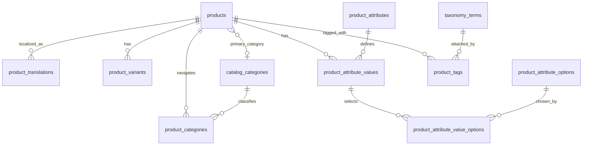

# `rustok-product` Documentation

`rustok-product` — default catalog submodule of the `ecommerce` family.

## Purpose

- product catalog;
- variants, options, translations and publishing;
- taxonomy-backed product tags via shared `rustok-taxonomy` and product-owned relation `product_tags`;
- product-owned migrations;
- `ProductModule`, `CatalogService`, module-owned admin UI package `rustok-product/admin` and module-owned storefront UI package `rustok-product/storefront`.

## Scope

- `rustok-product` owns module-owned admin/storefront UI packages, native `#[server]` internal paths and product-owned GraphQL contract types; the umbrella `rustok-commerce` remains the ecommerce composition layer, but does not mask the product owner boundary.
- The storefront read-side for published catalog now lives in `rustok-product/storefront` and uses host-neutral native Leptos server functions over `CatalogService` with `HostRuntimeContext` DB/event-bus handles, keeping the GraphQL storefront contract as a fallback.
- Storefront catalog filters, sorting, and pagination are carried together in
  `StorefrontProductListQuery`; transports construct this owner query instead
  of passing page controls as an independent positional service contract.
- Product CRUD in the admin UI has been moved out of `rustok-commerce-admin`
  into the module-owned route `product`; native server functions are the monolith/hydrate selected path,
  and GraphQL is maintained in parallel without returning ownership to the umbrella `rustok-commerce`;
- The generic GraphQL roots `product` / `storefrontProduct`, which are still used by
  module-owned product UI packages, are considered a catalog-authoritative surface:
  `variants.prices` in them remains a compatibility snapshot without explicit
  currency/region/price-list/channel resolution and must not be treated as a
  pricing source of truth alongside `adminPricingProduct` / `storefrontPricingProduct`;
- Module-owned `rustok-product/admin` and `rustok-product/storefront` are now also
  synchronized with this split: the UI no longer shows generic catalog
  `variants.prices` as resolved price, but keeps a separate pricing-module preview
  hook for `adminPricingProduct` / `storefrontPricingProduct`; admin list/status/filter,
  shipping-profile, pricing-preview and pricing deep-link helpers live in
  framework-agnostic `admin/src/core.rs` (including `SelectedProductSummaryViewModel`),
  admin GraphQL operations go through the module-owned facade `admin/src/transport.rs`,
  and the Leptos render/effect adapter is isolated in `admin/src/ui/leptos.rs`;
- The storefront FFA slices have moved route/query normalization, typed fetch request shape,
  shell copy, selected-product view-model composition, selected-card labels/empty
  state, catalog rail presentation, pricing/seller labels, pricing-context
  sanitization/defaulting and pricing deep-link state into `storefront/src/core.rs`;
  native/GraphQL storefront fetch paths are structured as `storefront/src/transport/`
  adapters, and Leptos `ProductView`/`SelectedProductCard`/`CatalogRail` live in
  `storefront/src/ui/leptos.rs` as a thin host-context/render layer over
  prepared core state;
- Product DTOs, product ORM entities, and Product errors are owner-local.
  Pricing ORM projections and atomic initial-price lifecycle operations come
  from the owner-owned `rustok-pricing-persistence` support crate; Product does
  not depend on `rustok-commerce-foundation`.
- FBA boundary is published as `ProductCatalogReadPort` / `product.catalog_read.v1`.
  Registry `contracts/product-fba-registry.json`, static matrix,
  no-compile runtime contract smoke, source-locked runtime fallback smoke, and
  the live PostgreSQL in-process port fixture maintain status `boundary_ready`;
  the composed `rustok-ai` consumer has live unavailable/deadline fallback
  evidence. `transport_verified` remains closed because Commerce checkout is a
  hard dependency and no external Product adapter has live execution evidence.
- Canonical vocabulary and attach semantics for product tags live in
  `rustok-taxonomy` + `product_tags`, and the public contract uses a first-class
  `tags` field instead of legacy `metadata.tags`.
- Shipping profile for product and variant now has a first-class typed surface in
  product DTO (`shipping_profile_slug`) and typed persistence in
  `products.shipping_profile_slug` / `product_variants.shipping_profile_slug`; metadata-backed
  `shipping_profile.slug` remains only a backward-compatible normalization form for old
  read/write-path consumers.
- Multivendor foundation now also starts at the product boundary: the create/update/read contract
  includes nullable `seller_id`, which is the canonical seller identity key for downstream
  cart/order/fulfillment orchestration; merchandising/display fields like `vendor` must not
  be used as seller identity.
- Effective shipping profile for deliverability is resolved as
  `variant.shipping_profile_slug -> product.shipping_profile_slug -> default`, and omission
  of the first-class field on the write-path must not overwrite an existing typed binding/compatibility
  normalization.
- Transport-level validation for `shipping_profile_slug` now lives in the
  `rustok-commerce` facade and checks the reference against active shipping profiles from the typed
  registry `shipping_profiles`, so that the product write-path does not accept arbitrary slugs.

## Native catalog attributes

- `product_attributes` is the unified reference for ecommerce attributes.
- `catalog_categories` stores structural, collection and virtual categories; `products.primary_category_id` determines product form only through structural category. Deferred PostgreSQL constraint triggers reject parent cycles and require `catalog_category_closure` to remain the exact tenant-owned ancestry projection at commit.
- `product_attribute_schemas` are optional reusable templates, and category bindings/groups provide inheritance, clone snapshot, custom and local override scenarios.
- `product_categories` stores additional navigation/storefront bindings and does not change the product form.
- Values live in typed product/variant attribute value tables; localized labels and text-like values are in translation tables.
- Product-level values are read and modified through an owner-owned typed read/patch contract: an omitted attribute does not change, `clear` deletes the value, an empty multiselect clears the value, options and effective schema are validated before transactional write, and detached values are preserved and returned with a separate marker.
- Detached values are displayed in the product admin as a separate review block and are cleared only through the owner-owned `clear_detached_product_attribute_values`; the service verifies that each deleted attribute is indeed outside the current effective schema, build-profile-selected native `#[server]` and GraphQL paths are maintained in parallel.
- Publish validation is performed in the owner-owned `ProductCatalogSchemaService`: required effective attributes must be filled before the product transitions to `Active`. Product document updates validate the persisted candidate category and translations inside their transaction whenever the resulting status is `Active`; typed product-value patches validate active-product completeness after applying all patches and before committing. Localized text-like values require an explicit non-empty translation row, option attributes require saved option relations, and create-with-publish is rejected for categories with required typed attributes.
- Typed product-value patch validation acquires the Product row lock before reading the category, effective form, definitions, and options on the write transaction. This serializes category changes against value patches; it does not establish a tenant-wide schema snapshot against concurrent schema administration.
- Repeated owner publish/unpublish/archive commands targeting the current status are no-ops: they preserve editorial revision, timestamps, and lifecycle events. These state-level no-ops are not durable replay: lifecycle caller keys are currently validated but not persisted as receipts (see [write boundary](./write-boundary.md)).
- Effective form loads localized options in a single bounded query by effective attribute ids; schema/category groups return a localized `group_label` by host locale, binding uses stable `group_code`, and the product admin groups fields by label/code, displays typed controls and sends only dirty patches after saving the product and its primary category.
- The former Product-to-Index projection has been removed with Index v1. Product and Search must not depend on an Index projection until the generic Index Engine publishes replacement owner contracts.
- Search consumes Product's public transport contract for category and attribute options. The Product write model remains authoritative for schema inheritance and detached-value handling.
- Visibility flags are computed with priority `global attribute defaults < schema/category overrides < channel settings`. Overrides are tri-state: a missing field inherits the previous value, explicit `false` disables the behavior. The resolver preserves overrides through live inheritance and clone snapshots.
- Virtual category uses a bounded V1 rule contract. All filled predicates are combined with AND: `statuses`, `primary_category_subtree_id`, overlapping range `price_min`/`price_max`, `in_stock` and a list of `attributes` with `eq`/`range` operators. Attribute rules work only with stable option codes and locale-neutral product values; localized and variant-only attributes are rejected on the write-side.

```json
{
  "version": 1,
  "statuses": ["active"],
  "primary_category_subtree_id": "00000000-0000-0000-0000-000000000000",
  "price_min": 1000,
  "price_max": 5000,
  "in_stock": true,
  "attributes": [
    { "code": "brand", "operator": "eq", "value": "rustok" },
    { "code": "weight", "operator": "range", "min": "1.0", "max": "2.5" }
  ]
}
```

When resolving virtual-category assignments, Product evaluates the stored rule against the effective form. Invalid old rule payloads do not stop resolution: the category is skipped with a warning; the creation service rejects new invalid payloads.

## Integration

- the module is part of the ecommerce family and must maintain its own storage/runtime boundary without returning responsibility to the umbrella `rustok-commerce`;
- product-owned admin/storefront UI, native server functions, GraphQL contract types and FBA read port are published by the owner `rustok-product`; `rustok-commerce` only composes the ecommerce family and does not reclaim product service/DTO ownership;
- cross-module contract changes must be synchronized with `rustok-commerce` and neighboring split modules.

## Search metadata

- The Leptos product admin package exports `fetch_catalog_search_options` and neutral option DTOs. The helper requires the host effective locale, uses a current-tenant native `#[server]` endpoint with a parallel GraphQL selected path and is already connected in `apps/admin` through host-owned `SearchAdminComposition` without a direct dependency from search UI on `rustok-product`.
- The Leptos product storefront package publishes a separate public-safe `fetch_catalog_search_options`: native `product/storefront/catalog-search-options` is the monolith/hydrate selected path and is built from `HostRuntimeContext` DB/event-bus handles, GraphQL `storefrontCatalogSearchOptions(locale: String!)` is the headless/CSR selected path. The payload contains only category ids/labels and filterable/sortable attribute codes/labels; `apps/storefront` connects it through `SearchStorefrontComposition` with host effective locale.
- The Next storefront has a mirror product-owned helper `apps/next-frontend/packages/rustok-product::fetchCatalogSearchOptions` which reads the same public GraphQL contract and returns safe DTOs to the host search composition without a direct product dependency inside the search package.

- The Next admin product package exposes owner-owned search metadata helpers: category options return `catalogCategories.id`, attribute options return filterable/sortable `productAttributes.code`, labels use the host effective locale, and the search UI consumes only host-provided options without importing product internals.

## SEO ownership

- `rustok-product/admin` already keeps an owner-side product SEO panel via
  `rustok-seo-panel`, without moving product metadata editing into `rustok-seo-admin`.

## Storage ownership and ER summary

`rustok-product` owns the catalog rows, product translations, variants, options,
catalog categories, EAV schema/value tables, and `product_tags`. `rustok-taxonomy`
owns term identity; `rustok-inventory` owns stock quantities; `rustok-pricing`
owns resolved prices; `rustok-media` owns media assets; and shipping-profile
identity belongs to the commerce shipping capability. `products.primary_category_id`
is the only canonical primary-category source.

`product_images.media_id` stores a Media-owned asset UUID without a direct
foreign key to Media storage and is non-null in the Product target schema.
The accepted retention cutover replaces the read-only decorator with a Product-owned
consumer port composed inside receipt admission. New images retain an exact Media hold
before the Product transaction; image/Product removal atomically queues postcommit release.
Missing provider and incomplete legacy provisioning fail closed. Bounded operator audit,
backfill and queue status preserve owner boundaries. See the
[workflow, maintenance-window cutover and unexecuted gates](./media-reference-retention.md)
and the [accepted ADR](../../../../DECISIONS/2026-10-17-product-image-media-reference-retention.md).
Source implementation is not Rust/database/live transport certification.

The target-schema migration removes unused compatibility fields from product,
translation, option, image, and variant storage and aligns
`product_variants.weight` with the owner ORM's `NUMERIC(20,6)` type. Inventory
management and quantity fields remain while current owner-port consumers use
them. The globally visible storefront page path is backed by a partial
tenant/status/published ordering index whose live plans are checked at 10k,
100k, and 1M rows.



All product tenant-bearing references use `(tenant_id, id)` composite foreign
keys where the referenced table can be independently tenant-scoped. Product
handle and SKU identities are tenant-scoped; root-category slugs are tenant-
scoped through a partial unique index. Product status, primary-category, EAV,
and tag constraints are specified in product-owned migrations.

GraphQL and native admin/storefront boundaries share
`map_product_public_error`. Internal error detail is logged with operation,
boundary, stable code, and correlation id; clients receive only the safe public
descriptor.

## Fulfillment capability gap

The accepted capability cutover must add digital/physical/mixed evidence proving that
digital products do not receive a synthetic shipping profile and that only products
with a typed physical-fulfillment requirement enter Cart/Order delivery groups. This
is governed by
[`docs/architecture/settings.md`](../../../../docs/architecture/settings.md).

## Verification

- `npm.cmd run verify:product:runtime-fallback-smoke`
- `npm.cmd run test:verify:product:runtime-fallback-smoke`
- `npm.cmd run verify:ecommerce:fba`
- `npm.cmd run test:verify:ecommerce:fba`
- cargo xtask module validate product
- cargo xtask module test product
- ignored owner-local PostgreSQL lifecycle and 10k/100k/1M query-plan tests in
  `tests/postgres_migrations.rs`
- targeted commerce tests for the product domain when changing runtime wiring

Cargo checks remain a targeted/live evidence step before promoting product FBA to `transport_verified`; the current fast gate for boundary evidence does not require Rust compilation.
## Related documents

- [README crate](../README.md)
- [README admin UI](../admin/README.md)
- [Product write boundary](write-boundary.md)
- [Product unpublish and archive lifecycle events](product-unpublish-archive-events.md)
- [Commerce split plan](../../rustok-commerce/docs/implementation-plan.md)

## Value-write serialization and lifecycle-only editing

Product value patch/clear and Variant value patch/clear acquire their owner locks before resolving
category-dependent state on the same transaction. Variant writes lock the parent Product before
the Variant, matching catalog update/delete/axis commands; the observed parent is rechecked under
the Variant lock. This protects against Product category changes, not independent concurrent
schema administration. SQLite test paths omit unsupported `FOR UPDATE` after acquiring the
parent write lock; PostgreSQL keeps the row locks. Exact-locale EAV Translation apply
also takes parent owner locks before the value row lock and verifies its owner predicates before
reading the CAS snapshot, avoiding the inverse value-to-owner order.

Next status changes use a separate lifecycle callback that sends only Product identity, status,
and the predecessor revision through the existing update API. They never submit unsaved document
fields or turn omitted nullable fields into clears. The status badge and local revision change
only after owner success. Same-status lifecycle-only updates preserve revision/timestamps, but a
supplied stale revision is still refused before that no-op.

## Product workflow remediation (2026-10-17)

The Next create adapter now preserves supplied translations (including SEO), primary category,
shipping profile, barcode, compare-at price, and inventory policy. An explicit zero price is not
silently dropped. The editor fences obsolete category-form responses and reloads by category and
locale. See the [implementation plan](./implementation-plan.md#workflow-remediation-2026-10-17)
for verification and remaining work. These changes do **not** make the multi-request editor save
atomic. That historical Media status is superseded by the 2026-10-18 accepted/source-implemented workflow; runtime verification remains open.

The follow-up also cuts Next money paths over to major-unit decimal strings and narrows catalog
price reads/replacement to unscoped base rows, preserving stored Pricing contexts. See
[base-price write semantics](./write-boundary.md#catalog-base-price-replacement) and the
[verification limits](./implementation-plan.md#decimal-money-and-catalog-base-price-scope-follow-up).
Next Product detail overlays Pricing by Variant ID only and has no missing-Pricing catalog fallback.
Rust execution, mounted UI/context coverage and atomic/durable aggregate save remain open.

All fourteen catalog commands now build their public response on the write connection before
commit and bind external command-port calls to durable owner receipts. Source wiring and mutation
guards pass; Rust/database execution is still outstanding. See the
[receipt write boundary](./write-boundary.md#lifecycle-receipts-and-pre-commit-results). This is not
atomic document/EAV save, client retry certification, or Media retention approval.

### Atomic editorial values

Catalog create/update compose locale-scoped typed values inside the document transaction before
Active publication validation. Next and the mounted Leptos editor send those values in the same
command; independent schema/value commands remain separately receipted. See the
[atomic editorial follow-up](./implementation-plan.md#atomic-editorial-follow-up-2026-10-17)
for source evidence and the still-open runtime, whole-screen Variant and browser-retry work.


## Nullable Variant patches (2026-10-18)

The [nullable Variant update contract](./variant-nullable-patches.md) supersedes earlier notes
that Variant nullable updates still conflate missing and null. Product now owns Keep/Clear/Set
for all five nullable fields, with Set-only Shipping admission, GraphQL exact-decimal mapping,
Next command-shaped callback/action forwarding, separate Leptos create/update drafts and
complete-draft retry intent. The unused foundation update DTO is removed. Source verification
and WASM formatting are not compilation or runtime proof. Ten new Rust regression scenario
sources are unrun, existing editor validation sources are migrated, and no test suite was run.
Mounted transports, database/concurrency/rollback and actual UI gates remain open; this does not
close durable child-command retry or whole-screen Variant atomicity gaps or advance readiness.


## Flex/error/receipt boundary (2026-10-18)

Flex conversion is exhaustive and payload-safe; fixed Product entity registration rejection is
internal rather than client validation. Storage class is preserved. Catalog command and receipt
replay-decode diagnostics no longer render raw owner/serde errors. The shared catalog/schema/
Translation failure finalizer persists only non-retryable Validation/NotFound/Conflict; an invariant
or permission failure is not terminal merely because `retryable=false`. See the
[current diagnostic contract and open runtime gates](./product-public-error-diagnostic-safety.md#flex-and-receipt-failure-continuation-2026-10-18).
Six new Rust scenario sources are unrun; no test suite was executed. Broader Core/Taxonomy
classification, mounted runtime and lease-reclaim execution remain open. Readiness is unchanged.


## Taxonomy and Core error continuation (2026-10-18)

The [current error boundary](./product-public-error-diagnostic-safety.md#taxonomy-and-nested-core-continuation-2026-10-18)
now distinguishes Taxonomy write refusals from read-projection corruption and centrally classifies
nested Core failures across Product read/write/Translation and shared public/HTTP adapters.
Generic conflicts have an owner Conflict variant rather than Validation text. GraphQL definitive
outcomes require a known domain code and actual domain kind; the shared receipt allowlist and
existing stored receipts remain unchanged. The three category source guards now track current
same-ID/all-backend owner composition rather than retired donor/binding/closure compatibility.
Seven new Rust scenarios and strengthened existing hierarchy scenarios are unrun. Sixteen standalone
source guards and WASM formatting/idempotence of 27 Rust files pass; these do not prove compilation,
mounted behavior, rollback/replay/reclaim or privacy at runtime. No test suites or CI were run.


## Native storefront context admission (2026-10-18)

Catalog list, facets, detail/Pricing and search options now require the canonical trusted
`RequestContext` before owner reads. Extractor rejection is no longer treated as an absent
optional context; valid anonymous/no-channel contexts remain allowed. Raw rejection/channel/
locale/correlation payload is removed from affected context diagnostics. See the
[current contract](./product-public-error-diagnostic-safety.md#native-storefront-context-admission-continuation-2026-10-18).
This is source-only, unintegrated work: five new negative guard scenarios are unrun;
compilation, host middleware composition and mounted behavior remain maintainer gates.


## Admin catalog trusted context (2026-10-18)

Native list and facet reads now propagate canonical RequestContext rejection before owner
queries, even with an explicit locale. Existing authentication, permission and tenant checks
remain mandatory. Successful locale precedence and owner translation fallback are unchanged.
See the [current contract](./product-public-error-diagnostic-safety.md#admin-catalog-context-admission-continuation-2026-10-18).
This is source-only/unintegrated: two new source scenarios are unrun; compilation, host trusted
resolved-locale composition, and mounted profile behavior remain maintainer verification gates.


## Schema/tag read diagnostic continuation (2026-10-18)

Both owner read adapters now reuse bounded Product context/error fact projections instead
of logging raw errors, admission message/code text or identity values. Existing classification,
public envelopes and read admission are preserved. See the [current contract](./product-public-error-diagnostic-safety.md#schema-and-tag-read-diagnostics-continuation-2026-10-18).
Eight scoped source guards and four-file formatting/idempotence pass; three new Rust scenarios
are unrun. Compilation, log capture, runtime and broader Product diagnostics remain open.


## Storefront attribute warning safety (2026-10-18)

Unsupported-type/missing-scalar projection warnings now retain bounded shape only, without
stored identity/code/type/error payload. Existing best-effort omission and valid false/zero/
localized formatting semantics are preserved. See the [current contract](./product-public-error-diagnostic-safety.md#storefront-attribute-degradation-diagnostics-continuation-2026-10-18).
Six scoped source guards and one-file formatting/idempotence pass; four new Rust scenarios
are unrun. Compilation, captured tracing and mounted projection execution remain open.


## Storefront HTTP read warning safety (2026-10-18)

The compatibility read port now logs bounded context/error shape and pagination failure flags,
not caller identity strings or exact rejected page inputs. Existing HTTP classification,
visibility and pagination behavior are preserved. See the [current contract](./product-public-error-diagnostic-safety.md#storefront-http-read-diagnostics-continuation-2026-10-18).
Six scoped source guards and one-file formatting/idempotence pass; two added Rust scenarios
are unrun. Compilation, captured tracing and mounted HTTP execution remain open.


## Catalog command diagnostic safety (2026-10-19)

Seven Product command-boundary events now use canonical context/error facts instead
of caller correlation/tenant strings, Product UUIDs and raw receipt/admission codes.
Public mapping, write admission, request fingerprints and receipt replay/finalization
are preserved. See the [current contract](./product-public-error-diagnostic-safety.md#catalog-command-diagnostics-continuation-2026-10-19).
Six scoped source guards and Rust formatting/idempotence pass; two new Rust scenarios
are deliberately unrun. Compilation, tracing capture and transaction/runtime gates remain open.
