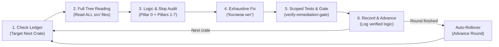

# Autonomous Continuous Code Review & Slop Remediation (ACRE)

> [!IMPORTANT]
> **Core Philosophy — Deep Engineering Review:**
> Code review is **NOT** a superficial regex scan for `.unwrap()`. It is a **deep, senior-level architectural and logic audit**:
> 1. **Zero AI Slop:** Eliminate file-stitching macros (`include!("...")`), phantom 1-line facades, bloated nested pyramids, and redundant `.clone()` churn.
> 2. **Transactional & Concurrency Correctness:** Ensure outbox events are published atomically inside transactions (`publish_in_tx`), eliminate TOCTOU races, and fix silent error swallowing.
> 3. **Data Integrity & Multi-Tenancy:** Verify every database mutation/read is strictly tenant-scoped (`WHERE tenant_id = ?`).
> 4. **Pure Typing & Domain Models:** Enforce Newtypes, strict state machines, and typed `thiserror` error propagation while preserving working domain contracts.

> [!TIP]
> **Canonical Trigger Instructions for Any AI Agent:**
> 1. **Sequential Module-by-Module Audit (Full-Stack / FS):**
>    ```
>    реализуй план аудита
>    ```
>    Operates on **[`docs/standards/continuous-review-ledger.md`](./standards/continuous-review-ledger.md)**: sequentially audits modules from `apps/server` down to domain crates.
>
> 2. **Horizontal Cross-Cutting Capability Audit (CodeGraph / CCAR):**
>    ```
>    реализуй план кроссфункционала
>    ```
>    *(or `реализуй план сквозного аудита`)*
>    Operates on **[`docs/standards/cross-cutting-review-ledger.md`](./standards/cross-cutting-review-ledger.md)**: traverses system-wide slices (FBA, FFA, RBAC, Cache, Outbox, API, Tenancy, DB, Workers, Telemetry, Settings, i18n) using `codegraph_explore` to trace end-to-end blast radius.

---

## 1. Quick Start for Any AI Agent

If you are an AI agent assigned to this task, execute this continuous loop:



### Step 1: Find the Next Module in the Active Round
Inspect the active round and locate the next pending `[ ]` component:
```bash
python scripts/maintenance/review_orchestrator.py ledger-status
```
Or open the living checklist: **[`docs/standards/continuous-review-ledger.md`](./standards/continuous-review-ledger.md)**.

### Step 2: Exhaustive Crate Tree Discovery (Read All Source Files)
> [!CAUTION]
> **Запрет «верхоглядства» (No Surface Skimming):**
> Запрещено ограничиваться чтением 1-2 файлов, на которые указал сканер или `review_orchestrator.py next`. Сканер находит лишь базовые синтаксические паттерны. Агент **ОБЯЗАН** просмотреть всю файловую структуру крейта (`src/**/*.rs`), понять назначение модуля, его публичный контракт, сущности и обработчики.

### Step 3: Deep Engineering & Logic Audit (Pillar 0 + 7 Pillars)

Do **NOT** stop at trivial mechanical linting (like unwrap or regexes). Perform a genuine senior-level engineering review based on [docs/standards/patterns-vs-antipatterns.md](standards/patterns-vs-antipatterns.md):

#### 0. Behavioral & Logical Correctness — PRIMARY (AGENTS.md §2.1, §4)
Code is defined by what it **does**, not just how cleanly it compiles. For every crate (foundation library, utility, worker, or domain module), systematically verify the **6 Universal Logic Dimensions**:
- **Preconditions & Boundary Bounds:** Verify extreme and invalid inputs: 0-values, negative numbers, empty strings/slices, integer overflows, timezone/clock skew. Reject invalid states at the boundary.
- **Branch Completeness & Anti-Swallowing:** Prohibit silent error suppression (`let _ = ...`, logging an error and returning dummy `Ok(())` or `None` that tricks callers into thinking work succeeded). Ensure every failure branch propagates typed domain errors.
- **State Transition Chains & Recovery:** Validate lifecycle state machines. Verify that mid-chain failures never leave entities permanently stranded in `processing`/`pending` without compensation or recovery paths.
- **Side-Effect Completeness:** When an entity is mutated, verify all dependent side-effects occur atomically: DB write -> outbox event emitted -> cache invalidated -> counters/balances adjusted -> locks released.
- **Calculation & Algorithmic Precision:** Verify currency/money math (`Decimal` vs `f64`), pagination cursor logic (off-by-one errors `<` vs `<=`), cycle detection in graphs/hierarchies, and collection sorting invariants.
- **Concurrency & Order of Operations:** Eliminate check-then-act (TOCTOU) races between state checks and database writes; guarantee order-independent async handling.

#### 1. Transactional & Event Correctness (AGENTS.md §7, §8):
- **Outbox Invariant:** Domain events MUST be emitted via `publish_in_tx(&txn, ...)` within the active database transaction, NOT after commit or outside the transaction.
- **Race Conditions & TOCTOU:** Avoid check-then-act logic without DB constraints or locks (e.g. checking uniqueness in application code without a UNIQUE index or advisory lock).
- **Error Swallowing:** Eliminate silent error suppression (`let _ = ...` or returning default `Ok(())` on critical failures).

#### 2. AI-Slop Remediation & Cognitive Bloat:
- **File Stitching Anti-Pattern:** Prohibit `include!("...")` macros used to bypass module boundaries. Use canonical Rust modules (`mod foo; use foo::*;`).
- **Spaghetti Nesting:** Flatten pyramid `match` / `if let` blocks (3+ levels deep) using early returns (`let ... else { return ... }`) or `?` combinators.
- **Phantom Abstractions:** Remove traits/interfaces that have only a single trivial implementation and zero mock/extension needs.
- **Meaningless Comments:** Strip AI-generated "captain-obvious" comments (`// create user`, `// return result`).

#### 3. Multi-Tenancy & Data Isolation (AGENTS.md §7):
- **Tenant Scope on Every Query:** Verify that **every single** database query touching domain data contains `.filter(Column::TenantId.eq(tenant_id))`.
- **Data Leakage:** Never return raw SeaORM Entities directly to GraphQL/REST. Always map into explicit DTOs to avoid leaking sensitive fields.

#### 4. Async Runtime Hazards & Performance (AGENTS.md §10):
- **Blocking IO in Tokio:** Strictly prohibit blocking calls (`std::fs::*`, `std::thread::sleep`, `std::sync::Mutex`) inside async functions. Use `tokio::fs` or `tokio::task::spawn_blocking`.
- **N+1 Database Queries:** Eliminate loops executing individual database queries per item. Batch queries via `Column::Id.is_in(...)`.
- **Clone Churn:** Remove redundant `.clone()` / `.to_string()` when passing borrowed slices (`&str`, `&[T]`) or `Cow` is sufficient.

#### 5. Type Safety & Domain Invariants (AGENTS.md §4, §6):
- **Newtypes over Primitives:** Replace raw `Uuid` / `String` for IDs with typed newtypes (`TenantId`, `UserId`) to prevent ID mix-ups.
- **State Machines:** Replace string-based status fields (`if status == "pending"`) with strongly-typed enums and valid state transition methods.
- **Strict Error Modeling:** Replace vague `anyhow` or `String` errors in libraries/modules with explicit, typed domain error enums (`thiserror`).

#### 6. Runtime Safety & Panic Elimination (AGENTS.md §14):
- Replace bare `.unwrap()` / `.expect()` in domain paths with typed `Result` propagation (`?`).
- If physically guaranteed by compiler or constant, document the guarantee: `// INVARIANT: <explanation>`.

#### 7. FFA Frontend & UI Boundary Correctness (AGENTS.md §5):
- **Zero Framework in Core:** `core/` MUST have zero UI framework imports (`leptos::*`, `dioxus::*`). All validation, calculations, computable view-models, and state machines MUST live in `core/` and be tested by standalone unit tests.
- **Zero Domain Logic in UI Adapters:** `ui/leptos` and `ui/dioxus` MUST NOT contain input validation rules, command construction, price/discount math, status evaluation, or direct backend API calls. The adapter ONLY binds the ready `ViewModel` to DOM/design tokens and events to callbacks.
- **Anti-Leak Smell:** If a module's `core/` is trivial or lacks unit tests while `ui/leptos.rs` is bloated with business logic, extract the logic into `core/` before declaring the component reviewed.

#### 8. Dual-Stack UI & Admin Parity (Leptos ↔ Next.js) (AGENTS.md §2.1, §5):
- **Synchronized Dual Implementations:** For any module with UI or admin surfaces, audit BOTH the Leptos crates (`crates/modules/<module>/admin`, `storefront`) and the Next.js packages (`apps/next-admin/packages/<module>`, `apps/next-frontend/packages/<module>`). Never review one implementation while leaving the other broken or desynchronized.
- **Route & Workspace Parity:** Ensure root navigation destinations (e.g. `/dashboard/<module>` and `/[locale]/<module>`) are fully functional and never return 404. Rich operational workspaces (moderation tables, category taxonomies, status filtering tabs, detail thread previews) present in Leptos Admin MUST have equivalent functional depth in Next.js Admin, and vice-versa.
- **GraphQL Schema Conformance:** Frontend GraphQL operations across both stacks MUST strictly match the backend schema:
  - Correct variable nullability (e.g. optional tenant context `$tenantId: UUID` vs non-null `$tenantId: UUID!`).
  - Correct connection structures (querying `pageInfo { totalCount }` instead of non-existent direct `total` fields).
  - Canonical public routing (e.g. `/[locale]/<module>` rather than internal `/[locale]/modules/<module>`).

### Step 4: Exhaustive Remediation ("Косяков нет, теперь иду дальше")
Remediate **ALL** discovered defects across the entire crate in the same change set. An agent MUST NOT fix 2-3 isolated issues and leave the rest unaddressed. When a non-trivial logical branch lacks a test, add a focused unit test to lock in the verified behavior.

### Step 5: Validate with Scoped Checks & Gatekeeper
Run scoped compiler and test checks:
```bash
cargo check -p <crate>
cargo test -p <crate> --lib
```
Before committing, run the gatekeeper on modified files:
```bash
python scripts/verify/verify-remediation-gate.py --files path/to/modified_file.rs
```
> [!CAUTION]
> **Anti-Suppression Enforcement ([AGENTS.md §14](../AGENTS.md)):**
> The gatekeeper will **REJECT** any diff containing `#[allow(dead_code)]`, `#[allow(unused)]`, `@ts-ignore`, `todo!()`, or any deleted tests.

### Step 6: Mark the Component Done in the Ledger
Once the crate is in a zero-defect state, gatekeeper passes, and changes are committed:
```bash
python scripts/maintenance/review_orchestrator.py mark-done <component_path> --notes "Logic verified: <details>; Remediated: <details>"
```
Record the specific verified logic chains and edge-case invariants in `docs/standards/continuous-review-ledger.md`.

---

## 2. Cyclical Rounds («Круги») & Auto-Recalculation

The review operates in persistent **Rounds (Круги)** recorded in git:

1. **Active Round Progress:** Every module has a checkbox `[ ]` in the ledger.
2. **Cycle Completion:** When all components in the active round reach `[x]`, the orchestrator:
   - Archives the completed round into the `## Completed Rounds Archive` section with metrics and timestamps.
   - Dynamically re-scans the repository to discover any newly added or renamed crates/apps.
   - Recalculates file counts and lines of code (LOC).
   - Resets the checklist to `[ ]` and advances to **Round N + 1**.

---

## 3. In-Repo Tooling Reference

| Tool / Document | Location | Purpose |
|---|---|---|
| **Continuous Review Ledger** | [`docs/standards/continuous-review-ledger.md`](./standards/continuous-review-ledger.md) | Living checklist tracking all 218 modules, LOC, and round completion. |
| **Review Rules Catalog** | [`scripts/maintenance/review_rules.toml`](../scripts/maintenance/review_rules.toml) | Canonical definitions of code smells, antipatterns, and slop patterns. |
| **Scanner** | [`scripts/maintenance/scan_codebase.py`](../scripts/maintenance/scan_codebase.py) | Fast AST/regex scanner producing `.review_backlog.json`. |
| **Orchestrator** | [`scripts/maintenance/review_orchestrator.py`](../scripts/maintenance/review_orchestrator.py) | CLI for ledger management, task dispatching, and cycle rollover. |
| **Gatekeeper** | [`scripts/verify/verify-remediation-gate.py`](../scripts/verify/verify-remediation-gate.py) | Pre-commit gate checking diff invariants and `cargo clippy`. |
| **Agent Guidelines** | [`docs/standards/agent-review-guidelines.md`](./standards/agent-review-guidelines.md) | Full technical standard for autonomous review agents. |

---

## 4. Universal CLI Cheat-Sheet

```bash
# View round status and next 5 pending modules:
python scripts/maintenance/review_orchestrator.py ledger-status

# Generate task brief for the next pending finding:
python scripts/maintenance/review_orchestrator.py brief

# Run gatekeeper on modified files:
python scripts/verify/verify-remediation-gate.py --files crates/modules/rustok-forum/src/service.rs

# Mark module completed in current round:
python scripts/maintenance/review_orchestrator.py mark-done crates/modules/rustok-forum --notes "Cleaned unwrap calls"

# Synchronize inventory (recount LOC / files across workspace):
python scripts/maintenance/review_orchestrator.py ledger-sync
```
