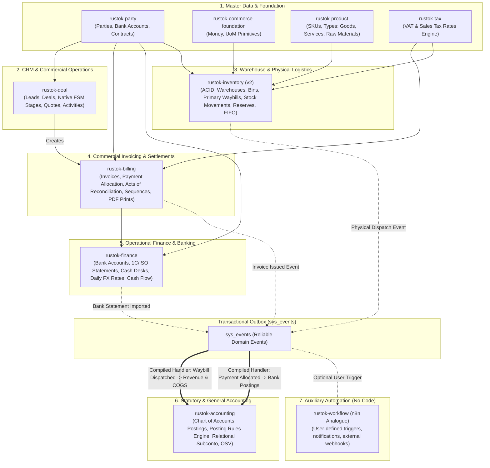
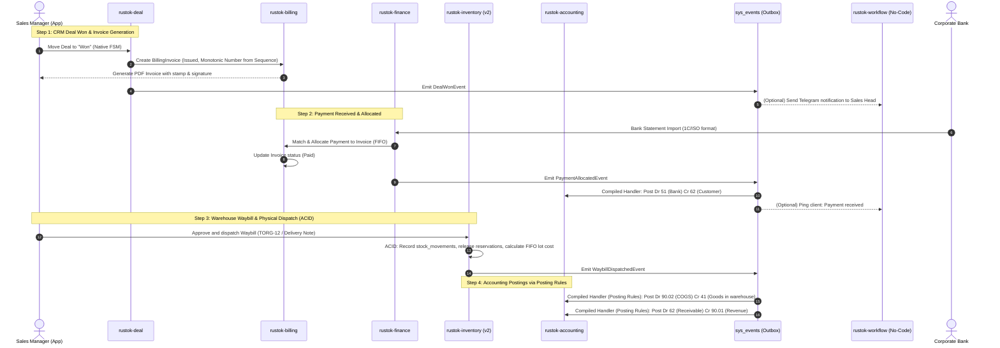
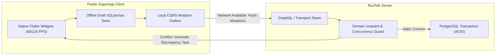
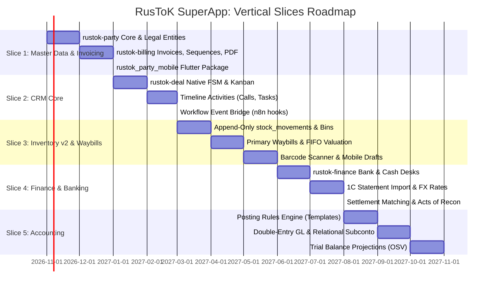

# Unified Domain Architecture: CRM, ERP, Accounting, and Commerce in RusToK

## 1. Executive Summary and Strategic Objective

The strategic goal is to establish RusToK as the foundation for a high-performance, modular **SuperApp** serving:
- **Digital Commerce:** Storefront, Multi-channel sales, Checkout, Retail order lifecycle (`rustok-order`).
- **Customer Relationship Management (CRM):** Master counterparties, Corporate tax IDs, Contracts, Commercial deals, Native FSM pipelines, Timeline activities (`rustok-party`, `rustok-deal`).
- **Enterprise Resource Planning (ERP):** Multi-tier warehouse topology (Warehouses, Zones, Bins), Primary warehouse documents (Receipts, Shipments, Transfers), Append-only inventory movements, Batch/lot tracking, FIFO costing, Sequential document numbering, and PDF print forms (`rustok-inventory` v2, `rustok-billing`).
- **Operational Finance:** Bank accounts, 1C/ISO statement import, Cash registers, Payment orders (PKO/RKO), Daily currency rates, Cash Flow statements (`rustok-finance`).
- **Commercial Billing & Settlements:** Invoicing (B2B Commercial Invoices/Bills), Payment allocations (`PaymentAllocation`), Acts of reconciliation, Monotonic sequence generators (`rustok-billing`).
- **Statutory & General Accounting:** Universal double-entry Chart of Accounts, Journal transactions ($\sum \text{Dr} = \sum \text{Cr}$), Configurable posting rules (Posting Profiles), Indexed relational subconto analytics, Trial balances (Оборотно-сальдовая ведомость), Balance sheets (`rustok-accounting`).
- **Auxiliary No-Code Automation:** Visual automation engine (`rustok-workflow` as an n8n analogue) for user-defined rapid notifications, webhooks, and third-party integrations, strictly decoupled from core system guarantees.
- **Mobile SuperApp (Flutter / FFA):** Role-based workspaces (Warehouse, Courier, Sales, Executive) with offline-first draft collection and server-authoritative transactional posting.
- **Workplace & Collaboration SuperApp:** Highload distributed messaging (`rustok-messenger`), Notion-grade collaborative docs with Live ERP blocks (`rustok-docs`), WebRTC conferencing (`rustok-calls`), and calendar scheduling (`rustok-calendar`), detailed in the companion plan [Workplace & Collaboration SuperApp Plan](./workplace-collaboration-superapp-plan.md).

---

## 2. As-Is Audit and Non-Duplication Boundaries

The table below catalogs current RusToK modules and explicitly defines non-duplication boundaries with the new CRM/ERP/Accounting capabilities:

| Existing Module | Crate Path | Current Capabilities | Boundary with CRM/ERP/Accounting (No Duplication) |
| :--- | :--- | :--- | :--- |
| **`customer`** | `crates/modules/rustok-customer` | Storefront buyer identity (`customers`), email, phone, name, tenant scope. | Retail B2C profile only. Does not store legal entity attributes (INN/OGRN/KPP/VAT, bank accounts, contracts). Retains backward compatibility by storing an optional foreign key reference to `Party` in `rustok-party`. |
| **`product`** | `crates/modules/rustok-product` | Catalog SKUs, variants, options, publishing states, categories. | Manages item definitions, descriptions, prices, and media. Extended with asset classification flags (`Goods`, `Services`, `RawMaterials`, `Assets`) and batch/serial tracking flags without moving warehouse balances here. |
| **`order`** | `crates/modules/rustok-order` | B2C sales orders, line items, checkout compensation, order state machine. | Retains exclusive ownership of customer checkout orders and storefront order lifecycle. Commercial B2B invoices and proformas are owned by `rustok-billing` (which can reference an `order_id` or `deal_id` as its basis). |
| **`inventory`** | `crates/modules/rustok-inventory` | `StockLocations`, `InventoryItems`, `InventoryLevels`, checkout reservations. | **Evolves in-place to v2:** Absorbs warehouse topology (Zones, Bins), primary warehouse documents (Receipts, Shipments, Transfers), append-only `stock_movements`, batch/lot expiry tracking, and FIFO lot valuation in **one ACID PostgreSQL transaction boundary**. |
| **`payment`** | `crates/modules/rustok-payment` | Online payment sessions (Stripe, YooKassa, etc.), gateway webhooks. | Gateway payment collections for retail checkouts. Corporate bank accounts, bank statement parsing, and cash desks belong to `rustok-finance`. |
| **`tax`** | `crates/modules/rustok-tax` | Tax rates, tax regions, tax calculation algorithms. | **Canonical tax rate calculator:** B2B invoices and warehouse waybills reuse `rustok-tax` for calculating VAT amounts (20%, 10%, 0%, Exempt), avoiding duplicate tax engines. |
| **`commerce-foundation`**| `crates/libs/rustok-commerce-foundation` | Shared commerce DTOs, Money primitives, error types. | Houses foundational Units of Measure (UoM: pieces, kg, liters, meters, packaging conversion factors) without creating a micro-crate. |
| **`marketplace-balance`** | `crates/modules/rustok-marketplace-balance` | Seller escrow balances, commission cuts, payout records, balance bucket transitions (`pending` $\to$ `available` $\to$ `reserved` $\to$ `paid`). | **Retained as Seller Balance / Escrow Wallet:** Preserved for marketplace seller balance management and payout hold lifecycles. Decoupled from platform-wide accounting: connects via typed FBA ports and outbox events to `rustok-accounting`, which translates seller payout and commission transitions into official G/L double-entry postings. |
| **`flex`** | `crates/modules/flex` | Attached custom fields (`FieldDefinition`, JSONB storage), standalone custom entities. | Metadata and custom attributes engine. Powers custom fields in party cards, deal forms, and documents without database DDL schema modifications. |
| **`workflow`** | `crates/modules/rustok-workflow` | Visual no-code workflow engine (n8n analogue), event triggers, cron, webhooks. | **Auxiliary automation and integration tool:** Listens to outbox events for user-defined rapid automations (notifications, external CRM sync, webhooks). **Never** used for core financial or inventory transaction paths. |

---

## 3. Core Architectural Principles

### 3.1 Sovereign Domain Modules with ACID-Bound Subprocesses
To eliminate distributed transaction complexity and prevent inventory/financial inconsistencies:
- **`rustok-party`:** Counterparties, Legal Entities, Tax Details, Bank Accounts, and Contracts/Credit Limits commit inside one relational boundary.
- **`rustok-inventory` (v2):** Warehouse Topology (warehouses, zones, bins), Primary Warehouse Documents (Receipts, Shipments, Transfers), Append-only Stock Movements (`stock_movements`), Reservations (`stock_reservations`), Batches/Lots, and FIFO cost calculation commit in **one ACID PostgreSQL transaction**.
- **`rustok-billing`:** B2B Invoices, Proformas, Payment Allocations (`PaymentAllocation`), Acts of Reconciliation, Document Number Sequences, and Print Form generation commit in one coherent billing boundary.
- **`rustok-finance`:** Bank Accounts, Statement Parsers (1C/ISO 20022), Cash Desks (PKO/RKO), Daily Currency Rates, and Cash Flow tracking.
- **`rustok-accounting`:** Universal Chart of Accounts, Double-Entry Postings ($\sum \text{Dr} = \sum \text{Cr}$), Posting Rules Engine, and Typed Relational Subconto Analytics.

### 3.2 Decoupling Accounting from Feature Domains
Accounting entries must never be trapped inside feature silos (such as marketplace, delivery, or subscriptions):
- **Universal Accounting Core (`rustok-accounting`):** All accounting transactions across the platform converge on `rustok-accounting`.
- **Domain Independence:** Feature modules (Storefront Orders, B2B Invoices, Warehouse Waybills, Marketplace Commissions) act strictly as operational sources of business facts. They emit events or invoke ports, while `rustok-accounting` translates those facts into balanced debits and credits via configured Posting Rules.

### 3.3 Dual-Layer Communication: Compiled Rust Handlers vs Auxiliary No-Code Automation
1. **Core Domain Paths (Compiled Rust):**
   - High-integrity transactions (e.g. `WaybillDispatched` $\to$ `Inventory` deduction $\to$ `Accounting` posting) are executed strictly by **statically typed, compiled Rust handlers** subscribing to the Transactional Outbox (`sys_events`).
   - These paths are atomic, idempotent, fully testable with pure Rust unit tests, and never depend on runtime scripting.
2. **Auxiliary No-Code Automation (`rustok-workflow` — n8n Analogue):**
   - Listens to domain facts emitted to `sys_events` (`DealWon`, `InvoiceIssued`, `PaymentReceived`, `WaybillDispatched`).
   - Enables business operators to visually configure custom notifications (Telegram, Slack, Email), external CRM sync, webhook calls, and cron schedules without touching code or redeploying the backend.
   - Failure of a no-code workflow **never** rolls back or blocks core financial or inventory operations.

### 3.4 Configurable Posting Rules Engine (Движок правил проводок)
Accounting debits and credits are not hardcoded in Rust. Primary documents pass through a declarative Posting Rules Engine in `rustok-accounting`:
$$\text{Document Type} + \text{Operation Type} + \text{Item Group / Tax Regime} \longrightarrow \text{Debit Account} + \text{Credit Account} + \text{Analytics}$$
Rules are stored in relational configuration tables with tenant overrides, enabling seamless adaptation to national accounting standards (RAS, US GAAP, IFRS) without recompiling Rust binaries.

### 3.5 Relational Analytics (Subconto) in PostgreSQL
To ensure instantaneous calculation of trial balances (Оборотно-сальдовая ведомость) and acts of reconciliation at multi-million row scale:
- Postings in `gl_postings` use **typed, indexed relational foreign keys** for high-cardinality standard dimensions:
  - `party_id: Option<Uuid>` (Контрагент),
  - `contract_id: Option<Uuid>` (Договор),
  - `item_id: Option<Uuid>` (Номенклатура),
  - `warehouse_id: Option<Uuid>` (Склад / Подразделение).
- An optional `additional_analytics: Option<Jsonb>` column is preserved for rare, user-defined dimensions.

### 3.6 Sequential Document Numbering & Print Forms
- **Monotonic Sequence Generator:** Primary documents (Invoices, Waybills, Cash orders) use a dedicated sequence generator (`document_sequences` table with `SELECT ... FOR UPDATE`) enforcing gap-free monotonic numbers per organization and fiscal year (e.g. `INV-2026-0001`).
- **PDF Print Engine:** Standard print layouts (Счет на оплату с печатью и факсимиле, УПД, ТОРГ-12, Акт сверки) are generated via server-side templates with downloadable PDF outputs and shareable secure links.

### 3.7 Multi-Currency & Exchange Difference Accounting
- Central Bank currency rates (ЦБ РФ / ECB) are imported daily into `finance_exchange_rates`.
- If an invoice is issued in foreign currency (USD/EUR/CNY) and settled in RUB (or vice versa), the system automatically calculates **Currency Exchange Gain/Loss (Курсовые разницы)** upon payment allocation and produces corresponding journal postings in `rustok-accounting`.

### 3.8 Evolutionary Extraction Principle (Эволюционное разделение вместо микромодулей)
На текущем этапе закладывается минимально необходимое число цельных и устойчивых доменных модулей. Преждевременная нарезка на десятки мелких крейтов (микромодулей) признана контрпродуктивной: она создает искусственные накладные расходы на компиляцию, межмодульные вызовы и усложняет транзакционную согласованность.
- **Стабилизация ядра:** Все базовые возможности реализуются в рамках консолидированных доменных модулей (`party`, `deal`, `inventory`, `billing`, `finance`, `accounting`).
- **Критерий выделения в отдельный модуль:** Любой функционал выносится в независимый крейт только после того, как его доменная модель и бизнес-процессы полностью стабилизируются в рамках родительского модуля, и возникнет доказанная необходимость в отдельном жизненном цикле (разный темп релизов, независимое масштабирование, изоляция прав доступа).

---

## 4. Consolidated Domain Matrix

| # | Functional Capability | E-Commerce | CRM | ERP | Accounting | Canonical Owner Module | Sub-processes within Transaction Boundary |
|---|---|---|---|---|---|---|---|
| **1** | **Master Counterparty Data & Contracts** | Buyer, Recipient | Lead, Account, Decision Maker | Supplier, Vendor, Carrier | Payer, Payee, Tax Agent | **`rustok-party`** | Legal entities, Tax IDs (INN/OGRN/KPP/VAT), Bank accounts, Contracts, Credit limits. |
| **2** | **Commercial Deals & Activities** | Abandoned cart recovery | Leads, Deals, Won/Lost reasons, Activities | Procurement quotes, Tender bids | — | **`rustok-deal`** | Deal pipeline (native FSM), Deal line items, Interaction timeline (calls, tasks, meetings). |
| **3** | **Units of Measure (UoM)** | Pieces, Sets | — | Weight, Volume, Pallets, Linear meters | Base unit, Packaging ratios | **`rustok-commerce-foundation`** | Base UoM table, packaging conversion factors with exact decimal precision. |
| **4** | **Item Classification & Assets** | Catalog SKU | Quoted item | Raw materials, Semis, Finished goods, Assets, Services | Asset accounts (10, 41, 43, 08) | **`rustok-product`** | SKU definitions, asset category tags, BOM linkages. |
| **5** | **Warehouse Topology, Stock Ledger & Waybills** | Stock availability | Quote availability | Multi-tier topology (Warehouse/Zone/Bin), Receipts, Transfers, Stocktake | Material registers, Asset balance, Landed cost FIFO | **`rustok-inventory`** *(v2)* | **ACID Boundary:** `warehouses`, `warehouse_bins`, primary documents (Waybills), `stock_movements` (append-only), `stock_reservations`, FIFO batch valuation. |
| **6** | **Commercial Billing, Settlements & Printing** | Order payment bill | Proforma Invoice | Supplier incoming bill, Payment demands | AR / AP basis, Reconciliation acts | **`rustok-billing`** | Invoices (Sales/Purchase/Proforma), Payment Allocation (`PaymentAllocation`), Acts of reconciliation, Sequence number generator, PDF print forms. |
| **7** | **Operational Finance, Cash & Banking** | Payment gateway | Deal payment status | Cashier desk, Outgoing payment orders | Bank statements (51), Cash desks (50), Bank exchange import | **`rustok-finance`** | Bank accounts, Cash registers, Bank statement parsing (1C/ISO 20022), Cash orders (PKO/RKO), Daily currency rates, Exchange difference calculation, Cash Flow (ДДС). |
| **8** | **General Ledger & Bookkeeping** | Platform-wide entries | — | Cost center accounting, Budgeting | Chart of accounts, Double-entry ($\sum \text{Dr} = \sum \text{Cr}$), Posting profiles | **`rustok-accounting`** | Chart of accounts, `gl_transactions`, `gl_postings`, Posting Rules Engine, Trial balance projections (OSV), Balance sheet. |
| **9** | **Tax Registers & VAT** | Calculated sales tax | — | Withholding tax, Customs declarations | VAT purchase/sales books, VAT offsets | **`rustok-accounting`** *(Tax Extension)* | VAT journal entries generated from posted waybills and invoices via `rustok-tax` rates. |
| **10** | **Visual No-Code Automation** | Order webhooks | Lead notification, CRM sync | Warehouse alerts, Procurement bot | Accountant notifications | **`rustok-workflow`** *(Auxiliary)* | Visual step editor (n8n analogue), HTTP requests, custom triggers, cron tasks. |

---

## 5. Architectural Topology and System Boundaries

---

## 6. End-to-End Cross-Module Transactional Choreography

---

## 7. Mobile SuperApp Architecture (Flutter & FFA)

### 7.1 Offline-First CQRS Architecture for Operational Workflows
Mobile devices (Warehouse pickers with barcode scanners, Couriers, On-site Sales reps) must operate reliably with intermittent connectivity:

1. **Client Drafts, Server Authority:**
   - The mobile client never generates final accounting postings or direct balance deductions.
   - Operations (e.g. scanning a pallet of goods) create local **Draft Waybill Items** queued in SQLite/Isar.
   - When the network reconnects, mutations are flushed with idempotency keys.
   - The server validates stock levels inside a single PostgreSQL transaction. If a stock conflict occurs (e.g. goods were claimed elsewhere), a typed **Discrepancy Resolution Task** is returned to the operator.

2. **Role-Based Dynamic Workspaces:**
   The Flutter shell (`apps/rustok_admin_mobile`) composes targeted workspaces based on operator permissions:
   - **Warehouse Picker:** Mounts barcode scanning, bin relocation, and waybill acceptance screens.
   - **Sales Representative:** Mounts CRM Kanban, Party lookups, Invoice creation, and PDF sharing.
   - **Finance & Executive:** Mounts Bank account balances, cash desk, statement reconciliation, and high-level KPI dashboards.
   - **Accountant:** Mounts Chart of Accounts, trial balance (OSV), and posting audit.

3. **Flex Metadata Form Integration:**
   Standard high-frequency screens are hand-tuned native Flutter widgets. Custom business attributes (e.g. industry-specific contract clauses or vehicle license numbers) render via `FlexDynamicFormWidget`, reading field metadata from `crates/modules/flex`.

4. **Collaborative Documents & Live ERP Blocks ([`rustok-docs`](./workplace-collaboration-superapp-plan.md)):**
   - **Live Business Embedding:** Commercial entities (Product, Party, Deal, Invoice) implement the `EntityCardResolverPort` adapter, providing live pills, summary cards, and interactive widgets inside collaborative documents.
   - **Reverse Backlinks Panel:** Any CRM Deal, Counterparty card, or Invoice view queries `docs_entity_links` to render an accordion of "Attached Documentation, Technical Specs & Acts" without manual document copying.
   - **RBAC Redaction Boundary:** Financial figures and sensitive contract terms are strictly filtered through canonical `SecurityContext`; unauthorized readers in shared team workspaces view graceful masked placeholders.

---

## 8. Pragmatic Implementation Roadmap: Vertical Slices

Implementation follows **5 vertical slices**, each delivering end-to-end business value:

### Slice 1: B2B Master Data, Commercial Invoicing & PDF Generation
- **Backend:** `rustok-party` (Parties, Tax IDs, Addresses, Bank Accounts, Contracts) and `rustok-billing` (Invoices, Proformas, Document Sequence Generator with `SELECT ... FOR UPDATE`, PDF generation with stamps).
- **Invariants:** Unique `(tenant_id, tax_identifier)`, credit limits, monotonic sequential numbers.
- **Client:** Counterparty lookup, B2B invoice creation, PDF preview and download.

### Slice 2: CRM Deals & Activities
- **Backend:** `rustok-deal` (Deals, pipelines with native FSM, interaction timeline activities).
- **Outbox Integration:** Events emitted on stage changes (`DealWon`, `DealLost`).
- **No-Code Seam:** `rustok-workflow` receives outbox events for custom user-configured alerts.
- **Client:** Drag-and-drop Kanban board on web and Flutter.

### Slice 3: Inventory v2, Primary Waybills & Mobile Barcode Scanners
- **Backend:** `rustok-inventory` v2 (multi-tier warehouses, zones, bins, primary waybills, append-only `stock_movements`, `stock_reservations`, FIFO batch valuation in one ACID transaction).
- **Invariants:** Append-only storno, non-negative stock balance, atomic reservation releases.
- **Client:** Mobile warehouse picker with hardware barcode scanner and offline mutation queue.

### Slice 4: Operational Finance, Bank Statements & Multi-Currency
- **Backend:** `rustok-finance` (Bank accounts, cash desks, statement parser for 1C/ISO 20022, daily FX rates, Cash Flow reports) and `rustok-billing` payment allocation (FIFO matching, acts of reconciliation).
- **Invariants:** Multi-currency balance integrity, payment allocation cannot exceed invoice amount, automated currency exchange difference postings.
- **Client:** Statement import UI, payment-to-invoice matcher, mutual settlement statement, cash flow graph.

### Slice 5: Accounting, Posting Rules Engine & Trial Balance (OSV)
- **Backend:** `rustok-accounting` (Chart of accounts, Posting Rules Engine, double-entry postings $\sum \text{Dr} = \sum \text{Cr}$, typed relational subconto).
- **Invariants:** Balanced journal lines, immutable postings (storno only), strict period closing locks.
- **Client:** Trial Balance (Оборотно-сальдовая ведомость), Ledger journal view, P&L / Balance Sheet reports.

---

## 7. Companion Workplace and Collaboration Architecture

For team communication, collaborative knowledge bases, video meetings, and scheduling (the office productivity and digital HQ layer that complements our transaction/accounting core), see the companion architecture plan:
- [Unified Workplace & Collaboration SuperApp: Messenger, Notion-Grade Docs, LiveKit Calls, and Calendar](./workplace-collaboration-superapp-plan.md)
