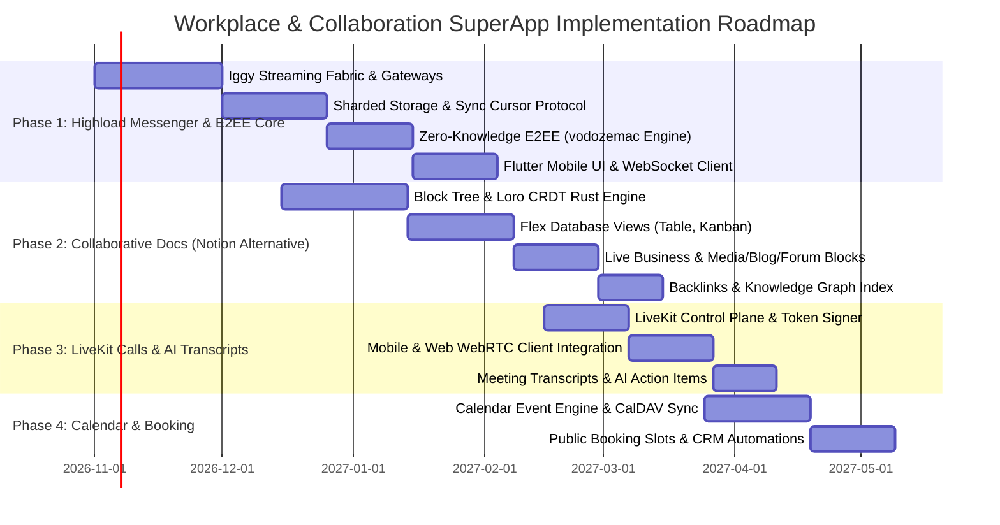

# Unified Workplace & Collaboration SuperApp: Messenger, Notion-Grade Docs, LiveKit Calls, and Calendar in RusToK

## 1. Executive Summary and Strategic Objective

Modern business software is severely fragmented across disconnected SaaS silos:
- **Team Communication:** Slack / Telegram / Microsoft Teams.
- **Knowledge & Documentation:** Notion / Confluence.
- **Video & Voice Conferencing:** Zoom / Google Meet.
- **Scheduling & Appointments:** Calendly / Cal.com.
- **Issue Tracking:** Linear / Jira.
- **ERP, Commerce, & Accounting:** Shopify, 1C:Enterprise, Odoo, SAP.

This fragmentation forces teams to constantly context-switch, copy-paste data manually across browser tabs, and rely on fragile third-party automation webhooks (Zapier/Make). Solutions like Macro (`macro-inc/macro`) attempt to unify team communication and note-taking, but they remain isolated from real-world enterprise transactional mechanics (inventories, warehouses, double-entry accounting, order checkouts, and multi-vendor marketplaces).

**The RusToK Strategic Advantage:**
RusToK expands beyond high-integrity Commerce, ERP, and Accounting into an **All-in-One Enterprise SuperApp**. By pairing our transactional PostgreSQL/ACID foundation and [ERP/CRM/Accounting Architecture](./crm-erp-accounting-matrix-and-plan.md) with a **highload communication and collaborative knowledge layer**, RusToK delivers:
1. **Highload Distributed Messenger (`rustok-messenger`):** Horizontally scalable messaging fabric backed by [Iggy streaming](../modules/registry.md) (`rustok-iggy`), monotonic sequence cursors, in-memory presence ring-buffers, sharded append-only message storage, and optional E2EE.
2. **Notion-Grade Collaborative Documents (`rustok-docs`):** Block-based structured pages with real-time multiplayer editing powered by **Loro CRDT** (Rust), integrated with [`crates/modules/flex`](../../crates/modules/flex) and [`crates/ui/rustok-grid`](../../crates/ui/rustok-grid) to provide dynamic database views (Table, Kanban, Calendar, Gallery).
3. **Live Business Blocks (Живые блоки):** Documents are not static text; they natively embed live product cards ([`rustok-product`](../../crates/modules/rustok-product)), live warehouse inventory stock levels ([`rustok-inventory`](../../crates/modules/rustok-inventory)), commercial invoices ([`rustok-billing`](./crm-erp-accounting-matrix-and-plan.md)), and CRM pipeline cards ([`rustok-deal`](./crm-erp-accounting-matrix-and-plan.md)).
4. **WebRTC Video & Voice Conferencing (`rustok-calls`):** Scalable audio/video rooms, screen sharing, persistent in-call chat, and recording powered by **LiveKit SFU**, with automated AI meeting transcripts and action item extraction into CRM deals.
5. **Calendar & Appointment Booking (`rustok-calendar`):** Team and personal schedules, RFC 5545 iCalendar / CalDAV synchronization, OAuth connectors (Google Calendar, Outlook/Exchange, Yandex), and public booking links that trigger deal creation and call room provisioning.
6. **Unified Mobile SuperApp ([`rustok_mobile`](../../rustok_mobile)):** Fully native Flutter application providing offline-first document caching, instant messaging, push notifications, and video calling.

---

## 2. Domain Decomposition & Sovereign Boundaries

| Sovereign Module | Crate Path | Core Responsibility | Persistence & Technology Stack | Non-Duplication Boundary |
| :--- | :--- | :--- | :--- | :--- |
| **`messenger`** | `crates/modules/rustok-messenger` | High-availability team chats, DMs, threads, channel hierarchies, read receipts, typing indicators, reactions. | **Streaming:** [`rustok-iggy`](../../crates/libs/rustok-iggy) partitions.<br>**Hot Cache:** Redis/Dragonfly.<br>**Cold Storage:** Partitioned PostgreSQL (`messenger_messages`, `messenger_conversations`). | Focuses purely on message transmission, cursors, and delivery. Does not own business entities; conversations link to external entities via `entity_type` + `entity_id`. |
| **`docs`** | `crates/modules/rustok-docs` | Block-based collaborative documents, workspaces, page trees, templates, Notion-like databases. | **CRDT:** Loro (Rust) delta logs + periodic page snapshots in PostgreSQL (`docs_pages`, `docs_blocks`, `docs_snapshots`). | Replaces static wiki tools. Cooperates with [`flex`](../../crates/modules/flex) for typed database properties and [`rustok-grid`](../../crates/ui/rustok-grid) for view rendering. |
| **`calls`** | `crates/modules/rustok-calls` | Audio/video rooms, participant tokens, screen sharing orchestration, recording egress hooks, meeting transcript ingestion. | **SFU:** LiveKit Server.<br>**State:** PostgreSQL (`calls_rooms`, `calls_sessions`, `calls_recordings`, `calls_transcripts`). | Media streaming is delegated to LiveKit SFU; `rustok-calls` manages room lifecycle, access tokens, RBAC authorization, and transcript persistence. |
| **`calendar`** | `crates/modules/rustok-calendar` | Personal & resource calendars, scheduling slots, meeting invitations, CalDAV / external calendar bi-directional synchronization. | **State:** PostgreSQL (`calendar_events`, `calendar_attendees`, `calendar_booking_slots`).<br>**Sync:** RFC 5545 iCalendar parsers. | Owns time allocations and booking links. Automatically creates calls via `rustok-calls` and notifies participants via `rustok-messenger`. |
| **`tasks`** | `crates/modules/rustok-tasks` | Linear-like team issues, sprints, backlogs, priorities, estimates, dependencies, board views. | **State:** PostgreSQL (`tasks_issues`, `tasks_sprints`, `tasks_labels`). | Issue tracking and developer/team tasks. Operational commercial CRM deals remain sovereign in [`rustok-deal`](./crm-erp-accounting-matrix-and-plan.md). |

---

## 3. Highload Distributed Messenger Architecture (`rustok-messenger`)

To guarantee zero database lock contention and scale horizontally across clusters:

```
[Flutter SuperApp / Web Admin]
            │
      (WebSocket / QUIC / gRPC stream)
            ▼
   [Edge Gateways (rustok-gateway)]
            │
            ├──────► [Iggy Streaming Fabric (rustok-iggy)]
            │             │  (Sub-ms stream partitioned by conversation_id)
            │             ├──────► [Ephemeral Hot State (Redis / Dragonfly)]
            │             │             • Presence ("online", "last seen")
            │             │             • Typing indicators
            │             │             • Ring-buffer (last 100 messages)
            │             ▼
            └──────► [Worker Ingestion Pipeline]
                          │  (Batched transactional writes)
                          ▼
                     [Partitioned PostgreSQL Store]
                          • append-only messages (Snowflake monotonic seq_id)
                          • zero update locks
```

### 3.1 Invariants of the Messenger Core
1. **Append-Only Immutability:** Messages are never updated in-place. Edits and deletions append delta events (`MessageEdited`, `MessageDeleted`) referencing the original 64-bit `message_id`.
2. **Monotonic Sequence Cursor (Snowflake ID):** Every message assigned a monotonically increasing 64-bit sequence identifier. Offline clients synchronize by requesting `GET /conversations/{id}/messages?since_seq={last_seen_seq}`, ensuring gap-free, deduplicated reconciliation.
3. **Decoupled Delivery Pipeline:** Incoming messages are immediately published to [`rustok-iggy`](../../crates/libs/rustok-iggy) and acknowledged to the client within < 5 ms. Persistence workers batch-insert records into PostgreSQL asynchronously, preventing database bottlenecks during traffic surges.
4. **End-to-End Encryption (E2EE):** Direct 1-on-1 and sensitive executive channels support double-ratchet E2EE; the server persists and relays encrypted binary blobs without inspecting payloads.

### 3.2 Matrix Cryptographic Stack Evaluation & Library Selection
To guarantee mathematical rigor without developing proprietary cryptography from scratch, RusToK leverages the battle-tested, independently audited cryptographic ecosystem originally engineered by the Matrix.org Foundation and the IETF MLS working group:

| Candidate Library | Origin & Cryptographic Audit | Strengths & Protocols | Bloat & Protocol Risk | Role in RusToK SuperApp |
| :--- | :--- | :--- | :--- | :--- |
| **`vodozemac`** | **Matrix.org Foundation (Pure Rust)**<br>Audited by *Least Authority* (2022). | • Pure Rust replacement for legacy C `libolm`.<br>• **Olm:** Double Ratchet (Signal protocol) + X3DH key agreement.<br>• **Megolm:** High-throughput group ratcheting (symmetric ratchet with pairwise key distribution).<br>• **SAS:** Interactive Short Authentication String device verification (emoji/decimal QR).<br>• Zero external runtime dependencies; compiles cleanly to native Linux/macOS/Windows, Android/iOS FFI, and WASM. | Low-level cryptographic engine only (requires an application-level state machine for network queues). | **Core Cryptographic Engine (Winner for Phase 1):** Selected for all internal 1-on-1 chats and executive group rooms. |
| **`ruma`** | **Ruma Project / Matrix.org (Pure Rust)** | • Complete, strictly typed implementation of 100% of the Matrix protocol specification.<br>• `ruma-events`: Serde types for all Matrix events (`m.room.encrypted`, `m.room.message`, `m.room_key`).<br>• `ruma-client-api` & `ruma-federation-api`: Typed endpoint contracts for Client-Server and Server-Server federation.<br>• `ruma-state-res`: Canonical Matrix State Resolution v2 algorithm. | Matrix protocol uses verbose JSON structures with heavy DAG transaction history (`auth_events`, `prev_events`), causing high bandwidth and latency overhead if used as the internal messaging fabric. | **External Federation & Bridge Gateway (Winner for Gateway):** Selected as the foundation for the optional `rustok-matrix-gateway` module to federate with external Matrix homeservers and bridge third-party clients (Element X, FluffyChat, Mautrix bridges). |
| **`matrix-sdk-crypto`** | **Matrix.org Foundation (Rust)** | • High-level cryptographic state machine handling key stores, one-time prekeys (OTKs), session backup, and verification workflows. | Hardwired to Matrix client-server JSON protocol types (`ruma_events`). Pulling it in would drag in heavy Matrix JSON schemas and protocol baggage into our native streaming core. | **Architectural Reference Only:** We adopt the state-machine pattern for session tracking and key stores, but bind it directly to `vodozemac` and RusToK Protobuf/Postcard transport without Matrix protocol bloat. |
| **`conduit` / `conduwuit`** | **Independent / Rust Community** | • Ultra-lean, high-performance Matrix homeserver written in Rust using `ruma` and RocksDB/Sled.<br>• Proves that Matrix federation on Rust uses 10x–20x less RAM and CPU than Python Synapse. | Full standalone homeserver daemon, not an embedded library for micro-modular composition. | **Benchmarking & Reference Implementation:** Architecture reference for how `ruma` endpoints map efficiently onto async Rust runtimes (Tokio/Axum). |
| **`openmls`** | **OpenMLS / IETF RFC 9420 (Rust)** | • **Messaging Layer Security (MLS)**: Modern IETF standard for asynchronous group key exchange via TreeKEM.<br>• $O(\log N)$ group membership changes (unlike Megolm $O(N)$ key re-distribution). | Higher implementation complexity; emerging specification; heavier client overhead for small groups (< 20 users). | **Enterprise Large-Group Engine (Phase 2):** Slated for company-wide encrypted broadcast channels with > 100 participants. |
| **`libsignal-protocol-rs`** | **Signal Messenger LLC (Rust)** | • Official Signal Protocol implementation. | Pairwise encryption only: group messaging requires sending $N$ separately encrypted payloads across the network, causing battery and bandwidth drain on mobile clients. | Rejected in favor of Megolm / MLS group ratchets. |

### 3.3 Zero-Knowledge End-to-End Encryption (E2EE) Architecture

```
[Alice Client (vodozemac)]                   [Bob Client (vodozemac)]
   │                                            │
   │ 1. Fetch Bob's Identity + OTK PreKey       │
   │◄───────────────────────────────────────────┤ (via Server Key Directory)
   │                                            │
   │ 2. X3DH + Initialize Olm Double Ratchet     │
   │    Encrypt message (AES-256-CBC + HMAC)    │
   │                                            │
   │ 3. Send Ciphertext Blob                    │
   ├──────────────────► [rustok-messenger] ────►│ 4. Decrypt & Advance Ratchet
   │                     (Zero-Knowledge Relay:  │    (Forward Secrecy &
   │                      Blind storage & Iggy)  │     Post-Compromise Security)
```

#### 1. Zero-Knowledge Blind Relay (`rustok-messenger` Role)
The RusToK messaging backend acts strictly as an untrusted, zero-knowledge blind broker:
* **Payload Blindness:** The server stores and streams only opaque binary ciphertext blobs (`CiphertextType::OlmPreKey`, `CiphertextType::OlmMessage`, `CiphertextType::MegolmMessage`).
* **Zero Key Access:** Master keys, identity private keys, and session ratchet states exist exclusively within client secure storage (iOS Keychain, Android Keystore, desktop SQLCipher). The server never touches or holds private keys.
* **Key Directory:** The server maintains only public cryptographic materials:
  - Long-term public Identity Keys (`Ed25519` for signing, `Curve25519` for key exchange);
  - Signed Pre-Keys with expiration timestamps;
  - Bundles of single-use One-Time Pre-Keys (OTK) replenished automatically by clients.

#### 2. Group Ratchet Lifecycle & Executive Room Forward Secrecy
For boardroom negotiations and closed B2B executive groups (3–100 participants):
1. **Outbound Megolm Session:** The sender's client initializes an outbound Megolm ratchet session using `vodozemac::megolm::GroupSession`.
2. **Pairwise Key Distribution:** The sender securely exports the room session key (`vodozemac::megolm::ExportedSessionKey`) and transmits it to every authorized room participant individually via their pairwise 1-on-1 Olm sessions.
3. **Single-Payload Group Broadcast:** Every subsequent message in the executive room is encrypted once with the Megolm session key and broadcasted over [`rustok-iggy`](../../crates/libs/rustok-iggy) partitions to all room members simultaneously.
4. **Immediate Ratchet Revocation on Member Departure (Forward Secrecy):** When a participant is removed or leaves the executive room:
   - The room owner client **immediately discards the current Megolm Outbound Session**;
   - A fresh session is generated and distributed exclusively to the remaining active participants;
   - The departed participant is mathematically incapable of decrypting any subsequent messages, even if they intercept the encrypted transport blobs.

#### 3. Zero-Knowledge Media & Document Attachments
Confidential PDFs, spreadsheets, voice messages, and video attachments are encrypted client-side prior to storage:
1. **Local Symmetric Encryption:** The sender client generates a random, cryptographically secure 256-bit AES-GCM key and 96-bit IV.
2. **Ciphertext Upload:** The encrypted payload is uploaded to [`rustok-media`](../../crates/modules/rustok-media), returning an opaque blob storage URL and SHA-256 integrity hash.
3. **Encrypted Key Envelope:** The AES-GCM decryption key, IV, and SHA-256 hash are packaged inside the encrypted Olm/Megolm text message payload.
4. **Result:** `rustok-media` stores only encrypted pseudorandom noise. Neither platform administrators nor compromised database backups can reveal attachment contents.

#### 4. Device Verification & Man-in-the-Middle Protection (SAS & Cross-Signing)
* **Short Authentication String (SAS):** Users can establish cryptographic trust between devices by comparing an out-of-band 7-emoji sequence or 6-digit decimal code generated via interactive Diffie-Hellman ephemeral exchanges (`vodozemac::sas::Sas`).
* **Hierarchical Cross-Signing:**
  - **Master Identity Key:** Root of trust per user, kept in offline or encrypted backup.
  - **Self-Signing Key:** Authorizes new devices belonging to the same user (e.g. iPad, laptop).
  - **User-Signing Key:** Signs verified colleagues and external B2B partners. Once a top manager verifies a partner once, all authorized devices display a verified green trust badge 🛡️.
* **Encrypted Key Backup & Secret Storage:** Multi-device session history is backed up to a client-side encrypted vault derived via Argon2id from a 48-character recovery key, allowing seamless device migration without server key disclosure.

### 3.4 Matrix Federation, External Clients, and Bridge Gateway (`rustok-matrix-gateway` via `ruma`)

While `rustok-messenger` relies on high-speed native streaming for internal operations, enterprise environments frequently require interoperability with external Matrix federations and legacy communication tools. Rather than compromising core performance, RusToK provides an optional gateway module:

```
[External Element / Element X]     [Partner Company Matrix Synapse]     [Telegram / WhatsApp / Slack]
              │                                   │                                    │
    (Matrix C-S API v3)                 (Matrix Federation API v1)              (Mautrix Appservices)
              │                                   │                                    │
              └─────────────────────────┬─────────┴────────────────────────────────────┘
                                        ▼
                         [rustok-matrix-gateway]
                         • Powered by `ruma` (ruma-client-api, ruma-federation-api, ruma-events)
                         • Protocol bidirectional translation: Matrix JSON Event ◄► RusToK Binary
                         • Matrix State Resolution (ruma-state-res)
                                        │
                                        ▼
                         [rustok-messenger Core Fabric]
                         • Sub-millisecond Iggy streaming partitions
                         • Snowflake sequence cursor ledgers
```

1. **Decoupled Architecture:** The highload internal messenger core remains 100% free of Matrix protocol overhead. The `rustok-matrix-gateway` exists as a separate sovereign module that consumes and publishes to [`rustok-iggy`](../../crates/libs/rustok-iggy).
2. **Third-Party Matrix Clients:** Employees can optionally use open-source Matrix clients (Element X, Cinny, FluffyChat) to connect to RusToK workspaces via endpoints powered by `ruma-client-api`.
3. **B2B Inter-Company Federation:** Organizations running RusToK can securely communicate with partner enterprises running self-hosted Synapse or Conduit servers via standard Matrix Server-Server federation (`ruma-federation-api`).
4. **Unified Bridges (Mautrix Ecosystem):** Enables seamless integration of popular Mautrix bridges (Telegram, WhatsApp, Slack, MS Teams, Discord), routing inbound external messages directly into RusToK team channels.

### 3.5 Interactive Message Components & Live Action Hooks (Block Kit Model)
Messages in `rustok-messenger` transcend plain text by supporting declarative UI components inspired by Slack Block Kit and Discord Message Components:

```rust
#[derive(Clone, Debug, Serialize, Deserialize)]
pub enum MessageComponent {
    ActionRow(Vec<MessageAction>),
    EmbedCard {
        title: String,
        description: Option<String>,
        color: u32,
        fields: Vec<EmbedField>,
        thumbnail_url: Option<String>,
    },
    EntityWidget(EntityRef),
}

#[derive(Clone, Debug, Serialize, Deserialize)]
pub enum MessageAction {
    Button {
        custom_id: String,
        label: String,
        style: ButtonStyle, // Primary, Secondary, Success, Danger, Link
        action_payload: serde_json::Value,
    },
    SelectMenu {
        custom_id: String,
        placeholder: String,
        options: Vec<SelectOption>,
    },
}
```

* **Zero-Context Switching B2B Workflows:**
  - *Billing Notification:* A bot or colleague posts an invoice notification containing an embedded `[Pay Invoice]` button. Clicking the button immediately invokes [`rustok-billing`](./crm-erp-accounting-matrix-and-plan.md) with an idempotent receipt.
  - *CRM Deal Approval:* A deal stage transition alert embeds `[Approve Discount]` and `[Reject]` buttons, committing the state change in [`rustok-deal`](./crm-erp-accounting-matrix-and-plan.md) within the chat thread.
  - *Warehouse Waybill Acceptance:* A warehouse picker confirms receipt of goods directly via action buttons.

### 3.6 Pts Cursor Synchronization & Reconnect Resume Protocol
To ensure instantaneous reconnection across flaky mobile networks without database load spikes, `rustok-messenger` combines Telegram's `pts` delta cursors with Discord's gateway memory resumes:

1. **Persistent Timestamp Sequence (`pts`):**
   - Each conversation maintains a monotonically increasing 64-bit atomic integer `pts`.
   - Edits, deletions, reactions, and new messages increment `pts` deterministically.
   - Reconnecting mobile clients request `GET /conversations/{id}/diff?since_pts=1042`. The server returns the exact compact binary delta slice, eliminating repetitive polling and massive history re-downloads.
2. **Gateway Ring-Buffer Resumes:**
   - Active gateway nodes buffer recent dispatches in an in-memory circular buffer (last 200 events).
   - If a client's WebSocket drops momentarily (e.g. cellular handoff), it sends `Resume { session_id, last_seq }`. The gateway replays missing frames directly from RAM in < 2 ms without querying PostgreSQL or Iggy.

### 3.7 Decoupled Multi-Backend Chat Search Architecture (`rustok-search` / Meilisearch / PG FTS)
To avoid architectural lock-in to any single search engine and keep `rustok-messenger` lightweight:
* **Decoupled Search Seam:** `rustok-messenger` does not embed a hardcoded search engine. Instead, it emits transactional domain events (`MessageDispatched`, `MessageEdited`, `MessageDeleted`) via `rustok-outbox`.
* **Multi-Backend Ingestion via `rustok-search`:** The platform's central search module (`rustok-search`) projects public conversation messages into the tenant's configured search backend (such as **Meilisearch**, PostgreSQL Full-Text Search, OpenSearch, or Tantivy).
* **Faceted & Scoped Filtering:** Search queries are routed through `SearchPort` and enforce strict conversation membership authorization (users can only search conversations where they are active members).
* **Zero-Knowledge Exclusion for E2EE:** Messages flagged with `is_encrypted: true` are strictly excluded from server-side indexing. For encrypted conversations, search is performed entirely client-side (e.g. SQLite FTS in the mobile/desktop app).

### 3.8 Multi-Platform Push Notification Pipeline (APNs, FCM, WebPush)
A unified push notification worker processes mentions, DMs, and high-priority alarms:
* **iOS / macOS:** Native HTTP/2 client using `a2` with token-based p8 authentication.
* **Android:** High-throughput Google Firebase Cloud Messaging (FCM v1 REST API).
* **Web:** W3C WebPush (RFC 8291 / 8292) with VAPID key pairs.
* **Zero-Knowledge E2EE Push Privacy:** When an end-to-end encrypted message arrives, the push payload contains only an opaque wake-up ping (`{"e2ee_wake": true, "conv_id": "..."}`) with zero plaintext. The mobile OS background handler wakes the app, fetches the ciphertext blob, decrypts it locally via `vodozemac`, and posts a local notification with the decrypted text.

### 3.9 In-Chat Mini-Apps SuperApp Container & Bi-directional RPC Bridge
Following the proven architecture of Telegram Mini Apps (TMA) and WeChat Mini Programs:
* **Sandboxed Webview Container:** Any RusToK web surface or third-party partner app can be opened in an inline modal sheet directly inside the chat.
* **Bi-directional SuperApp Bridge:** A secure postMessage RPC bridge (`window.RusTokBridge`) allows the embedded web app to:
  - Access the current user's authenticated session without re-login;
  - Trigger native haptic feedback, camera barcode scanning, and biometric authentication;
  - Return structured data back to the conversation (e.g., sharing a finalized order cart or signing a contract).

### 3.10 Dual-Surface Frontend Architecture (`rustok-messenger/storefront`)
To support both deep workplace collaboration and instant e-commerce/support interactions, `rustok-messenger` provides two complementary presentation modes:
1. **Dedicated Full-Page Workplace Messenger:**
   - **3-Column Workstation Layout:**
     - *Left Sidebar:* Folders and categories («All», «Channels», «Direct Messages», «Deals / Orders UER»), conversation search bar, channel creation trigger, dialog list with online indicators, draft previews, and unread badges.
     - *Center Chat Pane:* Conversation header (title, topic, participants, call action), virtualized message stream with date separators, message delivery ticks (`last_read_message_id`), reply banners, typing indicators, and a rich markdown composer with attachment upload controls.
     - *Right Context Drawer:* Collapsible panel showing channel members, shared media/documents, and threaded conversation branches (Thread View) without polluting main channel history.
2. **Contextual Floating Chat Widget:**
   - Compact overlay dockable on product pages, checkout flows, and order status screens.
   - Automatically initializes or binds to the context's Universal Entity Reference (UER: `entity_type` + `entity_id`) to allow instant communication with sellers or customer support.

---

## 4. Notion-Grade Collaborative Documents (`rustok-docs`)

### 4.1 Block-Tree Data Model & Loro CRDT
Every page is modeled as a hierarchical tree of atomic blocks:
```rust
pub struct DocBlock {
    pub id: Uuid,
    pub parent_id: Option<Uuid>,
    pub block_type: BlockType, // Paragraph, Heading, BulletList, Todo, Callout, Toggle, Table, Code, LiveErp
    pub properties: serde_json::Value,
    pub content: LoroText,     // High-performance CRDT rich-text
    pub children: Vec<Uuid>,
}
```

* **Zero Merge Conflicts:** Concurrent edits by multiple team members or AI agents are merged deterministically using the **Loro CRDT** engine compiled natively in Rust.
* **Granular Block Reordering:** Drag-and-drop block reordering is represented as CRDT tree movements, completely avoiding split-brain documents.

### 4.2 Notion-Like Databases: Unifying `flex` and `rustok-grid`
A database in `rustok-docs` is an aggregate of structured pages conforming to a typed schema:
1. **Data Model ([`crates/modules/flex`](../../crates/modules/flex)):** Reuses `FieldDefinition` to define typed column attributes (Text, Number, Select, MultiSelect, Date, Person, Formula, Relation, Rollup, Status).
2. **View Engine ([`crates/ui/rustok-grid`](../../crates/ui/rustok-grid)):** Provides 5 polymorphic views over the same underlying dataset:
   - **Table View:** Dense data grid with faceted filtering and column reordering.
   - **Kanban Board:** Columns grouped by `Status` or `Select` properties with drag-and-drop cards.
   - **Calendar View:** Events arranged by date attributes.
   - **Gallery View:** Visual cards highlighting image covers and key attributes.
   - **List View:** Minimalist linear summary.

### 4.3 Universal Entity Reference Protocol (UER / `EntityRef`)
To enable Notion-like live embedding of any platform entity across all 50+ RusToK modules, `rustok-docs` establishes a unified, strongly-typed reference protocol:

```rust
/// Canonical Uniform Entity Reference
#[derive(Clone, Debug, PartialEq, Eq, Serialize, Deserialize)]
pub struct EntityRef {
    pub tenant_id: Uuid,
    pub module: EntityModule, // Media, Blog, Forum, Pages, Taxonomy, Commerce, CRM, Billing, Flex
    pub entity_type: String,  // "asset", "post", "topic", "page", "term", "product", "deal", "invoice", "custom"
    pub entity_id: Uuid,
}

impl EntityRef {
    /// Formats as standard URN: urn:rustok:<tenant_id>:<module>:<entity_type>:<entity_id>
    pub fn to_urn(&self) -> String {
        format!("urn:rustok:{}:{}:{}:{}", self.tenant_id, self.module.as_str(), self.entity_type, self.entity_id)
    }
}
```

#### Pluggable Entity Preview Port (`EntityCardResolverPort`)
Host applications and consumer modules provide resolvers conforming to a unified trait:
```rust
#[async_trait]
pub trait EntityCardResolverPort: Send + Sync {
    async fn resolve_entity_preview(
        &self,
        security: SecurityContext,
        entity_ref: &EntityRef,
        view_mode: EntityViewMode,
    ) -> Result<EntityPreviewCard, EntityResolveError>;
}
```

### 4.4 Four Polymorphic Display Modes
Every embedded entity can be seamlessly toggled across 4 projection views without changing the underlying reference:

| Display Mode | Visual Representation | Target Entities & Use Cases |
| :--- | :--- | :--- |
| **1. Inline Mention / Pill** | `@Topic: RFC-042 Highload Messenger` | Mentioning team members, forum threads, blog drafts, products, or wiki pages in running text. Hovering displays an instant popover card. |
| **2. Compact Card / Bookmark** | Title, author avatar, thumbnail, excerpt, status badge, and reply/view count | Bookmarking relevant articles, customer tickets, contracts, or closed deals. |
| **3. Interactive Live Widget** | Functional, interactive embedded UI component with real-time state | - **Media ([`rustok-media`](../../crates/modules/rustok-media)):** In-line video/audio player with waveform, multi-page PDF viewer with table-of-contents.<br>- **Forum ([`rustok-forum`](../../crates/modules/rustok-forum)):** Embedded discussion thread with in-line reply composer and reaction buttons.<br>- **Blog ([`rustok-blog`](../../crates/modules/rustok-blog)):** Readable article with reading progress and author bio.<br>- **Wiki ([`rustok-pages`](../../crates/modules/rustok-pages)):** Transcluded documentation section with two-way sync.<br>- **Commerce ([`rustok-product`](../../crates/modules/rustok-product)):** Live price, variant selector, and buy CTA.<br>- **ERP & CRM ([`rustok-crm`](./crm-erp-accounting-matrix-and-plan.md)):** Deal stage switcher, invoice payment tracking, act of reconciliation download. |
| **4. Database Relation & Rollup** | Structured database column linked to external entities | Creating custom databases (e.g. "Release Tracker") where records link directly to Forum Topics, Blog Posts, or Media Assets, with auto-populated rollup fields (e.g. view count, reply count, publishing status). |

### 4.5 Media Lifecycle & Reference Retainment (`DocsMediaReferencePolicy`)
Embedding media in collaborative documents adheres strictly to the [`rustok-media`](../../crates/modules/rustok-media) reference governance discovered during code review:
1. **Reference Registration:** When an image, video, audio file, or PDF is inserted into a doc block, `rustok-docs` registers a reference via `MediaReference` with owner `docs` and retention policy `RetainedByActiveDocBlock`.
2. **Preventing Premature Garbage Collection:** Background cleanup jobs in `rustok-media` fail closed and never purge media assets that retain active references in published or revision-history document blocks.
3. **Signed Streaming URLs:** For sensitive internal documents, media assets are streamed via signed, time-limited tokens generated on demand according to the viewer's document access level.
4. **Blurhash & Responsive Transcoding:** Automatic generation of blurhash placeholders and responsive WebP/AVIF variants for zero-layout-shift document rendering.

### 4.6 Bidirectional Backlinks & Knowledge Graph Index (`docs_entity_links`)
To transform documentation into an interconnected company brain, `rustok-docs` maintains an append-only relational link ledger:

```sql
CREATE TABLE docs_entity_links (
    id UUID PRIMARY KEY DEFAULT gen_random_uuid(),
    tenant_id UUID NOT NULL,
    source_doc_id UUID NOT NULL,
    source_block_id UUID NOT NULL,
    target_module VARCHAR(64) NOT NULL,
    target_entity_type VARCHAR(64) NOT NULL,
    target_entity_id UUID NOT NULL,
    link_type VARCHAR(32) NOT NULL, -- 'mention', 'embed_card', 'interactive_widget', 'relation_column'
    anchor_text TEXT,
    created_at TIMESTAMPTZ NOT NULL DEFAULT NOW(),
    updated_at TIMESTAMPTZ NOT NULL DEFAULT NOW(),
    CONSTRAINT fk_docs_entity_links_doc FOREIGN KEY (tenant_id, source_doc_id) REFERENCES docs_documents(tenant_id, id) ON DELETE CASCADE
);

CREATE INDEX idx_docs_entity_links_target ON docs_entity_links (tenant_id, target_module, target_entity_type, target_entity_id);
CREATE INDEX idx_docs_entity_links_source ON docs_entity_links (tenant_id, source_doc_id);
```

* **Reverse Backlinks Accordion:** Any Forum Topic, Blog Post, Product page, or CRM Deal automatically displays a "Referenced in Documents" panel listing all pages mentioning it.
* **AI Knowledge Graph (MCP Seam):** Feeds directly into `rustok-mcp` and AI agents, allowing LLMs to reason across cross-domain relationships (e.g., *"What technical specs or forum discussions are linked to Invoice INV-2026-004?"*).

### 4.7 RBAC Security Delegation & Graceful Redaction
Collaborative documents frequently combine public documentation with confidential internal records:
* **Context Propagation:** When rendering an embedded entity, the resolver is passed the viewing user's canonical `SecurityContext`.
* **Zero Leakage / Masked Card Fallback:** If a user viewing a shared document does not have permission to read the embedded resource (e.g., an unauthorized team member viewing a document with an embedded B2B Invoice or private HR Forum Topic), the live block renders a graceful masked card:
  > 🔒 **Restricted Resource** — *You do not have permission to view this Forum Topic / Invoice in this tenant.*
* **Strict Tenant Boundary:** Cross-tenant entity resolution is unconditionally rejected at the database and resolver levels.

### 4.8 Cross-Domain Content Orchestration & Transformation
Integrating with [`rustok-content-orchestration`](../../crates/modules/rustok-content-orchestration) (`ContentOrchestrationBridge`), `rustok-docs` supports seamless content lifecycle workflows:
* **Promote Topic to Doc (`promote_topic_to_doc`):** Transform a successful brainstorm or architectural discussion in [`rustok-forum`](../../crates/modules/rustok-forum) into an official internal specification or policy document.
* **Publish Doc to Blog (`publish_doc_to_blog`):** Export an approved product announcement or whitepaper directly into [`rustok-blog`](../../crates/modules/rustok-blog) with preserved rich-text AST, images, and category metadata.
* **Transclude Wiki Page (`transclude_wiki_to_doc`):** Embed live, auto-synchronizing sections from [`rustok-pages`](../../crates/modules/rustok-pages) into team workspaces without manual copy-pasting.

### 4.9 Universal Search & Fast Inserter (`UniversalEntityPicker`)
Typing `@` or `/` in the rich-text editor triggers a unified fuzzy search across the entire tenant knowledge base:
* Blog Posts ([`rustok-blog`](../../crates/modules/rustok-blog))
* Forum Topics & Replies ([`rustok-forum`](../../crates/modules/rustok-forum))
* Wiki & CMS Pages ([`rustok-pages`](../../crates/modules/rustok-pages))
* Media Assets & Documents ([`rustok-media`](../../crates/modules/rustok-media))
* Taxonomy Terms & Categories ([`rustok-taxonomy`](../../crates/modules/rustok-taxonomy))
* Products & SKUs ([`rustok-product`](../../crates/modules/rustok-product))
* CRM Deals & Leads ([`rustok-crm`](./crm-erp-accounting-matrix-and-plan.md))
* Counterparties & Contracts ([`rustok-party`](./crm-erp-accounting-matrix-and-plan.md))
* Internal Collaborative Docs ([`rustok-docs`](./workplace-collaboration-superapp-plan.md))

---

## 5. WebRTC Conferencing & AI Meeting Assistant (`rustok-calls`)

1. **Selective Forwarding Unit (LiveKit):**
   - Self-hosted or managed LiveKit SFU handles high-bandwidth WebRTC audio/video distribution.
   - `rustok-calls` acts as the control plane: validates [`rustok-rbac`](../../crates/modules/rustok-rbac) room permissions, signs short-lived participant JWTs, and processes room lifecycle webhooks.
2. **AI Meeting Transcripts & Action Items:**
   - Egress workers record meeting audio tracks.
   - Background audio transcription pipelines (Whisper / [`rustok-ai`](../../crates/modules/rustok-ai)) produce synchronized text transcripts.
   - Large Language Models extract structured action items and meeting summaries, automatically publishing them to the associated deal in [`rustok-deal`](./crm-erp-accounting-matrix-and-plan.md) or conversation thread in `rustok-messenger`.

---

## 6. Calendar & Appointment Booking Engine (`rustok-calendar`)

1. **Enterprise Scheduling:**
   - Multi-calendar support for users, meeting rooms, and shared team resources.
   - Bi-directional CalDAV and OAuth synchronization with Google Calendar, Microsoft Outlook, and Yandex 360.
2. **Public Booking Links (Calendly / Cal.com Replacement):**
   - Configurable availability windows (e.g., "Monday–Friday, 10:00–18:00 MSK, 30-minute slots").
   - Buffer times between appointments, automated timezone conversion.
   - Booking confirmation triggers:
     - Calendar event creation with auto-generated LiveKit meeting URL.
     - Confirmation email via [`rustok-email`](../../crates/modules/rustok-email) and messenger alert via `rustok-messenger`.
     - Automatic counterparty / lead creation in [`rustok-party`](./crm-erp-accounting-matrix-and-plan.md) and [`rustok-deal`](./crm-erp-accounting-matrix-and-plan.md).

---

## 7. Phased Implementation Roadmap



### Milestone Checklist:
- [ ] **Milestone 1 (`rustok-messenger`):** Standalone distributed messaging passing 10,000 msgs/sec in-process benchmarking with Iggy; offline-first replay verified with Flutter test harness; Zero-Knowledge E2EE operational via `vodozemac` (1-on-1 Olm Double Ratchet, Megolm executive group ratchets with forward secrecy revocation, and SAS device verification).
- [x] **Milestone 2.1 (`rustok-docs` Core):** Concurrent editing of block trees with Loro CRDT (`CollaborativeDoc`); zero-conflict resolution, cycle-safe MovableTree drag-and-drop, and pure Markdown projections verified via unit tests.
- [x] **Milestone 2.2 (`rustok-docs` Persistence & Backlinks Ledger):** SeaORM migrations (`docs_pages`, `docs_snapshots`, `docs_updates`, `docs_entity_links`), append-only delta log, monotonic sequence numbers, automated snapshot compaction, and Universal Entity Reference (`EntityRef`) reverse backlinks ledger in `DocumentService`.
- [ ] **Milestone 2.3 (`rustok-docs` Enterprise Views):** Dynamic Table and Kanban views operational via `flex` and `rustok-grid`; Real-time WebSocket broadcaster and Media retainment policies (`DocsMediaReferencePolicy`).
- [ ] **Milestone 3 (`rustok-calls`):** LiveKit SFU integration; end-to-end room creation, audio/video broadcast, screen sharing, and transcription pipeline.
- [ ] **Milestone 4 (`rustok-calendar`):** Bi-directional RFC 5545 sync; public booking links generating calendar events and CRM deals.

---

## 8. Cross-Reference and Documentation Governance

- **Core Business Architecture:** [CRM, ERP, and Accounting Matrix and Plan](./crm-erp-accounting-matrix-and-plan.md)
- **ADR Governance:** [ADR: Atomic CRM, ERP, and Accounting Domain Architecture](../../DECISIONS/2026-10-12-atomic-crm-erp-accounting-architecture.md)
- **Streaming Infrastructure:** [`crates/libs/rustok-iggy`](../../crates/libs/rustok-iggy)
- **Dynamic Field Engine:** [`crates/modules/flex`](../../crates/modules/flex)
- **UI Grid & Views:** [`crates/ui/rustok-grid`](../../crates/ui/rustok-grid)
- **Mobile SuperApp:** [`rustok_mobile`](../../rustok_mobile)
- **Media Asset Engine:** [`crates/modules/rustok-media`](../../crates/modules/rustok-media)
- **Content & Forum Domain:** [`crates/modules/rustok-blog`](../../crates/modules/rustok-blog), [`crates/modules/rustok-forum`](../../crates/modules/rustok-forum), [`crates/modules/rustok-pages`](../../crates/modules/rustok-pages)
- **Cross-Domain Content Orchestration:** [`crates/modules/rustok-content-orchestration`](../../crates/modules/rustok-content-orchestration)
- **Taxonomy & Category Trees:** [`crates/modules/rustok-taxonomy`](../../crates/modules/rustok-taxonomy)

