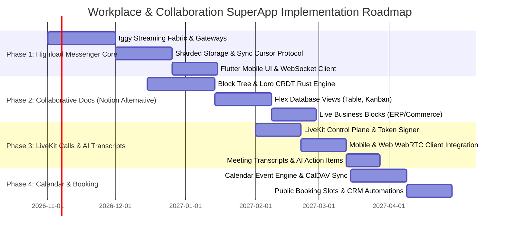

# Unified Workplace & Collaboration SuperApp: Messenger, Notion-Grade Docs, LiveKit Calls, and Calendar in RusToK

## 1. Executive Summary and Strategic Objective

Modern business software is severely fragmented across disconnected SaaS silos:
- **Team Communication:** Slack / Telegram / Microsoft Teams.
- **Knowledge & Documentation:** Notion / Confluence.
- **Video & Voice Conferencing:** Zoom / Google Meet.
- **Scheduling & Appointments:** Calendly / Cal.com.
- **Issue Tracking:** Linear / Jira.
- **ERP, Commerce, & Accounting:** Shopify, 1C:Enterprise, Odoo, SAP.

This fragmentation forces teams to constantly context-switch, copy-paste data manually across browser tabs, and rely on fragile third-party automation webhooks (Zapier/Make). Solutions like Macro (`macro-inc/macro`) attempt to unify team communication and note-taking, but they remain isolated from real-world enterprise transactional mechanics (inventories, warehouses, double-entry accounting, order checkouts, and multi-vendor marketplaces).

**The RusToK Strategic Advantage:**
RusToK expands beyond high-integrity Commerce, ERP, and Accounting into an **All-in-One Enterprise SuperApp**. By pairing our transactional PostgreSQL/ACID foundation and [ERP/CRM/Accounting Architecture](./crm-erp-accounting-matrix-and-plan.md) with a **highload communication and collaborative knowledge layer**, RusToK delivers:
1. **Highload Distributed Messenger (`rustok-messenger`):** Horizontally scalable messaging fabric backed by [Iggy streaming](../modules/registry.md) (`rustok-iggy`), monotonic sequence cursors, in-memory presence ring-buffers, sharded append-only message storage, and optional E2EE.
2. **Notion-Grade Collaborative Documents (`rustok-docs`):** Block-based structured pages with real-time multiplayer editing powered by **Loro CRDT** (Rust), integrated with [`crates/modules/flex`](../../crates/modules/flex) and [`crates/ui/rustok-grid`](../../crates/ui/rustok-grid) to provide dynamic database views (Table, Kanban, Calendar, Gallery).
3. **Live Business Blocks (Живые блоки):** Documents are not static text; they natively embed live product cards ([`rustok-product`](../../crates/modules/rustok-product)), live warehouse inventory stock levels ([`rustok-inventory`](../../crates/modules/rustok-inventory)), commercial invoices ([`rustok-billing`](./crm-erp-accounting-matrix-and-plan.md)), and CRM pipeline cards ([`rustok-deal`](./crm-erp-accounting-matrix-and-plan.md)).
4. **WebRTC Video & Voice Conferencing (`rustok-calls`):** Scalable audio/video rooms, screen sharing, persistent in-call chat, and recording powered by **LiveKit SFU**, with automated AI meeting transcripts and action item extraction into CRM deals.
5. **Calendar & Appointment Booking (`rustok-calendar`):** Team and personal schedules, RFC 5545 iCalendar / CalDAV synchronization, OAuth connectors (Google Calendar, Outlook/Exchange, Yandex), and public booking links that trigger deal creation and call room provisioning.
6. **Unified Mobile SuperApp ([`rustok_mobile`](../../rustok_mobile)):** Fully native Flutter application providing offline-first document caching, instant messaging, push notifications, and video calling.

---

## 2. Domain Decomposition & Sovereign Boundaries

| Sovereign Module | Crate Path | Core Responsibility | Persistence & Technology Stack | Non-Duplication Boundary |
| :--- | :--- | :--- | :--- | :--- |
| **`messenger`** | `crates/modules/rustok-messenger` | High-availability team chats, DMs, threads, channel hierarchies, read receipts, typing indicators, reactions. | **Streaming:** [`rustok-iggy`](../../crates/modules/rustok-iggy) partitions.<br>**Hot Cache:** Redis/Dragonfly.<br>**Cold Storage:** Partitioned PostgreSQL (`messenger_messages`, `messenger_conversations`). | Focuses purely on message transmission, cursors, and delivery. Does not own business entities; conversations link to external entities via `entity_type` + `entity_id`. |
| **`docs`** | `crates/modules/rustok-docs` | Block-based collaborative documents, workspaces, page trees, templates, Notion-like databases. | **CRDT:** Loro (Rust) delta logs + periodic page snapshots in PostgreSQL (`docs_pages`, `docs_blocks`, `docs_snapshots`). | Replaces static wiki tools. Cooperates with [`flex`](../../crates/modules/flex) for typed database properties and [`rustok-grid`](../../crates/ui/rustok-grid) for view rendering. |
| **`calls`** | `crates/modules/rustok-calls` | Audio/video rooms, participant tokens, screen sharing orchestration, recording egress hooks, meeting transcript ingestion. | **SFU:** LiveKit Server.<br>**State:** PostgreSQL (`calls_rooms`, `calls_sessions`, `calls_recordings`, `calls_transcripts`). | Media streaming is delegated to LiveKit SFU; `rustok-calls` manages room lifecycle, access tokens, RBAC authorization, and transcript persistence. |
| **`calendar`** | `crates/modules/rustok-calendar` | Personal & resource calendars, scheduling slots, meeting invitations, CalDAV / external calendar bi-directional synchronization. | **State:** PostgreSQL (`calendar_events`, `calendar_attendees`, `calendar_booking_slots`).<br>**Sync:** RFC 5545 iCalendar parsers. | Owns time allocations and booking links. Automatically creates calls via `rustok-calls` and notifies participants via `rustok-messenger`. |
| **`tasks`** | `crates/modules/rustok-tasks` | Linear-like team issues, sprints, backlogs, priorities, estimates, dependencies, board views. | **State:** PostgreSQL (`tasks_issues`, `tasks_sprints`, `tasks_labels`). | Issue tracking and developer/team tasks. Operational commercial CRM deals remain sovereign in [`rustok-deal`](./crm-erp-accounting-matrix-and-plan.md). |

---

## 3. Highload Distributed Messenger Architecture (`rustok-messenger`)

To guarantee zero database lock contention and scale horizontally across clusters:

```
[Flutter SuperApp / Web Admin]
            │
      (WebSocket / QUIC / gRPC stream)
            ▼
   [Edge Gateways (rustok-gateway)]
            │
            ├──────► [Iggy Streaming Fabric (rustok-iggy)]
            │             │  (Sub-ms stream partitioned by conversation_id)
            │             ├──────► [Ephemeral Hot State (Redis / Dragonfly)]
            │             │             • Presence ("online", "last seen")
            │             │             • Typing indicators
            │             │             • Ring-buffer (last 100 messages)
            │             ▼
            └──────► [Worker Ingestion Pipeline]
                          │  (Batched transactional writes)
                          ▼
                     [Partitioned PostgreSQL Store]
                          • append-only messages (Snowflake monotonic seq_id)
                          • zero update locks
```

### 3.1 Invariants of the Messenger Core
1. **Append-Only Immutability:** Messages are never updated in-place. Edits and deletions append delta events (`MessageEdited`, `MessageDeleted`) referencing the original 64-bit `message_id`.
2. **Monotonic Sequence Cursor (Snowflake ID):** Every message assigned a monotonically increasing 64-bit sequence identifier. Offline clients synchronize by requesting `GET /conversations/{id}/messages?since_seq={last_seen_seq}`, ensuring gap-free, deduplicated reconciliation.
3. **Decoupled Delivery Pipeline:** Incoming messages are immediately published to [`rustok-iggy`](../../crates/modules/rustok-iggy) and acknowledged to the client within < 5 ms. Persistence workers batch-insert records into PostgreSQL asynchronously, preventing database bottlenecks during traffic surges.
4. **End-to-End Encryption (E2EE):** Direct 1-on-1 and sensitive executive channels support double-ratchet E2EE; the server persists and relays encrypted binary blobs without inspecting payloads.

---

## 4. Notion-Grade Collaborative Documents (`rustok-docs`)

### 4.1 Block-Tree Data Model & Loro CRDT
Every page is modeled as a hierarchical tree of atomic blocks:
```rust
pub struct DocBlock {
    pub id: Uuid,
    pub parent_id: Option<Uuid>,
    pub block_type: BlockType, // Paragraph, Heading, BulletList, Todo, Callout, Toggle, Table, Code, LiveErp
    pub properties: serde_json::Value,
    pub content: LoroText,     // High-performance CRDT rich-text
    pub children: Vec<Uuid>,
}
```

* **Zero Merge Conflicts:** Concurrent edits by multiple team members or AI agents are merged deterministically using the **Loro CRDT** engine compiled natively in Rust.
* **Granular Block Reordering:** Drag-and-drop block reordering is represented as CRDT tree movements, completely avoiding split-brain documents.

### 4.2 Notion-Like Databases: Unifying `flex` and `rustok-grid`
A database in `rustok-docs` is an aggregate of structured pages conforming to a typed schema:
1. **Data Model ([`crates/modules/flex`](../../crates/modules/flex)):** Reuses `FieldDefinition` to define typed column attributes (Text, Number, Select, MultiSelect, Date, Person, Formula, Relation, Rollup, Status).
2. **View Engine ([`crates/ui/rustok-grid`](../../crates/ui/rustok-grid)):** Provides 5 polymorphic views over the same underlying dataset:
   - **Table View:** Dense data grid with faceted filtering and column reordering.
   - **Kanban Board:** Columns grouped by `Status` or `Select` properties with drag-and-drop cards.
   - **Calendar View:** Events arranged by date attributes.
   - **Gallery View:** Visual cards highlighting image covers and key attributes.
   - **List View:** Minimalist linear summary.

### 4.3 Live Business Blocks (Живые блоки ERP)
Unlike standalone Notion, `rustok-docs` interacts natively with the business core:
* **`/product-card`:** Renders live commercial details from [`rustok-product`](../../crates/modules/rustok-product) and real-time inventory from [`rustok-inventory`](../../crates/modules/rustok-inventory).
* **`/invoice-status`:** Embeds invoice payment tracking and PDF generation directly from [`rustok-billing`](./crm-erp-accounting-matrix-and-plan.md).
* **`/party-card`:** Displays legal entity details (INN/VAT, contracts, acts of reconciliation) from [`rustok-party`](./crm-erp-accounting-matrix-and-plan.md).
* **`/deal-pipeline`:** Embeds an interactive CRM deal card from [`rustok-deal`](./crm-erp-accounting-matrix-and-plan.md).

---

## 5. WebRTC Conferencing & AI Meeting Assistant (`rustok-calls`)

1. **Selective Forwarding Unit (LiveKit):**
   - Self-hosted or managed LiveKit SFU handles high-bandwidth WebRTC audio/video distribution.
   - `rustok-calls` acts as the control plane: validates [`rustok-rbac`](../../crates/modules/rustok-rbac) room permissions, signs short-lived participant JWTs, and processes room lifecycle webhooks.
2. **AI Meeting Transcripts & Action Items:**
   - Egress workers record meeting audio tracks.
   - Background audio transcription pipelines (Whisper / [`rustok-ai`](../../crates/modules/rustok-ai)) produce synchronized text transcripts.
   - Large Language Models extract structured action items and meeting summaries, automatically publishing them to the associated deal in [`rustok-deal`](./crm-erp-accounting-matrix-and-plan.md) or conversation thread in `rustok-messenger`.

---

## 6. Calendar & Appointment Booking Engine (`rustok-calendar`)

1. **Enterprise Scheduling:**
   - Multi-calendar support for users, meeting rooms, and shared team resources.
   - Bi-directional CalDAV and OAuth synchronization with Google Calendar, Microsoft Outlook, and Yandex 360.
2. **Public Booking Links (Calendly / Cal.com Replacement):**
   - Configurable availability windows (e.g., "Monday–Friday, 10:00–18:00 MSK, 30-minute slots").
   - Buffer times between appointments, automated timezone conversion.
   - Booking confirmation triggers:
     - Calendar event creation with auto-generated LiveKit meeting URL.
     - Confirmation email via [`rustok-email`](../../crates/modules/rustok-email) and messenger alert via `rustok-messenger`.
     - Automatic counterparty / lead creation in [`rustok-party`](./crm-erp-accounting-matrix-and-plan.md) and [`rustok-deal`](./crm-erp-accounting-matrix-and-plan.md).

---

## 7. Phased Implementation Roadmap



### Milestone Checklist:
- [ ] **Milestone 1 (`rustok-messenger`):** Standalone distributed messaging passing 10,000 msgs/sec in-process benchmarking with Iggy; offline-first replay verified with Flutter test harness.
- [ ] **Milestone 2 (`rustok-docs`):** Concurrent editing of block trees with Loro CRDT; zero-conflict resolution under 10 concurrent synthetic writers; dynamic Table and Kanban views operational.
- [ ] **Milestone 3 (`rustok-calls`):** LiveKit SFU integration; end-to-end room creation, audio/video broadcast, screen sharing, and transcription pipeline.
- [ ] **Milestone 4 (`rustok-calendar`):** Bi-directional RFC 5545 sync; public booking links generating calendar events and CRM deals.

---

## 8. Cross-Reference and Documentation Governance

- **Core Business Architecture:** [CRM, ERP, and Accounting Matrix and Plan](./crm-erp-accounting-matrix-and-plan.md)
- **ADR Governance:** [ADR: Atomic CRM, ERP, and Accounting Domain Architecture](../../DECISIONS/2026-10-12-atomic-crm-erp-accounting-architecture.md)
- **Streaming Infrastructure:** [`crates/modules/rustok-iggy`](../../crates/modules/rustok-iggy)
- **Dynamic Field Engine:** [`crates/modules/flex`](../../crates/modules/flex)
- **UI Grid & Views:** [`crates/ui/rustok-grid`](../../crates/ui/rustok-grid)
- **Mobile SuperApp:** [`rustok_mobile`](../../rustok_mobile)
