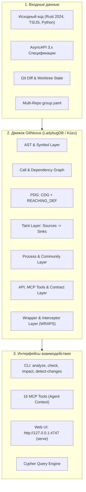

# Справочник возможностей и архитектурная книга рецептов GitNexus

Этот документ представляет собой исчерпывающий технический справочник по всем возможностям **GitNexus** (Knowledge Graph & Program Dependence Engine) и практическое руководство по его использованию для глубокого статического анализа, поиска антипаттернов, проверки инвариантов и рефакторинга.

---

## 1. Архитектура и принципы работы

GitNexus преобразует кодовую базу в обогащенный свойствами граф (**Code Knowledge Graph**), размещенный во встроенной графовой базе данных **LadybugDB / Kùzu** (буферный пул до 2048 MiB, нативная интеграция C++ через Node ABI).



### Уровни графа (Graph Layers)

1. **AST & Символьный слой (Syntax Layer):**
   * Узлы: файлы (`File`), папки (`Folder`), функции (`Function`), структуры (`Struct`), перечисления (`Enum`), трейты (`Trait`), реализации (`Impl`), модули (`Module`), методы (`Method`), классы (`Class`), интерфейсы (`Interface`).
   * Рёбра: `DEFINES`, `CONTAINS`, `MEMBER_OF`, `HAS_METHOD`, `HAS_PROPERTY`, `EXTENDS`, `IMPLEMENTS`, `METHOD_IMPLEMENTS`, `METHOD_OVERRIDES`.
2. **Слой вызовов, внедрения и зависимостей (Call & Dependency Graph):**
   * Рёбра: `CALLS`, `IMPORTS`, `ACCESSES`, `QUERIES`, `INJECTS`, `WRAPS` (middleware и интерцепторы).
3. **Слой процессов и архитектурных сообществ (Community & Process Layer):**
   * Узлы: `Community` (кластеры связанного кода, вычисленные алгоритмом Louvain с оценкой cohesion score), `Process` (сквозные цепочки сценариев выполнения).
   * Рёбра: `STEP_IN_PROCESS`, `ENTRY_POINT_OF`.
4. **Слой API, инструментов и контрактов (Contract & Client-Server Layer):**
   * Узлы: `Route` (HTTP/GraphQL эндпоинты), `Tool` (MCP/RPC функции), `Destination` (топики и очереди брокеров сообщений из AsyncAPI).
   * Рёбра: `HANDLES_ROUTE`, `FETCHES`, `HANDLES_TOOL`, `CONTRACT_LINK`.
5. **Слой потоков управления и данных (PDG Layer, флаг `--pdg`):**
   * Узлы: `BasicBlock`.
   * Рёбра: `CFG` (поток управления), `CDG` (зависимость управления / guard-клаузы), `REACHING_DEF` (определения и использования переменных).
6. **Слой безопасности (Taint Analysis Layer, флаг `--pdg`):**
   * Рёбра: `TAINTED` (внутрипроцедурное заражение), `TAINT_PATH` (межпроцедурные переходы данных), `SANITIZES` (барьеры санитизации).

---

## 2. Полный справочник CLI команд и флагов

Запуск осуществляется через проектный раннер: `node .gitnexus/run.cjs <command>` (или глобальный `gitnexus`).

### 2.1. Индексация и обновление (`analyze`)

```bash
node .gitnexus/run.cjs analyze [options] [path]
```

| Флаг | Назначение |
|---|---|
| `--pdg` | Построить слои Program Dependence Graph (CDG, REACHING_DEF, Taint). **Критично для поиска логических дыр, обходов проверок и инъекций.** |
| `--asyncapi-spec <path>` | Прочитать спеки AsyncAPI 3.x (файл или директория) и построить узлы `Destination` для очередей и топиков. |
| `--embeddings` | Включить локальную генерацию векторных эмбеддингов для семантического Graph-RAG поиска. |
| `--drop-embeddings` | Удалить существующие векторные индексы при переиндексации. |
| `--watch` | Запустить фоновый демон слежения за изменениями файлов с автообновлением графа. |
| `--debounce <ms>` | Задержка в миллисекундах перед переиндексацией в режиме watch (по умолчанию 300ms). |
| `--force` | Принудительная полная переиндексация с нуля, игнорируя кэш. |
| `--spring-actuator <path>` | Импорт метаданных Spring Actuator (для Java/Spring сервисов). |

### 2.2. Проверка инвариантов (`check`)

```bash
node .gitnexus/run.cjs check [options]
```

| Флаг | Назначение |
|---|---|
| `--cycles` | Обнаружить циклические импорты и зависимости между файлами и модулями. Завершается с ошибкой при их наличии. |
| `--json` | Вывод результата в формате JSON для CI/CD гейтов и скриптов верификации. |
| `-r, --repo <name>` | Имя целевого репозитория (при мультирепозиторной конфигурации). |

### 2.3. Визуальный Web UI Explorer (`serve`)

```bash
node .gitnexus/run.cjs serve --port 4747 --host 127.0.0.1
```
* Поднимает локальный веб-сервер на `http://127.0.0.1:4747`.
* Предоставляет интерактивный визуальный граф: кластеры, карты роутов, цепочки процессов, радиальные диаграммы связности и фильтры по типам связей.

### 2.4. Диагностика среды и движка (`doctor`)

```bash
node .gitnexus/run.cjs doctor
```
* Проверяет статус рантайма Node.js, ABI модулей, размер пула страниц LadybugDB, наличие нативных библиотек `lbugjs.node`, движка полнотекстового поиска (FTS) и расширений эмбеддингов.

### 2.5. Анализ изменений и воздействий (`detect-changes` / `impact`)

* `node .gitnexus/run.cjs detect-changes --scope all --repo .` — сопоставляет текущий незакоммиченный `git diff` с графом, определяя затронутые процессы и оценивая уровень риска (`LOW`, `MEDIUM`, `HIGH`, `CRITICAL`). Поддерживает флаг `--worktree <path>`.
* `node .gitnexus/run.cjs impact <symbol> --direction upstream --repo .` — расчет радиуса поражения символа на глубину до 3 уровней.

### 2.6. Генерация архитектурной документации (`wiki`)

```bash
node .gitnexus/run.cjs wiki [options]
```

| Флаг | Назначение |
|---|---|
| `--provider <name>` | LLM-провайдер: `minimax`, `openai`, `openrouter`, `azure`, `claude`, `cursor`, `codex`, `opencode`. |
| `--model <name>` | Название модели (по умолчанию `MiniMax-M3`). |
| `--lang <lang>` | Язык документации (например, `russian`, `english`). |
| `--force` | Принудительная регенерация всей вики-документации из графа. |
| `--concurrency <n>` | Количество параллельных запросов к LLM (по умолчанию 3). |

### 2.7. Мультирепозиторные группы (`group`)

* `node .gitnexus/run.cjs group list` — список сконфигурированных групп репозиториев.
* `node .gitnexus/run.cjs group sync` — перестроить реестр контрактов (`Contract Registry`) между связанными репозиториями.

---

## 3. Справочник всех 16 MCP-инструментов

| Инструмент | Параметры | Что возвращает |
|---|---|---|
| `query` | `search_query`, `repo` | Семантический/концептуальный поиск, сгруппированный по бизнес-процессам (`Process`). |
| `context` | `name`, `repo` | 360-градусный обзор символа: входящие/исходящие вызовы, методы, процессы. |
| `impact` | `target`, `direction`, `maxDepth`, `minConfidence` | Радиус поражения при изменении символа (глубины $d=1, 2, 3$). |
| `trace` | `from`, `to`, `maxDepth`, `includeTests` | Кратчайший направленный путь вызовов между двумя символами. Сообщает точное место разрыва при `no_path`. Поддерживает cross-repo с `repo: "@group"`. |
| `detect_changes` | `scope`, `worktree` | Анализ влияния текущего git diff на кодовую базу (с поддержкой `worktree`). |
| `rename` | `symbol_name`, `new_name`, `dry_run` | Координированное безопасное переименование во всех файлах с разделением правок по уверенности (graph vs text). |
| `cypher` | `statement`, `repo`, `limit` | Выполнение произвольного запроса на языке Cypher к базе LadybugDB. |
| `explain` | `target`, `limit` | Отчёт о цепочках заражения (Taint findings): источник $\to$ путь $\to$ опасный сток (SQLi, XSS, Path Traversal, Command Injection). |
| `pdg_query` | `mode` (`controls` / `flows`), `target`, `variable` | CDG (условия выполнения и гарды) или REACHING_DEF (поток значений переменной). |
| `check` | `cycles: true` | Проверка структурных инвариантов графа на циклы. |
| `route_map` | `repo` | Карта API маршрутов: клиентские компоненты $\leftrightarrow$ обработчики эндпоинтов. |
| `shape_check` | `repo` | Поиск расхождений (`MISMATCH`) между ключами ответа сервера и ключами, читаемыми клиентом. |
| `api_impact` | `route`, `method` | Оценка риска и список потребителей перед изменением API маршрута. |
| `tool_map` | `repo` | Карта определений MCP/RPC инструментов и файлов-обработчиков (`HANDLES_TOOL`). |
| `group_list` | — | Список сконфигурированных мультирепозиторных групп. |
| `group_sync` | — | Синхронизация реестра контрактов между репозиториями группы. |
| `list_repos` | `limit`, `offset` | Пагинированное перечисление всех зарегистрированных репозиториев. |

---

## 4. Кулинарная книга Cypher (Рецепты под специфические косяки RusToK)

### Рецепт 1: Поиск циклических зависимостей любой глубины
```cypher
MATCH path = (a:File)-[:CodeRelation {type: 'IMPORTS'}*2..6]->(a:File)
RETURN [n IN nodes(path) | n.filePath] AS cycle
LIMIT 20
```

### Рецепт 2: Нарушение слоистой архитектуры (Domain $\to$ Infrastructure)
```cypher
MATCH (domain:File)-[:CodeRelation {type: 'CALLS'|'IMPORTS'}]->(infra:File)
WHERE domain.filePath CONTAINS '/domain/' 
  AND (infra.filePath CONTAINS '/infrastructure/' OR infra.filePath CONTAINS '/database/')
RETURN domain.filePath AS violator, infra.filePath AS forbidden_target
```

### Рецепт 3: Нарушение изоляции БД (`P-OWNER-READ-BOUNDARY`)
Поиск функций модуля, выполняющих SQL-запросы к чужим таблицам:
```cypher
MATCH (fn:Function)-[:CodeRelation {type: 'QUERIES'}]->(table:CodeElement)
WHERE fn.filePath CONTAINS 'crates/modules/rustok-distribution/'
  AND table.name IN ['products', 'product_variants', 'channels']
RETURN fn.name, fn.filePath, table.name
```

### Рецепт 4: Утечка данных мультитенантности (Запросы без скоупа `tenant_id`)
Поиск запросов к базе данных, где в цепочке аргументов отсутствует `TenantContext` или `tenant_id`:
```cypher
MATCH (fn:Function)-[:CodeRelation {type: 'QUERIES'}]->(entity:CodeElement)
WHERE fn.filePath CONTAINS 'crates/modules/'
  AND NOT EXISTS {
    MATCH (fn)-[:CodeRelation {type: 'ACCESSES'|'CALLS'}*1..2]->(tenant_arg:CodeElement)
    WHERE tenant_arg.name CONTAINS 'tenant' OR tenant_arg.name CONTAINS 'Tenant'
  }
RETURN fn.name, fn.filePath, entity.name
LIMIT 30
```

### Рецепт 5: Бесхозные события (Orphaned Events в Outbox / Iggy)
```cypher
// 1. События без подписчиков (никто не слушает)
MATCH (ev:Struct)
WHERE ev.filePath CONTAINS '/contracts/' AND ev.name ENDS WITH 'Event'
  AND NOT (()-[:CodeRelation {type: 'CALLS'|'STEP_IN_PROCESS'}]->(ev))
RETURN ev.name AS unhandled_event, ev.filePath;

// 2. События без издателей (объявлены, но никогда не генерируются)
MATCH (ev:Struct)
WHERE ev.filePath CONTAINS '/contracts/' AND ev.name ENDS WITH 'Event'
  AND NOT EXISTS {
    MATCH (publisher:Function)-[:CodeRelation {type: 'CALLS'}]->(outbox:Function)
    WHERE outbox.name CONTAINS 'publish' AND publisher.filePath CONTAINS 'crates/modules/'
  }
RETURN ev.name AS unpublished_event, ev.filePath;
```

### Рецепт 6: Незащищенные роуты без Middleware-обертки (`WRAPS`)
Поиск API роутов, которые не обернуты в аутентификационные или CORS-интерцепторы:
```cypher
MATCH (r:Route)
WHERE NOT EXISTS {
  MATCH (mw:Function)-[:CodeRelation {type: 'WRAPS'}]->(r)
  WHERE mw.name CONTAINS 'auth' OR mw.name CONTAINS 'tenant' OR mw.name CONTAINS 'cors'
}
RETURN r.name, r.path, r.filePath
```

### Рецепт 7: MCP-инструменты без обработчиков (`HANDLES_TOOL`)
Поиск инструментов агентов, у которых отсутствует файл-обработчик:
```cypher
MATCH (t:Tool)
WHERE NOT (()-[:CodeRelation {type: 'HANDLES_TOOL'}]->(t))
RETURN t.name, t.filePath
```

### Рецепт 8: Неполная реализация портов и трейтов (`todo!` / `unimplemented!`)
Поиск структур, реализующих контрактные трейты из `ports/` или `contracts/`, у которых методы не вызывают реальную логику:
```cypher
MATCH (s:Struct)-[:CodeRelation {type: 'IMPLEMENTS'}]->(tr:Trait)
WHERE tr.filePath CONTAINS '/ports/' OR tr.filePath CONTAINS '/contracts/'
MATCH (s)-[:CodeRelation {type: 'METHOD_IMPLEMENTS'}]->(m:Method)
WHERE m.name CONTAINS 'todo' OR m.name CONTAINS 'stub'
RETURN s.name, tr.name, m.name, s.filePath
```

### Рецепт 9: Утечка инкапсуляции (Прямой доступ к полям структуры минуя методы)
```cypher
MATCH (caller:Function)-[:CodeRelation {type: 'ACCESSES'}]->(prop:CodeElement)
WHERE caller.filePath CONTAINS 'crates/modules/rustok-cart/'
  AND prop.filePath CONTAINS 'crates/modules/rustok-order/'
RETURN caller.name, caller.filePath, prop.name
```
