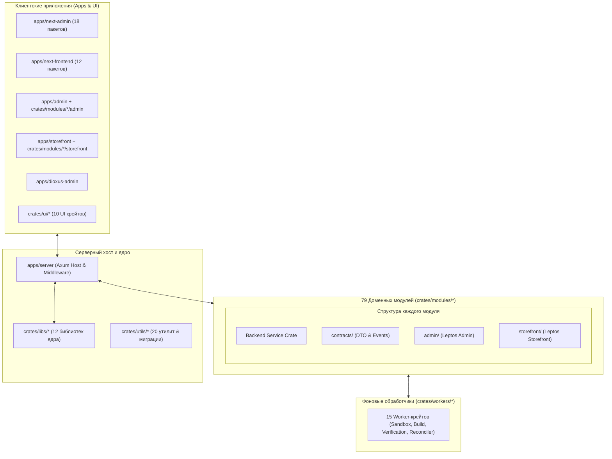

# План глубокого сквозного аудита на базе GitNexus Knowledge Graph

Этот документ определяет канонический план проведения **100% глубокого аудита** всей кодовой базы RusToK с использованием графового анализатора **GitNexus**.

План охватывает все **79 доменных модулей** (включая их подкрейты `contracts`, `admin`, `storefront`), **15 воркер-крейтов**, **12 базовых библиотек**, **10 UI-крейтов**, **20 утилитарных крейтов**, интеграционные пакеты, серверную часть (`apps/server`) и **все три клиентских окружения** (Next.js, Leptos и Dioxus) — суммарно **245 Cargo-пакетов** воркспейса.

Справочник всех команд, MCP-инструментов и Cypher-запросов:
👉 [Справочник возможностей GitNexus (gitnexus-capabilities-reference.md)](./gitnexus-capabilities-reference.md)

---

## 1. Архитектурный периметр аудита (Объекты проверки)



---

## 2. Фазы выполнения глубокого аудита

### Фаза 0: Подготовка и максимальное обогащение графа
1. **Глубокий анализ с построением PDG и Taint:**
   ```bash
   node .gitnexus/run.cjs analyze --pdg --force
   ```
2. **Индексация событийно-ориентированных очередей:**
   ```bash
   node .gitnexus/run.cjs analyze --asyncapi-spec docs/asyncapi/
   ```
3. **Запуск визуального инспектора:**
   ```bash
   node .gitnexus/run.cjs serve --port 4747
   ```
   *Проверка:* веб-интерфейс доступен на `http://127.0.0.1:4747`, кластеры и процессы отрисованы.

---

### Фаза 1: Топологический аудит монолита (Structural Invariants)
1. **Циклические зависимости:**
   * Команда: `node .gitnexus/run.cjs check --cycles`
   * *Цель:* 0 циклов импорта во всех 245 пакетах.
2. **Суверенитет таблиц БД (`P-OWNER-READ-BOUNDARY`):**
   * Cypher-поиск прямых запросов к чужим таблицам минуя сервисные порты:
     ```cypher
     MATCH (fn:Function)-[:CodeRelation {type: 'QUERIES'}]->(table:CodeElement)
     WHERE fn.filePath CONTAINS 'crates/modules/'
     RETURN fn.filePath, table.name
     ```
3. **Чистота слоев (Domain $\to$ Infrastructure):**
   * Ни один файл `crates/modules/*/src/domain/` не должен зависеть от веб-хэндлеров или СУБД.
4. **Мертвый код и неиспользуемые сущности:**
   * Поиск публичных функций и структур без входящих вызовов (`in-degree == 0`), исключая легитимные точки входа и миграции.

---

### Фаза 2: Мульти-UI паритет и дрейф API (Next.js ↔ Leptos ↔ Dioxus)
Согласно [AGENTS.md §2.1.6](../../AGENTS.md), все клиентские реализации обязаны находиться в строгом функциональном паритете.

1. **Сверка потребления роутов (`route_map`):**
   * Сравнить вызовы из `apps/next-admin/packages/*` и `crates/modules/*/admin`:
     * Все ли маршруты, запрашиваемые в Next.js, доступны и реализованы в Leptos и Dioxus?
     * Нет ли брошенных роутов без обработчиков (`HANDLES_ROUTE`).
2. **Дрейф формы ответов (`shape_check`):**
   * Выявить несовпадения (`MISMATCH`) между тем, что возвращают бэкенд-хэндлеры/резолверы, и тем, к каким полям обращаются хуки/компоненты фронтенда.
3. **Согласованность подкрейтов UI:**
   * Проверить модули, содержащие `admin/` и `storefront/`: соответствие контрактов в `contracts/` реальным вызовам из UI.

---

### Фаза 3: Потоки управления, изоляция арендаторов и гарды (CDG)
1. **Строгая изоляция арендаторов (Tenant Scoping Audit):**
   * Проверить через Cypher и PDG, что **каждый** запрос на чтение или мутацию данных в БД выполняет фильтрацию по `tenant_id` или получает проверенный `TenantContext`.
2. **Защита точек входа (Auth & RBAC Guards):**
   * Инструмент: `pdg_query { mode: "controls" }`.
   * Каждая мутирующая операция обязана находиться под предикатом guard-клаузы (`guard: true`) проверки прав.
3. **Искоренение проглатывания ошибок (`P-ANTI-SWALLOW`):**
   * Поиск мест подавления ошибок через `let _ = ...`, маскировочных `Ok(())` и замалчивания падений в миграциях.

---

### Фаза 4: Безопасность и Taint-анализ данных (Source $\to$ Sink)
* Инструмент: `explain` (слой PDG).
* Просканировать все входящие HTTP-запросы, заголовки, параметры роутов и вебхуки:
  1. **SQL Injection:** аргументы попадают в сырые запросы без типизированных параметров SeaORM.
  2. **Path Traversal:** передача недоверенных путей в `rustok-storage`, `rustok-media` или воркеры артефактов.
  3. **SSRF:** непроверенные URI в исходящих HTTP-вызовах (`rustok-commerce`, вебхуки платежей).
  4. **Command Injection:** вызовы команд ОС в воркерах сборки и песочницах (`rustok-sandbox`, `rustok-module-build-worker`).

---

### Фаза 5: Атомарность событий, Outbox и воркеры
1. **Полнота Transactional Outbox:**
   * Трассировка через `trace`: гарантирует ли каждая бизнес-мутация (заказ, платеж, модерация) вызов сохранения события в Outbox.
2. **Сверка жизненного цикла событий (Orphaned Events):**
   * Проверка рецептом Cypher: нет ли в `contracts/` событий, у которых 0 издателей (мертвые события) или 0 подписчиков (забытые события).
3. **Синхронизация кэша (`P-GENERATION-ACK-BEFORE-CACHE-EFFECT`):**
   * Проверка через CDG/PDG, что сброс эффективных политик происходит строго перед фиксацией нового поколения кэша.
4. **Graceful Shutdown воркеров (`P-WORKER-SHUTDOWN-ADMISSION`):**
   * Инспекция 15 воркеров в `crates/workers/*` и воркеров в `apps/server`: обязательная проверка `StopHandle` в главном цикле.

---

### Фаза 6: Исчерпывающая матрица компонентов репозитория

#### 6.1. Доменные модули (`crates/modules/` — 79 модулей)
Каждый модуль проверяется по цепочке: `contracts` $\to$ `src/` $\to$ `admin` $\to$ `storefront` $\to$ `migrations`.

* **Торговля, Финансы & Маркетплейс:**
  - [ ] `rustok-commerce` & `rustok-commerce-foundation`
  - [ ] `rustok-cart` & `rustok-order`
  - [ ] `rustok-payment` & `rustok-pricing` & `rustok-tax`
  - [ ] `rustok-billing` & `rustok-finance` & `rustok-accounting`
  - [ ] `rustok-fulfillment` & `rustok-inventory` & `rustok-distribution`
  - [ ] `rustok-marketplace` & `rustok-marketplace-seller` & `rustok-marketplace-listing`
  - [ ] `rustok-marketplace-commission` & `rustok-marketplace-balance`
  - [ ] `rustok-marketplace-payout` & `rustok-marketplace-allocation`
* **Каталог, Товары & Контент:**
  - [ ] `rustok-product` & `rustok-product-bundles` & `rustok-product-relations`
  - [ ] `rustok-taxonomy` & `rustok-navigation` & `rustok-brand`
  - [ ] `rustok-content` & `rustok-content-orchestration`
  - [ ] `rustok-pages` & `rustok-page-builder` & `rustok-forms`
  - [ ] `rustok-media` & `rustok-deal` & `rustok-docs`
* **Сообщество, Коммуникации & Социальный граф:**
  - [ ] `rustok-forum` & `rustok-comments` & `rustok-reactions`
  - [ ] `rustok-blog` & `rustok-newsletter` & `rustok-groups`
  - [ ] `rustok-customer` & `rustok-profiles` & `rustok-party`
  - [ ] `rustok-social-graph` & `rustok-moderation`
  - [ ] `rustok-notifications` & `rustok-email` & `rustok-messenger` & `rustok-calls`
* **Безопасность, Тенанты & Доступ:**
  - [ ] `rustok-tenant` & `rustok-auth` & `rustok-rbac` & `rustok-security`
* **Инфраструктура, События & Поиск:**
  - [ ] `rustok-cache` & `rustok-outbox` & `rustok-events-module`
  - [ ] `rustok-iggy` & `rustok-iggy-connector`
  - [ ] `rustok-search` & `rustok-index`
  - [ ] `rustok-workflow` & `rustok-tasks` & `rustok-calendar`
  - [ ] `rustok-translation` & `rustok-seo` & `rustok-region` & `rustok-channel`
  - [ ] `rustok-modules`
* **Искусственный Интеллект & MCP:**
  - [ ] `rustok-ai` & `rustok-ai-alloy` & `rustok-ai-athanor`
  - [ ] `rustok-ai-content` & `rustok-ai-media` & `rustok-ai-order`
  - [ ] `rustok-ai-product` & `rustok-ai-translation` & `rustok-mcp`
  - [ ] `alloy` & `flex`

#### 6.2. Фоновые воркеры (`crates/workers/` — 15 крейтов)
- [ ] `rustok-artifact-node-agent`, `rustok-artifact-node-controller`, `rustok-artifact-node-reconciler`, `rustok-artifact-node-transport`
- [ ] `rustok-module-build-dispatcher`, `rustok-module-build-transport`, `rustok-module-build-worker`
- [ ] `rustok-registry-validation-worker`
- [ ] `rustok-sandbox`, `rustok-sandbox-transport`, `rustok-sandbox-worker`
- [ ] `rustok-static-distribution-worker`
- [ ] `rustok-verification-transport`, `rustok-verification-worker`, `rustok-worker-transport`

#### 6.3. Библиотеки ядра платформы (`crates/libs/` — 12 крейтов)
- [ ] `rustok-core` (полевые схемы, базовые трейты, валидация)
- [ ] `rustok-api`, `rustok-fba`, `rustok-events`, `rustok-outbox-storage`
- [ ] `rustok-runtime`, `rustok-manifest`, `rustok-telemetry`
- [ ] `rustok-content-portability`, `rustok-seo-targets`, `rustok-translation-targets`, `rustok-web`

#### 6.4. Пользовательский интерфейс и UI-ядро (`crates/ui/` — 10 крейтов)
- [ ] `fly`, `leptos-ui-routing`, `rustok-graphql`, `rustok-grid`, `rustok-ui`
- [ ] `rustok-ui-auth`, `rustok-ui-core`, `rustok-ui-forms`, `rustok-ui-i18n`, `rustok-ui-transport`

#### 6.5. Утилиты, инструменты сборки и миграции (`crates/utils/` — 20 крейтов)
- [ ] `rustok-migrations` (проверка схемы и миграций)
- [ ] `rustok-module-sdk`, `rustok-module-template`, `rustok-secrets`, `rustok-storage`, `rustok-starter`
- [ ] `rustok-doctor`, `rustok-installer`, `rustok-installer-cli`, `rustok-installer-persistence`
- [ ] `rustok-cli`, `rustok-cli-core`, `rustok-cli-platform`, `rustok-cli-registry`
- [ ] `rustok-build`, `rustok-build-publication`, `rustok-build-source`
- [ ] `rustok-test-utils`, `serde-columnar-vendored`, `utoipa-swagger-ui-vendored`

#### 6.6. Интеграции и Хост-приложения (`apps/` & `crates/integration/`)
- [ ] `crates/integration/rustok-content-revisions`
- [ ] `apps/server` (главный роутер, middleware, жизненный цикл)
- [ ] `apps/next-admin` (18 пакетов модулей)
- [ ] `apps/next-frontend` (12 пакетов витрины)
- [ ] `apps/admin` (Leptos Admin Host)
- [ ] `apps/storefront` (Leptos Storefront Host)
- [ ] `apps/dioxus-admin` (Dioxus Admin Host)

---

## 3. Протокол устранения и закрытия находок

1. **Правило нулевых дефектов:** аудит не переходит к следующему блоку матрицы, пока в текущем остаются неисправленные дефекты или непроверенные файлы.
2. **Фиксация в каталоге:** новые типы антипаттернов вносятся в [logic-hygiene-patterns.md](./logic-hygiene-patterns.md) с кодом `P-XXXX`.
3. **Локальная проверка без сборки всего сервера:**
   ```bash
   cargo check -p <affected-crate>
   cargo test -p <affected-crate> --lib
   node .gitnexus/run.cjs detect-changes --scope all --repo .
   ```
