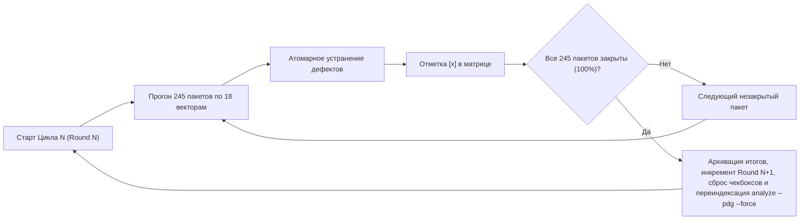

# План глубокого сквозного аудита на базе GitNexus Knowledge Graph

## Deep GitNexus Audit Cycle — Round 1 (Fresh Start from Scratch)

- **Status:** ACTIVE
- **Active Cycle:** Round 1 (Fresh Start from Scratch)
- **Active Phase:** Phase GN-01 — Shared Platform Foundation Libraries (`crates/libs/*`)
- **Next Pending Component:** [`crates/libs/rustok-core`](../../crates/libs/rustok-core)
- **Current main SHA:** `2cc5d38043`
- **Active Branch:** `main`

### Canonical Trigger
The single canonical trigger to continue this audit sequence is:
```text
реализуй план gitnexus
```
*(или: `реализуй план аудита gitnexus` / `execute gitnexus audit plan`)*

---

Этот документ определяет канонический план проведения **100% глубокого аудита** всей кодовой базы RusToK.

План построен по принципу: **Каждая возможность GitNexus = Отдельный обязательный вектор аудита с подробным деревом решений и нюансами (18 векторов проверки)**. Каждый из **245 пакетов** воркспейса (все 79 доменных модулей со своими подкрейтами `contracts`, `ports`, `admin`, `storefront`, `cli`, `panel`, `ui`, все 15 воркеров, 12 библиотек, 10 UI-крейтов, 20 утилит и 6 приложений) последовательно проверяется по **всем 18 векторам**.

Справочник всех команд, MCP-инструментов, схемы и Cypher-запросов:
👉 [Справочник возможностей GitNexus (gitnexus-capabilities-reference.md)](./gitnexus-capabilities-reference.md)

---

## 1. Архитектурная анатомия монолита RusToK

Из анализа корневого `Cargo.toml` каждый доменный модуль представляет собой законченный кластер подкрейтов:
* `crates/modules/<name>/` — серверный доменный крейт (SeaORM, логика, миграции).
* `contracts/` — публичные DTO, доменные события, фасады.
* `ports/` — выделенные порты чистой архитектуры (`flex/ports`, `product/ports`, `channel/ports`, `media/ports`).
* `admin/` — изолированный UI-крейт админки на Leptos.
* `storefront/` — изолированный UI-крейт витрины на Leptos.
* `cli/` — CLI-утилиты модуля (`blog/cli`, `auth/cli`, `rbac/cli`, `profiles/cli`, `media/cli`, `social-graph/cli`).
* `panel/` — встроенные панели управления (`seo/panel`).
* `ui/` — разделяемые UI-компоненты (`auth/ui`).
* `crates/ui/fly/*` & `crates/ui/rustok-*` — мульти-таргетные UI-библиотеки с независимыми реализациями под **Leptos** и **Dioxus**.

---

## 2. 18 Всеобъемлющих Векторов аудита GitNexus

```mermaid
flowchart TD
    subgraph Vectors ["18 Векторов аудита GitNexus (1:1 со всеми возможностями)"]
        V1["1. Циклы и топология (check --cycles)"]
        V2["2. Суверенитет БД и слои (QUERIES)"]
        V3["3. Связность и God-узлы (clusters, Cohesion)"]
        V4["4. Сквозные процессы (processes, trace)"]
        V5["5. Символы без вызовов (Dead Code vs WIP)"]
        V6["6. Инкапсуляция полей (ACCESSES)"]
        V7["7. Роуты и паритет Tri-UI (route_map)"]
        V8["8. Дрейф форм данных (shape_check)"]
        V9["9. Условия и гарды (CDG: controls)"]
        V10["10. Потоки данных и ошибки (REACHING_DEF)"]
        V11["11. Taint-безопасность (explain)"]
        V12["12. События и Outbox (AsyncAPI, Destinations)"]
        V13["13. Радиус поражения (impact, detect_changes)"]
        V14["14. Временная связность (Git Churn + Graph)"]
        V15["15. Инструменты агентов (tool_map, HANDLES_TOOL)"]
        V16["16. Полнота портов и трейтов (IMPLEMENTS, todo!)"]
        V17["17. Middleware-обертки (WRAPS, INJECTS)"]
        V18["18. Кросс-репозиторные контракты (group_sync)"]
    end

    subgraph Scope ["245 Пакетов монолита"]
        P1["79 Доменных модулей (src, contracts, ports, admin, storefront, cli)"]
        P2["15 Воркеров (crates/workers)"]
        P3["12 Библиотек ядра (crates/libs)"]
        P4["10 UI-крейтов (Leptos и Dioxus Fly)"]
        P5["20 Утилит и миграций (crates/utils)"]
        P6["6 Приложений (Server, Next-Admin, Next-Frontend, Leptos, Dioxus)"]
    end

    Vectors --> Scope
```



---

### Вектор 1: Циклы и топология импортов (`check --cycles`)
* **Что делает GitNexus:** `node .gitnexus/run.cjs check --cycles` или MCP `check({ cycles: true })`.
* **Нюансы и триаж:** Внутримодульный цикл устраняется разделением общих структур в `types.rs`. Межмодульный цикл (Crate A $\leftrightarrow$ Crate B) устраняется выносом контракта в `crates/libs/rustok-core` или в `contracts/` модуля-владельца.
* **Критерий:** 0 циклов импорта.

### Вектор 2: Суверенитет БД и слоистая архитектура (`QUERIES`)
* **Что делает GitNexus:** Cypher-поиск прямых запросов к чужим таблицам (`P-OWNER-READ-BOUNDARY`) и вызовов инфраструктуры из домена.
* **Нюансы и триаж:** Если крейту нужны чужие данные — **не удалять логику**, а спроектировать в модуле-владельце публичную проекцию (`Projection`). Domain не должен зависеть от веб-хэндлеров и драйверов СУБД.
* **Критерий:** 100% изоляция таблиц; вызовы только через сервисные порты.

### Вектор 3: Кластерная связность и раздутые узлы (`clusters` & Cohesion)
* **Что делает GitNexus:** Ресурс `gitnexus://repo/{name}/clusters` (Louvain, cohesion score) + Cypher-поиск Fan-in / Fan-out $> 25$.
* **Нюансы и триаж:** При Cohesion $< 0.45$ монолитный файл дробится на сфокусированные модули. God-функции разделяются на чистые шаги.
* **Критерий:** Высокая сплоченность кластеров; отсутствие раздутых спагетти-узлов.

### Вектор 4: Сквозные бизнес-процессы и цепочки (`processes` & `trace`)
* **Что делает GitNexus:** Ресурсы `processes`, `process/{name}` и инструмент `trace`.
* **Нюансы и триаж:** При `status: "no_path"` локализуется точка разрыва. Восстанавливается потерянный вызов или маппинг ошибок.
* **Критерий:** Все ключевые операции крейта имеют непрерывную трассировку от точки входа до БД.

### Вектор 5: Символы без вызовов: Мёртвый код vs WIP (`in-degree == 0`)
* **Что делает GitNexus:** Cypher-поиск функций/структур без ребер `CALLS` и `STEP_IN_PROCESS`.
* **Нюансы и триаж:** **Жалко терять хороший код!**
  1. *Недоподключенный WIP:* Дописать wiring в роутер/процесс и покрыть тестом.
  2. *Публичный контракт в contracts/:* Задокументировать и покрыть контрактным тестом.
  3. *Вызов через макросы (`derive`, `sea_orm`):* Подтвердить текстом и сохранить.
  4. *Легаси-мусор:* Удалить.
* **Критерий:** Ни один полезный функционал не потерян; устаревший мусор зачищен.

### Вектор 6: Инкапсуляция и прямой доступ к полям (`ACCESSES`)
* **Что делает GitNexus:** Cypher-поиск прямых межмодульных ребер `ACCESSES`.
* **Нюансы и триаж:** Заменить прямое чтение/запись полей чужой структуры на контрактные методы (`HAS_METHOD`) с валидацией инвариантов.
* **Критерий:** Доступ к полям между модулями строго инкапсулирован.

### Вектор 7: Карта API роутов и паритет Tri-UI (`route_map`)
* **Что делает GitNexus:** Инструмент `route_map`, ребра `FETCHES` и `HANDLES_ROUTE`.
* **Нюансы и триаж:** Если эндпоинт вызывается в Next.js, но отсутствует в Leptos или Dioxus — **дописать** недостающий UI под правило паритета ([AGENTS.md §2.1.6](../../AGENTS.md)). Неиспользуемые роуты бэкенда либо подключаются к UI, либо документируются как вебхуки.
* **Критерий:** 100% паритет интерфейсов (Next.js ↔ Leptos ↔ Dioxus).

### Вектор 8: Дрейф форм данных и контрактов (`shape_check` & `api_impact`)
* **Что делает GitNexus:** Инструмент `shape_check` (поиск `MISMATCH`) и `api_impact`.
* **Нюансы и триаж:** При `MISMATCH` синхронизируются GraphQL-схемы, DTO и клиентские хуки.
* **Критерий:** 0 предупреждений `MISMATCH` для роутов крейта.

### Вектор 9: Потоки управления и Guard-клаузы (`pdg_query controls` / CDG)
* **Что делает GitNexus:** `pdg_query { mode: "controls" }` (Control Dependence Graph).
* **Нюансы и триаж:** Любая мутация обязана быть защищена гардом (`guard: true`). Публичные точки входа явно маркируются `// public-entrypoint`. Мертвые взаимоисключающие ветвления удаляются.
* **Критерий:** 100% покрытие мутаций проверками `TenantContext` и RBAC.

### Вектор 10: Потоки данных и анти-проглатывание (`pdg_query flows` & REACHING_DEF)
* **Что делает GitNexus:** `pdg_query { mode: "flows" }` (поток переменных) + Cypher.
* **Нюансы и триаж (`P-ANTI-SWALLOW`):** Запрещены `let _ =` и пустые `Ok(())`. Все ошибки транслируются в типизированные `DomainError`. Устраняется затенение переменных.
* **Критерий:** Полная трассируемость значений; соблюдение линта `deny let_underscore_must_use`.

### Вектор 11: Анализ заражения и безопасность (`explain` / Taint Sinks)
* **Что делает GitNexus:** Инструмент `explain` (слой PDG).
* **Нюансы и триаж:** Все пути `Source` $\to$ `Sink` экранируются параметризацией SeaORM, каноникализацией путей или белыми списками с выставлением ребра `SANITIZES`.
* **Критерий:** 0 уязвимостей SQLi, Path Traversal, SSRF и Command Injection.

### Вектор 12: Событийные цепочки и шина сообщений (AsyncAPI & Outbox)
* **Что делает GitNexus:** Узлы `Destination`, флаг `--asyncapi-spec`, анализ Outbox.
* **Нюансы и триаж:** Устраняются бесхозные события (без издателей или подписчиков). Проверяется порядок сброса кэша перед подтверждением генерации (`P-GENERATION-ACK-BEFORE-CACHE-EFFECT`).
* **Критерий:** Все события спарены; мутации атомарно порождают Outbox-записи.

### Вектор 13: Радиус поражения и риски изменений (`impact` & `detect_changes`)
* **Что делает GitNexus:** Инструменты `impact` и `detect_changes` с поддержкой `--worktree`.
* **Нюансы и триаж:** Изменения с риском `CRITICAL` тестируются по всем затронутым процессам. Статус `UNKNOWN` перепроверяется текстовым поиском.
* **Критерий:** Полная предсказуемость воздействия любых правок.

### Вектор 14: Временная связность и копипаст-дрейф (Git Churn + Graph)
* **Что делает GitNexus:** Сопоставление истории коммитов с топологией графа + поиск дубликатов сигнатур.
* **Нюансы и триаж (`P-COPY-DRIFT-MOUNT`):** Ликвидация скрытой связности (Shotgun Surgery) и вынос дублирующихся реализаций в ядро.
* **Критерий:** Единый источник истины для каждого алгоритма.

### Вектор 15: Инструменты агентов и MCP/RPC хэндлеры (`tool_map` / `HANDLES_TOOL`)
* **Что делает GitNexus:** Инструмент `tool_map`, ребро `HANDLES_TOOL`.
* **Нюансы и триаж:** Все инструменты, объявленные в `rustok-mcp` и схемах агентов, обязаны иметь рабочий файл-обработчик. Устаревшие или нереализованные определения инструментов дописываются либо удаляются.
* **Критерий:** 100% регистрация обработчиков для всех декларированных MCP-инструментов.

### Вектор 16: Полнота реализации портов и трейтов (`IMPLEMENTS` / `METHOD_IMPLEMENTS`)
* **Что делает GitNexus:** Cypher-анализ реализации трейтов из `ports/` и `contracts/`.
* **Нюансы и триаж:**
  * Проверка соблюдения правил корневого `Cargo.toml`: `deny todo`, `deny unimplemented`.
  * Если метод трейта содержит заглушку `todo!()` или пустой возврат — это недописанная логика. **Дописать реальную реализацию адаптера.**
* **Критерий:** 0 заглушек `todo!` и `unimplemented!` в реализациях интерфейсов.

### Вектор 17: Middleware-цепочки и интерцепторы (`WRAPS` / `INJECTS`)
* **Что делает GitNexus:** Анализ ребер `WRAPS` в роутере `apps/server`.
* **Нюансы и триаж:** Каждый публичный API-маршрут обязан быть обернут полным стеком защитных middleware: CORS (`P-CORS-IMPLICIT-LOOPBACK`), резолвинг тенанта, ограничение частоты запросов, валидация контекста трассировки (`P-HTTP-UNBOUNDED-TRACE-CONTEXT`).
* **Критерий:** Ни один роут не опубликован в обход защитного периметра middleware.

### Вектор 18: Кросс-репозиторные контракты и внешние шлюзы (`group_sync` / `CONTRACT_LINK`)
* **Что делает GitNexus:** Инструменты `group_list`, `group_sync`, ребро `CONTRACT_LINK`.
* **Нюансы и триаж:** Синхронизация реестра контрактов с внешними платежными шлюзами, микросервисами и отдельными репозиториями витрин. Проверка соответствия форматов запросов и ответов.
* **Критерий:** Валидность всех внешних контрактных связей.

---

## 3. Матрица сквозного аудита монолита (245 пакетов в 11 фазах)

Каждый компонент последовательно тестируется по **Векторам В1–В18**:

### Phase GN-01 — Shared Foundation Libraries (`crates/libs/*` — 12 пакетов)
| Компонент / Пакет | Путь в репозитории | В1..В4 | В5..В8 | В9..В12 | В13..В18 |
|---|---|:---:|:---:|:---:|:---:|
| `rustok-core` | `crates/libs/rustok-core` | [ ] | [ ] | [ ] | [ ] |
| `rustok-api` | `crates/libs/rustok-api` | [ ] | [ ] | [ ] | [ ] |
| `rustok-fba` | `crates/libs/rustok-fba` | [ ] | [ ] | [ ] | [ ] |
| `rustok-events` | `crates/libs/rustok-events` | [ ] | [ ] | [ ] | [ ] |
| `rustok-outbox-storage` | `crates/libs/rustok-outbox-storage` | [ ] | [ ] | [ ] | [ ] |
| `rustok-runtime` | `crates/libs/rustok-runtime` | [ ] | [ ] | [ ] | [ ] |
| `rustok-manifest` | `crates/libs/rustok-manifest` | [ ] | [ ] | [ ] | [ ] |
| `rustok-telemetry` | `crates/libs/rustok-telemetry` | [ ] | [ ] | [ ] | [ ] |
| `rustok-content-portability` | `crates/libs/rustok-content-portability` | [ ] | [ ] | [ ] | [ ] |
| `rustok-seo-targets` | `crates/libs/rustok-seo-targets` | [ ] | [ ] | [ ] | [ ] |
| `rustok-translation-targets` | `crates/libs/rustok-translation-targets` | [ ] | [ ] | [ ] | [ ] |
| `rustok-web` | `crates/libs/rustok-web` | [ ] | [ ] | [ ] | [ ] |

### Phase GN-02 — Core Identity, Tenancy & Access Modules (4 модуля)
| Компонент / Пакет | Путь в репозитории | В1..В4 | В5..В8 | В9..В12 | В13..В18 |
|---|---|:---:|:---:|:---:|:---:|
| `rustok-tenant` | `crates/modules/rustok-tenant` | [ ] | [ ] | [ ] | [ ] |
| `rustok-auth` (вкл. `cli`, `ui`) | `crates/modules/rustok-auth` | [ ] | [ ] | [ ] | [ ] |
| `rustok-rbac` (вкл. `cli`) | `crates/modules/rustok-rbac` | [ ] | [ ] | [ ] | [ ] |
| `rustok-security` | `crates/modules/rustok-security` | [ ] | [ ] | [ ] | [ ] |

### Phase GN-03 — Commerce, Financial & Marketplace Modules (20 модулей)
| Компонент / Пакет | Путь в репозитории | В1..В4 | В5..В8 | В9..В12 | В13..В18 |
|---|---|:---:|:---:|:---:|:---:|
| `rustok-commerce` | `crates/modules/rustok-commerce` | [ ] | [ ] | [ ] | [ ] |
| `rustok-commerce-foundation` | `crates/modules/rustok-commerce-foundation` | [ ] | [ ] | [ ] | [ ] |
| `rustok-cart` | `crates/modules/rustok-cart` | [ ] | [ ] | [ ] | [ ] |
| `rustok-order` | `crates/modules/rustok-order` | [ ] | [ ] | [ ] | [ ] |
| `rustok-payment` | `crates/modules/rustok-payment` | [ ] | [ ] | [ ] | [ ] |
| `rustok-pricing` | `crates/modules/rustok-pricing` | [ ] | [ ] | [ ] | [ ] |
| `rustok-tax` | `crates/modules/rustok-tax` | [ ] | [ ] | [ ] | [ ] |
| `rustok-billing` | `crates/modules/rustok-billing` | [ ] | [ ] | [ ] | [ ] |
| `rustok-finance` | `crates/modules/rustok-finance` | [ ] | [ ] | [ ] | [ ] |
| `rustok-accounting` | `crates/modules/rustok-accounting` | [ ] | [ ] | [ ] | [ ] |
| `rustok-fulfillment` | `crates/modules/rustok-fulfillment` | [ ] | [ ] | [ ] | [ ] |
| `rustok-inventory` | `crates/modules/rustok-inventory` | [ ] | [ ] | [ ] | [ ] |
| `rustok-distribution` | `crates/modules/rustok-distribution` | [ ] | [ ] | [ ] | [ ] |
| `rustok-marketplace` | `crates/modules/rustok-marketplace` | [ ] | [ ] | [ ] | [ ] |
| `rustok-marketplace-seller` | `crates/modules/rustok-marketplace-seller` | [ ] | [ ] | [ ] | [ ] |
| `rustok-marketplace-listing` | `crates/modules/rustok-marketplace-listing` | [ ] | [ ] | [ ] | [ ] |
| `rustok-marketplace-commission` | `crates/modules/rustok-marketplace-commission` | [ ] | [ ] | [ ] | [ ] |
| `rustok-marketplace-balance` | `crates/modules/rustok-marketplace-balance` | [ ] | [ ] | [ ] | [ ] |
| `rustok-marketplace-payout` | `crates/modules/rustok-marketplace-payout` | [ ] | [ ] | [ ] | [ ] |
| `rustok-marketplace-allocation` | `crates/modules/rustok-marketplace-allocation` | [ ] | [ ] | [ ] | [ ] |

### Phase GN-04 — Catalog, Media, Content & CMS Modules (14 модулей)
| Компонент / Пакет | Путь в репозитории | В1..В4 | В5..В8 | В9..В12 | В13..В18 |
|---|---|:---:|:---:|:---:|:---:|
| `rustok-product` (вкл. `ports`) | `crates/modules/rustok-product` | [ ] | [ ] | [ ] | [ ] |
| `rustok-product-bundles` | `crates/modules/rustok-product-bundles` | [ ] | [ ] | [ ] | [ ] |
| `rustok-product-relations` | `crates/modules/rustok-product-relations` | [ ] | [ ] | [ ] | [ ] |
| `rustok-taxonomy` | `crates/modules/rustok-taxonomy` | [ ] | [ ] | [ ] | [ ] |
| `rustok-navigation` | `crates/modules/rustok-navigation` | [ ] | [ ] | [ ] | [ ] |
| `rustok-brand` | `crates/modules/rustok-brand` | [ ] | [ ] | [ ] | [ ] |
| `rustok-content` | `crates/modules/rustok-content` | [ ] | [ ] | [ ] | [ ] |
| `rustok-content-orchestration` | `crates/modules/rustok-content-orchestration` | [ ] | [ ] | [ ] | [ ] |
| `rustok-pages` | `crates/modules/rustok-pages` | [ ] | [ ] | [ ] | [ ] |
| `rustok-page-builder` | `crates/modules/rustok-page-builder` | [ ] | [ ] | [ ] | [ ] |
| `rustok-media` (вкл. `ports`, `cli`) | `crates/modules/rustok-media` | [ ] | [ ] | [ ] | [ ] |
| `rustok-deal` | `crates/modules/rustok-deal` | [ ] | [ ] | [ ] | [ ] |
| `rustok-forms` | `crates/modules/rustok-forms` | [ ] | [ ] | [ ] | [ ] |
| `rustok-docs` | `crates/modules/rustok-docs` | [ ] | [ ] | [ ] | [ ] |

### Phase GN-05 — Social, Community & Communication Modules (15 модулей)
| Компонент / Пакет | Путь в репозитории | В1..В4 | В5..В8 | В9..В12 | В13..В18 |
|---|---|:---:|:---:|:---:|:---:|
| `rustok-forum` | `crates/modules/rustok-forum` | [ ] | [ ] | [ ] | [ ] |
| `rustok-comments` | `crates/modules/rustok-comments` | [ ] | [ ] | [ ] | [ ] |
| `rustok-reactions` | `crates/modules/rustok-reactions` | [ ] | [ ] | [ ] | [ ] |
| `rustok-blog` (вкл. `cli`) | `crates/modules/rustok-blog` | [ ] | [ ] | [ ] | [ ] |
| `rustok-newsletter` | `crates/modules/rustok-newsletter` | [ ] | [ ] | [ ] | [ ] |
| `rustok-customer` | `crates/modules/rustok-customer` | [ ] | [ ] | [ ] | [ ] |
| `rustok-profiles` (вкл. `cli`) | `crates/modules/rustok-profiles` | [ ] | [ ] | [ ] | [ ] |
| `rustok-party` | `crates/modules/rustok-party` | [ ] | [ ] | [ ] | [ ] |
| `rustok-groups` | `crates/modules/rustok-groups` | [ ] | [ ] | [ ] | [ ] |
| `rustok-social-graph` (вкл. `cli`) | `crates/modules/rustok-social-graph` | [ ] | [ ] | [ ] | [ ] |
| `rustok-moderation` | `crates/modules/rustok-moderation` | [ ] | [ ] | [ ] | [ ] |
| `rustok-notifications` | `crates/modules/rustok-notifications` | [ ] | [ ] | [ ] | [ ] |
| `rustok-email` | `crates/modules/rustok-email` | [ ] | [ ] | [ ] | [ ] |
| `rustok-messenger` | `crates/modules/rustok-messenger` | [ ] | [ ] | [ ] | [ ] |
| `rustok-calls` | `crates/modules/rustok-calls` | [ ] | [ ] | [ ] | [ ] |

### Phase GN-06 — Infrastructure, Search, Workflow, Translation & Channel Modules (15 модулей)
| Компонент / Пакет | Путь в репозитории | В1..В4 | В5..В8 | В9..В12 | В13..В18 |
|---|---|:---:|:---:|:---:|:---:|
| `rustok-cache` | `crates/modules/rustok-cache` | [ ] | [ ] | [ ] | [ ] |
| `rustok-outbox` | `crates/modules/rustok-outbox` | [ ] | [ ] | [ ] | [ ] |
| `rustok-events-module` | `crates/modules/rustok-events-module` | [ ] | [ ] | [ ] | [ ] |
| `rustok-iggy` | `crates/modules/rustok-iggy` | [ ] | [ ] | [ ] | [ ] |
| `rustok-iggy-connector` | `crates/modules/rustok-iggy-connector` | [ ] | [ ] | [ ] | [ ] |
| `rustok-search` | `crates/modules/rustok-search` | [ ] | [ ] | [ ] | [ ] |
| `rustok-index` | `crates/modules/rustok-index` | [ ] | [ ] | [ ] | [ ] |
| `rustok-workflow` | `crates/modules/rustok-workflow` | [ ] | [ ] | [ ] | [ ] |
| `rustok-tasks` | `crates/modules/rustok-tasks` | [ ] | [ ] | [ ] | [ ] |
| `rustok-calendar` | `crates/modules/rustok-calendar` | [ ] | [ ] | [ ] | [ ] |
| `rustok-translation` | `crates/modules/rustok-translation` | [ ] | [ ] | [ ] | [ ] |
| `rustok-seo` (вкл. `panel`) | `crates/modules/rustok-seo` | [ ] | [ ] | [ ] | [ ] |
| `rustok-region` | `crates/modules/rustok-region` | [ ] | [ ] | [ ] | [ ] |
| `rustok-channel` (вкл. `ports`) | `crates/modules/rustok-channel` | [ ] | [ ] | [ ] | [ ] |
| `rustok-modules` (вкл. `cli`) | `crates/modules/rustok-modules` | [ ] | [ ] | [ ] | [ ] |

### Phase GN-07 — AI & MCP Extensibility Ecosystem (11 модулей)
| Компонент / Пакет | Путь в репозитории | В1..В4 | В5..В8 | В9..В12 | В13..В18 |
|---|---|:---:|:---:|:---:|:---:|
| `rustok-ai` | `crates/modules/rustok-ai` | [ ] | [ ] | [ ] | [ ] |
| `rustok-ai-alloy` | `crates/modules/rustok-ai-alloy` | [ ] | [ ] | [ ] | [ ] |
| `rustok-ai-athanor` | `crates/modules/rustok-ai-athanor` | [ ] | [ ] | [ ] | [ ] |
| `rustok-ai-content` | `crates/modules/rustok-ai-content` | [ ] | [ ] | [ ] | [ ] |
| `rustok-ai-media` | `crates/modules/rustok-ai-media` | [ ] | [ ] | [ ] | [ ] |
| `rustok-ai-order` | `crates/modules/rustok-ai-order` | [ ] | [ ] | [ ] | [ ] |
| `rustok-ai-product` | `crates/modules/rustok-ai-product` | [ ] | [ ] | [ ] | [ ] |
| `rustok-ai-translation` | `crates/modules/rustok-ai-translation` | [ ] | [ ] | [ ] | [ ] |
| `rustok-mcp` | `crates/modules/rustok-mcp` | [ ] | [ ] | [ ] | [ ] |
| `alloy` | `crates/modules/alloy` | [ ] | [ ] | [ ] | [ ] |
| `flex` (вкл. `ports`) | `crates/modules/flex` | [ ] | [ ] | [ ] | [ ] |

### Phase GN-08 — Background Workers & Execution Fleet (`crates/workers/*` — 15 пакетов)
| Компонент / Пакет | Путь в репозитории | В1..В4 | В5..В8 | В9..В12 | В13..В18 |
|---|---|:---:|:---:|:---:|:---:|
| `rustok-artifact-node-agent` | `crates/workers/rustok-artifact-node-agent` | [ ] | [ ] | [ ] | [ ] |
| `rustok-artifact-node-controller` | `crates/workers/rustok-artifact-node-controller` | [ ] | [ ] | [ ] | [ ] |
| `rustok-artifact-node-reconciler` | `crates/workers/rustok-artifact-node-reconciler` | [ ] | [ ] | [ ] | [ ] |
| `rustok-artifact-node-transport` | `crates/workers/rustok-artifact-node-transport` | [ ] | [ ] | [ ] | [ ] |
| `rustok-module-build-dispatcher` | `crates/workers/rustok-module-build-dispatcher` | [ ] | [ ] | [ ] | [ ] |
| `rustok-module-build-transport` | `crates/workers/rustok-module-build-transport` | [ ] | [ ] | [ ] | [ ] |
| `rustok-module-build-worker` | `crates/workers/rustok-module-build-worker` | [ ] | [ ] | [ ] | [ ] |
| `rustok-registry-validation-worker`| `crates/workers/rustok-registry-validation-worker`| [ ] | [ ] | [ ] | [ ] |
| `rustok-sandbox` | `crates/workers/rustok-sandbox` | [ ] | [ ] | [ ] | [ ] |
| `rustok-sandbox-transport` | `crates/workers/rustok-sandbox-transport` | [ ] | [ ] | [ ] | [ ] |
| `rustok-sandbox-worker` | `crates/workers/rustok-sandbox-worker` | [ ] | [ ] | [ ] | [ ] |
| `rustok-static-distribution-worker`| `crates/workers/rustok-static-distribution-worker`| [ ] | [ ] | [ ] | [ ] |
| `rustok-verification-transport` | `crates/workers/rustok-verification-transport` | [ ] | [ ] | [ ] | [ ] |
| `rustok-verification-worker` | `crates/workers/rustok-verification-worker` | [ ] | [ ] | [ ] | [ ] |
| `rustok-worker-transport` | `crates/workers/rustok-worker-transport` | [ ] | [ ] | [ ] | [ ] |

### Phase GN-09 — Platform Utilities, Storage & Build Tooling (`crates/utils/*` — 20 пакетов)
| Компонент / Пакет | Путь в репозитории | В1..В4 | В5..В8 | В9..В12 | В13..В18 |
|---|---|:---:|:---:|:---:|:---:|
| `rustok-migrations` | `crates/utils/rustok-migrations` | [ ] | [ ] | [ ] | [ ] |
| `rustok-module-sdk` | `crates/utils/rustok-module-sdk` | [ ] | [ ] | [ ] | [ ] |
| `rustok-module-template` | `crates/utils/rustok-module-template` | [ ] | [ ] | [ ] | [ ] |
| `rustok-secrets` | `crates/utils/rustok-secrets` | [ ] | [ ] | [ ] | [ ] |
| `rustok-storage` | `crates/utils/rustok-storage` | [ ] | [ ] | [ ] | [ ] |
| `rustok-starter` | `crates/utils/rustok-starter` | [ ] | [ ] | [ ] | [ ] |
| `rustok-doctor` | `crates/utils/rustok-doctor` | [ ] | [ ] | [ ] | [ ] |
| `rustok-installer` | `crates/utils/rustok-installer` | [ ] | [ ] | [ ] | [ ] |
| `rustok-installer-cli` | `crates/utils/rustok-installer-cli` | [ ] | [ ] | [ ] | [ ] |
| `rustok-installer-persistence` | `crates/utils/rustok-installer-persistence` | [ ] | [ ] | [ ] | [ ] |
| `rustok-cli` | `crates/utils/rustok-cli` | [ ] | [ ] | [ ] | [ ] |
| `rustok-cli-core` | `crates/utils/rustok-cli-core` | [ ] | [ ] | [ ] | [ ] |
| `rustok-cli-platform` | `crates/utils/rustok-cli-platform` | [ ] | [ ] | [ ] | [ ] |
| `rustok-cli-registry` | `crates/utils/rustok-cli-registry` | [ ] | [ ] | [ ] | [ ] |
| `rustok-build` | `crates/utils/rustok-build` | [ ] | [ ] | [ ] | [ ] |
| `rustok-build-publication` | `crates/utils/rustok-build-publication` | [ ] | [ ] | [ ] | [ ] |
| `rustok-build-source` | `crates/utils/rustok-build-source` | [ ] | [ ] | [ ] | [ ] |
| `rustok-test-utils` | `crates/utils/rustok-test-utils` | [ ] | [ ] | [ ] | [ ] |
| `serde-columnar-vendored` | `crates/utils/serde-columnar-vendored` | [ ] | [ ] | [ ] | [ ] |
| `utoipa-swagger-ui-vendored` | `crates/utils/utoipa-swagger-ui-vendored` | [ ] | [ ] | [ ] | [ ] |

### Phase GN-10 — Frontend Framework & UI Libraries (`crates/ui/*` — 10 пакетов)
| Компонент / Пакет | Путь в репозитории | В1..В4 | В5..В8 | В9..В12 | В13..В18 |
|---|---|:---:|:---:|:---:|:---:|
| `fly` (вкл. leptos, dioxus) | `crates/ui/fly` | [ ] | [ ] | [ ] | [ ] |
| `leptos-ui-routing` | `crates/ui/leptos-ui-routing` | [ ] | [ ] | [ ] | [ ] |
| `rustok-graphql` | `crates/ui/rustok-graphql` | [ ] | [ ] | [ ] | [ ] |
| `rustok-grid` (leptos, dioxus) | `crates/ui/rustok-grid` | [ ] | [ ] | [ ] | [ ] |
| `rustok-ui` (leptos, dioxus) | `crates/ui/rustok-ui` | [ ] | [ ] | [ ] | [ ] |
| `rustok-ui-auth` | `crates/ui/rustok-ui-auth` | [ ] | [ ] | [ ] | [ ] |
| `rustok-ui-core` | `crates/ui/rustok-ui-core` | [ ] | [ ] | [ ] | [ ] |
| `rustok-ui-forms` (leptos, dioxus) | `crates/ui/rustok-ui-forms` | [ ] | [ ] | [ ] | [ ] |
| `rustok-ui-i18n` | `crates/ui/rustok-ui-i18n` | [ ] | [ ] | [ ] | [ ] |
| `rustok-ui-transport` | `crates/ui/rustok-ui-transport` | [ ] | [ ] | [ ] | [ ] |

### Phase GN-11 — Client Applications & Host Frontends (7 пакетов)
| Компонент / Пакет | Путь в репозитории | В1..В4 | В5..В8 | В9..В12 | В13..В18 |
|---|---|:---:|:---:|:---:|:---:|
| `rustok-content-revisions` | `crates/integration/rustok-content-revisions`| [ ] | [ ] | [ ] | [ ] |
| `apps/server` | `apps/server` | [ ] | [ ] | [ ] | [ ] |
| `apps/next-admin` (18 пакетов) | `apps/next-admin` | [ ] | [ ] | [ ] | [ ] |
| `apps/next-frontend` (12 пакетов) | `apps/next-frontend` | [ ] | [ ] | [ ] | [ ] |
| `apps/admin` (Leptos Admin Host) | `apps/admin` | [ ] | [ ] | [ ] | [ ] |
| `apps/storefront` (Leptos Storefront)| `apps/storefront` | [ ] | [ ] | [ ] | [ ] |
| `apps/dioxus-admin` (Dioxus Admin) | `apps/dioxus-admin` | [ ] | [ ] | [ ] | [ ] |

---

## 4. Регламент устранения дефектов и интеграции

1. **Правило нулевых дефектов:** Аудит не переходит к следующему пакету, пока текущий содержит незакрытые проблемы по любому из 18 векторов.
2. **Бережное отношение к коду:** Недоподключенный код подключается, точки расширения покрываются тестами, легаси зачищается.
3. **Фиксация антипаттернов:** Новые типовые дефекты вносятся в [logic-hygiene-patterns.md](./logic-hygiene-patterns.md) с кодом `P-XXXX`.
4. **Локальная верификация без сборки всего сервера:**
   ```bash
   cargo check -p <affected-crate>
   cargo test -p <affected-crate> --lib
   node .gitnexus/run.cjs detect-changes --scope all --repo .
   ```

---

## 5. Регламент бесконечного цикла аудита («Круг завершён — сбросили чекбоксы — пошли заново»)

Чтобы гарантировать постоянный контроль качества и защиту от скрытых регрессий, аудит GitNexus работает по **бесконечному циклу**:



### Протокол перехода между циклами:
1. Когда последний пакет в матрице получает отметки `[x]` по всем 18 векторам, текущий цикл объявляется завершенным.
2. В раздел истории вносится краткая запись:
   * Номер завершенного цикла,
   * Дата фиксации,
   * Commit SHA закрытия,
   * Количество устраненных архитектурных дефектов и подключенных WIP-функций.
3. Заголовок переключается на следующий раунд:
   * `Active Cycle: Round N+1 (Fresh Start from Scratch)`
   * `Next Pending Component: crates/libs/rustok-core` (начиная с первого компонента)
4. **Все чекбоксы `[x]` в матрице пакетов сбрасываются обратно в `[ ]`.**
   * Это предотвращает пропуск кода будущими агентами и заставляет каждую новую волну аудита повторно сканировать актуальный `HEAD`.
5. Выполняется принудительное обновление графа:
   ```bash
   node .gitnexus/run.cjs analyze --pdg --force
   ```
6. Аудитор или агент не останавливается, а немедленно приступает к выполнению первого компонента нового цикла.
