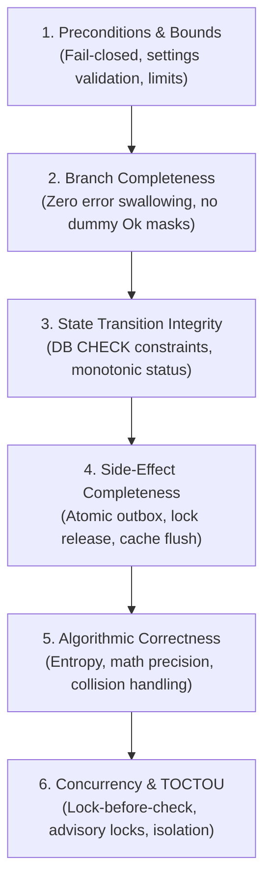

# RusToK — Domain Logic, Invariant Integrity, and Anti-Slop Patterns

This standard catalogs patterns and anti-patterns for RusToK. The evidence
inventory below identifies confirmed cases. Other entries are review guidance
until an actual owner path and its behavior have been verified. Illustrative
snippets describe techniques and must be checked against the owner's contract.
Doctor findings are candidates whose impact and confidence are reported separately.

## Confirmed cases in RusToK

These entries identify historical defects and their owner-side fixes. They do
not claim that every caller or deployment has been verified. A source change
without evidence of a failure is recorded separately below.

| Pattern | Observed defect and fix | Evidence |
| --- | --- | --- |
| `P-WORKER-RETRY-TIMER-SHUTDOWN-RACE` | Separate retry waits treated timer readiness as permission to start again even if the shutdown watch had closed or the stop update had already been observed. Use the common retry wait with a precheck, biased stop branch and post-wake admission check; use the same closed-watch admission predicate at durable phase boundaries. Detect with `rg -n 'wait_for_worker_retry_or_stop|may_admit_next_worker_operation' apps/server/src/services`. Category: worker lifecycle; dimensions: concurrency and admission. Source regressions authored, unrun. | [Stop helper](../../apps/server/src/services/stop_handle.rs), [Product Index](../../apps/server/src/services/product_index_refresh_worker.rs), [Forum Search](../../apps/server/src/services/forum_search_contract_consumer.rs), [Social Graph](../../apps/server/src/services/social_graph_index_worker.rs) |
| `P-CSP-OPAQUE-SCHEME-TELEMETRY` | Opaque URL schemes were length-bounded but otherwise attacker-controlled, so their text could carry private identifiers into logs. Preserve known scheme labels and normalized origins; collapse unknown opaque schemes to a fixed marker. Detect with `rg -n sanitized_location apps/server/src/middleware/csp_reports.rs`. Category: telemetry privacy; dimensions: input normalization and redaction. Regression authored, unrun. | [Collector](../../apps/server/src/middleware/csp_reports.rs) |
| `P-ACCESS-TOKEN-POST-LOOKUP-EXPIRY` | The common credential extractor verified JWT expiry before asynchronous database/policy work but could return authority after that deadline; a JWT-only final recheck still missed the observed durable session and OAuth registration deadlines. Recheck the earliest signed/durable expiry at the final admission boundary for all principal kinds, including the session absolute cap; reject equality and later timestamps without cancelling already-admitted operations. Detect with `rg -n ensure_access_token_not_expired apps/server/src/extractors/auth`. Category: authentication; dimensions: temporal preconditions and admission. Regression authored, unrun. | [Extractor](../../apps/server/src/extractors/auth/mod.rs) |
| `P-CLOSED-STOP-WATCH-ADMISSION` | A shutdown receiver can retain `false` after its last sender disappears; checking only the borrowed value could admit new durable work even though the wait branch treats closure as shutdown. Use the shared admission helper to reject channel closure and explicit stop before new operations; do not cancel already-admitted work. Source regressions authored, unrun. | [Stop helper](../../apps/server/src/services/stop_handle.rs), [Marketplace recovery](../../apps/server/src/services/marketplace_financial_worker.rs) |
| `P-DUAL-TRANSPORT-REPORTING-AUTHORITY-DRIFT` | Native dashboard server functions extracted a session but did not check field permissions, while GraphQL required analytics or user-directory authority. An authenticated caller could reach tenant reporting SQL through the weaker native path. Check the same effective permission and tenant binding before native reads; redact database errors and keep GraphQL and native ordering consistent. Detect with `rg -n 'dashboard_stats_native|recent_activity_native|require_dashboard_permission' apps/admin/src/features/dashboard`. Category: authorization boundary; dimensions: preconditions, transport parity and failure behavior. Regressions authored, unrun. | [Native dashboard adapter](../../apps/admin/src/features/dashboard/transport/native_server_adapter.rs) |
| `P-GRAPHQL-DUPLICATE-PREFLIGHT-PERMISSION-DRIFT` | A second dashboard-only GraphQL extension required `analytics:read` for `recentActivity`, even though the canonical sensitive-field policy and resolver require `users:list`. Remove the duplicate extension and keep field-specific admission in `SensitiveGraphqlField::allows`; documents containing both fields require both permissions. Test isolated grants, implied manage permission, combined documents and fragments. Detect with `rg -n 'DashboardStats|RecentActivity|GraphqlDashboardSecurityPolicy' apps/server/src/graphql`. Category: authorization boundary; dimensions: policy parity and branch completeness. Regressions authored, unrun. | [GraphQL security policy](../../apps/server/src/graphql/security.rs) |
| `P-FLY-QUEUE-ADMISSION-TAIL-STRAND` | Browser queue replay assumed the dequeued request would reach transport finally. Admission rejection (for example a lowered pending limit) left the unsent tail unresolved. Discard and settle the tail when replay cannot acquire the authoritative guard; recheck disposal after synchronous response/network events before rebasing. Browser regressions must distinguish serialized writes from concurrent reads and suppress post-stop events. Detect with `rg -n queuedAuthoritativeIntents crates/ui/fly/browser/assets/fly-browser.js`. Category: browser lifecycle; dimensions: queue completeness and reentrancy. Regressions authored, unrun. | [Browser adapter](../../crates/ui/fly/browser/assets/fly-browser.js) |
| `P-FLY-RECOVERY-LINEAGE-CYCLE-MASK` | Selecting only the latest record per writer before validating supersession links hid cycles in older records whenever another writer still had a usable record. Validate the complete persisted graph before projection, including disconnected components and superseded history; fail closed and preserve all records on any cycle. Detect with `rg -n recovery_lineage_has_cycle crates/modules/rustok-page-builder/admin/src/ui/dioxus_recovery.rs`. Category: draft recovery integrity; dimensions: graph cycle detection, corruption handling and data preservation. Regression authored, unrun. | [Dioxus recovery](../../crates/modules/rustok-page-builder/admin/src/ui/dioxus_recovery.rs) |
| `P-FLY-SAVE-LIFECYCLE-PROJECTION-DRIFT` | Generic Page Builder dispatch accepted save lifecycle events that only mutated the UI projection, leaving the revision owner and request identity inconsistent. SaveStarted also bypassed the document diagnostic admission of RequestSave, and blank revision acknowledgements could clear dirty state. Route lifecycle transitions through correlated controller APIs, share UI admission, reject blank acknowledgements before mutation and retain dirty state when the working hash differs. Detect with `rg -n require_save_admission crates/ui/fly/ui/src/machine.rs` and inspect the controller dispatch. Category: save state integrity; dimensions: admission, state transitions and projection parity. Regressions authored, unrun. | [Controller](../../crates/modules/rustok-page-builder/admin/src/model.rs), [Fly UI](../../crates/ui/fly/ui/src/machine.rs) |
| `P-FLY-INEXACT-HISTORY-INVERSE` | An asset removal inverse appended a non-tail asset at the wrong position, and a reverse theme rename could rewrite references that predated the original rename. A decoded token inverse also lost raw theme representation. Use exact snapshot history whenever the local inverse cannot restore the original document; test the full document, not only selected fields. Detect with `rg -n invert_command crates/ui/fly/src/command`. Category: history integrity; dimensions: side effects and reversibility. Regressions authored, unrun. | [Fly editor](../../crates/ui/fly/src/command/editor.rs) |
| `P-FLY-CANONICAL-LOCALE-COLLISION` | Distinct JSON keys could normalize to the same Fly locale, selecting a value by map order and falsely satisfying required coverage. Reject duplicate canonical identities at authoring and validation, preserve unresolved imported maps, and prevent ambiguous routes from producing inbound or outbound destinations. Share `duplicate_locale_key(values)` and `has_unambiguous_locale(values, locale)` across runtime, coverage and routing. Detect with `rg -n duplicate_locale_key crates/ui/fly/src`. Category: localization integrity; dimensions: identity, branch completeness and projection parity. Regressions authored, unrun. | [Fly locale runtime](../../crates/ui/fly/src/runtime_locale.rs) |
| `P-FLY-TRANSLATION-IDENTITY-SHAPE-DRIFT` | Fly validated trimmed translation IDs but wrote raw IDs and trimmed removal targets, making imported identities unaddressable and potentially deleting a different entry. It also interpreted a non-array catalog as empty on mutation. Validate the stored identity exactly (`valid_translation_id(entry.id.as_str())`), remove by exact identity, and reject malformed catalog shape before writing while preserving opaque array entries. Detect `rg -n 'invalid_catalog_shape\|validate_translation_identity\|retain\(' crates/ui/fly/src/translation.rs`. Category: document integrity; dimensions: identity, preconditions and side effects. Regressions authored, unrun. | [Fly catalog](../../crates/ui/fly/src/translation.rs) |
| `P-REGISTRY-SESSION-SENTINEL-DRIFT` | Registry request paths inferred session-backed identity by excluding only OAuth clients with nil sessions. Reuse the canonical direct grant classifier and reject nil actor/tenant identities before producing authority; share admission across controller and publication/artifact/owner-transfer middleware. Detect `rg -n 'is_registry_session|from_session' apps/server/src/services/registry_principal.rs apps/server/src/middleware/registry_* apps/server/src/controllers/marketplace_registry.rs`. Category: authorization boundary; dimension: principal classification. Source regressions unrun. | [Registry principal](../../apps/server/src/services/registry_principal.rs), [Registry V2 ADR](../../DECISIONS/2026-04-19-registry-v2-clean-contract-without-runtime-compat.md) |
| `P-REGISTRY-PRINCIPAL-SHAPE-DRIFT` | Registry owner transfer accepted `Uuid::nil()` because `is_user()` checked only the principal kind and presence of an optional UUID; persisted principal projection also converted malformed/legacy values to `legacy:unknown`, contrary to the V2 no-runtime-compatibility ADR, while public authority constructors/fields bypassed direct-session admission. Reject nil target IDs, validate canonical principal fields on construction/deserialization, propagate malformed projections as invalid contracts, and seal authority construction behind the direct-session gate. Detect `rg -n 'RegistryPrincipalRef::user|from_json_value|from_auth_context|pub struct RegistryAuthority' apps/server/src`. Category: principal integrity; dimensions: preconditions, authorization and anti-swallowing. Source regressions unrun. | [Registry principal](../../apps/server/src/services/registry_principal.rs), [Marketplace adapter](../../apps/server/src/services/marketplace_catalog_adapter.rs), [Registry V2 ADR](../../DECISIONS/2026-04-19-registry-v2-clean-contract-without-runtime-compat.md) |
| `P-BOOTSTRAP-IDENTITY-CONFLICT-DRIFT` | Default SuperAdmin bootstrap looked up an email before canonical normalization and treated a typed duplicate-email creation result as startup failure. Normalize before side effects; reconcile only the duplicate result against the exact tenant/email outside the failed transaction, with no mutation of the existing identity. Detect `rg -n 'normalize_email|EmailAlreadyExists' apps/server/src/initializers/superadmin.rs`. Category: identity bootstrap; dimensions: normalization and conflict recovery. Source regressions unrun. | [SuperAdmin initializer](../../apps/server/src/initializers/superadmin.rs), [Auth lifecycle](../../apps/server/src/services/auth_lifecycle.rs) |
| `P-CONNECTOR-PREFLIGHT-DRIFT` | Host external Iggy configuration validation accepted values the SDK connection builder rejected and returned unnormalized deployment endpoints. Reuse connector-owned structural validation after resolving secrets; share stored resolution between startup and readiness and return normalized endpoints without reordering failover priority. Detect `rg -n 'validate_connection_settings|resolved_deployment_config' apps/server/src/services/iggy_connector_settings_service.rs crates/modules/rustok-iggy-connector/src/lib.rs`. Category: configuration boundary; dimensions: authority and validation parity. Source regressions unrun. | [Server settings](../../apps/server/src/services/iggy_connector_settings_service.rs), [Connector](../../crates/modules/rustok-iggy-connector/src/lib.rs) |
| `P-QUEUED-STARTUP-SHUTDOWN` | Server context, application router, direct worker, module-work and Workflow cron startup could remain blocked behind a startup mutex after the terminal stop signal; Workflow cron also awaited read-only schema validation without listening for stop. Race unpublished mutex acquisition and read-only preparation against the runtime-owned stop watch using `await_worker_startup_or_stop`; preserve the existing result contract and shutdown drain for published handles. Recheck stop after cancellable child starters before beginning durable provisioning or returning a ready router. Detect `initialization.lock().await` and `initialization.0.lock().await` in startup entrypoints and inspect stop-check ordering. Category: background-worker lifecycle; dimensions: cancellation and admission. Source regressions unrun. | [Bootstrap](../../apps/server/src/services/server_bootstrap.rs), [Worker startup](../../apps/server/src/services/app_lifecycle.rs), [Scheduler](../../apps/server/src/services/app_runtime.rs), [Stop helper](../../apps/server/src/services/stop_handle.rs) |
| `P-WORKER-OBSERVABILITY-INVENTORY-DRIFT` | Readiness and metrics independently derived Outbox and remote-executor worker requirements, while lifecycle tests referred to a missing complete inventory or searched the additional-only list. Compose one runtime snapshot with host-mode-aware requirements and consume it from both surfaces; keep cache reconciliation requirements independent of general background-worker admission. Detect `rg -n 'runtime_worker_snapshots\|relay_required\|retention_required' apps/server/src`. Category: runtime observability; dimensions: branch completeness and projection parity. Source regressions unrun. | [Lifecycle](../../apps/server/src/services/app_lifecycle.rs), [Readiness](../../apps/server/src/controllers/health.rs), [Metrics](../../apps/server/src/controllers/metrics.rs) |
| `P-CACHE-INVALIDATION-RESUBSCRIBE-GAP` | Flex's broadcast invalidation supervisor restarted with a fresh receiver but retained cached schemas and fill tokens from the disconnected interval. Clear on consumer/factory failure, then subscribe before clearing again on retry or retained task replacement. Keep the durable generation reconciler and TTL for recovery during the gap. Detect `rg -n -e supervise_field_definition_cache_invalidation -e bus.subscribe apps/server/src/services/field_definition_cache_base.rs`. Regressions authored, unrun. | [Flex cache listener](../../apps/server/src/services/field_definition_cache_base.rs) |
| `P-CACHE-RECONCILIATION-RESTART-WATERMARK` | Flex generation polling rejected a lower durable generation but its supervisor immediately accepted that same lower value when reseeding. Preserve the last applied runtime watermark across retries and retained task replacement; withdraw health and clear cache before backoff on any unexpected exit or panic. Generation zero remains valid at initial startup. Category: worker lifecycle and cache consistency; dimensions: monotonicity, readiness and recovery. Regressions authored, unrun. | [Reconciler](../../apps/server/src/services/field_definition_cache_reconciliation.rs), [Regression](../../apps/server/src/services/field_definition_cache_reconciliation_tests.rs) |
| `P-WORKER-GROUP-SERIAL-ABORT` | On a group drain timeout, the host aborted and joined the first pending task before aborting its peers, allowing dependent cleanup to stall cancellation of the rest of the group. Broadcast abort to all remaining handles before joining any of them; preserve cancellation guards and ordered producer stages. Detect `rg -n 'await_runtime_worker_shutdown_tasks_with_timeout' apps/server/src/services/app_lifecycle.rs`. Category: worker lifecycle; dimension: cancellation ordering. Source regression unrun. | [Worker drain](../../apps/server/src/services/app_lifecycle.rs) |
| `P-UNBOUNDED-POST-ABORT-JOIN` | Runtime worker shutdown helpers timed the graceful drain but awaited `JoinHandle` indefinitely after `abort()`. Tokio abort is cooperative and an unresponsive task can keep the host shutdown future pending forever. Abort every group member first, then join under a separate bounded grace; release handles still pending after the grace and report that cleanup is not guaranteed. Detect `rg -n 'task\.abort\(\);|handle_mut\(\)\.await' apps/server/src/services/app_lifecycle.rs`. Category: async liveness; dimensions: cancellation and bounded waiting. Source regression unrun. | [Worker lifecycle](../../apps/server/src/services/app_lifecycle.rs), [Server lifecycle contract](../../apps/server/docs/README.md) |
| `P-FORWARDED-AMBIGUOUS-PARAMETER` | RFC Forwarded selected the first matching parameter and split quoted extension values at delimiters, allowing malformed or ambiguous authority facts. Split the trusted suffix with quote awareness, reject duplicate names and distinguish absent from malformed selectors; reject duplicate direct Host fields in the common resolver. Detect `rg -n 'parse_forwarded_pair|extract_effective_host' apps/server/src/common/request_trust.rs`. Category: HTTP trust boundary; dimensions: authority and branch completeness. Source regressions unrun. | [Request trust](../../apps/server/src/common/request_trust.rs), [Host contract](../../apps/server/README.md) |
| `P-REDIS-REPLY-DIAGNOSTIC-BOUNDARY` | Rate-limit Redis errors included arbitrary backend reply text in the reason propagated to module GraphQL logs. Keep only fixed operation labels and timeout duration; reject unexpected PING without interpolating its response. Detect `rg -n 'redis_with_timeout|unexpected redis rate-limit ping' apps/server/src/middleware/rate_limit_base.rs`. Category: diagnostic safety; dimension: failure branch completeness. Source regression authored, unrun. | [Rate limiter](../../apps/server/src/middleware/rate_limit_base.rs) |
| `P-REDIS-INITIALIZER-QUEUE-DEADLINE` | Rate-limit Redis initialization timed only the initializer closure, leaving queued callers outside their deadline. Apply the deadline to the entire shared OnceCell acquisition; leave failed initialization retryable. Detect `rg -n 'get_or_try_init|redis_with_timeout' apps/server/src/middleware/rate_limit_base.rs` and inspect timeout nesting. Category: async liveness; dimension: order of operations. Source regression unrun. | [Rate limiter](../../apps/server/src/middleware/rate_limit_base.rs) |
| `P-REDIS-EXPIRY-AFTER-FALLIBLE-COMMAND` | Persistent restored rate-limit counters could fail GET or INCR before their TTL was repaired. Repair missing expiry before fallible access, keep existing expiry, and fail closed for corrupt counters. Redis script errors do not roll back prior writes. Detect `rg -n 'PTTL|PEXPIRE|INCR' apps/server/src/middleware/rate_limit_base.rs` and check command order. Category: failure recovery; dimensions: branch completeness and side effects. Real Redis regression unrun. | [Rate limiter](../../apps/server/src/middleware/rate_limit_base.rs) |
| `P-READINESS-RESPONSE-CONTRADICTION` | HTTP readiness normalization could promote a failed HTTP response to success from its JSON status, and public redaction retained metadata for a privileged body. Reject contradictory/unknown readiness states, construct a new aggregate representation and enforce no-store at the shared outer edge. Detect with `rg -n 'normalize_readiness_response|is_observability_auth_path' apps/server/src/middleware`. Category: HTTP security and operational correctness; dimensions: branch completeness and preconditions. Source regressions unrun. | [Readiness gate](../../apps/server/src/middleware/metrics_auth.rs), [HTTP edge](../../apps/server/src/middleware/security_headers.rs) |
| `P-GLOBAL-SETTINGS-FIRST-WRITE-RACE` | Global event profile and Iggy settings selected a singleton before deciding between insert and update; concurrent first saves could hit a duplicate primary key. Use a database upsert on the singleton key, replacing mutable configuration and actor together and preserving creation time. Detect read-before-insert branches on singleton settings. Category: concurrency; dimensions: order of operations and side effects. Source regression unrun. | [Event settings](../../apps/server/src/services/event_delivery_settings_service.rs), [Iggy settings](../../apps/server/src/services/iggy_connector_settings_service.rs) |
| `P-BARE-ENDPOINT-URL-DRIFT` | Iggy endpoint admission parsed a synthetic URL without excluding query/fragment components or zero ports; errors echoed rejected input that might include credentials. Enforce bare host:port, validate nonzero ports and redact invalid input. Detect URL-based host:port validators that omit component checks. Category: input validation and diagnostic safety; dimensions: preconditions and branch completeness. Source regressions unrun. | [Iggy settings](../../apps/server/src/services/iggy_connector_settings_service.rs) |
| `P-PRICE-CALCULATE-BEFORE-LOCK` | Pricing discount apply calculated an unlocked preview, then opened a separate write transaction; intervening Product/Pricing changes could be overwritten. Calculate from the canonical row under the Variant and selected price-list locks and commit the result, event and Product predecessor together. Detect by inspecting `apply_percentage_discount` and `apply_price_list_percentage_discount` for preview calls preceding transaction admission. Category: concurrency and monetary integrity; dimensions: preconditions, calculation, side effects. Regressions authored, unrun. | [Pricing commands](../../crates/modules/rustok-pricing/src/services/pricing/commands.rs), [Pricing queries](../../crates/modules/rustok-pricing/src/services/pricing/queries.rs) |
| `P-CROSS-OWNER-PREDECESSOR-DRIFT` | Direct Pricing base-price writes locked Product Variant without advancing its optimistic predecessor. A stale catalog replacement could overwrite the newer price. Advance the owner clock and exact Index refresh ledger in the same transaction as the dependent write and its existing event. Detect by comparing `rg 'load_variant_for_update_in_tx' crates/modules/rustok-pricing/src/services` against Product predecessor checks and response fields. Category: cross-owner concurrency; dimensions: state, preconditions, atomic side effects. Source regression unrun. | [Pricing](../../crates/modules/rustok-pricing/src/services/pricing/commands.rs), [Product owner](../../crates/modules/rustok-product/src/services/catalog_references.rs) |
| `P-AUTHORED-MONEY-QUOTE-PARITY` | Product initial/replacement price admission and Pricing single/batch writes accepted excess currency precision while quote resolution refused it. Validate authored base and compare-at amounts using `rustok_core::money::to_minor_units_exact(amount, currency)` before mutation; only computed discounts round. Detect missing admission with `rg 'validate_price_precision\|to_minor_units_exact' crates/modules/rustok-{product,pricing}/src/services` and compare write paths against the resolver. Category: monetary integrity; dimensions: preconditions, calculation and transactional side effects. Source regressions unrun. | [Product admission](../../crates/modules/rustok-product/src/services/catalog/commands.rs), [Pricing bootstrap](../../crates/modules/rustok-pricing/src/services/bootstrap.rs), [Pricing commands](../../crates/modules/rustok-pricing/src/services/pricing/commands.rs) |
| `P-WORKER-OFFSET-DRIFT` | Artifact delivery tenant discovery used offset pagination with a separately sampled total; deleting earlier rows could skip a later active tenant. Use the owner's bounded active-ID query ordered by unique immutable ID with an exclusive cursor and stop on an empty page. Recheck eligibility at effect boundaries; live enumeration is not snapshot isolation. Detect `list_tenants(page` in durable worker enumeration and inspect offset/count dependence. Category: durable worker enumeration; dimensions: concurrency and branch completeness. Owner and host regressions authored, unrun. | [Server adapter](../../apps/server/src/services/artifact_delivery_tenants.rs), [Tenant owner](../../crates/modules/rustok-tenant/src/services/tenant_service.rs) |
| `P-ARTIFACT-GC-TENANT-STARVATION` | A bounded tenant-GC inventory repeatedly selected the first 256 UUIDs. A tenant with a persistent retention hold or more than one per-tenant batch of candidates remained in every page, starving tenants with later IDs. Use an owner-side exclusive UUID keyset cursor retained across passes; preserve it on discovery/snapshot failure, advance after a completed page even if an individual tenant fails, and wrap after a short/empty page. The cursor is process-local; durable candidate rows recover after restart. Owner and host regressions authored, unrun. | [Owner inventory](../../crates/modules/rustok-modules/src/data/gc.rs), [Maintenance worker](../../apps/server/src/services/module_artifact_maintenance.rs) |
| `P-ADMISSION-REVERIFICATION-STARVATION` | Admission reverification scanned at most 8,192 installation rows and returned the first 32 stale candidates on every pass. Persistent verifier errors left those rows stale, while a fresh prefix beyond the scan cap could never be reached. Return the last installation ID examined (not just the last stale candidate), retain that exclusive cursor across passes, advance after a successful scan even when a candidate fails, preserve it on scan error, and wrap when exhausted. The cursor is process-local; durable admission evidence remains authoritative after restart. Owner and host regressions authored, unrun. | [Admission owner](../../crates/modules/rustok-modules/src/installation.rs), [Maintenance worker](../../apps/server/src/services/module_artifact_maintenance.rs) |
| `P-NOTIFICATION-INTAKE-RETRY-PREFIX` | Notifications intake repeatedly selected the oldest bounded page; a full page of retryable errors left all later committed events unreachable. Advance an exclusive chronological owner-provided keyset cursor on successful selection, retain it on query failure, wrap at exhaustion, and leave retryable rows unacknowledged. Store the exact SQLite ordering value rather than reformatting it. Detect with `rg -n pending_outbox_page_after apps/server/src/services/notification_outbox_intake_worker.rs`. Category: queue liveness; dimensions: fairness and retry completeness. Source regression authored, unrun. | [Host worker](../../apps/server/src/services/notification_outbox_intake_worker.rs), [Notifications owner](../../crates/modules/rustok-notifications/src/outbox_intake.rs) |
| `P-REMOTE-REAPER-STOP-ADMISSION` | The remote validation reaper performed an unbounded sequence of independent per-claim transactions but only observed stop between whole sweeps, so a large expired-lease backlog could keep shutdown waiting until forced abort. Race the DB-only pass against the stop watch; committed per-claim transactions remain durable and the current uncommitted transaction is dropped, leaving remaining expired leases for rediscovery. Add a test proving stop cancels an in-flight pass and completed passes still return their result. Category: background-worker lifecycle; dimension: shutdown admission. Host regression authored, unrun. | [Server reaper](../../apps/server/src/services/app_lifecycle.rs), [Remote lease owner](../../crates/modules/rustok-modules/src/governance/remote_runners.rs) |
| `P-FORWARDED-SUFFIX-DECODE` | Host and scheme resolution decoded entire forwarding fields before choosing the authoritative proxy-appended suffix, so opaque bytes in an earlier caller-controlled value invalidated otherwise correct routing and HTTPS facts. Select the rightmost byte segment first, then require ASCII and decode only that segment; retain explicit-header precedence and peer trust. Detect with `rg 'last_forwarded_header_value' apps/server/src/common/request_trust.rs` and check that byte segmentation precedes decoding. Category: HTTP trust boundary; dimensions: preconditions and branch completeness. Source regressions authored, unrun. | [Request trust](../../apps/server/src/common/request_trust.rs), [Host contract](../../apps/server/README.md) |
| `P-CSP-ROUTE-FAMILY-DRIFT` | Prefix-only route classification assigned UI nonce policy to registry mutations and OAuth discovery while denying nonce-backed UI pages with similar names. Match reserved roots at segment boundaries; verify classification with a real nonce rather than the missing-nonce fallback, and assert middleware extension/header behavior. Detect with `rg -n 'is_api_surface|api_and_operator_paths_use_strict_csp' apps/server/src/middleware/security_headers.rs`. Category: HTTP security policy; dimensions: preconditions and branch completeness. Regressions authored, unrun. | [Security headers](../../apps/server/src/middleware/security_headers.rs), [CSP contract](../security/csp-report-only-inventory.md) |
| `P-HTTP-IDEMPOTENCY-HEADER-REPAIR` | Registry and artifact HTTP independently stripped arbitrary leading/trailing quotes before UUID parsing, accepting malformed wire keys as valid durable receipt identities. Use one parser for single optional non-nil UUID headers, allowing bare or exactly paired quotes; require presence only at the registry boundary. Reject duplicates even when equal. Detect with `rg -n 'optional_uuid_header|trim_matches' apps/server/src/controllers`. Category: transport admission; dimensions: identity and preconditions. Regressions authored, unrun. | [Shared parser](../../apps/server/src/common/idempotency.rs), [Registry](../../apps/server/src/controllers/marketplace_registry.rs), [Artifact HTTP](../../apps/server/src/controllers/artifact_http.rs) |
| `P-HTTP-SINGLETON-HEADER-AMBIGUITY` | The CSP collector selected the first Content-Type field, silently accepting conflicting or repeated singleton metadata. At a singleton header boundary, inspect all values and reject duplicates (even equal values) before decoding or performing effects; preserve the endpoint-specific policy for an absent field. Apply the same rule used by UUID idempotency and observability credential parsers, including the cookie-session refresh/logout marker. Detect with `rg -n 'CONTENT_TYPE|SESSION_REQUEST_HEADER' apps/server/src`. Category: transport admission; dimensions: input validation and branch completeness. Source regressions authored, unrun. | [CSP collector](../../apps/server/src/middleware/csp_reports.rs), [Idempotency parser](../../apps/server/src/common/idempotency.rs), [Observability auth](../../apps/server/src/middleware/metrics_auth.rs), [Session marker](../../apps/server/src/controllers/auth.rs) |
| `P-PROTOCOL-CREDENTIAL-ROUTE-DRIFT` | User JWT middleware attempted to decode opaque MCP runtime Bearer credentials before their owner could authenticate them; raw UUID parsing in the MCP management preflight also missed percent-encoded path parameters accepted by the router. Delegate only the exact remote protocol POST routes to owner credential resolution, preserving host authority and tenant routing; match dynamic route shape before typed extraction. Reject duplicate and mixed credential transports rather than choosing a hidden precedence. Detect with `rg -n is_remote_mcp_auth_request apps/server/src` and compare router/middleware path classifiers. Category: authentication and transport admission; dimensions: identity and branch completeness. Source regressions authored, unrun. | [Auth middleware](../../apps/server/src/middleware/auth_context.rs), [MCP preflight](../../apps/server/src/middleware/mcp_scaffold_workspace.rs), [MCP controller](../../apps/server/src/controllers/mcp.rs) |
| `P-HTTP-NOT-FOUND-DIAGNOSTIC-REFLECTION` | Host HTTP error conversion exposed the internal SeaORM RecordNotFound message on both direct and core-wrapped paths. Preserve the 404 category and stable machine code, but emit fixed public text instead of database diagnostics. Detect with `rg -n RecordNotFound apps/server/src/error.rs`. Category: transport confidentiality; dimensions: branch completeness and redaction. Regressions authored, unrun. | [Server error boundary](../../apps/server/src/error.rs) |
| `P-CSP-REPORT-SHAPE-ADMISSION` | Serde struct decoding alone accepted positional sequences and directive-free objects as CSP violations; prefix matching misclassified unrelated directive names. Require an object and a nonblank selected directive before recording telemetry; classify only exact known directive tokens (ignoring legacy source lists) while retaining unknown names as the fixed other label. Detect `rg -n 'parse_violation|selected_directive|normalized_directive' apps/server/src/middleware/csp_reports.rs`. Category: input validation and telemetry integrity; dimensions: preconditions and branch completeness. Source regressions authored, unrun. | [Collector](../../apps/server/src/middleware/csp_reports.rs), [Contract](../security/csp-report-only-inventory.md) |
| `P-CSP-DISTINCT-WIRE-FIELDS` | Legacy CSP reports can contain both effective and violated directives; treating them as aliases of one Serde field rejected valid reports. Decode independently, prefer the nonblank effective value, and normalize the selected value. Bound the final logged location, including opaque URL schemes. Parser and HTTP regressions authored, unrun. | [Collector](../../apps/server/src/middleware/csp_reports.rs), [Contract](../security/csp-report-only-inventory.md) |
| `P-AUTH-JWT-ALGORITHM-PIN` | Repository JWTs are RS256-only: reject every other JOSE algorithm before exact kid lookup, prepare only RSA keys and keep purpose/modulus identity isolated across generations. No algorithm selector, HMAC JWT derivation or symmetric verifier may remain. The durable marker is a fixed RS256 assertion only; reject HS256 snapshots. Source regressions authored, unrun. | [JWT](../../crates/modules/rustok-auth/src/jwt.rs), [Keyring](../../crates/modules/rustok-auth/src/jwt_keyring.rs), [Fence](../../crates/modules/rustok-auth/src/jwt_fence.rs) |
| `P-AUTH-JWT-AUTHORITY-CAS` | Bind independent JWT identity to every authority read and mutation, not only the pre-CAS read; verify caller root even for generation zero. Static grants cannot overlap different snapshots; observed expiry is terminal for that lease. Source regressions unrun. | [JWT fence](../../crates/modules/rustok-auth/src/jwt_fence.rs), [Authority](../../crates/modules/rustok-auth/src/jwt_fence/authority.rs), [Clock guard](../../crates/modules/rustok-auth/src/jwt_clock.rs) |
| `P-AUTH-HOST-MAC-KEY-SEPARATION` | Host CSRF used a local HMAC implementation with the root secret, and reset binding used an ad hoc secret-prefixed hash. Derive purpose-separated keys with HKDF-SHA256 and use library HMAC-SHA256; version formats and reject old proofs. Source regressions unrun. | [Auth MAC primitives](../../crates/modules/rustok-auth/src/crypto.rs) |
| `P-AUTH-JWT-CSRF-KEY-TIME-BOUNDARY` | Browser confirmation was not session-bound; JWT time conversion could panic on i64-representable oversized TTLs. Bind the MAC to the session, validate the independent host MAC root regardless of RSA JWT material, validate JWT time claims and use checked duration construction. Source regressions unrun. | [OAuth controller](../../apps/server/src/controllers/oauth.rs), [JWT primitives](../../crates/modules/rustok-auth/src/jwt.rs) |
| `P-AUTH-OAUTH-REVOCATION-CLIENT-FENCE` | RFC 7009 verified client credentials before acquiring the app lock but did not revalidate them after concurrent changes. Compare the authenticated snapshot against the locked client before touching token state. Source regression unrun. | [OAuth app service](../../apps/server/src/services/oauth_app.rs) |
| `P-AUTH-OAUTH-AUTHORIZATION-SESSION` | Browser approval persisted consent separately from code issuance, and issuance did not recheck the authorizing direct session. Lock app, subject and session, revalidate the principal, and commit approval with code persistence. Source regressions unrun. | [OAuth authorization service](../../apps/server/src/services/oauth_app.rs) |
| `P-AUTH-OAUTH-REFRESH-ROOT-INTEGRITY` | A referenced refresh row was treated as a family root based on its client, tenant and subject alone, allowing a corrupted descendant or newer row to redefine the absolute lifetime cap. Require non-nil lineage identity, a true self/legacy root, the original authorization-code identity and nondecreasing lineage creation time; reject future root creation and the exact absolute deadline before consumption. Use the same resolver in preflight and locked rotation. Source regressions unrun. | [Token exchange](../../apps/server/src/services/oauth_token_service.rs) |
| `P-AUTH-OAUTH-ISSUANCE-FENCE` | Consent re-grant changed the epoch without invalidating pending authorization codes, and code exchange could persist a refresh token prepared before the app removed its refresh grant. Invalidate scoped pending codes on re-grant and recheck the code epoch and refresh grant under the issuance fence. Source regressions unrun. | [Consent service](../../apps/server/src/services/oauth_app.rs), [Token exchange](../../apps/server/src/services/oauth_token_service.rs) |
| `P-AUTH-SESSION-MUTATION-FENCE` | Direct refresh locked the session but read subject state without the shared mutation fence; bulk revocation did not serialize with login or recheck its authorizing session. Use user-before-session locking, revalidate the digest and current session, and reserve SQLite's writer before history-only reads. Source regressions unrun. | [Auth lifecycle](../../apps/server/src/services/auth_lifecycle.rs) |
| `P-AUTH-REFRESH-RETRY-PROOF` | A committed refresh response could be lost while digest-only history prevented recovery. Do not return a successor to a historical bearer alone; bind the deterministic opaque successor to an independent CSPRNG operation key and exact tenant/session, verify its current digest and history under user/session locks, and preserve the committed deadline on retry. Reject prior candidate digests and distinguish conflict from authentication failure. Detect with `rg -n 'RefreshAlreadyRotated|detect_refresh_reuse_in_tx' apps/server/src/services`. Category: authentication; dimensions: idempotency, state, concurrency. Client integration and runtime evidence pending. | [Auth lifecycle](../../apps/server/src/services/auth_lifecycle.rs), [ADR](../../DECISIONS/2026-11-26-session-refresh-retry-proof.md) |
| `P-AUTH-BFF-REFRESH-PROOF-LOSS` | A process-local refresh promise map could not recover after replica or response loss. Retain an independent CSPRNG seed alongside the refresh credential in one HttpOnly envelope, derive a purpose-separated generation-bound proof, and retry only ambiguous refresh outcomes with identical inputs. Refuse redirects and duplicate cookie names before forwarding; do not clear cookies on unrelated upstream rejection or automatically replay the domain operation. Detect with `rg -n 'refreshRustokSession|rustokRefreshRetryKey' apps/next-admin/src`. Category: authentication; dimensions: idempotency, concurrency, transport. Source regressions authored, mounted verification pending. | [Next Admin BFF](../../apps/next-admin/src/shared/api/auth-server.ts), [Auth ADR](../../DECISIONS/2026-11-26-session-refresh-retry-proof.md) |
| `P-AUTH-SSR-DOUBLE-ROTATION` | Global SSR middleware could consume a refresh cookie before an explicit Auth server function and then append a stale Set-Cookie over login/logout. Exclude owner auth endpoints from the middleware exchange; preserve explicit handler cookie updates, use the same proof-bound native exchange and mark cookie-bearing responses noncacheable. Access JWT expiry schedules renewal rather than implicit revocation. Category: authentication; dimensions: transition ownership, ordering, expiry. Source regressions authored, runtime pending. | [Admin SSR](../../apps/admin/src/app/auth_ssr.rs), [Auth UI](../../crates/modules/rustok-auth/ui/README.md) |
| `P-AUTH-EXPECTED-SESSION-LINEAGE` | A stale cookie operation could resolve a different session before a client-side identity check, including a historical replay that revokes the wrong lineage. Pass a strict optional expected session ID, check credential ownership under tenant/user/session admission before rotation or reuse revocation, and verify current/previous/history digest ownership for expected logout under the row lock. Preserve cookies on mismatch; bind Next Auth.js and access projections to the same tenant/subject/session. The ID is comparison metadata, not authority. Source regressions authored; mounted verification and noncooperating delivery remain open. Category: authentication; dimensions: identity, transaction admission, failure behavior. | [Lifecycle](../../apps/server/src/services/auth_lifecycle.rs), [Recovery ADR](../../DECISIONS/2026-11-26-session-refresh-retry-proof.md) |
| `P-AUTH-STALE-BROWSER-PROJECTION` | Serializing only network calls allowed a queued intent or a stale memory projection to cross a cookie identity transition. Hold the shared browser lock through admission and publication, compare the captured start/end epoch before dispatch, invalidate foreign provider projections and publish one epoch-tagged verified memory pair. Require that pair for authenticated native calls; reject refresh subject/tenant/lineage replacement. Source regressions authored; mounted browser and noncooperating server-side admission remain open. Category: authentication; dimensions: identity, concurrency, projections. | [Auth provider](../../crates/modules/rustok-auth/ui/src/ui/leptos/context.rs), [Browser epoch](../../crates/modules/rustok-auth/ui/src/transport/browser_epoch.rs) |
| `P-AUTH-DIRECT-COOKIE-RETRY-COORDINATION` | A JS-inaccessible bearer could not retain a per-generation proof, and independent browser tabs could race login/logout/refresh. Let the cookie endpoint issue one token/seed envelope and derive the proof under its independent seed; relay the same envelope through the Next BFF, reject explicit cookie proof headers and malformed credentials, and use a secure-context origin-wide Web Lock through response parsing and bounded refresh retry. Refuse browser Fetch redirects. This coordinates cooperating network requests, not stale provider identities or noncooperating cookie delivery. Category: authentication; dimensions: retry, concurrency, transport admission. Source regressions authored, mounted verification pending. | [Auth cookie owner](../../crates/modules/rustok-auth/src/crypto.rs), [CSR lock](../../crates/modules/rustok-auth/ui/src/transport/browser_lock.rs) |
| `P-AUTH-ROTATION-HISTORY-LOSS` | Direct sessions overwrote the prior refresh digest at every rotation, losing theft evidence for older generations. Record each outgoing digest transactionally in session-owned history, backfill available evidence, and revoke under the session lock on post-grace replay. Source regressions unrun. | [Auth lifecycle](../../apps/server/src/services/auth_lifecycle.rs), [ADR](../../DECISIONS/2026-11-25-session-refresh-history.md) |
| `P-AUTH-SHARED-THROTTLE-KEY` | REST and GraphQL shared an Auth limiter but used incompatible counter keys, and GraphQL password changes were not charged. The Auth namespace now uses the same IP-only key across transports, with password changes and logout included; general API and OAuth dimensions are preserved. Source regressions unrun. | [Host middleware](../../apps/server/src/middleware/rate_limit_base.rs), [Auth GraphQL policy](../../crates/modules/rustok-auth/src/graphql/rate_limit.rs) |
| `P-AUTH-RECOVERY-MAILBOX-FENCE` | Password recovery REST and GraphQL independently prepared email and disagreed on account-dependent signing failures; the confirmation CAS omitted the observed email. One lifecycle request path preserves generic responses, and the confirmation write checks the exact mailbox alongside credential and active status. Regression authored, unrun. | [Recovery service](../../apps/server/src/services/auth_password_reset.rs) |
| `P-AUTH-RECOVERY-POST-LOCK-EXPIRY` | Password-reset and email-verification wrappers discarded authenticated expiry; hashing, database reads and user mutation lock waits could carry a formerly valid token beyond its deadline. Preserve the signed expiry, acquire the existing tenant-scoped mutation fence, and reject expiry at the admission instant before account changes. Email-change confirmation must check expiry after the final mailbox lookup, not before it. Detect with `rg -n lock_user_for_recovery apps/server/src/services`. Category: authentication; dimensions: temporal preconditions and admission. Source regression authored, unrun. | [Auth adapter](../../apps/server/src/auth.rs), [Lifecycle fence](../../apps/server/src/services/auth_lifecycle.rs), [Recovery](../../apps/server/src/services/auth_password_reset.rs), [Verification](../../apps/server/src/services/auth_email_verification.rs), [Email change](../../apps/server/src/services/auth_email_change.rs) |
| `P-AUTH-GRAPHQL-RESPONSE-KEY-ACCOUNTING` | Auth credential throttling counted mutation names once per document, undercharging distinct aliases, and recursively expanded unvalidated fragment graphs. Classify the selected operation by distinct response keys and traverse named fragments once with an explicit worklist. Focused regressions authored, unrun. | [Auth rate-limit policy](../../crates/modules/rustok-auth/src/graphql/rate_limit.rs) |
| `P-FLY-CROSS-DOCUMENT-INTENT` | Browser intents accepted an optional page ID without comparing it to the controller's owning document; a stale/wrong document could pass revision validation. The dispatcher now rejects explicit page scope mismatches before applying any selection or command, and Leptos checks response scope before facade execution. | [Browser dispatcher](../../crates/modules/rustok-page-builder/admin/src/browser_intent.rs), [Leptos runtime](../../crates/modules/rustok-page-builder/admin/src/editor/runtime.rs) |
| `P-FLY-PARTIAL-INTENT` | Page Builder's browser dispatcher applied `selected_component_id` to editor selection before resolving the requested operation. If a later step failed (unknown palette block, duplicate paste, page navigation), it returned an error while retaining the earlier state mutation. The browser-intent boundary now snapshots and rolls back the composed gesture on failure; focused tests authored, unrun. | [Browser dispatcher](../../crates/modules/rustok-page-builder/admin/src/browser_intent.rs) |
| `P-FLY-MIGRATION-PAYLOAD-VALIDATION` | Runtime-context migration reported acceptance for missing required values, mismatched types and failed computed producers; disabling materialization bypassed field validation entirely. Reuse strict preflight severity policy and validate actual fields even in no-materialization mode; compatibility tolerance must not waive payload validity. Owner and adapter regressions authored, unrun. | [Context migration](../../crates/ui/fly/src/context_migration.rs), [Page Builder adapter](../../crates/modules/rustok-page-builder/src/runtime_context_migration.rs) |
| `P-FLY-ACTION-RUNTIME-BOUNDARY` | Accordion target lookup could enter a nested accordion or hide the trigger's own ancestor; slider selection treated earlier visible slides as active and accepted malformed selector combinations; animation lookup accepted inherited object properties; swipe state was global and did not correlate touch identity. Enforce the nearest group, prefer the active marker, validate exactly one selector, check own animation keys, and scope gesture state to the document and touch identifier. Node and browser regressions authored, unrun. | [Published action runtime](../../crates/ui/fly/browser/assets/fly-actions.js) |
| `P-FLY-STRICT-DRAFT-GENERATION` | The strict SSR host commits draft context and advances generation even for view-state intents. Treat all strict draft transport requests as serialized receipt-bearing operations except pure receipt lookup, with identical admission before DOM dispatch and POST; never treat a successful HTTP response without the matching committed receipt as current or adopt its state/navigation, require an explicit matching page ID at the server boundary and in the receipt, and require operation IDs plus token/generation for every editable request even if the client omits the strict marker; never resolve across draft namespaces or lose parked conflict revision metadata. Also treat an explicit rendered-binding marker as authoritative even when no session exists, so a read-only Pages view cannot fall back to a stale browser-stored draft token. Source regressions authored, unrun. | [Browser adapter](../../crates/ui/fly/browser/assets/fly-browser.js), [Pages owner dispatch](../../crates/modules/rustok-pages/admin/src/browser_intent.rs) |
| `P-FLY-RECEIPT-RECOVERY-FENCE` | Classic SSR recovery allowed overlapping receipt lookups and retries, trusted a request receipt without checking the active pending envelope, and suppressed peer notifications for persisted writes requiring reload. Serialize recovery, correlate receipts with the exact pending envelope, draft namespace and advancing generation, reject competing writes to a shared recovery slot and clear it only if the original envelope still owns it; preserve peer fences and notify only for clean confirmed revision advances. Server replay must load the draft after observing the committed receipt, not reuse a snapshot taken before receipt lookup. Preflight receipt generation and capacity before external effects while retaining the final atomic CAS; preflight is not a cross-store reservation. Strict saves now persist the prepared working copy and reserve its generation before external I/O; only the matching operation can complete the receipt, and unknown outcomes retain preparation. Durable session reads must use the authoritative backend snapshot; stage candidates privately until CAS succeeds, and never evict unrelated cache entries on replacement. Capacity eviction must not discard a live prepared checkpoint; choose ordinary sessions or fail closed when none can be evicted. Source regressions authored, unrun. | [Browser adapter](../../crates/ui/fly/browser/assets/fly-browser.js), [Pages SSR dispatch](../../crates/modules/rustok-pages/admin/src/browser_intent.rs) |
| `P-FLY-CAPABILITY-PROJECTION-FENCE` | The UI's public effective capability projection could contain enabled sub-capabilities with edit denied, or exceed the host-evaluated ceiling; direct intent admission trusted that projection. Normalize and intersect with the ceiling at admission, and require effective style permissions for resize handles. Source regressions authored, unrun. | [UI machine](../../crates/ui/fly/ui/src/machine.rs), [Command requirements](../../crates/ui/fly/ui/src/command_capability.rs) |
| `P-FLY-HISTORY-TRANSITION-FENCE` | Undo/redo trusted restored history endpoints and skipped current policy validation; failed contribution installers also mutated active registries before returning an error. Check history endpoint equality and validate the candidate before moving stacks, and stage registry installation until every installer succeeds. Successful document mutations also invalidate retained drag/drop insertion slots; rejected and idempotent commands preserve the interaction. Core and host regressions authored, unrun. | [Editor](../../crates/ui/fly/src/command/editor.rs), [Controller](../../crates/modules/rustok-page-builder/admin/src/model.rs), [Contribution host](../../crates/modules/rustok-page-builder/admin/src/contribution_host.rs) |
| `P-FLY-SNAPSHOT-ORDER-LOSS` | Snapshot diffs reduced ordered collections to single values per ID, hiding pure reordering and earlier duplicate occurrences. A warmed raw-project hash could also hide a reorder. Preserve occurrence positions and payloads using owner identities, and calculate fingerprints from actual documents. Regressions authored, unrun. | [Snapshot diff](../../crates/ui/fly/src/snapshot/diff.rs) |
| `P-FLY-PATCH-VALIDATION-PARITY` | The cached patch path validated only selected local properties and skipped global runtime, form, layout and registered parent/child invariants. A warmed cache could authorize a document rejected by full validation. Mutating commands and the patch-target API now use the canonical project validator; selection-only caching remains. Regressions authored, unrun. | [Command execution](../../crates/ui/fly/src/command/editor.rs), [Validation](../../crates/ui/fly/src/validation.rs) |
| `P-FLY-SPLIT-VALIDATION-BOUNDS` | Page IDs in `PageCommand::Add/Patch` and action/form IDs used narrower local checks instead of the canonical identifier grammar and 128-byte bound; strict authored action URLs also bypassed the 2048-byte rendered-attribute limit. All admission paths now reuse canonical identifier/URL limits, and page-command regressions verify invalid IDs are rejected without partial mutation. | [Page commands](../../crates/ui/fly/src/page.rs), [Action validation](../../crates/ui/fly/src/action/validation.rs), [URL policy](../../crates/ui/fly/src/safe_url.rs) |
| `P-FLY-GENERATED-ATTRIBUTE-CASE-DRIFT` | Link, action and form materializers cleared only lowercase keys, while SSR lowercases attribute names and HTML treats them case-insensitively. A stale uppercase HREF, ACTION or METHOD could survive an invalid interaction or compete with the generated contract. Retain only keys that do not match any owned attribute using ASCII case-insensitive equality before validation and regeneration; preserve the imported source. Detect with `rg -n 'GENERATED_INTERACTION_ATTRIBUTES|GENERATED_INTERNAL_LINK_ATTRIBUTES' crates/ui/fly/src`. Category: HTML ownership; dimensions: authority, validation and side-effect completeness. Regressions authored, unrun. | [Internal links](../../crates/ui/fly/src/internal_link.rs), [Action materialization](../../crates/ui/fly/src/action/materialize.rs) |
| `P-FLY-LOCALIZED-ROUTE-SHADOWING` | Outbound page navigation chose a slug by target page alone; a different page could own that slug at higher inbound locale precedence. SSR also rebuilt the catalog from localized metadata, losing authored locale identities. Select the slug through the canonical runtime locale resolver, verify it against the same inbound matcher, and preserve the authored route catalog through rendering. Reject ambiguous or shadowed routes instead of applying a fallback URL. Detect `rg -n 'match_route_entry|slug_for|InteractionRouteCatalog' crates/ui/fly/src`. Category: routing; dimensions: identity, fallback and projection parity. Regressions authored, unrun. | [Localized routes](../../crates/ui/fly/src/localized_route.rs), [Interaction routes](../../crates/ui/fly/src/interaction_route.rs), [Runtime pipeline](../../crates/ui/fly/src/runtime_pipeline.rs) |
| `P-FLY-RESIZE-BOUND-PARITY` | Dioxus pointer and keyboard resize used the unbounded generic policy while Leptos applied the Page Builder dimension cap. Fly also rounded already validated dimensions during CSS serialization, potentially violating fractional bounds or changing a locked aspect ratio. Both host adapters now call `page_builder_resize_policy()` from the shared admin core; the Fly patch serializes the validated finite dimension without a second rounding step. Detect split policies with `rg -n 'ResizePolicy::default\(\)\|page_builder_resize_policy' crates/modules/rustok-page-builder/admin/src`. Category: geometry admission; dimensions: bounds, calculation and cross-adapter parity. Regressions authored, unrun. | [Fly resize](../../crates/ui/fly/ui/src/resize.rs), [Admin core](../../crates/modules/rustok-page-builder/admin/src/core/mod.rs) |
| `P-FLY-SRCSET-TOKENIZATION-PARITY` | Splitting srcset solely on commas admitted descriptor-less candidates whose comma was part of the actual browser URL token. Require a whitespace boundary around the comma after a bare URL, or an explicit descriptor before it; encode literal URL commas. Static publication shares Fly admission, bumps evidence format and checks both registry projections and review contract against the Rust format constants. Detect split grammars with `rg -n 'validate_srcset_candidates' crates/ui/fly crates/modules/rustok-page-builder`. Category: rendering and release evidence; dimensions: admission and validation parity. Source regressions unrun. | [URL policy](../../crates/ui/fly/src/safe_url.rs), [Static policy](../../crates/modules/rustok-page-builder/src/static_publish_policy.rs) |
| `P-FLY-CSS-RESOURCE-TOKEN-MASKING` | SSR and static publication duplicated a substring-based url() scanner and masked text inside quoted image URLs before checking the original resource, allowing URL length admission to differ. Share a quote-aware scanner, validate original resource strings before masking, collect disjoint original ranges in a single source-order scan before masking, reject malformed unquoted URL tokens and deny variable substitution in reflection masks. Bump static policy format and update both registry projections and review contract. Detect `rg -n 'strip_css_resource_references|css_property_may_load_resource' crates/ui/fly crates/modules/rustok-page-builder`. Source regressions authored, unrun. | [Fly renderer](../../crates/ui/fly/src/render.rs), [Static policy](../../crates/modules/rustok-page-builder/src/static_publish_policy.rs) |
| `P-FLY-UNVERSIONED-MUTATION` | The Page Builder browser dispatcher treated an absent revision as an acceptable mutation rather than a missing precondition; a request without a base revision bypassed its optimistic concurrency check. Mutating intents now require the page, revision and project hash captured by the workspace snapshot; a trusted callback must never upgrade an old event by re-reading the live controller. Focused regressions added, unrun. | [Browser intent admission](../../crates/modules/rustok-page-builder/admin/src/browser_intent.rs), [Leptos host adapter](../../crates/modules/rustok-page-builder/admin/src/editor/adapter_workspace.rs), [Dioxus host adapter](../../crates/modules/rustok-page-builder/admin/src/ui/dioxus.rs) |
| `P-FLY-DOCUMENT-CACHE-INVALIDATION` | Public Fly document mutators updated pages and extension catalogs without invalidating the cached project hash/component index; later revision and lookup reads could observe stale state. Public command writers now invalidate after successful mutation, mutable page access invalidates before returning a borrow, and symbol/theme commands stage changes on a candidate document so validation failures cannot leak partial writes. Indexed mutable access also invalidates before returning a borrow; `project_mut()` is the canonical raw write accessor. The still-public field remains a bypass until a repository-wide migration closes it. Direct-mutator regressions are authored but unrun. | [Page commands and mutable access](../../crates/ui/fly/src/page.rs), [Document cache boundary](../../crates/ui/fly/src/model.rs), [Catalog writers](../../crates/ui/fly/src/binding.rs), [Context schema](../../crates/ui/fly/src/context_schema.rs), [Dynamic catalogs](../../crates/ui/fly/src/dynamic.rs), [Translations and locales](../../crates/ui/fly/src/translation.rs), [Locale policy](../../crates/ui/fly/src/locale_policy.rs), [Styles](../../crates/ui/fly/src/style_rule.rs), [Theme](../../crates/ui/fly/src/theme.rs), [Symbols](../../crates/ui/fly/src/symbol.rs) |
| `P-FLY-PEER-WIRE-ADMISSION-DRIFT` | Peer-write receivers accepted missing sender IDs and disagreed on UTF-8 metadata and envelope size limits, so malformed advisory messages could fence a valid editor. Require structured confirmed-write objects, all four bounded nonblank metadata fields and the same UTF-8 envelope limit before baseline mutation or broadcast; server CAS remains authoritative. Detect `rg -n 'MAX_PEER_WRITE|validPeerWriteMessage|PeerWriteMessage' crates/ui/fly`. Category: browser coordination; dimensions: input bounds and cross-adapter parity. Rust and browser regressions authored, unrun. | [Rust peer channel](../../crates/ui/fly/web/src/peer_write.rs), [Browser adapter](../../crates/ui/fly/browser/assets/fly-browser.js) |
| `P-FLY-STALE-INTERACTION-GEOMETRY` | Selection or hover changes left rectangles and resize handles attached to the previous target; document mutations invalidated only insertion candidates. Centralize identity transitions and clear all measured geometry after committed mutations, retaining valid selection IDs and clearing removed or off-page hover IDs. Failed commands preserve the prior snapshot. Detect `rg -n 'set_selected_component|invalidate_document_geometry|SetSelectedOverlay' crates/ui/fly/ui crates/modules/rustok-page-builder/admin`. Category: editor interaction; dimensions: identity, rollback and state synchronization. Regressions authored, unrun. | [Fly state](../../crates/ui/fly/ui/src/state.rs), [Admin controller](../../crates/modules/rustok-page-builder/admin/src/model.rs) |
| `P-FLY-STALE-SAVE-ACK` | Fly UI cleared the dirty bit when a save for an earlier command sequence succeeded even though newer edits had been made in flight; the browser also cleared parked save failures on responses without a clean-state observation. The UI now compares the sequence captured at save start and the browser requires an explicit `dirty: false` before removing a standing failure. SSR and framework consumers must retain the emitted hash and sequence, validate the complete persistence effect (including page, CAS revision and payload) before I/O and complete the exact started attempt on every transport outcome. Inactive completions must not overwrite current session feedback. Focused regressions authored, unrun. | [Fly UI state machine](../../crates/ui/fly/ui/src/machine.rs), [Browser save state](../../crates/ui/fly/browser/assets/fly-browser.js), [Save warning regression](../../apps/next-admin/tests/e2e/fly-browser-save-failure.spec.ts) |
| `P-PRODUCT-PAGED-FILTER-PUSHDOWN` | The native admin grid filtered only the currently loaded server page while pagination totals and owner results still described the full catalog. Column filters now push supported title/status/vendor predicates through the URL into the Product owner before pagination; unsupported product-type/date filters are not exposed. Source regressions are authored but not run. | [Mounted grid](../../crates/modules/rustok-product/admin/src/ui/product_grid.rs), [column contract](../../crates/modules/rustok-product/admin/src/core.rs) |
| `P-PRODUCT-FACET-OPTION-PARITY` | Product's UUID-based option filter admitted archived or unrelated dictionary options while the code-based filter excluded archived options; facet bucket aggregation also emitted those options. Both filter forms and facet aggregation now require matching tenant, attribute, active option and value-assignment ownership. Rust source regressions were authored but not run. | [Product filter](../../crates/modules/rustok-product/src/services/catalog/attribute_filters.rs), [Product facets](../../crates/modules/rustok-product/src/services/catalog/facets.rs) |
| `P-GENERATION-ACK-BEFORE-CACHE-EFFECT` | Tenant cache-generation recovery updated its durable checkpoint without clearing the independent effective-policy cache after missed Pub/Sub generations; ordinary in-order events also acknowledged before applying the cache effect. Recovered gaps now clear all tenant policies before checkpoint, in-order events ack after effects, invalid keys fail conservatively and all listener paths serialize. Tests authored but not run. | [Tenant generation listener](../../apps/server/src/services/tenant_cache_generation.rs), [Effective-policy cache](../../crates/modules/rustok-modules/src/policy_cache.rs) |
| `P-LOCALE-GENERATION-TRANSITION-RACE` | Local, Redis and periodic tenant-locale listeners shared a bounded generation map and readiness flag but could concurrently read, invalidate, acknowledge and update readiness. They now share one async gate across the entire effect/ack/readiness transition. A Tokio contention regression is authored but unrun. | [Tenant locale listener](../../apps/server/src/services/tenant_locale_generation.rs), [Regression](../../apps/server/src/services/tenant_locale_generation_tests.rs) |
| `P-REGISTRY-PUBLISH-GUARD-PARITY` | The outer atomic registry route interceptor only delegated an exact publish path, although its classification/auth policy accepted trailing slash aliases. The outer boundary now uses the same owner path recognizer and the body rewrite drops stale HTTP framing headers; focused tests were authored but not executed. | [Registry route interception](../../apps/server/src/middleware/registry_remote_claim.rs), [Publish policy](../../apps/server/src/middleware/registry_publish_policy.rs) |
| `P-CORS-IMPLICIT-LOOPBACK` | Credentialed production CORS previously trusted a synthesized localhost origin with an empty/invalid allow-list, and mapped a wildcard bind host to the same trusted origin. Production now allows only explicit valid HTTP(S) browser origins; developer bind-host fallback remains local-only. A follow-up found explicit environment entries were still rewritten to loopback before validation; the raw entries now reach the common validator, which rejects non-origin syntax before URL canonicalization. Explicit environment/settings lists now precede development bind hints, and an empty or entirely invalid explicit list cannot activate defaults. Source/regressions are authored but unrun. | [CORS middleware](../../apps/server/src/middleware/cors.rs), [Router composition](../../apps/server/src/services/app_router.rs), [Server docs](../../apps/server/docs/README.md) |
| `P-OAUTH-ISSUER-NORMALIZATION-DRIFT` | Startup and discovery separately accepted issuer URLs whose original syntax was changed by URL normalization. Use the same discovery issuer validator at both boundaries and reject malformed literal authorities and non-root paths before parsing; keep the exact JWT issuer string and the separate JWT-only policy. Test discovery routes with GET, not POST. Category: configuration and protocol correctness; dimensions: authority and preconditions. Source regressions unrun. | [Host](../../apps/server/src/host.rs), [Discovery](../../apps/server/src/controllers/oauth_metadata.rs), [Routes](../../apps/server/src/routes.rs) |
| `P-FLY-IFRAME-ORIGIN-PARITY` | The JS adapter accepted raw origin strings that Rust canonicalized, and Rust parsed malformed authorities and paths normalized away by WHATWG URL parsing. Both now admit only explicit HTTP(S) origins or the opaque sandbox marker, reject non-origin syntax before parsing, and compare canonical origins. Detect split policies with `rg -n 'normalizeExpectedOrigin|normalize_expected_origin' crates/ui/fly`. Rust and mounted browser regressions authored, unrun. | [Rust origin policy](../../crates/ui/fly/web/src/origin.rs), [JS adapter](../../crates/ui/fly/browser/assets/fly-browser.js) |
| `P-RELEASE-SECURITY-MODE-DRIFT` | Host startup enforced production checks for release binaries, but downstream gates trusted only the `RUSTOK_ENV` label. An explicit `staging`/`development` label could therefore weaken HTTPS/JWT/database validation, tenant isolation, cookies, CORS/WebSocket policy, observability, or installer authentication. A later router-composition regression passed the label-only predicate to CORS; the edge stack now uses the shared release-aware production-security mode as well. Retain label-only checks only for non-security environment behavior. | [Host validation](../../apps/server/src/host.rs), [Router composition](../../apps/server/src/services/app_router.rs), [Security mode](../../apps/server/src/common/settings.rs), [Request trust](../../apps/server/src/common/request_trust.rs), [Installer](../../apps/server/src/controllers/installer.rs), [CORS](../../apps/server/src/middleware/cors.rs), [Metrics](../../apps/server/src/middleware/metrics_auth.rs) |
| `P-ACCESS-TOKEN-TENANT-ADMISSION-DRIFT` | Global routes bypass tenant middleware, but the common access-token resolver previously checked only token/subject tenant equality, not live tenant activation. Resolve current tenant existence and activation once in the common credential admission path for every principal; WebSocket revalidation reuses the check. Successful OAuth service tests must persist matching access-token registration rows. Category: authorization; dimensions: preconditions and transport parity. Source regressions unrun. | [Auth resolver](../../apps/server/src/extractors/auth/mod.rs), [Regressions](../../apps/server/src/extractors/auth/tests.rs) |
| `P-TENANT-AUTHORITY-TO-HOST-WRITE` | Tenant-scoped `mcp:manage` previously authorized scaffold apply even though the destination was one process-wide host workspace. Tenant/client binding cannot authorize a host filesystem mutation; require independent `HostAuthority::Manage` at the canonical service boundary and record the host operator separately in the audit event. | [Workspace guard](../../apps/server/src/services/mcp_scaffold_workspace.rs), [MCP management](../../crates/modules/rustok-mcp/src/persistence/service.rs), [Host authority](../../apps/server/src/host_authority.rs) |
| `P-LOCKOUT-PASSWORD-ORACLE` | Login verified the real password hash before checking an active lockout and returned `InvalidCredentials` for a wrong password but `AccountLocked` for a correct one. Because attempts are not incremented during lockout, this exposed an unlimited password-validity oracle. Locked accounts now use the same dummy-hash verification and generic failure as unknown users; the transactional recheck returns the same generic result if a concurrent attempt activates the lock. Regression authored, unrun. | [Auth lifecycle](../../apps/server/src/services/auth_lifecycle.rs), [Server audit record](../../apps/server/docs/README.md) |
| `P-DISPATCHER-SHUTDOWN-REGISTRATION-RACE` | A direct module dispatcher or its startup-owned paid-order/marketplace/payment/product-media workers could publish their handles after shutdown had taken the task snapshot. All five paths now share one registration lock and check stop under it; product-media also has drop-safe reservation. Concurrent tests authored but unrun. | [Dispatcher](../../apps/server/src/services/module_event_dispatcher.rs), [Shutdown](../../apps/server/src/services/app_lifecycle.rs) |
| `P-EVENT-TRANSPORT-LOSING-INSERT` | Transactional EventBus fallback ignored a failed `shared_insert_if_absent` and returned a private `OutboxTransport`, diverging from the registered runtime transport. Both forwarder and transactional publishers now use the same atomic singleton resolver; tests cover contention and configured transport identity but are unrun. | [EventBus transport](../../apps/server/src/services/event_bus.rs), [Runtime singleton](../../apps/server/src/services/server_runtime_context.rs) |
| `P-TENANT-ERROR-INPUT-REFLECTION` | Tenant resolution mapped typed errors to public HTTP messages through Display, interpolating raw Host, slug, header names and validator details. Public messages now use fixed bounded text while keeping HTTP status and machine code; a response-level regression is authored but not run. | [Tenant error mapping](../../apps/server/src/middleware/tenant_resolution.rs), [Tenant middleware](../../apps/server/src/middleware/tenant.rs) |
| `P-HTTP-UNBOUNDED-TRACE-CONTEXT` | The outer HTTP span still logged raw client-supplied request/correlation IDs, traceparent and extension methods after URI path bounding. Root-span diagnostics now validate fixed-size UUID/trace IDs and W3C version-00 traceparent, redact other input and bucket nonstandard methods; headers are unchanged. Regression authored but unrun. | [HTTP edge](../../apps/server/src/middleware/http_stack.rs), [Server docs](../../apps/server/docs/README.md) |
| `P-HTTP-PER-ROUTE-CONCURRENCY-QUOTA` | Axum applies Router::layer to individual route services, so Tower ConcurrencyLimitLayer allocated a separate semaphore per route rather than enforcing the configured router-wide quota. Use GlobalConcurrencyLimitLayer, sharing one semaphore across route services; exact upload classification must not discard empty path segments or invent route aliases. Category: HTTP resource management; dimensions: admission and route parity. Cross-route and malformed-path regressions authored, unrun. | [HTTP edge](../../apps/server/src/middleware/http_stack.rs), [Server docs](../../apps/server/docs/README.md) |
| `P-HTTP-ROUTER-TIMEOUT-POLICY-DRIFT` | Composing an HTTP router overwrote process-global timeout atomics used by previously composed routers, allowing tests and co-hosted routers to change each other's request budgets. Capture an immutable pair of bounded request/upload durations in the router-local middleware state; preserve the standalone compatibility entry points separately. Category: HTTP runtime configuration; dimensions: state ownership and deadline consistency. Router-isolation and upload-budget regressions authored, unrun. | [HTTP edge](../../apps/server/src/middleware/http_stack.rs), [Server docs](../../apps/server/docs/README.md) |
| `P-HTTP-RAW-PATH-TRACE` | Edge tracing and metrics-auth/rate-limit debug diagnostics emitted user-controlled URI path segments even though HTTP metrics were already route-template bounded. The root HTTP trace, metrics-auth, rate-limit, tenant, auth-context, channel, locale, security-header and registry authorization middleware use one fixed `trace_path_family` vocabulary; the 404 fallback and embedded-admin rewrite failure diagnostics now follow the same rule. Request dispatch and policy matching retain the original URI. Registry method diagnostics also use a fixed method family. Regression is authored but unrun. | [HTTP edge](../../apps/server/src/middleware/http_stack.rs), [Route fallback](../../apps/server/src/routes.rs), [Application router](../../apps/server/src/services/app_router.rs), [Metrics auth](../../apps/server/src/middleware/metrics_auth.rs), [Rate limit](../../apps/server/src/middleware/rate_limit.rs) |
| `P-QUERYRESULT-DECODE-ORDER` | The poison receipt claim-failure fallback shadowed its raw SQL `QueryResult` with a decoded neutral receipt and then passed the decoded type to an expiry helper requiring the SQL row. Read the derived SQL-only expiry before decoding, retain a narrow source-order regression guard; compile verification remains maintainer-run. | [Receipt store](../../crates/modules/rustok-iggy-connector/src/consumer_poison_receipt.rs), [Source guard](../../scripts/verify/verify-iggy-consumer-poison-receipts.mjs) |
| `P-DLQ-OBSERVER-SINGLE-OWNER` | Physical Event DLQ duplicate-alert scanner and telemetry companion could overwrite each other's shutdown-visible lifecycle independently of stop. They now share a registration mutex acquired by shutdown before snapshot; exited tasks emit a stable diagnostic instead of silently returning and are retained for join accounting. No-task modes keep their existing semantics; source tests are authored but unrun. | [Scanner](../../apps/server/src/services/event_dlq_duplicate_alert_observer.rs), [Telemetry companion](../../apps/server/src/services/event_dlq_duplicate_alert_observability.rs), [Shutdown](../../apps/server/src/services/app_lifecycle.rs) |
| `P-DLQ-OBSERVER-INFLIGHT-STOP` | The physical DLQ observer checked stop between polls but awaited broker connection and read-only scans without cancellation, so a stalled broker could force host abort and leave the last alert evaluation visible. Supervise the cancellable read-only loop with the shared stop watch, retain the runtime publisher outside the cancelled future, and clear its evaluation on exit. No broker offset or acknowledgement is persisted. Host regression authored, unrun. | [Observer](../../apps/server/src/services/event_dlq_duplicate_alert_observer.rs), [Read-only owner contract](../../crates/modules/rustok-iggy/docs/dlq-duplicate-alert-server-observer.md) |
| `P-OBSERVER-LIFECYCLE-OWNERSHIP` | Social Graph position/poison observers used a check-then-spawn registry check, allowing duplicate tasks to overwrite a shutdown handle; retained finished handles also produced false idempotent success. Both observers now reserve startup atomically, reject exited handles and reject stop-time admission; shutdown also waits on their shared registration lock before taking handles. Regression tests are authored but unrun. | [Poison observer](../../apps/server/src/services/social_graph_index_poison_observer.rs), [position observer](../../apps/server/src/services/social_graph_index_position_observer.rs), [runtime reservation](../../apps/server/src/services/server_runtime_context.rs) |
| `P-DLQ-AMBIGUOUS-PUBLISH` | The neutral poison receipt allowed automatic takeover of expired `publishing` leases, while Forum Search and Social Graph retried external DLQ sends after ambiguous transport errors. The connector now retains ambiguous claims and reports `ReconciliationRequired` on expiry; server workers leave their offsets uncommitted for evidence-based reconciliation. Source/regression changes are authored but unrun. | [Poison receipt](../../crates/modules/rustok-iggy-connector/src/consumer_poison_receipt.rs), [Forum Search consumer](../../apps/server/src/services/forum_search_contract_consumer.rs), [Social Graph consumer](../../apps/server/src/services/social_graph_index_worker.rs), [Recovery decision](../../DECISIONS/2026-11-12-durable-side-effect-recovery.md) |
| `P-WORKER-SHUTDOWN-ADMISSION` | Comments source-retry handoff checked shutdown only outside a bounded multi-claim cycle; Notifications candidate/fanout could begin a new durable action after an async policy check; three broker consumers could process a delivery selected concurrently with shutdown. The host now rechecks stop between durable claims and after policy observation, without cancelling an already claimed operation. Source-level fix and regression authored, unrun. | [Comments handoff loop](../../apps/server/src/services/comments_provider_runtime_keyring_schedule_audit_handoff_worker_source_retry.rs), [stop admission](../../apps/server/src/services/stop_handle.rs), [broker consumer](../../apps/server/src/services/social_graph_index_worker.rs), [candidate worker](../../apps/server/src/services/notification_candidate_worker.rs), [fanout worker](../../apps/server/src/services/notification_fanout_worker.rs) |
| `P-COMMENTS-HANDOFF-RETRY-BYPASS` | The public no-budget Comments audit handoff claim/publish shortcuts selected source rows outside the retry-ready query, allowing deferred and dead-letter rows to be claimed despite the worker's recovery policy. The shortcuts now take a bounded attempt budget and share retry-ready selection; publication also fences dead-letter state. Focused SQL-source tests were authored but not run. | [Handoff](../../apps/server/src/services/comments_provider_runtime_keyring_schedule_audit_handoff_postgres.rs), [Retry-ready selection](../../apps/server/src/services/comments_provider_runtime_keyring_schedule_audit_handoff_retry_ready.rs), [Server runtime](../../apps/server/docs/README.md) |
| `P-WORKER-STOP-TIME-READY` | The common worker liveness helper accepted a retained live task as a successful repeated startup even after process shutdown had signaled its drain. The helper now rejects post-stop readiness while preserving the join handle; a Tokio regression was authored but not run. | [Runtime context](../../apps/server/src/services/server_runtime_context.rs), [Shutdown signal](../../apps/server/src/services/stop_handle.rs) |
| `P-INDEX-WORKER-MISSING-EXTENSIONS-PANIC` | Product Index refresh's public worker starter used the panic-on-missing runtime extension accessor, unlike its other explicitly fallible dependencies. The starter now returns a configuration error; a missing-context regression is authored but not run. | [Product Index worker](../../apps/server/src/services/product_index_refresh_worker.rs), [Runtime context](../../apps/server/src/services/server_runtime_context.rs) |
| `P-AUTH-RETENTION-EMAIL-CHANGE-OMISSION` | Pending mailbox-change challenges were cleaned only when another request was issued in the same tenant, leaving expired address pairs and token hashes indefinitely in inactive tenants. Include expired challenges in the existing transactional auth retention sweep, using the same expiry predicate as issuance and reporting committed per-table counts. Preserve live requests. Source regressions authored, unrun. | [Auth retention](../../apps/server/src/services/auth_retention.rs), [Worker](../../apps/server/src/services/app_lifecycle.rs), [Email change](../../apps/server/src/services/auth_email_change.rs) |
| `P-RETENTION-FAILURE-DAILY-BACKOFF` | Auth retention reused its once-daily success interval after a transactional purge failed, delaying recovery from transient storage failures by 24 hours. Failed purges now retry in 15 minutes and log bounded failure facts; the success cadence is unchanged. A focused delay regression was authored but not run. | [Auth retention worker](../../apps/server/src/services/app_lifecycle.rs), [Transactional purge owner](../../apps/server/src/services/auth_retention.rs) |
| `P-OUTBOX-RETENTION-FAILURE-CADENCE` | Outbox retention treated a failed prune as an empty successful sweep and slept for its configured interval (up to 24 hours), so a transient PostgreSQL outage could stall cleanup for a day. The supervisor now chooses a bounded ≤60-second retry only on failure and retains successful/batch-exhausted cadence, with an unrun regression. | [Outbox retention worker](../../apps/server/src/services/outbox_retention_worker.rs), [Server runtime](../../apps/server/docs/README.md) |
| `P-PAGES-PROCESS-GLOBAL-EVENT-DEDUPE` | Pages invalidation shared one process-global success ledger across independent `CacheService` generation stores. A second host/runtime with the same event ID could skip its own required generation bumps and fail duplicate receipt validation. A generation-store-owner-scoped weak registry now prevents cross-context suppression without constructing a cache value backend; separate-owner, concurrent-port and zero-backend-construction regressions are authored but unrun. | [Pages cache adapter](../../apps/server/src/services/pages_cache_invalidation.rs), [CacheService backend](../../crates/modules/rustok-cache/src/service.rs) |
| `P-HOST-SHUTDOWN-READINESS-GAP` | Readiness treated shutdown as a worker lifecycle signal only; registry-only and worker-disabled surface hosts could continue reporting HTTP 200 after shutdown admission had closed. An unconditional critical shutdown check now samples the stop flag after dependency probes for all host modes; a registry-only source regression was authored but not run. | [Health readiness](../../apps/server/src/controllers/health.rs), [Stop handle](../../apps/server/src/services/stop_handle.rs) |
| `P-READINESS-PROCESS-GLOBAL-CIRCUITS` | Dependency checks used one static name-keyed circuit breaker across all server contexts. An outage in one host could open the same check in an independent healthy host for 30 seconds and falsely mark it unready. Circuit state now follows its `ServerRuntimeContext`, with clones sharing the state, and the failure counter saturates; a two-context regression is authored but unrun. | [Health checks](../../apps/server/src/controllers/health.rs), [Runtime context](../../apps/server/src/services/server_runtime_context.rs) |
| `P-WORKER-STARTUP-LIVENESS` | Thirteen server worker starters reported idempotent startup when only a terminated Tokio `JoinHandle` remained registered. Repeated bootstrap now distinguishes live/absent/exited handles at the relevant checks, rejecting terminated tasks without orphaning the shutdown handle. No runtime tests have been executed for this patch. | [Shared guard](../../apps/server/src/services/server_runtime_context.rs), [Host worker startup](../../apps/server/src/services/app_lifecycle.rs), [Notifications intake](../../apps/server/src/services/notification_outbox_intake_worker.rs), [Forum contract consumer](../../apps/server/src/services/forum_search_contract_consumer.rs), [Product Index refresh](../../apps/server/src/services/product_index_refresh_worker.rs) |
| `P-TRIGGER-ROW-CHANGE` | Product's earlier `AFTER UPDATE OF index_revision` trigger missed revisions changed by a `BEFORE` trigger on ordinary Product updates. Change `48e692c886` fixes the trigger and the freshness fixture exercises a scalar update. | [Trigger migration](../../crates/modules/rustok-product/src/migrations/m20261109_000040_fix_index_graph_update_trigger.rs), [PostgreSQL fixture](../../crates/modules/rustok-distribution/tests/product_materialized_query_freshness_postgres.rs) |
| `P-OWNER-READ-BOUNDARY` | Distribution queried private Product and Channel tables. Change `8cc68c8fa2` moved the read contracts to their owners while retaining one PostgreSQL snapshot for admission. | [Decision](../../DECISIONS/2026-11-08-distribution-index-owner-read-contracts.md), [Product projection](../../crates/modules/rustok-product/src/index_projection.rs), [Channel projection](../../crates/modules/rustok-channel/src/index_projection.rs) |
| `P-FIXTURE-OWNERSHIP` | A migration verifier could attempt cleanup after creation failed because a fixture name already existed. Change `8b407a1bb3` tracks successful acquisition before cleanup. | [Verifier](../../crates/utils/rustok-migrations/src/bin/verify_migrations.rs), [bootstrap](../../crates/utils/rustok-migrations/src/verification/bootstrap.rs) |
| `P-MIGRATION-DIALECT-DRIFT` | Product's two commit-ordering migrations require PostgreSQL but entered the portable SQLite plan and stopped schema setup. The shared SQLite projection excludes both identities. | [Product migration declarations](../../crates/modules/rustok-product/src/migrations/mod.rs), [SQLite plan and schema test](../../crates/utils/rustok-migrations/src/lib.rs) |
| `P-DUPLICATE-LEDGER-INSERT` | Signed bootstrap duplicated the release ledger's idempotency insert and omitted the expression for `correlation_id`. PostgreSQL rejected every valid import before it wrote the release. Bootstrap, admission and revocation now use the same insert. | [Release ledger](../../crates/modules/rustok-modules/src/distribution_release.rs), [PostgreSQL test](../../crates/utils/rustok-installer-persistence/tests/postgres_base_distribution_import.rs) |
| `P-DLQ-MIXED-BIND-TYPES` | The server DLQ scope reused one string bind in both an indexed UUID comparison and a JSON text comparison, which PostgreSQL cannot type consistently. Compose the UUID predicate through the typed ORM column and bind legacy JSON text separately; keep the canonical-key precedence and apply the same condition to the atomic replay update. Detect `rg -n 'sys_event_tenant_condition|sys_event_tenant_sql' apps/server/src/controllers/admin_events.rs`. PostgreSQL fixture authored, unrun. | [DLQ controller](../../apps/server/src/controllers/admin_events.rs) |
| `P-DB-INTEGER-WIDTH` | The build lookup and worker claim decoded the attempt counter as `i64`. PostgreSQL returned `INT4` and rejected the decode. Both readers now use the same backend-aware counter decoder. | [Build and claim reads](../../crates/modules/rustok-modules/src/distribution.rs), [PostgreSQL test](../../crates/utils/rustok-installer-persistence/tests/postgres_base_distribution_import.rs) |
| `P-DB-CHECK` | Forum reconciliation counted approved replies without excluding archived or deleted parent topics. Change `d55c32c990` aligns the predicates and adds corrective migration. | [Reconciler](../../crates/modules/rustok-forum/src/services/solution_reconciliation.rs), [migration](../../crates/modules/rustok-forum/src/migrations/m20261110_000045_reconcile_archived_counters.rs) |
| `P-ANTI-SWALLOW` | Channel's SQLite migration discarded an `ALTER TABLE` error. Change `dfaab54060` handles the known duplicate-column case and propagates other errors. Its message-based compatibility branch remains a separate limitation. | [Channel migration](../../crates/modules/rustok-channel/src/migrations/m20260730_000010_add_channel_index_revision.rs) |
| `P-ANTI-SWALLOW` | A migration composition error could become an empty plan, and failed serialization could become an empty receipt value or the same digest for unrelated inputs. Database entrypoints now check the composed inventory, and receipt and digest builders propagate serialization errors. | [Migration entrypoints](../../crates/utils/rustok-migrations/src/lib.rs), [Schema digests](../../crates/utils/rustok-migrations/src/schema_diff.rs), [Receipt persistence](../../crates/utils/rustok-installer-persistence/src/persistence.rs) |
| `P-ZERO-INCLUDE` | Forum's `1c5a07dc8b` mechanically inlined source when removing `include!`. Follow-up `37bb36fd80` repaired the resulting module structure. | [Forum services](../../crates/modules/rustok-forum/src/services/mod.rs) |
| `P-COPY-DRIFT-MOUNT` | Commerce's mounted storefront checkout runtime carried a 611-line hand-inlined copy of `storefront_checkout_runtime.rs` inside `mod legacy`; the copy was rustfmt-reformatted, so a textual diff against the original showed only line-wrapping noise while the two bodies drifted as independent sources. The same mounted-copy drift was removed from `checkout_compensation_error_safe.rs` (734-line legacy copy), `rustok-payment`'s `checkout_execution.rs` (eight sibling `mod` mounts replaced by the contracted flat-include composition), and `graphql/mutations/safe_checkout.rs` (753-line byte-identical resolver copy under boundary/shim modules replaced by `include!("checkout.rs");`). | [Mounted facade](../../crates/modules/rustok-commerce/src/storefront_checkout_runtime_mounted.rs), [Compensation facade](../../crates/modules/rustok-commerce/src/services/checkout_compensation_error_safe.rs), [Payment execution](../../crates/modules/rustok-payment/src/checkout_execution.rs), [GraphQL checkout facade](../../crates/modules/rustok-commerce/src/graphql/mutations/safe_checkout.rs), [Audit](../../maintainer-conflicts-2026-11-17.md) |
| `P-BOUNDED-OWNER-FACTS` | Cart's promotion guard logged raw request payloads (`scope = ?request.scope`) and Order's checkout recovery adapter logged a raw `checkout_operation_id = %request.checkout_operation_id` UUID at owner boundaries. Both now log bounded facts (`scope_kind = request_facts.scope_kind`, `checkout_operation_id_non_nil = !request.checkout_operation_id.is_nil()`), matching the bounded shape already used by the sibling diagnostics in the same files. The same raw-UUID shape was later removed from Order's compensation and settlement owner entries (`checkout_operation_id`/`cart_id`/`order_id` → `_non_nil` facts in `checkout_owner_context.rs` and `checkout_compensation.rs`). | [Promotion guard](../../crates/modules/rustok-cart/src/promotion_guard.rs), [Checkout recovery](../../crates/modules/rustok-order/src/checkout_order_recovery.rs), [Owner context](../../crates/modules/rustok-order/src/checkout_owner_context.rs), [Audit](../../maintainer-conflicts-2026-11-17.md) |
| `P-NIL-UUID-COMPARE` | Direct equality comparison against `Uuid::nil()` via `==` or `!=` in production paths. Replaced with idiomatic zero-cost `.is_nil()` checks. | [Checkout finalization](../../crates/modules/rustok-commerce/src/services/checkout_finalization.rs), [Reply move](../../crates/modules/rustok-forum/src/services/topic_reply_range_move.rs), [Artifact set](../../crates/modules/rustok-pages/src/services/page/artifact_set.rs) |
| `P-HTTP-BOUNDED-CONTROLLER-FACTS` | HTTP controller diagnostics emitted raw request-controlled paths, slugs, names, permission keys, tool names and stage/correlation values before validation, enabling log injection and unbounded log volume. Controllers now log bounded lengths/presence instead; MCP correlation IDs are restricted to 1–128 printable ASCII characters before audit and SSE event-ID construction, preventing Axum's invalid-ID panic. The correlation-ID regression is authored but unrun. | [Artifact HTTP](../../apps/server/src/controllers/artifact_http.rs), [Marketplace registry](../../apps/server/src/controllers/marketplace_registry.rs), [MCP](../../apps/server/src/controllers/mcp.rs), [MCP runtime](../../crates/modules/rustok-mcp/src/persistence/runtime.rs), [Channel](../../apps/server/src/controllers/channel.rs), [Flex](../../apps/server/src/controllers/flex.rs), [Artifact permissions](../../apps/server/src/controllers/artifact_permissions.rs) |
| `P-GRAPHQL-STORAGE-PROBE-NIL-ID` | GraphQL `systemHealth` built a chronological storage probe key with `Uuid::nil()` and then called `expect`, although the canonical `ObjectKey` constructor rejects nil identities; a configured media storage backend therefore made the host-authorized health query panic. HTTP readiness had already been fixed independently, leaving the GraphQL path behind. Both surfaces now share a per-runtime non-nil probe identity, serialize access to its stable key, and attempt cleanup after ambiguous writes. A focused runtime-identity regression is authored but unrun. | [Shared storage probe](../../apps/server/src/services/storage_health_probe.rs), [GraphQL system health](../../apps/server/src/graphql/system.rs), [HTTP readiness](../../apps/server/src/controllers/health.rs) |
| `P-BLOCKING-IO-IN-ASYNC` | The artifact runtime hashed the running executable with synchronous `std::fs` operations from an async runtime-composition call path. Since the executable may be up to 1 GiB, this could occupy a Tokio worker for a prolonged period. The digest now runs through `spawn_blocking` and join failures become composition errors. | [Artifact runtime](../../apps/server/src/services/artifact_runtime.rs) |
| `P-RELEASE-IMAGE-CONFIG-ISOLATION` | The runtime-only release image copied the whole config directory, baking development/test/browser-smoke YAML and their known local credentials into production, and omitted `RUSTOK_HTTPS=true` even though host startup requires it in production. The image now contains only the binary plus an empty operator-mounted config directory with explicit production env; the binary archive carries only a safe production template. | [Release Dockerfile](../../apps/server/Dockerfile.release), [Release workflow](../../.github/workflows/release.yml), [Release package script](../../scripts/release/package-server.sh), [Release verifier](../../scripts/verify/verify-release-runtime-image-contract.mjs) |
| `P-RBAC-GENERATION-READ-FAILURE-CACHE` | RBAC lag recovery and periodic generation reads returned errors before fencing stale permission snapshots; the watchdog likewise retained the cache on database read failure. Use a shared recovery read that clears the local permission cache and rejects pre-failure fills on error, without advancing the durable checkpoint or swallowing the error. The request-local snapshot and cross-replica delivery contracts are unchanged. Detect `rg -n read_rbac_invalidation_generation_for_cache_recovery apps/server/src/services`. Source regression authored, unrun. | [Generation watchdog](../../apps/server/src/services/rbac_invalidation_generation.rs), [Listener](../../apps/server/src/services/rbac_cache_invalidation.rs) |
| `P-RBAC-INVALIDATION-PROCESS-GLOBAL-CACHE` | RBAC mutation publishers resolved their `CacheService` through a process-global `Lazy<RwLock<Option<CacheService>>>`, even though `ensure_cache_service` owns a distinct local invalidation bus and Redis client per `ServerRuntimeContext`. Starting another runtime overwrote the publisher owner, so mutations could fan out through the wrong runtime and rely on delayed durable-generation reconciliation. Publishers now receive the originating runtime cache explicitly; auth-admin and GraphQL writers share the context-owned service, and a two-owner regression plus architecture guard protects the boundary. | [RBAC invalidation](../../apps/server/src/services/rbac_cache_invalidation.rs), [Cache runtime](../../apps/server/src/services/cache_runtime.rs), [Auth admin provider](../../apps/server/src/services/auth_admin_mutation_provider.rs), [GraphQL RBAC writer](../../apps/server/src/graphql/rbac_runtime.rs) |

### P-NIL-UUID-COMPARE — use .is_nil() instead of direct equality with Uuid::nil()

- **Category:** Idiomatic Rust, performance and type invariants.
- **Observed defect:** Production services used `== Uuid::nil()` or `!= Uuid::nil()`,
  which instantiates a new Nil UUID value and runs a full 16-byte comparison
  instead of the optimized, canonical `.is_nil()` / `!.is_nil()` check.
- **Canonical correction:** Use `id.is_nil()` or `!id.is_nil()`. Where a missing
  identifier represents absence, prefer `Option<Uuid>` over a Nil UUID sentinel.
- **Verification:** Scoped compilation and Doctor hygiene scan.

### P-MIGRATION-OMITTED-LOCAL-SOURCE — migration source coverage

- **Category** — Source provenance. **Logic dimensions** — Preconditions and bounds, branch completeness.
- **Failure mode** — A valid digest over a declared list can omit a file
  that supplies executable migration logic. The Blog baseline loads the
  nested `schema/tables/translations.rs`; Forum soft-delete revisions load
  their SQLite counters through a literal `#[path]`. Omitting either from
  the declaration still gives a digest when only the supplied list is hashed.
- **Implementation** — Starting with the reviewed migration entrypoint,
  inspect the actual Git blobs and require each supported Rust module and
  literal include target in the migration's declaration. Report this as
  local source coverage. Build-time expansion and imported or generated
  inputs require separate evidence.

```json
{
  "migration": "step",
  "entrypoints": ["src/migrations/step.rs"],
  "files": ["src/migrations/step.rs", "src/migrations/step/schema.rs"]
}
```

Find likely edges with `rg -n '\bmod\s+\w+\s*;|#\[path\s*=|\binclude(_str|_bytes)?!' crates/modules -g '*.rs'`.

### P-CARGO-EXTRACTION-DRIFT — packaged source integrity

- **Category** — Dependency provenance. **Logic dimensions** — Preconditions and bounds, branch completeness.
- **Failure mode** — A locked `.crate` can keep the correct SHA-256 while
  a file under Cargo's extracted `registry/src` tree changes or a new file
  appears. In the registry verification regression, changing `src/lib.rs`
  leaves the archive digest intact.
- **Implementation** — Compare the committed lockfile checksum with the
  archive bytes, then verify the packaged relative paths and file bytes in
  the corresponding extracted tree. Reject unlisted files other than
  Cargo's own cache marker. Record whether this is an inspection of the
  current cache or evidence collected during the build.

```sh
cargo test --locked -p xtask --bin xtask verifies_extracted_cache_against_the_locked_archive
```

### P-GIT-OBJECT-REPLACEMENT — immutable Git evidence

- **Category** — Source provenance. **Logic dimensions** — Preconditions and bounds, branch completeness.
- **Failure mode** — Default `git ls-tree` and `git cat-file` reads in the
  migration snapshot tooling let a local `refs/replace` redirect a pinned
  object ID. A regression replaces an SQL blob and observes different source
  bytes from a normal Git read of the original object ID.
- **Implementation** — Route all source object reads through the same Git
  command constructor and disable replace refs before resolving, listing or
  reading the objects.

```rust
let mut command = Command::new("git");
command.current_dir(root).arg("--no-replace-objects");
```

Check call sites with `rg -n 'Command::new\("git"\)|ls-tree|cat-file' xtask/src/migrations.rs`.

### P-MIGRATION-DIALECT-DRIFT — portable migration selection

Database compatibility covers preconditions and branch completeness. A migration
that installs PostgreSQL triggers on an existing PostgreSQL-only table also
requires exclusion from the portable SQLite composition. In Product, both new
commit-ordering migrations reached their dialect guard during SQLite setup.

Keep the production migration and dialect guard intact. Record the exact
migration identity in the shared `SQLITE_INCOMPATIBLE_MIGRATIONS` selection and
use the same predicate in narrower SQLite fixtures.

```rust
let portable = migrations
    .into_iter()
    .filter(|migration| sqlite_test_migration_is_compatible(migration.name()));
```

Detect new drift with the portable schema test and verify the full production
composition on PostgreSQL.

```sh
cargo test --locked -p rustok-migrations --lib sqlite_test_migrator
```

### P-DUPLICATE-LEDGER-INSERT — share the operation reservation

Persistence owns the effect of reserving the idempotency key. Copying the
release reservation into the bootstrap path left its columns and bound values
out of sync, which aborted the import before it could record a release.

Share the insert in the ledger owner. Keep the interpretation of a previously
reserved key in the calling operation, where admission, revocation and signed
import can validate their own replay state.

```rust
let reserved = try_reserve_release_idempotency_key(txn, kind, context, digest).await?;
```

Detect copies of the reservation SQL with `rg 'INSERT INTO module_static_distribution_release_idempotency_keys' crates/modules/rustok-modules/src`
and exercise valid import and replay against PostgreSQL.

### P-DB-INTEGER-WIDTH — decode the stored SQL width

Database projection preconditions include the SQL type of each value. The
distribution build counter decoded as `i64` on SQLite and failed with the same
decoder on PostgreSQL `INTEGER` (`INT4`). The failure affected build resolution
and worker claims.

Decode the physical type at the store boundary, then perform the checked
conversion to the domain counter. Reuse the decoder for the same column.

```rust
let count = match backend {
    SupportedBackend::Postgres => row.try_get::<i32>("", "attempt_count").map(i64::from),
    SupportedBackend::Sqlite => row.try_get::<i64>("", "attempt_count"),
}
.map_err(store_error)?;
u32::try_from(count).map_err(|_| ModuleStaticDistributionError::AttemptOverflow)
```

Use `rg 'attempt_count (INTEGER|BIGINT)|try_get.*attempt_count' crates/modules/rustok-modules/src`
to compare the schema and readers. Run the owner path on PostgreSQL to verify
the driver mapping.

### P-FLY-CROSS-DOCUMENT-INTENT — check document ownership as well as revision

- **Category:** Multi-document UI safety and request authorization.
- **Observed defect:** The browser envelope had an owning document `page_id`
  but the dispatcher ignored mismatches and validated only revision/hash.
  A stale callback from another page could be applied to the wrong editor.
- **Canonical correction:** Reject an explicit owning page ID that does not
  equal `controller.page_id()` before any command or selection. Independently
  verify the completed workspace result belongs to the currently mounted
  page/revision/hash/command sequence before processing its facade effects.
- **Verification:** Source regression authored; integration evidence deferred.

### P-FLY-PARTIAL-INTENT — one browser gesture is one transaction

- **Category:** UI/command state atomicity and side-effect completeness.
- **Observed defect:** The browser dispatcher changed selection before validating
  an operation that might fail, leaking half-applied user intent into the editor
  and clipboard. Multi-step actions likewise committed their first steps.
- **Canonical correction:** Treat a compound browser intent as one transaction:
  preserve the prior controller state, execute all steps, and restore it when
  any step or final response construction fails. Non-mutating hot paths without
  selection hints need no clone. Review performance with large projects.
- **Fast detection:** `rg -n 'apply_selection_hint|dispatch_named_intent' crates/modules/rustok-page-builder/admin/src`.
- **Verification:** Regression for selection hint followed by invalid insertion,
  authored but not executed.

### P-FLY-SPLIT-VALIDATION-BOUNDS — no weaker secondary validators

- **Category:** User-input bounds, render/action parity and denial-of-service resistance.
- **Observed defect:** Stored Fly action/form identifiers passed a duplicated ASCII-only
  validator with no core 128-byte limit. The strict action URL policy also omitted
  the 2048-byte limit used by rendered URL attributes.
- **Canonical correction:** Reuse the exact canonical identifier validator and
  URL length bound in every admission path, without a second independent policy.
- **Fast detection:** `rg -n 'fn validate_identifier|MAXIMUM_URL_LENGTH' crates/ui/fly/src`.
- **Verification:** Regression cases for 128/129-byte identifiers and 2048/2049-byte
  URLs authored, not executed.

### P-FLY-UNVERSIONED-MUTATION — missing concurrency tokens must not mean no check

- **Category:** Browser mutation authorization, optimistic concurrency and
  preconditions.
- **Observed defect:** `validate_revision` in Page Builder checked revision
  only when it happened to be present. Omission bypassed the check entirely
  for insert, remove, save and all other mutating intents.
- **Canonical correction:** Require the observed page, revision and project
  hash for every mutating request, returning typed errors when any precondition
  is absent or stale. Non-mutating selection/preview remains unversioned.
  A trusted in-process adapter may bind the values captured by the exact
  workspace render that created its callback; it must not re-read the live
  controller and thereby upgrade a stale event. Untrusted HTTP input must
  never be silently upgraded.
- **Fast detection:** `rg -n 'validate_revision|\.revision\.as_deref\(\)|dispatch_browser_intent' crates/modules/rustok-page-builder/admin/src`.
- **Verification:** Browser-intent mutation/selection unit regressions authored,
  unrun; both host/browser transports must be tested end-to-end.

### P-FLY-STALE-SAVE-ACK — acknowledgements apply only to their snapshot

- **Category:** Browser/editor state transitions, optimistic concurrency and
  the side-effect completion dimension.
- **Observed defect:** A save started for command sequence N, then a new edit
  advanced to N+1. The success handler unconditionally cleared `dirty` and
  overwrote the draft hash with the hash of the earlier saved snapshot.
  Separately, a successful browser response without `dirty` erased a parked
  revision-conflict warning, even though no save was confirmed.
- **Canonical correction:** Carry the submitted sequence into save completion,
  and clear the dirty state only when the current sequence still matches.
  For persisted failure state, only a response that explicitly confirms a
  clean working copy (`dirty: false`) may clear the warning. In JavaScript:
  `if (state.dirty === false) clearSaveFailure(pageId)`; in Rust, compare
  `saved_sequence == current_sequence` before clearing `dirty`.
  A stronger cross-transport contract should also correlate every response
  with a unique request token; do not mistake a successful HTTP status for
  a verified persisted revision.
- **Fast detection:** `rg -n 'SaveSucceeded|save_started_sequence|settleSaveFailure|dirty ===' crates/ui/fly`.
- **Verification:** Unit and browser regressions authored but not executed;
  mounted-host optimistic concurrency remains maintainer verification.

### P-GENERATION-ACK-BEFORE-CACHE-EFFECT — checkpoint only after invalidation

- **Category:** Cache consistency, authorization projection freshness and
  concurrent delivery/recovery.
- **Observed defect:** Durable-generation reconciliation acknowledged a
  generation but never invalidated the separate effective-policy cache
  after missing one or more tenant invalidations. An in-order handler
  likewise advanced its tracker before applying the effect.
- **Remediation:** Use a shared transition mutex, evict all effective
  policies and shared backends on an advanced/unverified recovered
  generation, and move normal acknowledgement after cache invalidation.
  On unexpected invalidation keys use full-cache eviction, not a silent
  selective-invalidation miss. Preserve the canonical `*` global key,
  and reject a nil tenant UUID as an invalid selective-invalidation key.
- **Verification:** Unit source tests cover gap, changed/unchanged
  reconciliation, unrelated tenant policies and malformed keys; unrun.

### P-LOCALE-GENERATION-TRANSITION-RACE — serialize effects with checkpoints

- **Category:** Concurrent cache invalidation, durable generation offsets,
  and operational readiness.
- **Observed defect:** Separate tasks shared an atomic tracker but not the
  asynchronous sequence around its observations, local cache clearing,
  acknowledgements and the global readiness flag.
- **Remediation:** Share one per-listener async transition lock between all
  cloned task owners, covering both event application and reconciliation
  through the readiness update. Preserve durable generation checks.
- **Verification:** Tokio regression confirms both entrypoints are fenced
  by a lock held by another clone; not executed.

### P-REGISTRY-PUBLISH-GUARD-PARITY — one route recognizer for auth boundaries

- **Category:** Authorization routing and request framing.
- **Observed defect:** The outer registry middleware matched an exact
  publication URL while the actual policy accepted terminal slashes. The
  canonical publication route could enter an unprotected handler via a
  distinct path spelling if the transport exposed a matching alias.
- **Remediation:** Reuse the publish policy's canonical path predicate at
  the outer interception point. When serializing a normalized request body,
  remove obsolete content-length *and* transfer-encoding metadata.
- **Verification:** Source tests cover multiple trailing slash spellings,
  HTTP methods and normalizing-body framing; unrun.

### P-CORS-IMPLICIT-LOOPBACK — bind hosts do not grant browser trust

- **Category:** Web security and configuration fail-closed behavior.
- **Observed defect:** A production CORS layer enabled credentials and
  automatically allowed a localhost origin when configuration was missing,
  invalid, or derived from a wildcard bind address.
- **Remediation:** Require explicit HTTP(S) browser origins in production,
  reject URL credentials and non-origin components, and leave the
  allow-list empty when none is valid. Reject unspecified IPv4/IPv6 bind
  addresses even when entered explicitly, instead of converting them
  into localhost browser authority. Preserve explicit configuration entries
  until the common validator runs; use bind-host rewriting only for the
  development fallback. Validate raw authority syntax before URL parsing
  can erase paths or control characters. Same-origin HTTP is unaffected.
- **Verification:** Regression scenarios for missing/invalid origins,
  explicit environment bind addresses, valid mixed lists, raw URL syntax
  and development bind-host fallback; unrun.

### P-DISPATCHER-SHUTDOWN-REGISTRATION-RACE — shutdown owns each published task

- **Category:** Background task lifecycle, startup admission and graceful shutdown.
- **Observed defect:** A worker startup reservation fenced competing
  initializers but did not serialize the final check-stop/spawn/handle
  publication with the shutdown snapshot. A direct entrypoint outside
  router bootstrap could leak a late background dispatcher or one of
  its four recovery worker handles.
- **Remediation:** Share one per-runtime synchronous registration
  mutex between dispatcher and all four child worker publication
  paths and each corresponding shutdown handle take; recheck stop
  with the mutex held, and release it before joining. Use a drop-safe
  startup reservation for product-media. The rate-limit registry follows the
  same publication fence and retains its closed state after draining; removing
  a terminal registry would allow a late initializer to recreate it.
- **Verification:** Concurrent stop-vs-start and snapshot-vs-registration
  Tokio regressions for dispatcher and child workers authored but unrun.

### P-EVENT-TRANSPORT-LOSING-INSERT — losing CAS must use the owner

- **Category:** Publication correctness and concurrent startup.
- **Observed defect:** A transactional EventBus caller could race
  `shared_insert_if_absent`, lose the registry insert, and still use its
  own unregistered default transport, diverging from the process's
  selected forwarder transport.
- **Remediation:** Resolve typed shared transports via the runtime's
  atomic get-or-insert API and return only the registered winner.
  Preserve the existing transport and lifecycle contracts. The complete
  event delivery factory must reuse the published runtime graph too: replacing
  the listener bus while the dispatcher retains its prior subscription
  disconnects relay delivery. Serialize construction and return the existing
  graph before reading mutable desired deployment settings.
  Apply the same rule to the host cache singleton: a failed insert followed
  by a separate lookup must never fall back to an unregistered cache bus.
  Detect split singleton resolution with
  `rg -n 'shared_insert_if_absent|unwrap_or\(candidate\)' apps/server/src/services`.
- **Verification:** Source-level concurrency and configured-transport
  identity regressions authored, not run. The cache regression checks shared
  broadcast channel identity and independent runtime isolation without Redis.

### P-TENANT-ERROR-INPUT-REFLECTION — do not echo untrusted routing facts

- **Category:** HTTP error confidentiality and bounded response envelopes.
- **Observed defect:** Public tenant-resolution messages used an internal
  error Display containing untrusted hostnames, asserted slugs and
  validation reasons, with no response-size bound.
- **Remediation:** Preserve typed internal diagnostics and the current
  HTTP status/error-code mapping; return a fixed public message for
  every error class. Follow the existing tenant context-load pattern.
- **Verification:** Response-level Tokio regression checks redaction,
  bounded size and error-code/status preservation across variants; unrun.

### P-HTTP-UNBOUNDED-TRACE-CONTEXT — trace metadata is untrusted input

- **Category:** Unbounded tracing cardinality, credential exposure and log integrity.
- **Observed defect:** Pre-routing traces copied arbitrary client HTTP header
  strings and custom method names directly into request spans.
- **Remediation:** Preserve legitimate UUID/hex tracing identities and valid
  W3C traceparent, but redact arbitrary or oversized values from span fields.
  Map extension HTTP methods to a fixed `OTHER` category; do not change
  transport propagation or routing behavior.
- **Verification:** Focused pure unit tests for accepted identifiers, malformed
  and overlong values, traceparent IDs and extension methods; unrun.

### P-HTTP-RAW-PATH-TRACE — pre-routing spans must not expose URL segments

- **Category:** Sensitive diagnostic data and untrusted request paths.
- **Observed defect:** HTTP edge traces emitted `request.uri().path()`;
  metrics-auth and rate limit repeated it. Additional inspection found
  identical raw-path logging in seven middleware files for tenant, auth,
  locale, channel, security headers and registry authorization. Unknown
  routes and dynamic segments can contain identifiers and reset tokens.
- **Remediation:** Emit a closed family label before routing. Use exact
  static health/metrics/GraphQL labels and generic API/admin/default
  categories; never interpolate arbitrary path components. Preserve the
  original URI for actual routing, auth/tenant and rate-limit matching.
  Reuse the same vocabulary across all middleware; registry diagnostic
  methods have a separate fixed group. Matched Axum templates remain
  available after routing for Prometheus HTTP labels.
- **Verification:** Unit source regressions cover sensitive nested paths and
  segment-boundary lookalikes; unrun.

### P-QUERYRESULT-DECODE-ORDER — preserve SQL-only metadata before mapping

- **Category:** Rust type safety at data-store projection boundaries.
- **Observed defect:** A result variable was shadowed after decoding into a
  minimal public receipt; a later SQL-only lease inspection was attempted on
  the decoded type, causing an uncompilable branch.
- **Remediation:** Compute the lease-expiry boolean from `QueryResult` before
  decoding to the privacy-preserving public receipt. Keep the raw broker
  claim state and the externally exposed receipt DTO separate.
- **Verification:** Static source-order guard; Rust compilation not run.

### P-DLQ-OBSERVER-SINGLE-OWNER — scanning and reporting share a shutdown fence

- **Category:** Lifecycle supervision and concurrent optional observers.
- **Observed defect:** The physical DLQ scanner and its telemetry companion
  used non-atomic check-then-spawn registry updates. Competing bootstrap and
  direct calls could orphan Tokio handles, and shutdown could snapshot before
  a late starter published the task.
- **Remediation:** Use one short synchronous registration mutex for both
  companions and have shutdown acquire it before taking the worker snapshot.
  Check stop and retained task liveness under the mutex before publishing.
  Treat disabled/unavailable/not-applicable static records differently from
  finished live tasks; preserve the latter for shutdown accounting. Observer
  failure remains non-blocking for event delivery.
- **Verification:** Completed-task and post-stop admission tests for both
  companion paths, plus static lifecycle markers; unrun.

### P-OBSERVER-LIFECYCLE-OWNERSHIP — observation tasks need a single owner

- **Category:** In-process concurrency, health and graceful shutdown.
- **Observed defect:** Independent read-only observers used
  `shared_contains::<ObserverHandle>()` before spawning and then overwrote
  the registry with `shared_insert`. Concurrent starts could orphan a
  `JoinHandle`; a retained exited task falsely represented active metrics.
- **Remediation:** Acquire a typed atomic startup reservation before
  publishing the observer, retain it on successful publication, release it
  automatically on failure, and inspect `JoinHandle::is_finished` before
  returning idempotent success. Protect the stop-check and handle publication
  with a shared mutex that shutdown also acquires before taking its handle
  snapshot. Reject admission after the shared shutdown signal; preserve any
  old handle so shutdown accounting can observe it.
- **Detection:** Inspect read-only observers along with durable consumers:
  non-effectful tasks can still leak resources, leave stale gauges and
  misreport lifecycle state. New tests cover exited Tokio tasks and contested
  in-process startup.

### P-DLQ-AMBIGUOUS-PUBLISH — lease expiration is not proof of failure

- **Category:** Durable external side effects, retry and crash recovery.
- **Observed failure:** `publishing` poison receipts were automatically
  reclaimable after lease expiry; on an Iggy publish error, the server would
  release its claim and resend. A broker can accept a message and lose its
  response, so neither the transport error nor lease expiry proves that an
  earlier publish did not happen.
- **Remediation:** Preserve the pending publishing receipt and stable source
  identity; return `Busy` while the attempt remains leased and
  `ReconciliationRequired` after expiry. Do not release or repeat the
  external send after an uncertain outcome. Retain the original source offset
  until a persisted confirmed publish allows acknowledgment. A late
  publisher can still settle the original claim. Operator recovery requires
  effect-owner evidence and an audited, fenced decision.
- **Verification:** Exercise an expired claim and concurrent publisher in
  SQLite and PostgreSQL; ensure the second publisher cannot publish and the
  original can still persist the confirmed result. Existing tests and
  verification contracts were updated but have not been executed.

### P-WORKER-SHUTDOWN-ADMISSION — stop after awaits, before new effects

- **Category:** Concurrency, lifecycle shutdown and durable retry; **logic
  dimensions:** order/concurrency, side-effect completeness and state
  transition integrity.
- **Observed failure:** Checking a stop flag only at an outer polling-loop
  boundary allows a bounded inner loop to claim more durable items after the
  stop request. Similarly, an `await` between a batch entry's stop check and
  its first effectful operation makes the earlier admission obsolete. A broker
  consumer's `tokio::select!` may also return the delivery branch when receive
  and shutdown become ready simultaneously.
- **Correct handling:** Finish the operation whose claim/effect boundary was
  already entered, including its transactional receipt or failure transition.
  Before the next claim, retry phase, newly received broker message, or effect
  after a policy `await`, re-read the subscribed stop flag and exit if
  signaled. Leave a broker delivery unacknowledged if received after stop. Do **not** cancel a
  transaction halfway through its owner-managed recovery semantics.
- **Detection:** Inspect `for` / `while` batches and the awaited steps
  between `stop_rx.borrow()` and effectful service calls, including
  `tokio::select!` receive branches; start with
  `rg -n 'claim_next|process_candidate|materialize_source_inbox|process_fanout_job|stop_rx.borrow' apps/server/src/services`.
  The existence of a stop check at the top of the outer worker loop is not
  proof of a shutdown boundary inside a cycle.

### P-WORKER-STARTUP-LIVENESS — dead handle is not readiness

- **Category:** Concurrent startup and durable worker lifecycle; **logic dimensions:** state transitions, side effects, and order/concurrency.
- **Root cause:** A worker can exit while its owned `JoinHandle` remains in the
  runtime's typed registry. `shared_contains::<WorkerHandle>()` answers only
  whether the handle was published, not whether its task is still alive.
  Treating that as successful bootstrap hides a stalled consumer.
- **Remediation:** Check the retained handle's `is_finished()` status in the
  initial preflight, the failed-reservation contender, and the post-claim
  double-check. A live handle permits idempotent success. A missing handle
  may acquire the atomic startup claim. A terminated handle must return an
  observable error while remaining owned for shutdown/join accounting. Do
  not blindly spawn another consumer with an unacknowledged offset or effects.
  A scheduler with a documented stopped-host no-op must distinguish a retained
  handle from an absent, already drained handle under its startup/shutdown
  registration lock. In `apps/server/src/services/app_runtime.rs`, both
  module-work and Workflow cron had invoked the stop-aware liveness guard
  before the explicit no-op, returning an error even after the handle was
  drained. The corrected ordering preserves the retained-handle error and
  the absent-handle stop check; regression coverage is source-only.
  Dispatcher-owned paid-order, marketplace financial, payment-provider and
  Product Media recovery workers had the same retained-handle false success.
  Their synchronous constructors share one registration gate with shutdown,
  so the canonical liveness check, reservation and publication can all occur
  inside that gate. Return the child startup error through dispatcher bootstrap,
  preserve the handle for shutdown, and release a claim when an optional
  dependency is absent. Focused regression authored, unrun.

  ```rust
  if published_worker_running::<WorkerHandle>(
      ctx, "worker name", WorkerHandle::is_finished,
  )? {
      return Ok(());
  }
  ```

- **Detection:** `rg -n 'shared_contains::<.*WorkerHandle>' apps/server/src/services`
  then inspect the worker's early-return, contention, and post-claim branches
  against the actual task liveness and owner recovery contract.

For `P-ID-ENTROPY`, Forum's route identifier changed from 12 to 16 hex
characters in `1c5a07dc8b`; this does not establish that a collision occurred.
The current [Forum route owner](../../crates/modules/rustok-forum/src/services/topic_route.rs)
generates and accepts 16 characters, and [Search](../../crates/modules/rustok-search/src/engine.rs)
accepts both canonical 16-hex owner routes and legacy 12-hex route projections,
eliminating route contract drift while preserving backwards compatibility.

The confirmed-cases inventory is intentionally narrower than the pattern
catalog. Add a concrete affected path, historical change or reproduction, and
verification status before describing another pattern as an observed defect.

The Forum error adapter currently searches formatted error details for SQLSTATE
and trigger tokens. This is a source-level candidate for
`P-SQLSTATE-DISCRIM`; a specific misclassification against a PostgreSQL error
has not been reproduced. [Forum error adapter](../../crates/modules/rustok-forum/src/error.rs)

The Alloy executor currently discards errors from `record_error` after a script
failure. If persistence fails, the failed execution may not advance the counter
used to disable a repeatedly failing script, and the accounting failure is not
reported by that call site. This is a confirmed source-level failure branch,
not evidence that such a persistence failure has occurred in production.
`P-ANTI-SWALLOW` reports the call for review. See the
[executor](../../crates/modules/alloy/src/runner/executor.rs),
[registry implementation](../../crates/modules/alloy/src/storage/sea_orm/mod.rs),
and [threshold](../../crates/modules/alloy/src/model/script.rs).

In AI accounting, two branches turn rollback errors into `None` and discard
them. A rollback failure is therefore not reported at those call sites; whether
the affected database connection recovers depends on the driver and runtime.
See [accounting](../../crates/modules/rustok-ai/src/accounting.rs).

The AI admin [approval actions](../../crates/modules/rustok-ai/admin/src/ui/components/chat_session_panel.rs)
previously discarded the transport result and refreshed the session for both approve and reject.
They now capture any transport error into an `action_error` reactive signal and display an error banner to the operator on failure.

---

### P-REVISION-REFUSAL-FACTS — recognize only genuine predecessor conflicts

- **Category:** error mapping / state transition integrity.
- **Observed defect:** Product SKU revision refusal classification accepted equal revisions
  and integer spellings that the write admission parser rejected (leading zeroes or plus
  signs). This could turn a validation failure into a conflict in the public response
  and command receipt classification.
- **Canonical correction:** Reuse the owner revision admission parser and require an
  actual mismatch. For positive revision counters, reject nonpositive stored predecessors
  before incrementing. In the existing reserved-message contract:
  `match (parse(expected), parse(current)) { (Ok(a), Ok(b)) => a != b, _ => false }`.
  Keep the typed public codes unchanged; prefer typed owner facts for new contracts.
- **Detection:** `rg -n 'revision_conflict_of|expected_variant_revision|next_revision' crates/modules/rustok-product/src`.
- **Evidence:** [Product revision control](../../crates/modules/rustok-product/src/services/catalog/concurrency.rs),
  [command-port mapping](../../crates/modules/rustok-product/src/catalog_command_port.rs).
  Focused regression sources authored, not executed.

### P-SCOPED-PROJECTION-FALLBACK — never substitute a broader stock scope

- **Category:** scope integrity / branch completeness.
- **Observed defect:** Product storefront detail reused the unscoped variant quantity
  when the Inventory channel map omitted an identity, contradicting Inventory's
  own public projection and potentially displaying stock outside the sales channel.
- **Canonical correction:** Consume only the selected scope's authoritative result.
  Inventory's public quantity contract maps missing entries to zero
  (`map.get(&variant_id).copied().unwrap_or(0)`), preserves signed values and
  propagates provider errors. Never reuse a broader projection as proof of availability.
- **Detection:** `rg -n 'apply_public_channel_inventory_to_product|resolve_variant_inventory_quantity' crates/modules/rustok-product`.
- **Evidence:** [Product public projection](../../crates/modules/rustok-product/src/services/catalog/helpers.rs),
  [Inventory public projection](../../crates/modules/rustok-inventory/src/services/public_channel.rs).
  Focused regression sources authored, not run.

### P-BATCH-PRICE-IDENTITY — reject repeated and ambiguous price positions

- **Category:** batch admission / deterministic state transitions.
- **Observed defect:** Pricing batch authoring repeatedly updated one logical
  channel/currency position and used `.one()` on potentially ambiguous stored
  matches, unlike the single-row writer.
- **Canonical correction:** Under the SKU lock, admit the full input using the
  normalized currency and resolved Channel UUID as the duplicate key; reject
  multiple exact stored matches through the shared bounded row selector
  (`.limit(2).all(...)`). Preserve one transaction and one catalog predecessor
  advancement for the successful batch.
- **Detection:** `rg -n 'set_prices|unique_existing_price|admit_batch_price_identity' crates/modules/rustok-pricing/src`.
- **Evidence:** [Pricing commands](../../crates/modules/rustok-pricing/src/services/pricing/commands.rs).
  Focused regression sources authored, not executed.

### P-MONEY-STORAGE-RANGE — currency representability is not storage representability

- **Category:** persistence admission / monetary integrity.
- **Observed defect:** Pricing accepted major-unit values that fit the platform
  currency minor-unit i64 but exceeded the narrower NUMERIC(16,6) price columns,
  exposing callers to database overflow after validation.
- **Canonical correction:** The storage owner intersects its real nonnegative
  decimal range and scale with the exact currency rule. Apply it to both money
  fields in authoring, bootstrap and stored-price validation. Product consumes
  the typed owner refusal; it does not copy the storage bound. Do not round or
  clamp submitted values to make them fit.
- **Evidence:** [Pricing validation](../../crates/modules/rustok-pricing/src/services/pricing/types.rs),
  [Pricing bootstrap](../../crates/modules/rustok-pricing/src/services/bootstrap.rs),
  [Product adapter](../../crates/modules/rustok-pricing/src/integrations/product_pricing_port.rs).
  Boundary regressions authored, not executed.

### P-SCOPED-MUTATION-POSTCOMMIT-READ — do not rediscover the committed target

- **Category:** mutation response integrity / scoped selection.
- **Observed defect:** Pricing percentage-rule projection committed a list
  update, then searched an unscoped active-list projection. A channel-scoped
  list disappeared from that projection; expiry or concurrent writes could
  also substitute a refusal or a later value for the committed mutation.
- **Canonical correction:** capture the exact saved row and requested
  translation projection inside the owner transaction, validate stored
  percentage precision before commit, and return the captured result only
  after successful commit. Do not claim this solves unknown commit outcomes.
- **Evidence:** [Pricing commands](../../crates/modules/rustok-pricing/src/services/pricing/commands.rs),
  [Pricing service regression](../../crates/modules/rustok-commerce/tests/pricing_service_test/price_list.rs).
  Regression sources authored, not executed.

### P-CHANNEL-PRICE-ALIAS-IDENTITY — resolve before selecting a price row

- **Category:** identity / scoped mutation.
- **Observed defect:** Direct base-price writers verified a Channel UUID/slug
  but searched using the submitted nullable tuple. A later request using
  another alias inserted a second row for the same channel/currency/tier.
- **Canonical correction:** Resolve the tenant Channel, match its UUID or
  current slug-only row, and share that predicate with discount preview.
  Reject multiple matches; preserve the existing row ID and scope. Keep
  unscoped and other-channel rows separate and list override scope exact.
- **Evidence:** [Pricing commands](../../crates/modules/rustok-pricing/src/services/pricing/commands.rs),
  [shared predicate](../../crates/modules/rustok-pricing/src/services/pricing/queries.rs),
  [regression](../../crates/modules/rustok-commerce/tests/pricing_service_test/price_set.rs).
  Historical duplicates require reconciliation; regression source unexecuted.

### P-PRICE-EVENT-FACTS — encode exact stored predecessor and successor

- **Category:** event integrity / transactional state.
- **Observed defect:** PriceUpdated rounded the previous stored amount and
  converted failures into absence, while the successor was taken from input.
- **Canonical correction:** only a missing row yields a missing predecessor;
  invalid stored money refuses ordinary mutation. Verify exact persisted
  successor money and currency before publishing, derive catalog scope from
  the saved row, and retain the single transaction and revision advance.
- **Evidence:** [Pricing commands](../../crates/modules/rustok-pricing/src/services/pricing/commands.rs),
  [regression](../../crates/modules/rustok-commerce/tests/pricing_service_test/price_set.rs).
  Historical invalid money requires reconciliation; regressions authored, unrun.

### P-INVENTORY-BOOTSTRAP-OWNERSHIP — supplied location snapshots are not authority

- **Category:** transactional ownership / lock ordering.
- **Observed defect:** Initial inventory bootstrap inserted tenant-less
  item and level records using a supplied warehouse snapshot, without
  proving the SKU parent tenant or current active warehouse ownership.
- **Canonical correction:** Admit the entire bounded SKU batch and lock
  verified tenant-owned variants before location creation or locking.
  The low-level writer repeats the SKU proof and verifies the saved
  active location by tenant and ID before any bookkeeping write.
- **Evidence:** [Inventory bootstrap](../../crates/modules/rustok-inventory/src/services/bootstrap.rs),
  [Product adapter](../../crates/modules/rustok-inventory/src/product_inventory_port.rs),
  [regressions](../../crates/modules/rustok-commerce/tests/inventory_quantity_writes.rs).
  Source regressions authored, not executed.

### P-RESERVATION-CLAIM-COVERAGE — counters do not replace active claims

- **Category:** reservation integrity / current-state admission.
- **Observed defect:** Anonymous reserve could increase a counter already
  below the total live ledger claims, including keyed reservations. A bounded
  aggregate that omitted overflow groups could also misrepresent them as zero.
- **Canonical correction:** Under the shared item lock, read the exact level
  and prove its counter covers all active claims at that location. Refuse
  aggregate overflow explicitly, match original counters on update, and
  preserve existing allocation history. Do not automatically repair counters.
- **Evidence:** [Inventory service](../../crates/modules/rustok-inventory/src/services/inventory.rs),
  [regression](../../crates/modules/rustok-commerce/tests/inventory_quantity_release.rs).
  Regression source authored, not executed.

### P-INVENTORY-PHYSICAL-COUNTERS — signed availability is not negative physical stock

- **Category:** shared arithmetic / read-write parity.
- **Observed defect:** Native availability accepted negative stocked or
  incoming counters while Product projection rejected them. Duplicate
  item/level identities could also inflate projected stock.
- **Canonical correction:** Reuse the checked owner projection reducer for
  native response arithmetic, reject all negative physical counters and
  duplicate identities, and apply the same selected-level bound per item.
  Retain signed net availability for backorders and exact wide accumulation.
  Anonymous release refuses negative physical stock before mutation.
- **Evidence:** [quantity reducer](../../crates/modules/rustok-inventory/src/services/quantity.rs),
  [native service](../../crates/modules/rustok-inventory/src/services/inventory.rs),
  [regressions](../../crates/modules/rustok-inventory/src/services/quantity/tests.rs).
  Source-only evidence; tests not executed.

### P-INVENTORY-BOUNDED-IDENTITY-READ — refuse ambiguity and truncation

- **Category:** identity / bounded projection.
- **Observed defect:** Native inventory reads and reservation selection
  could choose the first item for a SKU; catalog quantity projections
  materialized unbounded rows before checking arithmetic bounds.
- **Canonical correction:** Probe at most two native item matches and
  refuse ambiguity. Share chunked projection loaders with an overflow
  sentinel and per-item original level bound before channel filtering.
  Never return a truncated projection as authoritative stock.
- **Evidence:** [Inventory service](../../crates/modules/rustok-inventory/src/services/inventory.rs),
  [projection loaders](../../crates/modules/rustok-inventory/src/services/quantity.rs),
  [regression](../../crates/modules/rustok-inventory/src/services/quantity/tests.rs).
  Source-only evidence, not executed.

### P-INVENTORY-EXACT-SAVED-QUANTITY — verify the persisted successor

- **Category:** transactional effect / event integrity.
- **Observed defect:** A successful conditional counter update could return
  one affected row while storage rewrote counters, leaving the planned
  availability, event and actual persisted state inconsistent.
- **Canonical correction:** Retain the complete bounded locked predecessor,
  change only the target stocked counter in the expected successor, and
  verify the saved levels before publishing source history or events.
- **Evidence:** [quantity writer](../../crates/modules/rustok-inventory/src/services/quantity.rs),
  [regression](../../crates/modules/rustok-commerce/tests/inventory_quantity_writes.rs).
  Regression source authored, not executed.

### P-BACKORDER-OWNER-PROOF — caller policy snapshots do not authorize availability

- **Category:** ownership / stale policy admission.
- **Observed defect:** The exported channel availability check returned
  true for a caller-supplied continue policy before proving SKU ownership
  or checking current Product policy.
- **Canonical correction:** Validate request shape, resolve the tenant-owned
  SKU and parent, and use current owner policy for advisory availability.
  Preserve the separate locked allocation contract and do not treat a
  compatibility projection input as authorization.
- **Evidence:** [public channel check](../../crates/modules/rustok-inventory/src/services/public_channel.rs),
  [regression](../../crates/modules/rustok-commerce/tests/inventory_reservation_channel.rs).
  Source regression authored, not executed.

## 1. Core Philosophy: The 6 Universal Logic Dimensions

Under [AGENTS.md §4](../../AGENTS.md), verify the affected behavior and its owner contract across the **6 Universal Logic Dimensions**. Use source matches to find code to inspect. A match alone cannot establish a behavioral defect:



---

## 2. Catalog of Platform Patterns

### Pattern 1: Scope-Generic Deduplication (`P-SCOPE-GENERIC`)
* **Category:** Structural Architecture & Code Deduplication
* **Problem:** In complex modules, multiple entities require nearly identical storage, multi-layer inheritance, or batch insertion logic (e.g. category visibility, category moderation, topic visibility, reply policies). Writing separate services for each entity creates thousands of lines of copy-pasted SQL/SeaORM queries.
* **Pattern Solution:** The following generic interface is illustrative.
  Forum's actual scope types and ownership live in
  [audience_policy.rs](../../crates/modules/rustok-forum/src/services/audience_policy.rs).
  1. Define a marker trait `EntityScope` with static metadata:
     ```rust
     pub trait EntityScope: Send + Sync + 'static {
         const NAME: &'static str;
         const TABLE_PREFIX: &'static str;
         const SUBJECT_COLUMN: &'static str;
     }
     ```
  2. Implement a single generic struct with `PhantomData<S>`:
     ```rust
     pub struct PolicyEngine<S: EntityScope> {
         pub subject_id: Uuid,
         pub constraints: Option<AudienceConstraints>,
         _marker: PhantomData<S>,
     }
     ```
  3. Keep the shared storage functions (`insert_*_raw`, `load_*_raw`) parameterized and tested in a single submodule.
  4. **Preserve External DTOs:** Convert generic internals into strongly-typed public DTOs (`ForumCategoryModerationAudiencePolicy`, `SellerAudiencePolicy`) or type aliases. Public transports and OpenAPI/GraphQL schemas must never leak internal generic structures.
* **Anti-Pattern (Forbidden):**
  * Copy-pasting this generic engine into unrelated modules where the data model does not match.
  * Creating speculative scopes without an existing canonical consumer.

---

### Pattern 2: Database-Enforced State Invariants (`P-DB-CHECK`)
* **Category:** State Transition & Data Integrity
* **Problem:** Application-level validation is fragile. Migrations, raw SQL updates, or missed application branches can leave rows in corrupted states (e.g. `status = 'archived'` while `is_locked = false`, or `deleted_at IS NOT NULL` while `status = 'active'`). A database trigger can also overwrite a valid application update when it uses an older predicate. Forum's counter guards counted archived threads after the owner began excluding them. Inspect the trigger, command and reconciliation predicates together (`rg -n 'forum_enforce_.*reply_count|topic.status.*archived' crates/modules/rustok-forum/src`).
* **Pattern Solution:** Enforce the owner's actual invariant in each supported
  database and verify command, trigger, and repair predicates together. Forum's
  archived-topic lock invariant is implemented by its
  [owner migration](../../crates/modules/rustok-forum/src/migrations/m20261109_000043_enforce_archived_locked_invariant.rs).

---

### Pattern 3: Lock-Before-Check Concurrency (`P-LOCK-ORDER`)
* **Category:** Order of Operations & TOCTOU Elimination
* **Problem:** Checking invariants (such as rate limits, inventory availability, balance thresholds, or slug uniqueness) *before* acquiring the transactional or advisory lock introduces a Time-Of-Check to Time-Of-Use (TOCTOU) race condition.
  Concurrent Blog tag removals both counted a relation the other transaction
  had yet to commit deleting. The usage row serialized the upserts only after
  they had already computed stale counts. Blog enters its tenant tag lock
  before changing any relation or acquiring a post or term write lock.
* **Pattern Solution:**
  Always acquire the mutex or advisory lock first, and verify preconditions *inside* the protected critical section:
  ```rust
  // Correct Order of Operations:
  let txn = db.begin().await?;

  // 1. Acquire transaction-level lock first
  lock_entity_in_tx(&txn, tenant_id, entity_id).await?;

  // 2. Perform precondition & rate-limit checks
  enforce_rate_limit_in_tx(&txn, tenant_id, author_id).await?;

  // 3. Mutate entity state
  insert_or_update(&txn, ...).await?;

  txn.commit().await?;
  ```
* **Anti-Pattern (Forbidden):**
  * Performing rate-limit increment or stock validation on a non-transactional connection before `db.begin()`.
  * Using raw string formatting with `execute_unprepared` for advisory locks instead of parameterized SeaORM `Statement`.

---

### P-LOCK-ORDER in credential rotation

When a credential inherits a mutable policy, authorize the currently stored policy
under the same aggregate lock that serializes policy updates. Checking it before
that lock lets rotation proceed after a concurrent policy change that the caller
could not authorize. MCP token rotation resolves the delegated principal facts,
locks the client, and reads the policy on the rotation transaction before issuing
or revoking tokens.

```rust
let client = lock_client_for_update_txn(&txn, tenant_id, client_id).await?;
Authority::validate_token_rotation(&txn, &client, manager_permissions, delegated_permissions)
    .await?;
```

Detection: compare the order of the client lock and policy validation in the
rotation method and its callers.

`rg -n "rotate_token|lock_client_for_update_txn|validate_token_rotation" crates/modules/rustok-mcp/src/persistence`

### Pattern 4: Fail-Closed Security Floor (`P-FAIL-CLOSED`)
* **Category:** Preconditions, Bounds & Authorization
* **Problem:** Evaluating child permission layers (e.g. category-level audience, product visibility) before evaluating global tenant policies allows unauthorized access if a child entity is marked "public" while the entire tenant/feature is restricted.
* **Pattern Solution:**
  Tenant-wide and security policies act as a hard floor. Check fail-closed conditions at the very top of the evaluation chain:
  ```rust
  // Fail-closed floor check
  if !allow_anonymous_reading && security.is_public_read() {
      return Err(DomainError::AuthenticationRequired);
  }

  // Only if the global floor passes, evaluate category/resource policies
  evaluate_resource_audience(&security, resource_policy)?;
  ```
* **Anti-Pattern (Forbidden):**
  * Treating `PermissionScope::None` as permission to proceed when the guard owns the access decision. Return a denial in the guard's own contract, such as `Err(Forbidden)` or `Ok(false)`. A secondary policy may return `Ok(())` to mean “no additional restriction” when an earlier guard already owns authorization.
* **Verification:** Exercise a missing-scope caller against an otherwise public resource and verify the final outcome. The scanner flags explicit success branches for review.

---

### P-PUBLIC-READ-OWNER-ADMISSION — enforce visibility before building a public response

* **Category:** Authorization scope and branch completeness.
* **Problem:** Blog's native storefront, GraphQL and SEO route adapters each
  filtered slug results after reading the localized post. SEO also read using
  system authority, so its published-status filter admitted rows without a
  publication timestamp.
* **Pattern Solution:** Apply tenant, publication and channel policy in the
  owner operation before loading localized response data. Use public authority
  for public routes. Keep explicitly granted editorial reads in the same owner
  operation.
  ```rust
  let channel_slugs = self.load_channel_slugs(tenant_id, post.id).await?;
  if !can_read_any_post && !is_post_visible_for_channel(&channel_slugs, channel_slug) {
      return Ok(None);
  }
  ```
* **Verification:** Compare hidden and missing route results and verify locale
  fallback, the publication stamp, channel availability and editor authority.
* **Detection:** `rg -n 'get_post_by_slug|is_post_visible_for_channel' crates/modules/rustok-blog`
  and trace public callers to the owner gate before DTO assembly.

---

### P-RELEASE-SECURITY-MODE-DRIFT — environment labels must not weaken release security

* **Category:** Deployment security and preconditions.
* **Problem:** Host startup treats every non-debug binary as production for database, HTTPS/HSTS, and JWT validation, while individual middleware and controllers may consult only the environment label. A release binary with `RUSTOK_ENV=staging` could therefore skip a security gate, issue a non-`Secure` credential cookie, allow development CORS or plaintext WebSockets, expose observability details, accept the development tenant profile, or omit the installer setup token.
* **Pattern Solution:** Derive one host security mode and use it consistently for every security-sensitive boundary:
  ```rust
  fn production_security_mode_for(environment_is_production: bool, debug_assertions: bool) -> bool {
      environment_is_production || !debug_assertions
  }
  ```
  Keep `is_production_environment()` for behavior that genuinely depends on the selected environment label and is not a security gate. Do not duplicate the release-build expression in individual middleware.
* **Anti-Pattern (Forbidden):**
  * Using `is_production_environment()` alone for a security decision when host startup uses the release-aware security mode.
  * Reimplementing `|| !cfg!(debug_assertions)` in multiple components.
* **Verification:** Test the mode matrix: debug + non-production label is non-production; release + non-production label is production-security mode; any build with a production label is production-security mode. Audit every environment predicate in `apps/server/src` and verify that security-sensitive consumers use the shared helper.
* **Detection:** `rg -n 'is_production_environment\(\)|cfg!\(debug_assertions\)|is_production_security_mode\(\)' apps/server/src`; manually classify each environment-only use as a non-security setting or a missed security boundary.

---

### P-TENANT-AUTHORITY-TO-HOST-WRITE — tenant grants must not authorize host-global side effects

* **Category:** Authorization scope and cross-tenant isolation.
* **Problem:** A tenant-scoped `mcp:manage` grant authorized scaffold apply even though the destination was the process-wide host workspace. A tenant administrator could therefore write source files into a workspace shared by other tenants. Tenant/client binding proves which tenant owns the MCP draft; it does not prove authority to mutate host-global state.
* **Pattern Solution:** Keep tenant `mcp:manage` for tenant-owned client and draft operations, but require an independent `HostAuthority::Manage` credential for host-wide filesystem writes. Enforce the host check in the canonical service boundary as well as the HTTP middleware, and record the host operator actor separately from the tenant/client actor in the durable audit event.
* **Anti-Pattern (Forbidden):**
  * Treating a tenant-scoped permission or tenant/client binding as authorization for a process-global filesystem mutation.
  * Relying only on HTTP middleware when remote MCP, GraphQL, or in-process transports can reach the same service port.
* **Verification:** Missing and read-only host authority must be denied; host `manage` authority must be accepted only when the tenant-level MCP operation is also authorized. Verify both direct apply and remote MCP tool paths, and assert that the audit record contains the host operator actor.
* **Detection:** `rg -n 'apply_scaffold_draft|workspace_root|MCP_MANAGE|HostAuthority' apps/server/src/services apps/server/src/middleware apps/server/src/controllers` and classify every process-global side effect by its authorization scope.

---

### Shared checkpoint scope (`P-SHARED-CHECKPOINT-SCOPE`)

**Category** — State transition integrity and authorization.

**Failure mode** — Taxonomy's editorial discovery omits module terms the actor
cannot read. Rebuilding the tenant's shared Translation inventory from that
view discards other modules' records. Filtering the same journal by actor can
also advance the shared checkpoint past unreadable changes.

**Owner contract** — Authorize the whole metadata projection at its owner.
Both the baseline and the journal must cover the same tenant and resource
scope. Check editorial permissions separately when serving localized content.
The inventory baseline stores only identity, revision and lifecycle.

```rust
// TranslationInventoryService rebuilds from the provider's maintenance view.
let page = provider.list_inventory_resources(context, request).await?;
```

Find owner discovery filters and their maintenance entry points with
`rg -n 'async fn (list_inventory_resources|read_changes)|authorize_term' crates/modules`.

### Commit-ordered journal cursor (`P-JOURNAL-COMMIT-ORDER`)

**Category** — Order of operations and concurrency.

**Failure mode** — Taxonomy formerly used the change UUID as its checkpoint.
An earlier insert can commit after a later insert and fall behind an already
stored checkpoint. Same-millisecond IDs can also sort a term's deletion ahead
of its creation.

**Owner contract** — Give each entry a publication position that can only
become visible after all earlier positions in that scope. Taxonomy increments
its tenant journal head during PostgreSQL commit and inside SQLite's serialized
write transaction. Reads seek on the position and leave the UUID as identity.

```rust
query
    .filter(ChangeColumn::Position.gt(after))
    .order_by_asc(ChangeColumn::Position)
```

Find candidate journals with `rg -n 'ChangeColumn::Id\.(gt|lt)|order_by_asc\(ChangeColumn::Id' crates/modules`.
Test by holding one write open, committing a second, checkpointing and then
committing the first.

### Pattern 5: Bounded Identifier Entropy (`P-ID-ENTROPY`)
* **Category:** Calculation & Algorithmic Correctness
* **Problem:** The probability of at least one collision among 10 million identifiers in one uniqueness namespace is about 16.3% at 48 bits and 0.000271% at 64 bits, assuming independent, uniform draws. Twelve hex characters encode at most 48 bits. A 12-character prefix of the simple form of UUIDv7 is its timestamp, as defined by [RFC 9562](https://www.rfc-editor.org/rfc/rfc9562.html#name-uuid-version-7), so the uniform-random assumption does not apply.
* **Pattern Solution:** Choose the entropy budget for the namespace and expected volume. Enforce uniqueness at the owner persistence boundary and define an explicit collision outcome, such as retry on the relevant uniqueness conflict. A lookup with `LIMIT 2` detects ambiguity but cannot enforce uniqueness. Preserve existing public route compatibility when changing an identifier scheme.
* **Verification:** Inspect the generator, effective random bits, uniqueness scope, and collision path. The scanner recognizes narrow short-ID declarations, UUID compaction, and short-ID SQL column hints.

---

### P-PROVIDER-FABRICATED-REFERENCE — Resolve attached identities through the selected owner

- **Category and logic dimensions:** Owner collaboration, preconditions, and failure propagation.
- **Failure mode:** The Groups fallback accepted any category UUID, generated a placeholder
  summary, and synthesized tag IDs. The directory also converted Taxonomy storage errors into
  empty results. An unavailable or broken provider could therefore produce a successful write
  or read with data the owning module had never issued.
- **Remediation:** Permit operations that require no reference to run without a provider. For
  operations with a reference, obtain the selected provider and propagate its failure. For native
  writes, read the canonical snapshot once using the aggregate transaction and reuse it in the
  result and receipt.

```rust
let category = self.taxonomy()?
    .load_categories((&transaction).into(), tenant_id, &[category_id], &locale, None)
    .await?
    .remove(&category_id)
    .ok_or_else(|| GroupsError::Validation("Group category does not exist".into()))?;
```

- **Detection:** `rg -n 'Noop.*TaxonomyPort|load_categories|unwrap_or_default' crates/modules/rustok-groups/src`.
  Verify missing-provider, missing-identity, and provider-error paths against the composed host.

### Pattern 6: Zero Error Swallowing (`P-ANTI-SWALLOW`)
* **Category:** Branch Completeness & Anti-Slop
* **Problem:** Developers and AI agents frequently use `let _ = ...`, dummy `Ok(())` fallbacks, or `std::hint::black_box(...)` to silence compiler warnings and linter errors (such as `let_underscore_must_use = "deny"`), masking aborted rollbacks or unhandled failures.
* **Pattern Solution:**
  1. Propagate errors via typed `Result<T, DomainError>`.
  2. If an error cannot fail the outer operation (e.g. best-effort background notification or rollback cleanup), log it explicitly with structured context:
     ```rust
     if let Err(err) = txn.rollback().await {
         tracing::warn!(error = %err, %tenant_id, "Transaction rollback failed during error recovery");
     }
     ```
  3. Check the discarded expression’s type and its failure contract. The scanner flags discarded calls for review and skips plain values. Verify any required existence check at the owner boundary.
  4. For batch or adapter outcomes, inspect both typed errors and successful
     return values containing failure counts or error details. In the installer
     seed workflow, a loader failure with an unknown item count was previously
     stored with `failed_count = 0`; checking that count alone reported success.
     Preserve the unknown count and treat the diagnostic as a failed outcome:
     ```rust
     let succeeded = outcome.failed_count == 0 && outcome.errors.is_empty();
     ```
     When continuation is disabled, a partial outcome must fail the enclosing
     operation. Validate known missing dependencies before invoking owner ports.
     Find candidates with `rg -n 'failed_count == 0|continue_on_content_error' crates`;
     inspect each owner's semantics rather than treating the match as a defect.
* **Anti-Pattern (Forbidden):**
  * Using `std::hint::black_box` in production service code to suppress unused variable or must-use warnings.

---

### Pattern 7: Module Tree Decoupling (`P-ZERO-INCLUDE`)
* **Category:** Compilation Hygiene & Zero AI Slop
* **Problem:** The `include!("...")` macro is abused to merge multiple files into one module to bypass circular dependencies or file-count limits. This breaks `rust-analyzer`, `goto-definition`, incremental compilation, and cargo documentation.
* **Pattern Solution:**
  1. Use standard Rust module hierarchies and explicit exports, such as `mod category; pub use category::CategoryService;`.
  2. Break circular dependencies by defining narrow traits (e.g. `LockProvider`, `AncestorLoader`) implemented by the caller or foundation crate, rather than text-including source files.
  3. Keep handwritten Rust source in modules. Build output loaded through `concat!(env!("OUT_DIR"), ...)` is a separate use case. The scanner gates direct literal `include!("file.rs")` outside recognized test, example, and build contexts.
  4. When replacing a file-stitching macro, register the existing source file as a module and move child declarations to their owner as needed. Pasting the file body at the call site can leave a second copy and a stray statement delimiter. Retarget source guards to the compiled modules and verify the resulting tree with a scoped build.
* **Mounted-facade exemption boundary:** A small, contracted family of mounted facades is the sanctioned inverse case, and the doctor's literal-include finding is a known false positive there. In these facades a verify contract pins the composition `mod legacy { include!("owner_file.rs"); }` (or a flat include list) as the terminal state of a `P-COPY-DRIFT-MOUNT` cutover: the included file remains the single owner of that source and the wrapper only adds sanitizing adapters and public policies. Current members: `graphql/mutations/safe_cart.rs`, `graphql/mutations/safe_legacy_helpers.rs`, `graphql/mutations/safe_checkout.rs`, `graphql/safe_query/source.rs`, `storefront_checkout_runtime_mounted.rs`, `services/checkout_compensation_error_safe.rs`, and `rustok-payment`'s `checkout_execution.rs`. The slop in this family is the drifting hand-inlined copy it replaced, not the include that removed the copy. Review a literal-include finding by asking which of the two states it protects: a second copy that can drift (defect), or the single-owner include that prevents one (contracted).

---

### Pattern 8: Configuration & Settings Bounding (`P-CONFIG-BOUND`)
* **Category:** Preconditions & Anti-DoS
* **Problem:** Inconsistent settings bounds can make an owner's operations reject valid inputs. Confirm the relevant settings and write paths for each owner.
* **Pattern Solution:**
  The following illustrative validation demonstrates an ordering check:
  ```rust
  impl ModuleSettings {
      pub fn validate(&self) -> Result<(), DomainError> {
          if self.min_length > self.max_length {
              return Err(DomainError::Validation("min_length cannot exceed max_length".into()));
          }
          if self.rate_limit_seconds > 86_400 {
              return Err(DomainError::Validation("rate_limit_seconds cannot exceed 24 hours".into()));
          }
          Ok(())
      }
  }
  ```
  Apply the owner's actual bounds at its settings write boundary.

---

### Pattern 9: Elimination of Dead Twins (`P-DEAD-TWIN`)
* **Category:** Maintenance Integrity & Zero AI Slop
* **Problem:** An unused implementation can obscure the active owner. For example, Forum's experimental merge reconciliation executor added a second lock while each reconciliation path already acquired its owner-defined transaction lock. Removing an implementation based only on local callers can also break public consumers. Forum's posting policy fact providers and its create cooldown have distinct callers and responsibilities.
* **Pattern Solution:**
  * Trace reexports, host composition and tests before deleting a duplicate. Preserve the transaction and idempotency contracts of active callers.
  * If a prototype is planned for future delivery, preserve it in an ADR or design specification, not as dead code inside `src/`.

---

### Pattern 10: Bounded Tree Projections (`P-BOUNDED-TREE`)
* **Category:** Algorithmic Correctness & Memory Safety
* **Problem:** Recursive hierarchy traversals without an owner-defined bound can exhaust memory on sufficiently large inputs. Confirm the affected entrypoint and its actual bounds before classifying a finding as a defect.
* **Pattern Solution:**
  1. Establish a node or depth bound from the owner's requirements and resource budget.
  2. When hierarchy exceeds the bounded memory envelope, require depth-limited queries (`?depth=2`) or streaming traversals.

---

### Pattern 10A: Selected GraphQL Operation Policy (`P-GQL-SELECTED-OP`)

- **Category:** GraphQL transport security and request correctness.
- **Logic dimensions:** Preconditions and bounds, branch completeness.
- **Observed behavior:** A GraphQL document can contain several named operations, but the executor runs only the operation selected by `operationName`. A request-preparation security policy that scans every operation can reject a harmless selected operation because an unselected operation contains an admin, tenant, service-principal, or legacy mutation field. This is a false authorization denial and a request-level availability defect.
- **Remediation:** Parse the document and classify only the operation the executor will run. A missing operation name selects the sole operation; a multi-operation document without a name is invalid and has no selected operation. `operationName` selects the executed AST operation; it is never itself an authorization grant. Permissions and field policy remain server-owned.
- **Verification:** In a multi-operation document, select a public operation beside an unselected sensitive operation and verify it executes; select the sensitive operation and verify its guard still denies; cover a single named operation and a multi-operation document without a name.
- **Detection:** Review GraphQL `prepare_request` classifiers for unfiltered `document.operations.iter()` loops and ensure their policy input matches the operation passed to `NextExecute`.

### Pattern 10B: Cycle-Safe GraphQL Fragment Traversal (`P-GQL-FRAGMENT-CYCLE`)

- **Category:** GraphQL parser hardening and denial-of-service resistance.
- **Logic dimensions:** Preconditions and bounds, algorithmic correctness.
- **Observed behavior:** GraphQL fragment spreads form a directed graph, not a guaranteed tree. The parser can produce an AST containing cyclic fragment references; GraphQL validation rejects the cycle later, but host `prepare_request` security classifiers run before that validation. Recursive fragment inspection without a visited set can therefore recurse indefinitely and overflow the request task's stack before the normal validation error is returned.
- **Remediation:** Track visited fragment names per selected operation before expanding a spread. When classification depends on traversal context, include that context in the visited key. Use an explicit worklist rather than recursive calls: even an acyclic chain of distinct fragments can exhaust the stack before validation. Continue inspecting the first visit so sensitive fields reachable through a cycle are still detected; do not rely on later GraphQL validation to protect earlier host preflight code. The shared host walker in `apps/server/src/graphql/mod.rs` preserves field order, root-only policies and context-sensitive Forum visits.
- **Verification:** Cover self-cycles, multi-fragment cycles and long acyclic chains, with a sensitive field in the reachable fragment; classification must terminate and still detect the field. Verify context-sensitive revisits and root-only traversal. Host source regressions authored, unrun.
- **Detection:** Review `Selection::FragmentSpread` handlers in GraphQL request-preparation policies for recursive expansion and missing context-aware cycle guards.

### P-GQL-NESTED-VARIABLE-AMPLIFICATION — classify immutable input once

- **Observed defect:** Host tenant preflight repeatedly traversed the same nested variable for each reference before GraphQL validation, allocated unused diagnostic path strings at every level, and accumulated duplicate tenant IDs. Deep nested values also grew the traversal call stack.
- **Category / logic dimension:** Input validation and resource bounds; algorithmic correctness and preconditions.
- **Remediation:** Use an explicit worklist, deduplicate nested variable names within each selected operation, and collect distinct tenant identities. Keep direct tenant argument classification independent: an object already scanned as nested input is not a valid direct UUID.
- **Detection:** `rg -n 'collect_nested_tenant|visited_nested_variables|requested_tenant_ids' apps/server/src/graphql/tenant_security.rs`. Review pre-validation input visitors for repeated variable expansion and recursive path construction.
- **Verification:** Repeated variable, mixed direct/nested use and nested list regressions are authored; execution remains unverified.

### Pattern 10C: Token-Effective Authority on REST (`P-TOKEN-CEILING`)

- **Category:** Authentication, OAuth, and RBAC authorization.
- **Logic dimensions:** Preconditions, authorization, and branch completeness.
- **Observed behavior:** In the server's [channel REST controller](../../apps/server/src/controllers/channel.rs), an authenticated `CurrentUser` has a token-effective permission snapshot, but the prior channel-management guard re-resolved persisted RBAC grants by user ID. Unlike the GraphQL execution path, the REST handler had no task-local RBAC request scope. An OAuth token narrowed to unrelated scopes could therefore be admitted on the strength of its user's broader database grants.
- **Remediation:** Enforce the current authenticated token's effective permissions at the REST admission boundary; do not silently re-resolve unscoped user grants when the token carries a narrower ceiling. Also bind actor tenant to the routed tenant before allowing writes. Owner-defined RBAC semantics (including implied manage permissions) still apply through `has_effective_permission`.
- **Verification:** With a privileged underlying/inferred role, supply a permission snapshot without the required token-effective manage grant and verify denial; allow valid effective manage grants and deny a mismatched tenant.
- **Detection:** Review authenticated HTTP handlers for `RbacService::has_permission`, `RbacService::has_any_permission` or `get_user_permissions` calls that receive only tenant/user IDs while a token-effective `CurrentUser` is available.

### Pattern 10D: Lockout Must Not Become a Password Oracle (`P-LOCKOUT-PASSWORD-ORACLE`)

- **Category:** Authentication and credential-guessing resistance.
- **Logic dimensions:** Preconditions, authorization outcomes, and concurrency.
- **Root cause:** Checking the password before checking an active lockout makes the response depend on password validity. If failed attempts are no longer counted while locked, an attacker can submit unlimited guesses and distinguish the correct password from an incorrect one through different errors.
- **Remediation:** Check an active lockout before verifying the stored password. Run the same dummy-hash verification used for unknown accounts and return one generic credential failure for every password while locked. Recheck the lock under the transaction after a successful hash verification, and return the same generic failure if a concurrent request activated it after the initial read.
- **Verification:** For a locked account, submit both the correct and an incorrect password and assert the same public error, unchanged lock state and unchanged failure counter. Also cover the race where another request activates the lock between the initial read and the transaction.
- **Detection:** Inspect login branches that verify a stored password before testing lockout state, and ensure the locked branch cannot reveal whether the password was correct.

### Pattern 11: Transactional Batching & Anti-N+1 (`P-BATCH-QUERY`)
* **Category:** Algorithmic & Concurrency Performance
* **Problem:** Executing per-item queries inside a transaction can increase round trips and extend lock duration. Measure the affected path and check transaction semantics before changing it.
* **Pattern Solution:**
  1. Batch all IDs into an `is_in` set:
     ```rust
     let rows = Entity::find()
         .filter(Column::TenantId.eq(tenant_id))
         .filter(Column::Id.is_in(ids))
         .all(txn)
         .await?;
     ```
  2. Bound the batch size and index the results for lookup. Preserve the caller’s ordering, missing-ID behavior, and lock semantics when replacing per-item queries.

---

### Pattern 12: Zero Runtime Panics in Production (`P-ZERO-PANIC-PROD`)
* **Category:** Preconditions, Bounds & Anti-Slop
* **Problem:** A panic on fallible runtime data can abort the current task or
  process depending on build settings and panic boundaries. A source match does
  not prove reachability: validate the caller's invariant and input provenance.
  In [ArtifactRelease::fork](../../crates/modules/rustok-modules/src/artifact.rs),
  the publicly constructible and deserializable parent descriptor is parsed with
  `expect` although only the new descriptor is validated. In
  [transition view conversion](../../crates/modules/rustok-modules/src/transition_service.rs),
  public unsigned fields are converted to signed fields with `expect`; values
  outside the signed range panic even though safe Rust or deserialization can
  construct them. These are source-level API cases; external transport reachability
  has not been established.
  The vendored [DeltaOfDelta iterator](../../crates/utils/serde-columnar-vendored/src/iterable.rs)
  unwraps the fallible decoder constructor; a local probe reproduced a panic from
  public `new(&[])`.
  The [decoder](../../crates/utils/serde-columnar-vendored/src/strategy/rle.rs)
  also unwraps reads of potentially truncated bitstreams; a local probe reproduced
  this with `[1, 0, 1, 128]`. Propagation through a specific Loro snapshot or
  network request has not been reproduced.
* **Pattern Solution:**
  1. Convert all runtime value parsing to return `Result<T, DomainError>` or `PortError::invalid_input`.
  2. For genuinely static constants, construct them at compile time via `const` or pre-validate them during module initialization.
  3. Use fallible conversions at public boundaries unless the source type itself
     enforces the range; distinguish test fixtures and reviewed invariants.
  4. Never leave bare `unreachable!()` or panic macros in production UI/service match branches; either handle fallback states gracefully or document the physical invariant explicitly with `// INVARIANT:`.

  ```rust
  let parent_version = Version::parse(&self.descriptor.version)
      .map_err(|error| ModuleArtifactError::InvalidVersion(error.to_string()))?;
  ```

  Detection: `cargo xtask doctor hygiene --all --ignore-rule P-UNFINISHED-CODE`
  and inspect `P-ZERO-PANIC-PROD` with its callers. Doctor checks `.expect()`,
  `.unwrap()`, `.unwrap_err()`, `panic!()`, and `unreachable!()` in production code.

---

### Pattern 13: Allocation Hygiene & Late Clones (`P-HOTPATH-ALLOC`)
* **Category:** Algorithmic Efficiency & Memory Optimization
* **Problem:** Cloning an input before a rejection can add allocations. Establish whether that cost matters for the actual path before refactoring.
* **Pattern Solution:**
  1. Validate borrowed slices (`&str`, `&[u8]`) first.
  2. Allocate and normalize (`.to_string()`, `.into()`, `.clone()`) strictly *after* all precondition gates have succeeded.

---

### Pattern 14: SQLSTATE Error Discrimination (`P-SQLSTATE-DISCRIM`)
* **Category:** Branch Completeness & Error Robustness
* **Problem:** Matching database errors via raw message substrings (e.g. `err.to_string().contains("topic conflict")`) is brittle. Changing a trigger message, database locale, or driver wording silently breaks error mapping, returning `500 Internal Server Error` instead of `409 Conflict`.
* **Pattern Solution:**
  1. Discriminate database errors via standard SQLSTATE error codes:
     * `23505`: Unique constraint violation (`Conflict`).
     * `23503`: Foreign key violation (`BadRequest` / `NotFound`).
     * `P0001`: PostgreSQL user-defined trigger exception (`RAISE EXCEPTION`).
  2. Prefer structured constraint identity or distinct owner-defined SQLSTATEs for failures that share a generic code. Where a legacy contract exposes only a stable message token, keep the fallback at that boundary and test it against the actual database error.

---

### Pattern 15: Contextual Observability Spans (`P-STRUCTURED-TRACE`)
* **Category:** Observability & Production Diagnostics
* **Problem:** When the effective span lacks tenant, actor, or operation context, operators cannot correlate authorization or storage failures with the affected request.
* **Pattern Solution:**
  1. Establish context at the owner entry point or inherit it from the caller. Exclude sensitive inputs from span fields:
     ```rust
     #[tracing::instrument(
         skip(self, security, input),
         fields(tenant_id = %tenant_id, user_id = %security.user_id())
     )]
     pub async fn update_entity(&self, tenant_id: Uuid, security: SecurityContext, input: Input) -> DomainResult<Output> {
         // ...
     }
     ```
  2. Verify the emitted span or trace for the failing operation. A function name and nearby span marker are lexical hints and cannot prove inherited context.

---

### Pattern 16: Ignored Transaction Finalization (`P-TXN-ROLLBACK-SWALLOW`)
* **Category:** Branch Completeness & Transaction Integrity
* **Problem:** Discarding a commit result can report success for a failed or uncertain write. Discarding a rollback result hides cleanup failure. PostgreSQL [transaction advisory locks](https://www.postgresql.org/docs/current/explicit-locking.html#ADVISORY-LOCKS) are released at transaction end. Session advisory locks survive rollback and require explicit release or session termination.
* **Pattern Solution:** Propagate commit failure and use the owner’s idempotency or reconciliation contract when the outcome is uncertain. On failure recovery, report explicit rollback errors with context while preserving the primary error:
  ```rust
  if let Err(rollback_err) = transaction.rollback().await {
      tracing::warn!(%rollback_err, "transaction rollback failed");
  }
  return Err(primary_error);
  ```
* **Observed Groups remediation:** The membership Moderation adapter discarded both rollback errors and failed terminal producer-receipt persistence. Application and receipt completion now share explicit rollback; if finalization itself fails, the adapter returns a retryable error preserving the primary code/message and the failed stage. A failed rollback must not be followed by recording a permanent rejection as though finalization succeeded.
* **Verification:** Identify the actual transaction and lock kind. Test that callers never receive false success and that cleanup failures remain observable. The scanner flags discarded `commit` and `rollback` calls.

---

### Pattern 17: Synchronous Lock Guard Across Await Points (`P-SYNC-LOCK-AWAIT`)
* **Category:** Async Concurrency & Thread Pool Starvation
* **Problem:** A synchronous guard retained across suspension keeps the lock held. A competing synchronous acquisition can then block an executor thread or deadlock with the suspended task. Some guards also make a future non-`Send`.
* **Pattern Solution:** Prefer a short synchronous scope that releases the guard before awaiting. Use an async lock when the owner genuinely requires a critical section that spans suspension.
  ```rust
  let snapshot = {
      let guard = self.cache.lock(); // parking_lot::Mutex
      guard.clone()
  };
  remote_client.send(snapshot).await?;
  ```
* **Verification:** Inspect the guard type and all reachable suspension paths, including conditional drops. Where supported, run [Clippy’s `await_holding_lock`](https://clippy.rust-lang.org/master/index.html#await_holding_lock) on the owning crate. The scanner uses lexical acquisition and scope cues.

---

### Pattern 18: Unprepared SQL String Interpolation (`P-RAW-SQL-INTERP`)
* **Category:** Security, Preconditions & Injection Prevention
* **Problem:** Formatting runtime values into SQL can change query semantics and permit injection. Fixed SQL fragments and identifiers selected from a closed set have a different trust boundary from request values.
* **Pattern Solution:**
  1. Bind runtime values as parameters. For identifiers that cannot be bound, use a typed query builder or a fixed allowlist. The scanner traces direct formatting and simple local bindings; verify the origin of each interpolated value.
  2. Use parameterized queries via SeaORM or SeaQuery:
     ```rust
     use sea_orm::{ConnectionTrait, Statement};

     let stmt = Statement::from_sql_and_values(
         db.get_database_backend(),
         "UPDATE orders SET status = $1 WHERE id = $2 AND tenant_id = $3",
         [status.into(), order_id.into(), tenant_id.into()],
     );
     db.execute(stmt).await?;
     ```

---

### Pattern 19: Tenant Isolation Fallback & Identity Leaks (`P-TENANT-FALLBACK-LEAK`)
* **Category:** Multi-Tenancy & Fail-Closed Security
* **Problem:** A default UUID used as a tenant selector can violate the authorization boundary if it reaches data access without an owner-defined denial. A source match alone does not establish a cross-tenant leak.
* **Pattern Solution:**
  1. Multi-tenant operations must fail closed:
     ```rust
     let tenant_id = tenant_id.ok_or(DomainError::TenantNotFound)?;
     ```
  2. Do not use dummy nil UUIDs as wildcard or fallback selectors. Verify that absent and wrong-tenant requests cannot reach another tenant’s rows. The scanner recognizes explicit tenant selectors and assignments, and cannot establish identity flow through wrappers.

---

### Pattern 20: Transactional Outbox Decoupling (`P-OUTBOX-DETACHED`)
* **Category:** Side-Effect Completeness & Atomicity
* **Problem:** Publishing independently of the owner’s mutation can emit an event for a rolled-back change or lose the event after a successful commit.
* **Pattern Solution:**
  1. In transactional scopes, always write outbox events through the transaction handle using `publish_in_tx`:
     ```rust
     event_bus.publish_in_tx(&txn, domain_event).await?;
     txn.commit().await?;
     ```
  2. Verify that commit makes both rows durable and rollback leaves neither the change nor its outbox row. The scanner flags direct publication when it sees transaction evidence in the same function. Verify the publisher implementation and transaction handle at the owner boundary.

---

### Pattern 21: UI Reactive Signal Invalidation (`P-LEPTOS-DEAD-SIGNAL`)
* **Category:** Client Architecture & UI Reactivity
* **Problem:** A discarded signal read outside a reactive tracking context does not establish a subscriber. Verify the actual consumer before treating the source match as a UI defect.
* **Pattern Solution:**
  1. Bind signal dependencies inside an effect when the operation needs reactive tracking:
     ```rust
     Effect::new(move |_| {
         let value = signal.get();
         update_view_model(value);
     });
     ```
  2. In Leptos views, reference signals directly within view macros: `move || signal.get()`.

---

### Pattern 22: Lingering Incomplete Code & Work Markers (`P-UNFINISHED-CODE`)
* **Category:** Production Readiness & Maintenance Integrity
* **Problem:** Reachable `todo!()` and `unimplemented!()` can panic in production. A `TODO` or `FIXME` comment identifies work to review; it does not establish that an invariant is broken.
* **Pattern Solution:** Complete runtime paths with typed error and edge-case behavior. Track agreed follow-up work in the owning plan or ADR. Check that affected inputs cannot reach incomplete execution paths.

---

### Pattern 23: Blocking Sleep in Async Functions (`P-SYNC-SLEEP-AWAIT`)
* **Category:** Async Concurrency & Thread Pool Starvation
* **Problem:** Calling `std::thread::sleep` on an executor worker occupies the thread for the whole delay. Concurrent waits can starve requests and timers.
* **Pattern Solution:** Use the runtime timer for async waiting. Keep necessary blocking work on a blocking executor.
  ```rust
  tokio::time::sleep(delay).await;
  ```
* **Detection:** Start with `rg -n 'std::thread::sleep' crates apps -g '*.rs'`. Verify the execution context, including `spawn_blocking` and dedicated threads. The scanner recognizes direct synchronous sleep calls in lexically async functions.

---

### Pattern 24: Owner SQL Read Boundaries (`P-OWNER-READ-BOUNDARY`)
* **Category:** Module Isolation & Concurrency
* **Problem:** Distribution's Product and Channel Index adapters read owner-private tables. A storage change can break the adapter despite an unchanged owner API. Splitting freshness checks into separate reads can admit stale rows or produce the wrong page or count.
* **Pattern Solution:** Put the projection and selection rules in the owner. Compose the published SQL in the existing transaction or query when the consumer needs one snapshot. For example, the relation resolver uses the Channel owner's statement:
  ```rust
  let statement = rustok_channel::index_projection::relation_channel_ids(
      tenant_id, selected_slugs, fetch_limit,
  );
  let rows = transaction.query_all_raw(statement).await?;
  ```
* **Detection:** Start with `rg -ni '(from|join) (products|product_[a-z_]+|channels|channel_index_[a-z_]+)' crates/modules/rustok-distribution/src`. Review ownership and verify that delayed or deleted owner state is rejected before pagination and exact count.
* **Commerce example:** The storefront Product list had a compiled ORM handler
  alongside the owner-port handler. Remove the superseded handler and check that
  Product counts and pages the same tenant- and channel-filtered SQL query.

---

### Pattern 25: Observe Trigger-Derived Revisions (`P-TRIGGER-ROW-CHANGE`)

* **Category:** Transactional integrity. **Dimension:** Side-effect completeness.
* **Problem:** A PostgreSQL `AFTER UPDATE OF revision` trigger checks the statement's target columns. An earlier `BEFORE UPDATE` trigger can change the revision on a scalar edit, leaving the append-only projection at its previous watermark. Both the initial Product graph ledger and its canonical successor contained this defect.
* **Pattern Solution:** Match the row transition after the write. Reuse the owner reconciler so the source and derived watermark commit together.
  ```sql
  CREATE OR REPLACE TRIGGER trg_products_index_graph_projection_update
  AFTER UPDATE ON products
  FOR EACH ROW
  WHEN (OLD.index_revision IS DISTINCT FROM NEW.index_revision)
  EXECUTE FUNCTION rustok_product_capture_index_graph_projection_from_product();
  ```
* **Detection:** Run `rg -ni 'AFTER UPDATE OF .*revision|NEW\\.[a-z_]*revision\\s*:=' crates/modules` and compare each live update trigger with the preceding triggers on its table. On PostgreSQL, update an indexed scalar alone and verify that the projection records the final revision.

---

### Pattern 26: Clean Up Only Created Fixtures (`P-FIXTURE-OWNERSHIP`)

* **Category:** Resource ownership. **Dimension:** Side-effect completeness.
* **Problem:** The PostgreSQL smoke and fresh verifier used a fixture name as evidence of ownership. If creation failed because the database or role already existed, dropping that name could delete a resource from another run.
* **Pattern Solution:** Treat each successful exclusive creation as the acquisition of that resource. Carry partial acquisition into cleanup and surface cleanup errors alongside the primary failure.
  ```rust
  create_postgres_database(&admin, &name).await?;
  let result = run_fixture(&name).await;
  let cleanup = drop_postgres_database_if_exists(&admin, &name).await;
  finish_fixture(result, cleanup)
  ```
* **Detection:** Run `rg -ni 'DROP (DATABASE|ROLE) IF EXISTS|drop_postgres_database_if_exists' crates` and trace ownership on each cleanup path. Pre-create the fixture name and verify that the attempt fails while the original resource survives.

### Pattern 27: Strongly-Typed Domain & Library Errors (`P-TYPED-DOMAIN-ERROR`)

* **Category:** API design & error handling. **Dimension:** Branch completeness & anti-swallowing.
* **Problem:** Using bare `String`, `&str`, or `anyhow::Error` as error types in library crates or domain modules erases error identity, loses compiler-checked variant discrimination, prevents callers from cleanly handling and matching domain outcomes, and forces string inspection.
* **Pattern Solution:** Define strongly-typed error enums via `#[derive(thiserror::Error)]` in each module or library. Ensure every failure path returns a typed error variant that callers can match on.
  ```rust
  #[derive(Debug, thiserror::Error)]
  pub enum ModuleOperationError {
      #[error("module '{0}' was not found")]
      NotFound(String),
      #[error("invalid module state: {0}")]
      InvalidState(String),
  }
  ```
* **Detection:** Doctor checks for `Result<..., String>`, `Result<..., &str>`, or `anyhow::` in non-test, non-CLI library and module code.

### Pattern 28: Idiomatic Pattern Matching Over Check-Then-Unwrap (`P-CHECK-THEN-UNWRAP`)

* **Category:** Reliability & idiomatic Rust. **Dimension:** Branch completeness & order of operations.
* **Problem:** Checking an `Option` or `Result` with `.is_some()`, `.is_none()`, `.is_ok()`, or `.is_err()` and then unwrapping with `.unwrap()` or `.expect()` in subsequent statements bypasses Rust's affine type system. If the variable is mutated, shadowed, or refactored, the unwrap can panic. Furthermore, developers are often tempted to silence `P-ZERO-PANIC-PROD` with dummy invariant comments rather than binding the value atomically.
* **Pattern Solution:** Use idiomatic Rust pattern matching (`if let Some(val) = ...`, `if let Ok(val) = ...`, or `match`) to bind the inner value safely and atomically without panic-prone unwraps.
  ```rust
  // Anti-pattern: check-then-unwrap
  if user.is_some() {
      let u = user.unwrap();
      process(u);
  }

  // Idiomatic pattern: atomic binding
  if let Some(u) = user {
      process(u);
  }
  ```
* **Detection:** Doctor checks for `if <var>.is_some()` or `if <var>.is_ok()` followed by `<var>.unwrap()` or `<var>.expect(...)` in the subsequent scope window.

---

### Pattern 29: Mounted-Copy Drift (`P-COPY-DRIFT-MOUNT`)
* **Category:** Compilation Hygiene & Zero AI Slop. **Dimension:** Single source of truth.
* **Problem:** A wrapper module hand-inlines the body of a sibling source file — typically as `mod legacy { /* full copy of owner_file.rs */ }` under a mounted facade — instead of mounting that file. The copy is usually rustfmt-reformatted, so a textual diff against the original shows only line-wrapping noise while the two bodies silently drift apart as independent sources. Any fix applied to the original file (a bounded diagnostic, a new error variant, a signature change) does not reach the mounted copy, and the copy's stale behavior is what actually serves the mounted path. This is the mechanical-slop form of `P-DEAD-TWIN`: the twin is not dead, it is live and diverging.
* **Pattern Solution:**
  1. Mount the single owner of the source instead of pasting it: `mod legacy { include!("owner_file.rs"); }` for the contracted facade family (see the `P-ZERO-INCLUDE` mounted-facade boundary), or a normal `mod owner_file;` with explicit re-exports elsewhere.
  2. When auditing a suspected copy, normalize both bodies (strip indentation, collapse whitespace) before diffing; a raw diff hides semantic equivalence under reformatting noise. The storefront checkout audit found a 611-line copy whose raw diff exceeded a thousand lines while the normalized diff was zero.
  3. Keep wrapper-only concerns (sanitizing adapters, public policies, bounded mappers) in the wrapper file, and keep the owner file free of wrapper imports so it can be mounted textually without shim indirection. Where the owner file must reference crate items through shims, keep the `use super::..._shim as ...;` lines in the wrapper immediately before the include.
  4. A copy that exists only to rename an import (a "facade copy" instead of a facade) is the same defect: fix the import path or the module wiring instead of duplicating the body.
* **Detection:** Manual today. Candidate heuristic: a file containing a `mod` block whose whitespace-normalized content matches another file in the same crate at ≥90% (after stripping the wrapper's own items), reported as a duplicate-source finding with the matched path.

---

### Pattern 30: Bounded Owner Facts at Boundaries (`P-BOUNDED-OWNER-FACTS`)
* **Category:** Observability & Diagnostic Safety. **Dimension:** Data minimization at owner boundaries.
* **Problem:** Adapter and guard code at owner boundaries logs raw owner values — `error = ?error`, `internal_message = %error.message`, `tenant_id = %context.tenant_id`, `scope = ?request.scope`, or raw UUID request fields (`checkout_operation_id = %request.checkout_operation_id`). Raw `Debug`/`Display` of owner errors and request payloads forwards owner-internal text (validation messages, provider payloads, PII-shaped identifiers) into consumer-facing logs, and it makes log shape depend on owner internals that change without notice. The recurring verified form of this defect is a raw field appearing in one log site while sibling logs in the same file already use the bounded shape — the file itself proves the intended contract.
* **Pattern Solution:**
  1. Log bounded facts instead of values: presence flags (`channel_present`), non-nil checks (`checkout_operation_id_non_nil = !request.checkout_operation_id.is_nil()`), lengths (`tenant_id_length`, `owner_message_len`), and closed enum labels (`scope_kind = request_facts.scope_kind`, `error_kind`).
  2. Derive the bounded facts once per call (`let request_facts = cart_promotion_request_facts(&request);`) and reuse the same facts structure in validation, logging, and mapping so the shapes cannot diverge.
  3. Owner-internal service files may log their own values; the boundary is the mounted/sanitizing adapter. When a facade mounts an owner file that still carries raw logging (contracted `P-COPY-DRIFT-MOUNT` cutovers), the raw lines live in the owner file where the owner's diagnostic contract governs them, not in the wrapper.
  4. Keep the public error path and the diagnostic path separate: the public envelope carries a stable code and static message; the correlated log carries the bounded facts. Never satisfy a bounded-diagnostics requirement by logging the raw value through a different macro level.
* **Detection:** Manual today. Candidate heuristic: inside `tracing` macros, field values of the forms `?error`, `%error.message`, `%context.tenant_id`, or `%request.<uuid field>` in files that also define sanitizing adapters or `mod legacy` facades, when sibling logs in the same file already use the bounded shape.

---

### Pattern 31: Infallible Integer Casts (`P-TRY-FROM-LEN-PANIC`)
* **Category:** Reliability & Panic Prevention. **Dimension:** Zero runtime panics in production.
* **Problem:** Production code converts container lengths via `u64::try_from(slice.len()).expect("bounded component length")` or `.unwrap()`. Converting `usize` to `u64` is infallible on 32-bit and 64-bit target architectures (`len as u64`). Using `try_from().expect()` introduces panic branches, pollutes code with pseudo-invariants, and increases runtime fragility.
* **Pattern Solution:**
  1. Use infallible native casts for widening integer conversions: `let length = value.len() as u64;`.
  2. Reserve `try_from` only for narrowing integer conversions (e.g. `u64 -> u32` or `usize -> i32`), and always propagate or handle the resulting error without `expect` or `unwrap`.
* **Detection:** Doctor rule `P-TRY-FROM-LEN-PANIC`: direct regex match on `(?:u64|usize|i64|u32)::try_from\s*\([^)]*\.len\(\)\s*\)\s*\.(?:expect|unwrap)`.

---

### Pattern 32: Non-Panicking Migration Failure Paths (`P-MIGRATION-PANIC`)
* **Category:** Database & Migration Integrity. **Dimension:** Branch completeness and anti-swallowing.
* **Problem:** Database migrations use `unreachable!()` or `panic!()` in dialect match branches (e.g. `match manager.get_database_backend() { DbBackend::Postgres => ..., _ => unreachable!(...) }`). When migrations are executed in an unsupported dialect or during dry-run validations, panicking aborts the process rather than reporting a typed `DbErr::Custom`.
* **Pattern Solution:**
  1. Always return a typed migration error: `_ => Err(DbErr::Custom("unsupported database backend".to_string()))`.
  2. Ensure migration failure paths preserve rollback semantics without tearing down the host process.
* **Detection:** Doctor rule `P-MIGRATION-PANIC`: flags `unreachable!()` and `panic!()` inside `src/migrations/*.rs`.

---

### Pattern 33: Unique Distributed Lease Ownership Token (`P-DISTRIBUTED-LEASE-OWNER`)
* **Category:** Distributed Concurrency & Coordination. **Dimension:** Concurrency and TOCTOU.
* **Problem:** Distributed lease claiming (e.g. for scheduled jobs, outbox relays, reconcilers) uses process-local counters (e.g. `worker-1` or `format!("worker-{}", id)`). When multiple replica instances run concurrently, multiple distinct replicas claim or renew leases under the identical owner token, leading to split-brain execution and concurrent mutation races.
* **Pattern Solution:**
  1. Include a globally unique instance token in every lease owner identifier: `format!("{worker_prefix}:{}:{}", instance_id, Uuid::new_v4())` or storage-issued fencing tokens.
  2. Validate that the lease owner string fits the database column schema length without truncation.
* **Detection:** Doctor rule `P-DISTRIBUTED-LEASE-OWNER`: flags `claim_lease` / `claim_execution` where the owner string uses static prefixes without instance-level entropy.

---

### Pattern 34: Atomic Backpressure Queue Reservation (`P-ATOMIC-BACKPRESSURE`)
* **Category:** Concurrency & Resource Bounding. **Dimension:** Order of operations and concurrency.
* **Problem:** A `load-then-increment` sequence on atomic counters (`capacity.load()` followed by `if capacity < max { capacity.fetch_add(1) }`) is a check-then-act race. Concurrent tasks can all observe capacity below the threshold and collectively overrun the buffer, leading to silent message drops in bounded broadcast rings.
* **Pattern Solution:**
  1. Reserve queue permits with an atomic compare-and-swap loop (`compare_exchange` or `fetch_update`).
  2. Release reservations consistently on completion, send failure, and task cancellation.
* **Detection:** Doctor rule `P-ATOMIC-BACKPRESSURE`: flags atomic `.load()` followed by conditional `.fetch_add()` within lexical window.

---

### Pattern 35: Background Worker Task-Handle Liveness (`P-WORKER-READINESS-LIVENESS`)
* **Category:** Runtime Observability & Health. **Dimension:** State transition integrity.
* **Problem:** Long-lived background workers (outbox relay, cache synchronizer, index reconciler) are spawned with `tokio::spawn`, but their `JoinHandle` is discarded or omitted from readiness probes. When a worker terminates unexpectedly, the HTTP host remains green (200 OK) while background operations have silently stopped.
* **Pattern Solution:**
  1. Retain worker `JoinHandle`s in health registries and verify `!handle.is_finished()` in readiness snapshots.
  2. Mark optional workers as required once they are successfully initialized.
* **Detection:** Manual review of startup lifecycle services; verify that spawned workers register liveness probes.

---

### Pattern 36: Critical Identity Fallback Leakage (`P-NIL-IDENTITY-FALLBACK`)
* **Category:** Multi-Tenancy & Authorization. **Dimension:** Preconditions & bounds / Branch completeness.
* **Problem:** Replacing `.expect()` with `.unwrap_or_default()` or `unwrap_or(Uuid::nil())` on critical entity identities (`seller_id`, `actor_id`, `user_id`, `channel_id`, `account_id`, `order_id`, `organization_id`). When the identity is absent or malformed, the operation silently proceeds with Nil UUID (`00000000-0000-0000-0000-000000000000`), polluting shared data stores or bypassing tenant isolation.
* **Pattern Solution:**
  1. Fail closed on missing required identities: `entity_id.ok_or(DomainError::IdentityRequired)?`.
  2. If the field is truly optional in the domain, model it explicitly as `Option<Uuid>` and check `is_some()` rather than collapsing to Nil.
* **Detection:** Doctor rule `P-NIL-IDENTITY-FALLBACK`: flags `.unwrap_or_default()` or `unwrap_or(Uuid::nil())` on critical identity identifiers.

---

### Pattern 37: SQLite Row Lock Bypass (`P-SQLITE-UNLOCKED-RACE`)
* **Category:** Database Concurrency & Isolation. **Dimension:** Order of operations and concurrency.
* **Problem:** Because SQLite does not support `SELECT ... FOR UPDATE`, dialect match arms discard locking (`DbBackend::Sqlite => query, _ => query.lock_exclusive()`). Under SQLite's default deferred transaction mode (`BEGIN DEFERRED`), omitting row locks allows concurrent transactions to interleave read-modify-write operations, leading to lost updates.
* **Pattern Solution:**
  1. Ensure transactions in SQLite are opened with immediate write locks (`BEGIN IMMEDIATE`) or serialized via an application mutex.
  2. Document the concurrency contract explicitly: `// INVARIANT: SQLite transaction uses BEGIN IMMEDIATE isolation`.
* **Detection:** Doctor rule `P-SQLITE-UNLOCKED-RACE`: flags SQLite dialect arms that discard `.lock_exclusive()` without an invariant comment.

  **Pages examples:** the shared admission helper lives in
  [page persistence](../../crates/modules/rustok-pages/src/services/page/persistence.rs);
  exact metadata translation and route-history import must use the same
  immediate SQLite writer boundary before reading their revision/route ledgers.

---

### Pattern 38: Silent Domain Event Discard (`P-SILENT-EVENT-DISCARD`)
* **Category:** Distributed State & Messaging. **Dimension:** Side-effect completeness / Anti-swallowing.
* **Problem:** Domain events or outbox entries dispatched via `let _ = event_dispatcher.publish(event).await` or `.enqueue(event).await.ok()`. If the outbox table or message broker fails, the mutation commits while downstream consumers (search indexing, cache invalidation, billing, notifications) are never notified, causing silent state desynchronization.
* **Pattern Solution:**
  1. Atomically write outbox records in the same transaction as the primary mutation.
  2. Propagate publication errors with `?` or initiate compensatory rollback.
* **Detection:** Doctor rule `P-SILENT-EVENT-DISCARD`: flags `let _ =` or `.ok()` on event dispatcher / outbox publication calls.

---

### Pattern 39: Loop Helper Database Calls (`P-LOOP-HELPER-AWAIT`)
* **Category:** Persistence & Performance. **Dimension:** Algorithmic correctness.
* **Problem:** N+1 database queries hidden inside loop bodies by extracting the query into a helper method (e.g. `for item in items { self.load_item_details(txn, item.id).await?; }`). Static scanners that check only for direct `.all(&txn).await` miss these indirect query loops.
* **Pattern Solution:**
  1. Batch load related records before the loop: `let map = self.load_items_batch(txn, &ids).await?;`.
  2. Lookup in-memory from the pre-fetched map inside the loop.
* **Detection:** Doctor rule `P-LOOP-HELPER-AWAIT`: flags database helper method calls with transaction/db handles inside loop bodies.

---

### Pattern 40: Unchecked Slice Range Indexing (`P-BYTE-SLICE-PANIC`)
* **Category:** Memory & Codec Safety. **Dimension:** Preconditions and bounds.
* **Problem:** In binary decoders and token parsers, indexing byte slices with constant ranges (e.g. `&bytes[0..12]` or `&slice[1..5]`) without verifying length first. Malformed or truncated inputs cause runtime panics (out-of-bounds index).
* **Pattern Solution:**
  1. Check slice length up-front: `if bytes.len() < 12 { return Err(CodecError::TooShort); }`.
  2. Or use safe slicing: `bytes.get(..12).ok_or(CodecError::TooShort)?`.
* **Detection:** Doctor rule `P-BYTE-SLICE-PANIC`: flags direct range slicing on slice/buffer variables without length guards.

---

### Pattern 41: Shadow Macro & Module Include Hijack (`P-SHADOW-MACRO-HIJACK`)
* **Category:** Module Architecture & Maintainability. **Dimension:** Branch completeness & state transition.
* **Problem:** Masking external crates or shadowing standard library macros (e.g. defining local `mod rustok_pricing_shim`, `macro_rules! format { ... }`, or `use self::shim as ...`) and then textually embedding target code via `include!("...")` to alter its compile-time behavior without explicit interfaces. This breaks language server navigation, rust-analyzer, incremental compilation, and creates confusing AST scoping bugs.
* **Pattern Solution:**
  1. Refactor underlying services to accept explicit typed parameters, configuration structs, or traits instead of ambient module names.
  2. Implement proper error boundary wrappers with `thiserror` rather than hijacking macro expansions.
* **Detection:** Doctor rule `P-SHADOW-MACRO-HIJACK`: flags local `macro_rules!` format/println or `..._shim` module definitions followed by `include!(...)`.

---

### Pattern 42: Inherent Impl Splitting via Textual Inclusion (`P-SPLIT-INHERENT-IMPL-HACK`)
* **Category:** Code Structure & Clean Architecture. **Dimension:** Modular cohesion.
* **Problem:** In Rust, inherent method blocks (`impl Foo { ... }`) must reside in the exact module where `struct Foo` is defined. To mechanically split large files without designing traits or free functions, authors cut methods into sibling `.rs` files and stitch them back together with multiple `include!("foo/subfile.rs")`. This produces bogus `unused import: super::*` warnings and prevents files from functioning as valid standalone Rust modules.
* **Pattern Solution:**
  1. Extract capabilities into domain traits: traits can be implemented in any module across the crate (`impl MyTrait for Foo`).
  2. Or extract free helper functions in submodules (`pub(super) async fn do_work(service: &Foo, ...)`), with `impl Foo` serving as a clean dispatcher.
  3. Keep coherent inherent methods in the parent module if state is tightly coupled.
* **Detection:** Doctor rule `P-ZERO-INCLUDE` / `P-SPLIT-INHERENT-IMPL-HACK`: flags any `include!(...)` used to stitch source code files together.

---

### Pattern 43: Production Dependency Hidden in Dev-Dependencies (`P-DEV-DEP-PROD-LEAK`)
* **Category:** Build Invariants & Dependency Sovereignty. **Dimension:** Preconditions & bounds.
* **Problem:** A library crate or domain module references an external or workspace dependency in production code (`src/` or `migrations/`), but that dependency is declared exclusively under `[dev-dependencies]` in `Cargo.toml`.
  - When running `cargo check -p <crate>` or `cargo test`, Cargo implicitly compiles dev-dependencies, masking the deficiency during local crate development.
  - However, when downstream consumer crates depend on the library (e.g. `rustok-server` or CLI tools), or when compiling `--lib` without dev-dependencies, Cargo excludes dev-dependencies. The compilation abruptly crashes with `error[E0433]: cannot find module or crate X in this scope`.
* **Pattern Solution:**
  1. Inspect whether the dependency is genuinely required in production or migrations.
  2. If required, move the dependency into `[dependencies]` in `Cargo.toml`.
  3. If optional or target-specific, feature-gate both the dependency in `[dependencies]` and its usage in code (`#[cfg(feature = "...")]`).
* **Detection:** Doctor rule `P-DEV-DEP-PROD-LEAK`: cross-references crates declared exclusively in `[dev-dependencies]` against non-test production source files.

---

### Pattern 44: Erased Error Display in Function-Pointer MapErr (`P-MAP-ERR-STRING-CONVERSION-MISMATCH`)
* **Category:** Type Safety & Error Propagation. **Dimension:** Branch completeness & typed errors.
* **Problem:** Passing an error variant or constructor function expecting `String` (e.g. `.map_err(AiError::Validation)`, `.map_err(async_graphql::Error::new)`, `.map_err(Error::BadRequest)`, `.map_err(Error::Cache)`) directly as a function pointer to `.map_err(...)` when the source error type `E` implements `Display` or `std::error::Error`, but does NOT implement `Into<String>`.
  - This passes compiler checks if the file is gated behind an inactive feature flag, but violently fails with `E0631: type mismatch in function arguments` or `E0277: the trait bound String: From<CustomError> is not satisfied` the moment the feature or downstream crate is activated.
* **Pattern Solution:**
  1. Implement `From<CustomError> for TargetError` to allow direct `?` propagation with zero mapping overhead.
  2. Or write explicit closure conversions: `.map_err(|err| TargetError::Validation(err.to_string()))`.
  3. Avoid relying on accidental implicit `String` conversions across crate boundaries.
* **Detection:** Doctor rule `P-MAP-ERR-STRING-CONVERSION-MISMATCH`: flags `.map_err(Variant)` where `Variant` is a known `(String)` constructor passed to non-String errors.

---

## 3. Summary Matrix

The evidence column describes how to verify the invariant at its owner. “Manual” means RusToK Doctor has no rule for that pattern.

| ID | Dimension | Evidence to verify | RusToK Doctor |
|---|---|---|---|
| `P-SCOPE-GENERIC` | Structure | Equivalent behavior and one owner across scopes | Manual |
| `P-DB-CHECK` | State integrity | Database rejects invalid state transitions or combinations | Manual |
| `P-LOCK-ORDER` | Concurrency | Competing writers cannot invalidate a checked precondition | Manual |
| `P-FAIL-CLOSED` | Authorization | Missing scope is denied even for an otherwise public resource | Heuristic: explicit success for absent scope |
| `P-RELEASE-SECURITY-MODE-DRIFT` | Deployment security | Release binaries retain production security gates regardless of environment label | Manual: audit every environment predicate |
| `P-TENANT-AUTHORITY-TO-HOST-WRITE` | Authorization scope | Tenant grants cannot authorize host-global filesystem mutations | Manual: inspect host-wide side effects |
| `P-ID-ENTROPY` | Calculation | Effective entropy, uniqueness scope, and collision handling | Heuristic: named widths, UUID compaction, short-ID schema |
| `P-ANTI-SWALLOW` | Failure paths | Required failures propagate or are handled and observable | Heuristic: discarded call or `black_box` |
| `P-ZERO-INCLUDE` | Module structure | Handwritten Rust is wired with explicit modules | High: direct literal Rust inclusion outside recognized exemptions |
| `P-CONFIG-BOUND` | Preconditions | All writers reject invalid combinations and limits | Manual |
| `P-DEAD-TWIN` | Ownership | Active callers and exports show whether an implementation is redundant | Heuristic: broad inner lint suppression |
| `P-BOUNDED-TREE` | Algorithmic bounds | Deep, wide, and cyclic input respects the declared budget | Manual |
| `P-GQL-SELECTED-OP` | GraphQL authorization | Only the operation selected for execution is classified | Manual |
| `P-GQL-FRAGMENT-CYCLE` | GraphQL parser safety | Cyclic fragment graphs terminate while retaining reachable field detection | Manual |
| `P-TOKEN-CEILING` | OAuth/RBAC authorization | REST gates cannot widen the effective token permissions by rereading grants | Manual |
| `P-LOCKOUT-PASSWORD-ORACLE` | Authentication | Correct and incorrect passwords produce the same result while an account is locked, including a concurrent lock transition | Manual |
| `P-BATCH-QUERY` | Performance and concurrency | Query count stays bounded without changing lock or result semantics | Heuristic: transaction query in a loop |
| `P-ZERO-PANIC-PROD` | Reliability | Runtime inputs cannot trigger panic paths | Heuristic: panic-prone calls |
| `P-HOTPATH-ALLOC` | Allocation | Invalid requests avoid unnecessary allocations on the affected path | Heuristic: early clone |
| `P-SQLSTATE-DISCRIM` | Error mapping | Real SQLSTATE and constraint failures map correctly | Heuristic: error-message substring match |
| `P-STRUCTURED-TRACE` | Observability | Emitted or inherited spans contain required context | Heuristic: mutation name and nearby span marker |
| `P-TXN-ROLLBACK-SWALLOW` | Failure paths | Commit errors propagate and rollback errors remain observable | Heuristic: discarded finalization call or direct `.await.ok()` conversion |
| `P-FIXTURE-OWNERSHIP` | Side effects | Name collisions leave pre-existing fixtures intact | Manual |
| `P-SYNC-LOCK-AWAIT` | Concurrency | Actual synchronous guard lifetimes exclude suspension | Heuristic: lock and await in lexical scope |
| `P-RAW-SQL-INTERP` | Security | Runtime values are bound and interpolated identifiers are trusted | Heuristic: formatted direct SQL or local binding |
| `P-TENANT-FALLBACK-LEAK` | Tenant isolation | Missing and wrong-tenant identities fail closed | Heuristic: fallback on a tenant selector |
| `P-OUTBOX-DETACHED` | Side effects | Domain write and outbox write commit or roll back together | Heuristic: direct publish with transaction evidence in the same function |
| `P-LEPTOS-DEAD-SIGNAL` | UI reactivity | An update reruns the intended reactive consumer | Heuristic: discarded signal read outside known reactive scopes |
| `P-UNFINISHED-CODE` | Runtime completeness | Affected runtime paths cannot reach incomplete code | Heuristic: work marker or incomplete-code macro |
| `P-SYNC-SLEEP-AWAIT` | Concurrency | Blocking delay runs outside executor workers | Heuristic: direct blocking sleep in async function |
| `P-OWNER-READ-BOUNDARY` | Ownership and concurrency | Owner controls storage reads and the adapter preserves snapshot and admission semantics | Manual |
| `P-TRIGGER-ROW-CHANGE` | Side effects | An update that derives a revision in a trigger commits the matching projection | Heuristic: column-filtered AFTER UPDATE trigger in migration SQL; inspect active migration chain and dialect |
| `P-JSON-DECODE-DEFAULT` | Failure paths | Invalid stored or external JSON is handled according to the owner's compatibility contract | Heuristic: direct `serde_json::from_*` followed by `unwrap_or_default` |
| `P-FILTER-DROPPED-ERROR` | Failure paths | Partial results and rejected items follow the owner's contract | Heuristic: `filter_map` converts item errors into `None` |
| `P-PAGE-AGGREGATE` | Calculation | An aggregate represents all matching records under the owner's filter and consistency contract | Manual |
| `P-COMMAND-ADMISSION` | Concurrency | Same-key concurrent commands serialize admission before reading receipt state | Manual |
| `P-REPLAY-PRECONDITION` | Idempotency | A replay preserves the original command identity and revision | Manual |
| `P-ORPHAN-SPAWN` | Concurrency | Background tasks supervise JoinHandles or JoinSet | High: unassigned tokio::spawn statements |
| `P-UNSAFE-VEC-SETLEN` | Memory safety | Bounds and initialization verified before set_len | Critical: direct set_len on vector |
| `P-CLIENT-PER-REQUEST` | Resource management | HTTP clients and sockets reused across requests | High: Client::new() or UdpSocket::bind in async fn or loop |
| `P-TLS-DANGER-BYPASS` | Security | Root CAs and signatures strictly verified | Critical: danger_accept_invalid_certs or dummy assertions |
| `P-UNBOUNDED-ALLOC-OOM` | Preconditions & bounds | Network payload lengths validated against max limit | Critical: vector allocated from unvalidated byte buffer length |
| `P-CANONICAL-DIGEST` | Cryptographic integrity | Variable-length elements prefixed with length in signatures/hashes | Manual |
| `P-PTR-ARG` | API design | Borrowed slices used instead of &String, &Vec, &PathBuf | High: &String, &Vec, or &PathBuf in function parameters |
| `P-BLOCKING-IO-IN-ASYNC` | Concurrency | Asynchronous tasks use non-blocking I/O or spawn_blocking | High: synchronous std::fs or std::process::Command in async fn |
| `P-STALE-ALLOW-LINT` | Code completeness | Unused code tested, deleted, or marked with #[expect(..., reason = "...")] | Medium: bare #[allow(dead_code)], #[allow(unused_imports)], or #[allow(unused_mut)] |
| `P-LOG-RAW-PRINT` | Observability | Production code uses tracing macros instead of raw stdout/stderr prints | High: direct println!, eprintln!, or dbg! in non-CLI/non-test code |
| `P-TYPED-DOMAIN-ERROR` | Error handling | Library and domain modules propagate strongly-typed domain errors with thiserror | High: Result with bare String, &str, or anyhow in domain/library signatures |
| `P-CHECK-THEN-UNWRAP` | Reliability | Atomic pattern matching (if let / match) used instead of check-then-unwrap | High: if .is_some()/.is_ok() followed by .unwrap()/.expect() |
| `P-COPY-DRIFT-MOUNT` | Module structure | The mounted path compiles the single owner file, not a hand-inlined copy | Manual: normalized duplicate-content match |
| `P-BOUNDED-OWNER-FACTS` | Observability | Boundary adapters log bounded facts (presence, length, kind), not raw owner values | Manual: raw owner field in tracing macro beside bounded sibling shapes |
| `P-TRY-FROM-LEN-PANIC` | Reliability | Infallible length conversions avoid panicking try_from | High: try_from on .len() followed by expect/unwrap |
| `P-MIGRATION-PANIC` | Database integrity | Migrations return DbErr::Custom instead of crashing | High: unreachable! or panic! in migration files |
| `P-DISTRIBUTED-LEASE-OWNER` | Distributed coordination | Lease tokens are unique across replicas | High: local worker counters without instance UUID in lease_owner |
| `P-ATOMIC-BACKPRESSURE` | Concurrency | Queue capacity reservations use compare-and-swap | High: load-then-increment race on queue capacity atomics |
| `P-WORKER-READINESS-LIVENESS` | Observability | Readiness probes verify task-handle liveness | Manual |
| `P-NIL-IDENTITY-FALLBACK` | Authorization | Critical identities fail closed without Nil fallback | High: unwrap_or_default or Uuid::nil on entity IDs |
| `P-SQLITE-UNLOCKED-RACE` | Concurrency | SQLite transactions document immediate lock semantics | High: SQLite arms bypassing lock_exclusive without invariant |
| `P-SILENT-EVENT-DISCARD` | Reliability | Event and outbox dispatch failures propagate | High: let _ = or .ok() on outbox/event publish |
| `P-LOOP-HELPER-AWAIT` | Performance | Queries in loops batched even through helper methods | Heuristic: database helper calls inside loop bodies |
| `P-BYTE-SLICE-PANIC` | Reliability | Byte slice decoders verify length before constant range indexing | Heuristic: range index on buffer without bounds check |
| `P-SHADOW-MACRO-HIJACK` | Architecture | Modules and macros not shadowed before textual inclusion | High: local shims or macro_rules! before include! |
| `P-SPLIT-INHERENT-IMPL-HACK` | Architecture | Inherent impl blocks not mechanically split across include! files | High: series of include! stitching struct impls |
| `P-DEV-DEP-PROD-LEAK` | Build invariants | Production code only uses dependencies declared in [dependencies] | High: dev-only dependency referenced in non-test source |
| `P-MAP-ERR-STRING-CONVERSION-MISMATCH` | Type safety | Error variant function pointers match parameter types | Heuristic: .map_err(Constructor) with string-variant on typed error |

---

## 4. Periodic Domain Hygiene & Code Cleanup Utility

> [!NOTE]
> **Автономная периодическая чистка (Offline Periodic Maintenance Utility):**
> `rustok-doctor` предоставляет вспомогательную утилиту для периодической фоновой санитарной чистки кодовой базы.
> Он **НЕ** входит в обязательный протокол непрерывного аудита (`CONTINUOUS_CODE_REVIEW.md`, `continuous-review-ledger.md`) и **НЕ** заменяет глубокую архитектурную проверку и 6 Universal Logic Dimensions.
> Агенты, выполняющие директиву `реализуй план аудита`, выполняют проверку крейта по контракту аудита. Doctor предоставляет дополнительные данные для анализа.

Doctor проверяет исходный код Rust и находит кандидатов из матрицы антипаттернов для плановой чистки:

```bash
# Periodic domain-module maintenance sweep (e.g. monthly cleanup)
npm run verify:hygiene:strict

# Scan a specific domain module (smart resolution: forum -> crates/modules/rustok-forum)
cargo xtask doctor hygiene --crate forum

# Scan multiple crates at once
cargo xtask doctor hygiene --crate commerce,forum,index

# Scan staged Rust blobs directly from the Git index
cargo xtask doctor hygiene --staged --strict

# Scan all modified files in working tree
cargo xtask doctor hygiene --changed

# Scan changes relative to a base branch
cargo xtask doctor hygiene --diff main

# Filter by minimum severity (P0 = critical only, P1 = high+, P2 = all)
cargo xtask doctor hygiene --crate commerce --severity P0

# Display remediation guidance
cargo xtask doctor hygiene --crate commerce --suggest-fixes

# Export machine-readable JSON or GitHub-flavored markdown report artifact
cargo xtask doctor hygiene --crate commerce --markdown-report commerce_hygiene.md
cargo xtask doctor hygiene --crate commerce --json --fail-on P1

# Generate a patch that appends advisory comments to the scanned source
cargo xtask doctor hygiene --crate commerce --patch commerce_hygiene.patch

# Run regression tests for the scanner
npm run test:verify:hygiene
```

The scanner runs through the `rustok-doctor` library and `xtask`. Git modes require Git.
Severity (`P0` through `P2`) describes potential impact. The separate `confidence`
field is `high` for a direct source-level violation or `heuristic` for a candidate
that needs review. Text, JSON, CSV, and Markdown reports show both. `--severity`
filters findings by impact. `--strict` is equivalent to `--fail-on P2`: the scanner
returns `1` only for high-confidence findings at or above the threshold, in text
and JSON modes. The current high-confidence rule has severity `P1`, so
`--fail-on P0` does not block on any current rule. A target-selection or
source-read error returns `2`.

Git modes select files and scan their full contents. A pre-existing match in a
selected file can fail a gate even when the matching line was not edited.

The patch keeps flagged Rust statements intact and appends advisory comments with
their original line numbers. Check a working-tree patch with `git apply --check`
and a `--staged` patch with `git apply --cached --check`.

Rules use lexical scope and preserve literal contents for checks that need them.
They do not resolve Rust types, expand macros, or follow calls between functions.
The Leptos rule recognizes effect, memo, and `view!` delimiters. An empty report
means the scanner found no matches in the selected sources; verify behavioral
invariants with the owner’s tests and runtime evidence.

---

## P-JSON-DECODE-DEFAULT — Preserve JSON decode failures

- **Category:** Persisted-data integrity and compatibility.
- **Logic dimensions:** Preconditions, failure paths, side-effect completeness.
- **Observed behavior:** The AI run projections currently apply
  `serde_json::from_value(model.decision_trace).unwrap_or_default()` in two
  [mapping paths](../../crates/modules/rustok-ai/src/service/mapping.rs). An
  incompatible stored value is represented as an empty/default trace without
  exposing the decoding error. Whether a particular historical value is supposed
  to fall back requires the owner compatibility contract; a malformed row or
  production incident was not reproduced here.
  In [MCP policy mapping](../../crates/modules/rustok-mcp/src/persistence/models/mcp_policies.rs), an
  invalid `denied_tools` value becomes an empty list. A tool present in both
  the valid allow-list and the intended deny-list may then pass the deny-list
  check if its other authorization requirements are also satisfied. See
  [the authorization order](../../crates/modules/rustok-mcp/src/access.rs).
- **Remediation:** If the owner requires a valid trace, propagate the typed
  decode failure, as the same mapper does for `tool_calls`. For an accepted
  legacy representation, handle that representation explicitly and make unexpected
  failures observable rather than defaulting every decoding error.

```rust
let trace = serde_json::from_value(model.decision_trace).map_err(json_err)?;
```

Detection: `cargo xtask doctor hygiene --crate ai` or
`rg -n 'serde_json::from_(value|str|slice)' crates/modules/rustok-ai/src`.
Doctor detects direct chained defaults within 16 source lines as candidates;
it does not infer provenance, validate schemas, or follow intermediate bindings.

## P-FILTER-DROPPED-ERROR — Account for rejected batch items

- **Category:** Batch completeness and error visibility.
- **Logic dimensions:** Branch completeness, side-effect completeness.
- **Observed behavior:** The AI provider-target migration decodes profile slugs
  using `filter_map(... .ok())` when constructing a blocking error. If a slug
  cannot be decoded, that slug is omitted from the diagnostic; the migration
  still fails closed because it checks the original row count. See the
  [migration](../../crates/modules/rustok-ai/src/migrations/m20260712_000001_provider_targets.rs).
  The [SEO projection](../../crates/modules/rustok-seo/src/services/meta.rs)
  similarly drops translations whose JSON cannot be decoded; whether partial
  results are acceptable must be resolved by the SEO owner. The Payment
  storefront's [refund summary](../../crates/modules/rustok-payment/storefront/src/transport/graphql_adapter.rs)
  excludes amounts that fail decimal parsing, which can understate the displayed
  sum for malformed input. This describes a source-level failure path; malformed
  GraphQL refund data was not reproduced against a running backend.
- **Remediation:** Propagate errors when a batch must be complete, or explicitly
  document and observe rejected entries when partial results are supported.

```rust
let entries = values.into_iter().map(parse_entry).collect::<Result<Vec<_>, _>>()?;
```

Detection: `rg -n 'filter_map\(.*(\.ok\(\)|Result::ok)' crates/modules`.
Doctor handles calls within a 16-line window. Matches do not establish that a
particular owner forbids partial results, and it does not follow helper functions.

## P-PAGE-AGGREGATE — Do not present a page subtotal as a full aggregate

- **Category:** Pagination and calculation correctness.
- **Logic dimensions:** Preconditions and bounds; calculation correctness.
- **Observed behavior:** The Payment storefront requests the first 50 refunds
  and computes `refunded_amount` from that page while returning the count of all
  matches. This occurs in the [GraphQL adapter](../../crates/modules/rustok-payment/storefront/src/transport/graphql_adapter.rs)
  and the [native read path](../../crates/modules/rustok-commerce/src/storefront_checkout_runtime.rs)
  with its [summary mapping](../../crates/modules/rustok-payment/storefront/src/transport/native_server_adapter/server_functions.rs).
  If an order has more than 50 matching positive refunds, the amount returned is
  a page subtotal even though `total` includes later pages. This follows from
  the code; a database containing 51 refunds was not exercised in this review.
  Both storefront summaries also add all returned statuses, while the
  [Payment owner](../../crates/modules/rustok-payment/src/services/payment.rs)
  counts only `Refunded` for `refunded_amount`. The GraphQL adapter's existing
  unit example adds a `pending` amount to a `refunded` amount, demonstrating
  this predicate drift without requiring a database.
- **Remediation:** The owning payment read contract should return an aggregate
  over the complete authorized, tenant-scoped filter, independently of page size.
  Preserve the owner's status and currency semantics and define snapshot behavior.

```text
count, refunded_amount = owner.aggregate_refunds(tenant, authorized_order, filter)
items = owner.list_refunds(tenant, authorized_order, filter, page)
```

Detection: `rg -n 'per_page: 50|refunded_amount|summarize.*refund' crates/modules/rustok-payment/storefront/src crates/modules/rustok-commerce/src`.
Doctor does not currently detect this cross-function relationship.

## Related Documents

- [RusToK Doctor](../../crates/utils/rustok-doctor/README.md) — Repository hygiene diagnostics
- [Coding Standards](./coding.md) — Rust syntax and styling rules
- [Engineering standards navigation](./patterns-vs-antipatterns.md) — Links to the owners of platform contracts
- [Continuous Code Review Protocol](../CONTINUOUS_CODE_REVIEW.md) — The audit workflow
- [Continuous Review Ledger](./continuous-review-ledger.md) — Living audit progress
- [AGENTS.md](../../AGENTS.md) — Canonical platform contract


## P-COMMAND-ADMISSION — Serialize receipt admission before snapshots

- **Category:** Idempotency and transaction concurrency.
- **Logic dimensions:** Order/concurrency, state transitions, side-effect completeness.
- **Observed defect:** Groups invitation/application writes queried receipts before
  waiting on child locks. Concurrent identical requests could both miss a receipt;
  the loser then validated changed lifecycle state instead of replaying success.
  On SQLite a read before writer reservation could also fail snapshot promotion.
- **Canonical solution:** Bound and normalize the tenant/key; acquire transaction
  admission before reads; replay the receipt; then lock the aggregate and children,
  authorize, mutate, append audit/outbox where required, and persist the receipt in
  the same transaction. PostgreSQL advisory-key hash collisions may serialize extra
  requests but must never replace exact receipt identity/hash comparison.

```rust
let transaction = database.begin().await?;
reserve_command(&transaction, tenant_id, &key).await?;
if let Some(result) = replay_receipt(&transaction, &key).await? {
    transaction.commit().await?;
    return Ok(result);
}
// Lock aggregate before children; authorize and write owner state and receipt.
transaction.commit().await?;
```

Detection: `rg -n 'begin\(\)|replay_receipt|reserve_command' crates/modules/rustok-groups/src`.
Review ordering in the actual compiled module graph; source markers do not prove
runtime admission or replay. Keep parallel same-key DB tests beside sequential replay.

## P-REPLAY-PRECONDITION — Preserve the original command revision

- **Category:** Idempotency and optimistic concurrency.
- **Logic dimensions:** State transitions and order/concurrency.
- **Observed defect:** Installer seed toggles reused a deterministic command key
  while reading the current aggregate revision again. After the first successful
  toggle the new revision changed the command fingerprint, so a retry conflicted
  with its own receipt. Blindly accepting the old receipt can also conceal a later
  opposite toggle.
- **Canonical solution:** Recover the immutable revision from the owner's exact
  receipt and verify all command identity fields; fail when historical evidence
  is absent. Handle a same-key admission racing the initial lookup. If the caller
  promises current state, check that state after replay and describe its locking
  limits instead of treating historical success as proof of present state.

```rust
let original = owner.original_toggle_revision(tenant, slug, enabled, &context).await?;
let revision = match original {
    Some(revision) => revision,
    None => owner.static_lifecycle_snapshot(tenant, slug).await?.revision,
};
// Submit with the original identity and revision; reconcile a concurrent admission.
```

Detection: `rg -n 'idempotency_key|expected_revision' crates/modules crates/utils`;
trace retries through the owning journal and test both repeated commands and a
later opposing transition.

## P-CONSUMER-GRAMMAR — Contain untrusted text with the consumer's grammar

- **Category:** Output containment and parser differentials.
- **Logic dimensions:** Preconditions and bounds, algorithmic correctness.
- **Observed defect:** Both storefronts wrapped landing CSS in `@scope (…) { … }` after
  scanning it with a hand-written approximation of CSS: a quote was "escaped" when
  the previous character was a backslash, `url(` was recognised by its neighbours,
  and Unicode whitespace was treated as CSS whitespace. A stylesheet could show the
  scanner one block structure and the browser another, so a `}` the scanner kept
  closed the wrapper and released the remaining rules onto the host page. The
  Leptos twin also returned any input starting with `@scope` unchanged, and the
  result could contain `</style` although it is emitted as `<style>` text.
- **Canonical solution:** Recognise tokens exactly where the consuming parser
  starts them (for CSS: comments, strings, escapes, names, hash/at-keyword/numeric
  tokens, `url()` tokens, `{}`/`()`/`[]` blocks). Make the output well-formed by
  construction: drop a closer that would end the wrapper, close what the input left
  open, and pass through only the function's own output. Escape for every grammar
  the result is embedded in (here CSS inside an HTML raw-text element). Upstream
  sanitization narrows the input; it does not replace containment at the boundary.

```rust
let scan = scan_blocks(&css, true); // tokenizer-accurate block structure
let mut completed = scan.text;      // stray top-level `}` already dropped
if !scan.open.is_empty() {
    completed.push('\n');           // backslash-newline is not an escape
    completed.extend(scan.open.iter().rev().map(|block| block.closer()));
}
```

Detection: `rg -n -F -e "[i - 1]" -e "starts_with(\"@scope\")" -e "inner_html" -e "dangerouslySetInnerHTML" crates apps`
lists previous-character checks, prefix-based pass-through and raw embedding
sites. A match is a place to read, not a defect: confirm which parser consumes
the text and compare the scanner with that parser's token rules.

## P-TWIN-VECTORS — Pin twin implementations with shared vectors

- **Category:** Leptos ↔ Next.js parity.
- **Logic dimensions:** Branch completeness, side-effect completeness.
- **Observed defect:** `scopeLandingCss` (Next.js) was hardened while its Rust twin
  `scope_landing_css` (Leptos) kept the original defects; each side had its own
  copy of the tests, so nothing failed. The Rust side had drifted further: the
  stylesheet was scoped to a class the host could replace, which left published
  landings unstyled in `rustok-pages-storefront`, and two of four surfaces emitted
  project CSS unscoped.
- **Canonical solution:** When the same pure function exists in Rust and
  TypeScript, keep one vector file under the owning module's `contracts/` and
  assert it from both test suites with exact expected output. Change both
  implementations in one change and add a vector for each behaviour change. Anchor
  a UI contract to something the component renders itself, never to a value the
  caller may override, and assert that every surface goes through the shared
  function.

```rust
let vectors: ParityVectors =
    serde_json::from_str(include_str!("../../contracts/landing-css-scope-parity.json"))?;
for case in vectors.cases {
    assert_eq!(scope_landing_css(&case.css, SELECTOR), wrap(SELECTOR, &case.inner));
}
```

Detection: `rg -n "byte-exact copy|Rust twin|must stay in sync" apps crates` lists
declared twins; for each, check that a shared fixture exists and that both suites
read it. Shared vectors prove agreement on the listed inputs only.

## P-RETRY-PROGRESS — A retry must make progress or reach its deadline

- **Category:** Retry loops and repeated side effects.
- **Logic dimensions:** Branch completeness, state transitions, order/concurrency.
- **Observed defect:** The draft-session token lock broke a stale lock with
  `let _ = fs::remove_file(..); continue;`. When the removal failed, the lock was
  found stale again on every pass and the `continue` skipped the deadline check: an
  unbounded busy loop on a request thread. In the Pages builder, a draft whose save
  had failed was saved again on every later intent, including ones that changed
  nothing, so a persistent failure answered each click with an error and a reload.
- **Canonical solution:** A branch that retries must either observe the state
  change that justifies the retry or fall through to the bound. Propagate the
  failure of the step the retry depends on. Key automatic retries to a change in
  the input that failed (here the document hash), and leave an explicit action as
  the way to retry unchanged input. Count a cleanup as done only when it happened.

```rust
if stale {
    remove_file_if_present(&lock_path)
        .map_err(|err| SsrDraftSessionError::Io(err.to_string()))?;
    continue; // sound only because the stale lock is gone
}
```

Detection: `rg -n -B3 "continue;" crates | rg "let _ ="` and
`rg -n "\.is_ok\(\)|let _ = .*remove|let _ = .*delete" crates` list retries and
counters that follow a discarded result. Read each loop for the path that reaches
its deadline.

## P-GRPC-DEADLINE-STATUS — Preserve retryability when Tonic cancels an expired request

- **Category:** FBA transport error translation.
- **Logic dimensions:** Branch completeness, order of operations and concurrency.
- **Observed defect:** With Taxonomy stopped, the Product storefront request
  could exhaust the caller's gRPC deadline before Product returned its typed
  dependency error. Tonic converts `TimeoutExpired` to `Cancelled`. The Product
  client handled only `DeadlineExceeded` as a timeout, so the Commerce REST
  boundary returned a nonretryable HTTP 500. The Taxonomy client already accepts
  both deadline status forms.
- **Canonical solution:** Decode the owner's structured `PortError` first. For
  bare transport statuses, classify both deadline forms as retryable timeouts.
  A timeout leaves a write's outcome unknown. Retry a command with its original
  idempotency key so the owner can replay any committed result.

```rust
Code::Cancelled | Code::DeadlineExceeded => PortErrorKind::Timeout,
```

Detection: `rg -n 'Code::(Cancelled|DeadlineExceeded)' crates/modules` locates
status mappings. Check both forms in Tonic clients and exercise the mounted
consumer with its downstream owner unavailable.
[Product client](../../crates/modules/rustok-product/ports/src/grpc/client.rs),
[Taxonomy client](../../crates/modules/rustok-taxonomy/ports/src/grpc/client.rs),
[mounted Commerce regression](../../apps/server/tests/product_remote_storefront_http.rs).

## P-BOOTSTRAP-STATE-ADMISSION — Validate a bootstrap candidate before persisting it

- **Category:** Startup and durable configuration.
- **Logic dimensions:** Preconditions, side-effect completeness, order of operations.
- **Observed defect:** The API host created the initial `platform_state` row
  before comparing the module manifest with the compiled registry. Startup
  rejected the invalid composition, but the next startup loaded the same
  persisted revision and ignored the corrected manifest file.
- **Canonical solution:** Validate the candidate at the first-write boundary.
  The owner still serializes competing initializers. Existing installations
  load their active snapshot from the database.

```rust
ManifestManager::validate(&bootstrap)?;
ManifestManager::validate_with_registry(&bootstrap, &crate::modules::build_registry())?;
let bootstrap_json = Self::manifest_snapshot_json(&bootstrap)?;
let snapshot = owner.ensure_active_snapshot(&bootstrap_json, "bootstrap").await?;
```

Detection: `rg -n 'ensure_active_snapshot\(' apps/server` finds initialization
calls. Check that a rejected first start leaves no active row and can be
retried with a corrected manifest. [Host composition](../../apps/server/src/services/platform_composition.rs).

## P-UNRECOGNIZED-TO-SINK — Input a reader does not recognise never reaches the sink

- **Category:** Output containment and fail-open fallbacks.
- **Logic dimensions:** Preconditions and bounds, branch completeness.
- **Observed defect:** The Next storefront fetched a landing artifact only when the
  page body announced one of two formats that no server path produces. Every real
  page took the last branch, which wrapped the received text in a `<div>` and
  rendered it with `dangerouslySetInnerHTML`. That text was the authoring document
  from GraphQL, so published landings showed their source instead of the page, and
  markup in an authoring text field reached the browser without the publish
  sanitizer. The artifact splitter had the same shape: when it found no `<body>` it
  returned the whole input as the body.
- **Canonical solution:** A reader accepts the one format its producer writes and
  rejects everything else with a typed error; it has no branch that returns the
  input unchanged. Markup reaches an HTML sink only from the reader's success
  path. Address the trusted resource by identity (page id and locale) instead of
  deciding from the content what it might be. Pin the reader to the producer with
  a test that compares the two definitions. Where the owner can expose the trusted
  value as a typed field, prefer that to any reader: the consumer then has one
  shape to render and an explicit absent state, and nothing to recognise.

```tsx
// `landing` is the typed published content; the authoring `body` is not selected.
const landing = page?.status === "published" ? page.landing : null;
if (!landing) {
  notFound();
}
```

Detection: `rg -n "dangerouslySetInnerHTML|inner_html" apps crates` lists the sinks;
for each, follow the value back and read every branch of its reader for one that
returns or wraps the input (`rg -n "return \{ html: " apps` finds the direct form).

## P-OWNER-COPY-PRESERVATION — Preserve owner state during a partial write

**Category:** Module boundaries. **Logic dimension:** Side-effect completeness.

Product sent empty icon and color values to Taxonomy's exact category snapshot
writer during a translation sync. The writer interpreted the empty values as
clears and advanced the presentation revision.

Use the owner operation that matches the fields the caller can set. A copy
write preserves presentation and lets Taxonomy extend its own route history.
It retains historical slugs as aliases and rejects a request to reuse one
as the canonical route.

```rust
sync_module_category_copy_in_tx(txn, tenant_id, localized_snapshot).await?;
```

Inspect exact snapshot writers used by copy or translation mutations with
`rg -n 'sync_module_category_in_tx\(' crates/modules`.

## P-CHECK-FOLLOWS-SOURCE — A source-pinning check changes with the source it pins

- **Category:** Verification integrity.
- **Logic dimensions:** Preconditions and bounds, branch completeness.
- **Observed defect:** Source verifiers of Pages and Page Builder pin Rust, TypeScript
  and Markdown by text. Sources changed without them, in six ways. A cleanup removed
  the statements that read deleted documents by text and left 75 scripts that do not
  parse. A governance change deleted three plans that verifiers and contracts still
  read. A module implementation moved from `lib.rs` to `module.rs` and three checks
  kept reading the old file. A formatter rewrote quotes, so required markers stopped
  matching and forbidden ones (`trace: "on"`) could never match. A check on one
  struct read to the end of the file and failed on an unrelated type added later.
  An ordering check compared positions of helper functions in a file instead of the
  order of calls. More than half of the affected scripts ran in no workflow, so
  nothing showed the drift; the workflows that ran the rest were already red.
- **Canonical solution:** A change that moves, renames, reformats or deletes pinned
  source updates the check in the same commit, and runs it. Remove a reference by
  editing the syntax tree or by hand, never by deleting lines, and parse the result.
  Slice the source to the item the check is about (one function, one struct) and
  assert order inside the function that makes the calls. Compare data as data: split
  a table row into cells, compare strings without their quote form. After changing a
  check, break the source once and see the check fail. A check that no workflow runs
  is not evidence; wire it or delete it.

The shared FFA lint used to accept adapter files next to `transport.rs` even
though ordinary Rust child declarations resolve under `transport/`. The layout
fixtures now exercise both forms of the facade, a misplaced child, and ambiguous
entry points where both Rust module files exist.

Next Product editor fixtures missed variant journal state, and a fixture for
variant replay bound the journal to a different Product ID than the request.
Exercise the editor handler with the actual journal and matching resource
identity. After a payload change, cover admission and replay with a lost
response so schema drift surfaces before the user attempts a save.

```js
// One struct, not the rest of the file.
const start = model.indexOf("pub struct PageMetadataPatch {");
const patch = model.slice(start, model.indexOf("\n}\n", start) + 2);
```

Detection: `for f in $(git ls-files '*.mjs'); do node --check "$f" || echo "$f"; done`
lists scripts that do not parse. Running every verifier at the commit and at its
parent separates new failures from old ones. For each path string in a verifier or
contract, `test -e` finds references to deleted files.

## P-TWO-SIDED-MARKUP — A markup contract is derived from both of its sides

- **Category:** Verification integrity, cross-language contracts.
- **Logic dimensions:** Branch completeness, preconditions and bounds.
- **Observed defect:** In the default server-rendered Page Builder the editor controls
  work only when a Rust view emits a `data-fly-*` attribute and `fly-browser.js` binds
  the same one. A migration replaced the views that emitted `data-fly-block-id` and
  three action values with views that emitted `data-fly-block` and a Leptos click
  handler, which does not exist without hydration. The adapter bound nothing, the
  palette and the layer tree rendered and did nothing, and every build was green: the
  adapter tests ran against markup written in the test, and the view tests asserted
  the attributes the views happened to emit. A second control had the opposite defect:
  the view emitted an action the adapter had no case for. A list of the contract kept
  in a check would have been a third copy with the same fate.
- **Canonical solution:** Name both sides of the contract and derive it from them.
  The check reads what the consumer binds and what the producers emit, compares the
  two sets in both directions, and keeps no list of its own; a known gap is an entry
  that names the backlog record, and the entry is rejected once the gap is closed.
  Each part needs a test on each side that uses the real artifact: the producer test
  renders the real view, the consumer test loads the shipped script. A control whose
  transport the host did not provide is not rendered. State that the server renders
  from and that is not a command (a previewed viewport) travels in the route under a
  key that the view and the server resolver share as one constant.

```js
// Both directions, from the sources, with no list in the check.
for (const action of adapterActions) if (!emitted.has(action)) fail(`unbound: ${action}`);
for (const action of emitted) if (!handles(action)) fail(`unhandled: ${action}`);
```

Detection: `rg -o 'data-[a-z-]+' <script>` against `rg -o 'data-[a-z-]+' <views>`;
the difference in either direction is a candidate. For each test of the script,
check whether its markup comes from a view or was typed into the test.

## P-ADMITTED-STATE — A gate before a transition accepts the state after it

- **Category:** Verification integrity, state transitions.
- **Logic dimensions:** State transitions, branch completeness.
- **Observed defect:** A verifier required a registry node to be `pending` so that an
  admission could run. The admission ran and set the node to `verified`; the verifier
  then failed forever, and nothing separated that from a real drift. In the same
  family, one module's readiness was written in a registry, in the local plan the
  registry names as its source, and in two contracts; one commit changed the registry
  only, and the contracts went on requiring the old row "until approval". Two
  evidence runners compared the row as a string against a table that a formatter had
  padded, so they refused to run for a reason unrelated to the state.
- **Canonical solution:** A check on a value that a transition changes accepts exactly
  the value before and the value after, names which one it found, and rejects any
  third value. The transition itself still refuses to run twice. A fact stated in more
  than one place has one source; every other statement is checked against it by a
  check that runs with the others, and a change to the source updates them in the same
  commit. Compare a table row by its cells.

```js
const allowed = [admission.before_value, admission.admitted_value];
if (!allowed.includes(current)) fail(`drift: ${current} is neither ${allowed.join(" nor ")}`);
```

Detection: `rg -n '!== "pending"|=== "pending"' scripts/verify` lists checks that
know one side of a transition. For a status that appears in a registry, search the
same identifier in `contracts/` and in the owner plan and compare the values.

## P-SHADOWED-HANDLER — A handler is tested through the entry point that reaches it

- **Category:** Verification integrity, dispatch.
- **Logic dimensions:** Branch completeness, preconditions and bounds.
- **Observed defect:** Four page intents were sent in two payload shapes under one name:
  a typed envelope that addressed a page by index, and an SSR form that named it by id.
  The dispatcher had an arm for each name that read the envelope shape, and a fallback
  that handed every other name to a form resolver. The resolver had arms for the same
  four names, written for the form shape. They were never reached: the dispatcher arms
  came first. Three forms failed on a missing index, and the fourth succeeded with a
  generated id in place of the one the author typed. The resolver arms had no test
  through the dispatcher, and a first check that asked "does some arm carry this name"
  answered yes.
- **Canonical solution:** One name with two shapes needs an explicit discriminator in
  one place: a guard that names the keys that tell the shapes apart, before the arms
  that read either of them. A handler is tested by sending the bytes its producer sends
  to the public entry point, not by calling the handler. A check that follows a request
  to its handler reads the arms in source order with their guards and reports an arm
  that an earlier one always pre-empts.
  The shapes differ in how the payload is read, not in what the intent does. A step that
  follows the read (opening the page that was created) is one function both arms call.
  In the same code the envelope arm opened the created page and the form arm did not,
  for as long as each arm kept its own tail.

```rust
"create_page" if is_ssr_page_form(payload) => {
    let effects = dispatch_ssr_form(controller, intent, payload)?;
    open_created_page(controller, effects)?
}
"activate_page" | "remove_page" | "rename_page" | "patch_page_metadata"
    if is_ssr_page_form(payload) => dispatch_ssr_form(controller, intent, payload)?,
```

Detection: list the string arms of the dispatcher and of every resolver it falls back
to; a name in both is a candidate. For each, send the payload of every producer through
the entry point.

## P-ATTRIBUTE-REACH — A reused attribute is checked against everything that already reads it

- **Category:** Markup contracts, verification integrity.
- **Logic dimensions:** Preconditions and bounds, parity across surfaces.
- **Observed defect:** `data-fly-component-id` marked the nodes of the canvas preview. A
  later change put the same attribute on the rows of the layer tree, so that the browser
  adapter could select a component from a row. The canvas preview also wrote a global
  style rule for the selected component, `[data-fly-component-id="<id>"] { outline … }`,
  with no canvas scope: it was correct while only canvas nodes carried the attribute. In
  the workspace, which renders both in one document, the row of the selected component
  took the canvas outline, `position: relative` and `z-index`. The change that added the
  attribute was reviewed against the consumer it was written for and against no other.
- **Canonical solution:** An attribute is a public name. Before an element gains an
  attribute that already exists, list every reader of that attribute in the same document
  — style rules, `querySelector`, `closest`, observers — and decide for each whether the
  new element belongs to it. A style rule or a query that means "inside this surface"
  says so with the scope of the surface.

```rust
format!(".fly-canvas--interactive [data-fly-component-id=\"{id}\"] {{ outline: … }}")
```

Detection: search for the attribute name in selectors and queries, not only in the views
that emit it. `scripts/verify/verify-fly-ssr-control-contract.mjs` (part 7) fails on a
canvas style rule keyed on a contract attribute without a class scope.

## P-HOST-DELIVERY — A capability is verified in the configuration that the host builds

- **Category:** Build configuration, verification integrity.
- **Logic dimensions:** Parity across surfaces, preconditions and bounds.
- **Observed defect:** `rustok-page-builder-admin` declares `default = ["ssr", "browser-js"]`,
  and its tests ran with the default features. Both of its consumers depend on it with
  `default-features = false` and enabled `ssr` alone, so the admin binary rendered
  `<span data-fly-browser-adapter="disabled">` where the tested build rendered the adapter.
  The adapter script also took a `script_nonce` property that no caller passed, and the
  canvas `srcdoc` document had no nonce at all, while the host answers with a
  `script-src … 'nonce-<n>'` policy that drops an inline element without it. The browser
  tests served their pages without a policy. Every check was green; no control worked in
  the host.
- **Canonical solution:** A capability has three conditions outside its own crate: the
  features that the host enables, the inputs that the host passes, and the policy under
  which the host serves it. Each is stated at the consumer and checked there. A default
  feature is not a guarantee for a consumer that turns defaults off; an optional input
  with no caller is an unconnected capability.

```toml
ssr = [
  "rustok-page-builder-admin/ssr",
  "rustok-page-builder-admin/browser-js",
]
```

Detection: for a crate with default features, list the consumers that set
`default-features = false` and compare the features they name with the features the tests
use. For an optional property or context value, search for a writer. `scripts/verify/
verify-fly-ssr-first.mjs` fails on a manifest feature that enables the editor's `ssr`
without `browser-js` and on a missing nonce hand-off.

## P-RUNTIME-PORT-PROPAGATION — Pass the selected port to nested services

**Category:** Runtime composition. **Logic dimension:** Branch completeness.

Blog's primary transports selected the host's Taxonomy port. Widget previews,
draft previews and RSS constructed services with the standalone default, so the
same post could lose Taxonomy data on those paths.

Pass the selected port whenever a transport or an owner service constructs
another service that reads or mutates owner data:

```rust
let posts = PostService::new(db, event_bus).with_taxonomy_port(taxonomy_port);
```

Trace the constructors from each entry point with
`rg -n 'PostService::new\(|with_taxonomy_port\(' crates/modules/rustok-blog`.

Commerce GraphQL cart addition needs the same selected Product runtime for the
direct catalog read and the Pricing adapter's catalog reads. Select it once,
clone its read port, and pass the runtime into the Pricing adapter.

The Blog/Forum conversion bridge took a separate path to Taxonomy and then
called a Blog relation writer without its port. Promotion could create Blog
tags without the caller's permission, and the usage projection lost its
canonical tag key or retained unused global tags. Both conversion directions
now use the Blog port and owner commands. Exercise a promotion with and
without the creation grant, then verify tag usage after demotion.

## P-ORPHAN-SPAWN — Supervise background tasks and retain JoinHandles

- **Category:** Concurrency, task supervision, and lifecycle shutdown.
- **Logic dimensions:** Side-effect completeness, order/concurrency, branch completeness.
- **Observed behavior:** Discarding the `JoinHandle` returned by `tokio::spawn` (either directly as a standalone statement `tokio::spawn(async move { ... });` or via `let _ = tokio::spawn(...)`) leaves background execution unmanaged. If a spawned task panics, Tokio silently swallows the panic without propagating it to any caller or supervisor. Furthermore, when the owning runtime or component shuts down, orphan tasks continue running untracked or are abruptly terminated mid-operation, risking partial writes and resource leaks. Observed in workflow task dispatch ([cron_scheduler.rs](../../crates/modules/rustok-workflow/src/services/cron_scheduler.rs), [trigger_handler.rs](../../crates/modules/rustok-workflow/src/services/trigger_handler.rs)) and HTTP request handlers ([auth.rs](../../apps/server/src/controllers/auth.rs)).
- **Remediation:** Always retain the returned `JoinHandle`. For long-lived background workers, pass ownership to a supervisor struct (e.g. `JoinHandle<()>`), store in a `tokio::task::JoinSet` / `TaskTracker`, or coordinate cooperative cancellation via a `tokio_util::sync::CancellationToken`. For fire-and-forget background jobs, log panics explicitly using `tokio::spawn` with a monitored wrapper or supervisor channel.

```rust
// Vulnerable: unmanaged fire-and-forget task
tokio::spawn(async move {
    engine.execute(workflow_id, tenant_id, None, steps, ctx).await;
});

// Remediation: retain handle in supervisor or track via JoinSet
let handle = tokio::spawn(async move {
    if let Err(e) = engine.execute(workflow_id, tenant_id, None, steps, ctx).await {
        error!(%workflow_id, error = %e, "workflow execution failed");
    }
});
self.tasks.lock().await.push(handle);
```

Detection: `cargo xtask doctor hygiene --crate <crate>` or
`rg -n '^\s*(let\s+_\s*=\s*)?(tokio::)?spawn\(' crates/ apps/`.
Doctor detects unassigned `spawn(...)` statements that terminate with a semicolon, while exempting test suites, tail expressions returning `JoinHandle`, and bound variables.

## P-BROADCAST-OUTBOX-ADMISSION — Bound and lifecycle-order in-memory outbox bridges

- **Category:** Event delivery, backpressure, and lifecycle shutdown.
- **Logic dimensions:** Side-effect completeness, order/concurrency, capacity bounds, failure semantics.
- **Observed behavior:** A Tokio broadcast sender can return success while a slow receiver has already fallen behind and old messages are overwritten. If configurable backpressure is disabled, retrying one outbox write can block the forwarder long enough for that loss to occur. Subscribing only inside a spawned task also leaves a first-publish window with no receiver. Finally, stopping the forwarder concurrently with producers creates a check-empty/late-publish race during shutdown.
- **Remediation:** Subscribe synchronously before returning the publisher; always enforce a hard admission limit no greater than broadcast capacity even when configurable early thresholds are disabled; give the forwarder a dedicated stop signal and drain it only after producers have stopped and joined. Keep the original envelope through retries. A process-local bridge is still not crash-durable before its first outbox insert; business mutations requiring atomic event durability must use the transactional outbox.
- **Evidence:** [Server event bus](../../apps/server/src/services/event_bus.rs), [server lifecycle](../../apps/server/src/services/app_lifecycle.rs), [event transport contract](../../apps/server/docs/event-transport.md). Regression coverage is authored but uncompiled/unrun in this task.

## P-UNSAFE-VEC-SETLEN — Validate capacity and bounds before mutating vector length

- **Category:** Memory safety and `unsafe` invariant preservation.
- **Logic dimensions:** Preconditions and bounds, algorithmic correctness.
- **Observed behavior:** In low-level buffer manipulation or C-style FFI wrappers, code allocates a vector via `Vec::with_capacity(capacity)` and subsequently updates its length using `unsafe { vec.set_len(written) }`. If the foreign function or decoder returns an error, fails to fully populate elements in `0..written`, or if `written > capacity`, uninitialized memory is exposed to safe Rust, producing Undefined Behavior (UB) and potential segfaults under edge cases.
- **Remediation:** Avoid `set_len` in safe application crates (`#![forbid(unsafe_code)]`). Where raw buffer interaction is required, initialize the buffer before passing (e.g. `vec![0u8; capacity]` or `Vec::resize`), or assert `written <= vec.capacity()` and verify that the write operation completed successfully before invoking `unsafe { vec.set_len(written) }`.

```rust
// Vulnerable: uninitialized memory exposed on partial write or overflow
let mut out = Vec::with_capacity(estimated_size);
let written = unsafe { decompress(input.as_ptr(), input.len(), out.as_mut_ptr(), out.capacity()) };
unsafe { out.set_len(written); }

// Remediation: initialize memory safely or strictly validate bounds
let mut out = vec![0u8; estimated_size];
let written = decompress_safe(&input, &mut out)?;
out.truncate(written);
```

Detection: `cargo xtask doctor hygiene` or
`rg -n '\.set_len\(' crates/ apps/`.
Doctor flags direct invocations of `.set_len(...)` in non-test source files.

## P-CLIENT-PER-REQUEST — Reuse HTTP clients and sockets across requests

- **Category:** Resource management and network efficiency.
- **Logic dimensions:** Preconditions and bounds, order/concurrency, side-effect completeness.
- **Observed behavior:** Instantiating `reqwest::Client::new()` or binding `UdpSocket::bind("0.0.0.0:0")` on every individual request in an `async fn` or within a loop creates a new connection pool, TLS context, and file descriptor per request. Under load, this rapidly exhausts available file descriptors (FD leak / `EMFILE`), causes socket port exhaustion (`TIME_WAIT`), and completely disables HTTP keep-alive connection reuse. Observed in admin REST adapters ([rest_adapter.rs](../../crates/modules/rustok-channel/admin/src/transport/rest_adapter.rs)) and AI-generated probe handlers.
- **Remediation:** Instantiate network clients and sockets once as long-lived instances. Store the client in a service struct, dependency injection context, or module state, or initialize statically via `std::sync::LazyLock<reqwest::Client>`. Reuse the shared client across all request dispatches.

```rust
// Vulnerable: new client and connection pool created on every request
pub async fn send_notification(url: &str, body: &Payload) -> Result<()> {
    let client = reqwest::Client::new();
    client.post(url).json(body).send().await?;
    Ok(())
}

// Remediation: reuse long-lived client from service struct or LazyLock
pub struct NotificationService {
    client: reqwest::Client,
}

impl NotificationService {
    pub fn new() -> Self {
        Self { client: reqwest::Client::new() }
    }

    pub async fn send_notification(&self, url: &str, body: &Payload) -> Result<()> {
        self.client.post(url).json(body).send().await?;
        Ok(())
    }
}
```

Detection: `cargo xtask doctor hygiene --crate <crate>` or
`rg -n '(Client::new|ClientBuilder::new|UdpSocket::bind)' crates/ apps/`.
Doctor flags client instantiation and socket binding inside async functions and loop blocks.

## P-TLS-DANGER-BYPASS — Enforce strict TLS certificate and signature verification

- **Category:** Security and cryptographic verification.
- **Logic dimensions:** Preconditions and bounds, branch completeness.
- **Observed behavior:** To bypass TLS handshake errors or self-signed certificate warnings during rapid development, AI models frequently generate "solutions" that disable TLS verification completely — e.g. calling `.danger_accept_invalid_certs(true)`, `.danger_accept_invalid_hostnames(true)`, or implementing custom `ServerCertVerifier` / `HandshakeSignatureValid` traits that return `Ok(ServerCertVerified::assertion())`. This completely neutralizes Man-In-The-Middle (MITM) protection, allowing any attacker on the network to intercept or forge authenticated traffic.
- **Remediation:** Never bypass certificate verification or signature checks in production builds. In development environments where custom root certificates are needed, add the certificate authority to the client's trusted root store via `.add_root_certificate(cert)` instead of disabling security checks globally.

```rust
// Critical vulnerability: all TLS signatures blindly asserted valid
fn verify_tls13_signature(&self, ...) -> Result<HandshakeSignatureValid, rustls::Error> {
    Ok(rustls::client::danger::HandshakeSignatureValid::assertion())
}

// Remediation: rely on standard verifier or explicitly configure trusted root store
let cert = reqwest::Certificate::from_pem(&pem_bytes)?;
let client = reqwest::Client::builder()
    .add_root_certificate(cert)
    .build()?;
```

Detection: `cargo xtask doctor hygiene` or
`rg -n 'danger_accept_invalid|HandshakeSignatureValid::assertion|ServerCertVerified::assertion' crates/ apps/`.
Doctor flags any occurrence of danger-mode certificate acceptance or assertion mocks with Critical severity.

## P-UNBOUNDED-ALLOC-OOM — Validate length before allocating network buffers

- **Category:** Memory bounds and DoS prevention.
- **Logic dimensions:** Preconditions and bounds, calculation correctness.
- **Observed behavior:** Network protocols and binary RPC decoders read a length prefix from incoming packet headers (e.g. `u32::from_be_bytes(len_buf) as usize`) and immediately allocate a buffer using `vec![0u8; len]` or `Vec::with_capacity(len)` without validating `len` against an upper limit. An untrusted remote peer can send a header claiming a 4 GB length, causing the node to immediately abort with an Out-Of-Memory (OOM) panic or crash under memory pressure. The same boundary defect appears in string-based browser message bridges when an unbounded `postMessage` payload is passed directly to `serde_json::from_str`: parser allocations and CPU are then controlled by the sender before domain validation can reject the decoded message.
- **Remediation:** Enforce a hard protocol limit (e.g. `MAX_FRAME_SIZE` or `MAX_PAYLOAD_BYTES`) on the parsed length *before* allocating memory. Validate `len <= MAX_ALLOWED_LEN` and return a typed protocol error if the declared length exceeds the limit. For string-based JSON bridges, validate the UTF-8 byte length (`payload.len()`) against a shared message ceiling before deserialization, and apply the same ceiling to outbound serialization before `postMessage`.

```rust
// Vulnerable: remote attacker triggers OOM by declaring 4GB length
let len = u32::from_be_bytes(len_buf) as usize;
let mut response_bytes = vec![0u8; len];

// Remediation: validate against explicit upper bound before allocation
let len = u32::from_be_bytes(len_buf) as usize;
if len > MAX_PAYLOAD_BYTES {
    return Err(ProtocolError::PayloadTooLarge { len, max: MAX_PAYLOAD_BYTES });
}
let mut response_bytes = vec![0u8; len];
```

String-based browser bridge:

```rust
if payload.len() > MAX_IFRAME_MESSAGE_BYTES {
    return Err(BridgeError::PayloadTooLarge);
}
let message: BridgeMessage = serde_json::from_str(payload)?;
```

Detection: `cargo xtask doctor hygiene`, `rg -n 'from_(be|le)_bytes' crates/ apps/`, or
`rg -n 'serde_json::from_str|postMessage|onmessage' crates/ apps/`.
Review every externally supplied string for a byte bound before JSON parsing; the search is
a candidate finder, not proof that a guard is absent. Doctor flags buffer allocations
(`vec![...; len]` or `Vec::with_capacity(len)`) following `from_be_bytes` / `from_le_bytes`
without an intervening bound check or guard function.

## P-CANONICAL-DIGEST — Delimit variable-length fields in cryptographic digests

- **Category:** Cryptographic integrity and signature malleability.
- **Logic dimensions:** Preconditions and bounds, calculation correctness.
- **Observed behavior:** When computing cryptographic digests, HMACs, or digital signatures over structured data composed of multiple variable-length elements (such as domain strings, addresses, or payload slices), code simply appends raw bytes sequentially: `hasher.update(field_a); hasher.update(field_b);`. Because there are no length prefixes or field delimiters, different inputs can produce identical byte streams (e.g. `["192.168.1.1", ":8080"]` and `["192.168.1.1:", "8080"]` both produce `"192.168.1.1:8080"`). This creates a signature malleability vulnerability.
- **Remediation:** Use canonical serialization for cryptographic commitments. Prefix every variable-length field with its byte length (e.g. encoded as a fixed-width `u32` or LEB128/varint) before writing to the hasher, or use a length-delimited structured encoding like canonical CBOR / protobuf:

```rust
// Vulnerable: ambiguous boundary permits collision/malleability
for addr in &addrs {
    hasher.update(addr.as_bytes());
}

// Remediation: prefix each element with its byte length
for addr in &addrs {
    let bytes = addr.as_bytes();
    hasher.update(&(bytes.len() as u32).to_be_bytes());
    hasher.update(bytes);
}
```

Detection: Review signature generation and hash commitment implementations in security and identity boundaries.

## P-PTR-ARG — Use borrowed slices rather than references to owned containers

- **Category:** API design and allocation minimization.
- **Logic dimensions:** Preconditions and bounds, algorithmic efficiency.
- **Observed behavior:** Function signatures accepting `&String`, `&Vec<T>`, or `&PathBuf` (or nested in `Option<&String>`, `Option<&Vec<T>>`, `Option<&PathBuf>`, or `&[&String]`) force callers to construct, allocate, or borrow specifically owned containers, even when a borrowed slice `&str`, `&[T]`, or `&Path` would suffice. For example, `fn validate(name: &String)` rejects a string literal `"admin"` without an explicit `String::from("admin")` allocation. Observed in fulfillment administration ([core.rs](../../crates/modules/rustok-fulfillment/admin/src/core.rs)) and flex standalone schemas ([standalone.rs](../../crates/modules/flex/src/standalone.rs)).
- **Remediation:** Replace references to owned types with their standard borrowed slice counterparts: `&str` instead of `&String`, `&[T]` instead of `&Vec<T>`, and `&Path` instead of `&PathBuf`. For in-place mutation buffers (e.g. `&mut String` or `&mut Vec<T>`), retain the mutable reference.

```rust
// Vulnerable to redundant allocations and inflexible caller requirements
pub fn format_allowed_profiles(locale: Option<&str>, profiles: Option<&Vec<String>>) -> String {
    // ...
}

// Idiomatic and zero-cost: accepts &[String], &Vec<String>, array slices, and literals
pub fn format_allowed_profiles(locale: Option<&str>, profiles: Option<&[String]>) -> String {
    // ...
}
```

Detection: `cargo xtask doctor hygiene --crate <crate>` or
`rg -n 'fn \w+\([^)]*:\s*(Option<)?&(String|Vec<|PathBuf)' crates/ apps/`.
Doctor flags immutable references to `String`, `Vec`, or `PathBuf` in non-test function signatures.

## P-BLOCKING-IO-IN-ASYNC — Disallow synchronous filesystem I/O in async functions

- **Category:** Async concurrency and worker thread starvation.
- **Logic dimensions:** Order and concurrency, side-effect completeness.
- **Observed behavior:** Calling synchronous filesystem operations (`std::fs::read`, `std::fs::write`, `std::fs::File::open`, `std::fs::remove_file`) directly within an `async fn` blocks the executing Tokio worker thread for the entire duration of the OS syscall. Under concurrent load, multiple blocking I/O calls deplete the async executor thread pool, causing severe request latency, timer drifts, and thread starvation.
- **Remediation:** In asynchronous contexts, use non-blocking equivalents from `tokio::fs` or offload heavy/blocking file operations to the dedicated blocking pool via `tokio::task::spawn_blocking`:

```rust
// Blocking: starves executor worker thread
async fn load_template(path: &Path) -> Result<String, Error> {
    let content = std::fs::read_to_string(path)?;
    Ok(content)
}

// Non-blocking remediation via tokio::fs
async fn load_template(path: &Path) -> Result<String, Error> {
    let content = tokio::fs::read_to_string(path).await?;
    Ok(content)
}
```

Detection: `cargo xtask doctor hygiene --crate <crate>`.
Doctor flags direct calls to `std::fs::` inside functions declared with `async fn`.

## P-STALE-ALLOW-LINT — Prohibit bare dead-code lint suppression on functions

- **Category:** Production readiness and incomplete code detection.
- **Logic dimensions:** Branch completeness, state transitions.
- **Observed behavior:** Attaching `#[allow(dead_code)]` to uncalled functions or methods masks abandoned stubs, incomplete features, and unverified logic chains from the compiler. Unlike `#[expect(dead_code, reason = "...")]` (stabilized in Rust 1.81), `#[allow]` permanently silences the warning even after callers are added or if the stub is abandoned indefinitely. Observed in SEO bulk processing ([bulk.rs](../../crates/modules/rustok-seo/src/services/bulk.rs)) where multiple batch executor variants were left commented out or dormant.
- **Remediation:** Either provide active unit tests and callers for the function, remove dead and abandoned code, or migrate to `#[expect(dead_code, reason = "...")]` with an explicit justification if the API is part of an agreed pending milestone.

```rust
// Masked dead code: compiler never reminds author to wire or test
#[allow(dead_code)]
fn parse_bulk_csv(...) -> SeoResult<Vec<BulkImportRow>> { ... }

// Self-cleaning expectation: compiler warns if function becomes used
#[expect(dead_code, reason = "planned bulk ingestion API for milestone 4")]
fn parse_bulk_csv(...) -> SeoResult<Vec<BulkImportRow>> { ... }
```

Detection: `cargo xtask doctor hygiene --crate <crate>`.
Doctor detects bare `#[allow(dead_code)]` on function definitions in non-test, non-migration crates.

## P-LOG-RAW-PRINT — Prohibit direct stdout/stderr prints in production runtime code

- **Category:** Observability and structured logging hygiene.
- **Logic dimensions:** Side-effect completeness, order and concurrency.
- **Observed behavior:** Invocations of `println!`, `eprintln!`, or `dbg!` in library crates, domain services, or controllers bypass the unified platform tracing infrastructure (`tracing`). Raw standard I/O prints lack structured fields (such as `tenant_id`, `trace_id`, `span_id`), cannot be dynamically filtered by log levels (`RUST_LOG`), and can contend on standard I/O mutexes under heavy request concurrency.
- **Remediation:** Replace ad-hoc prints with structured `tracing` macros (`tracing::info!`, `tracing::warn!`, `tracing::error!`, or `tracing::debug!`). CLI binaries (`main.rs`, `cli.rs`, `xtask`), build scripts (`build.rs`), examples, and test files are exempted.

```rust
// Forbidden in services and libraries
println!("User {} logged in", user_id);

// Canonical structured logging
tracing::info!(%user_id, %tenant_id, "User authenticated successfully");
```

Detection: `cargo xtask doctor hygiene --crate <crate>` or
`rg -n '\b(println|eprintln|dbg)!\s*\(' crates/ apps/`.
Doctor flags raw print macros in non-test, non-CLI production crates.

## P-LOSSY-JSON-NUMBER — Preserve numeric identity at validation and UI boundaries

- **Category:** Numeric precision and transport integrity.
- **Logic dimensions:** Preconditions and bounds; calculation correctness.
- **Observed behavior:** Static module settings converted JSON integers to `f64`
  before checking bounds, and Next Admin parsed and reserialized the same
  documents with JavaScript `Number`. A valid integer above 2^53 can round to a
  different integer, bypass a limit, or be silently changed by an unrelated edit.
- **Remediation:** Preserve the owner's numeric domain throughout the write path.
  Compare integer values without casting them to floating point; if a bound is
  represented as a finite float, compare against its mathematical ceiling or
  floor in a wide integer domain. This does not make the float bound itself an
  exact representation of every integer. For browser JSON editing, use a
  lossless parser/serializer, including every structured-field editor that
  rewrites the document. Use an exact bound type when the contract requires it.

```rust
// An integer upper bound check against an already represented finite f64.
let exceeds = integer_value > max_bound.floor() as i128;
```

```ts
const updated = formatSettingsJson(originalDocument, true);
const edited = mergeSettingsJson(updated, changes);
```

The helpers above refer to the module settings editor's lossless JSON boundary;
other owners must use the corresponding parser and object validation for their
own document contract.

Detection: `rg -n 'as_f64\(\)|JSON\.parse\(|JSON\.stringify\(' crates/modules/rustok-modules/src/settings.rs apps/next-admin/src/features/modules/components`;
inspect numeric values and whether the parsed document is ever written back.

## P-THISERROR-SOURCE-FIELD-COLLISION — Avoid String fields named source in thiserror types

- **Category:** Domain error typing and macro attribute collision.
- **Logic dimensions:** Branch completeness, anti-swallowing.
- **Observed behavior:** In a struct or enum derived with `#[derive(thiserror::Error)]`, declaring a field named `source: String` (or `&str` / `Box<str>`) causes `thiserror`'s derive macro to infer `source` as an error cause (`std::error::Error::source`). Because `String` does not implement `std::error::Error`, the compiler rejects the derived code with `error[E0599]: the method as_dyn_error exists for reference &String, but its trait bounds were not satisfied`.
- **Remediation:** Name the payload field `message`, `details`, or `cause`, or explicitly disable the automatic source inference by annotating the field with `#[source(false)]`.

```rust
// Forbidden: collisions between field name and thiserror source inference
#[derive(Debug, thiserror::Error)]
pub enum FieldDefinitionError {
    #[error("unknown field type: {source}")]
    UnknownFieldType { source: String },
}

// Canonical remediation: use descriptive field name or explicit #[source(false)]
#[derive(Debug, thiserror::Error)]
pub enum FieldDefinitionError {
    #[error("unknown field type: {message}")]
    UnknownFieldType { message: String },
}
```

Detection: `cargo xtask doctor hygiene --crate <crate>`.
Doctor flags fields named `source` with string types inside types deriving `thiserror::Error`.


## Distributed event delivery, leases, and backpressure

### Lease ownership must be unique across replicas

A process-local counter is not a distributed lease identity. If two replicas
both claim work as `worker-1`, an expired lease can be reclaimed by the second
replica while the stale first worker still presents the same owner string. The
stale worker can then pass an owner-equality check and commit work under the
new lease.

**Invariant:** every lease owner token is unique across concurrent replicas and
worker restarts. Use a per-instance UUID or a storage-issued fencing token;
keep any local counter only for diagnostics. Validate the token against the
storage column's actual length.

**Regression check:** create two workers with the same local instance number
and assert that their lease owner tokens differ. Also verify the serialized
token fits the owner column.

### Backpressure reservation must be atomic and match the real queue

A load-then-increment sequence is a check-then-act race: concurrent producers
can all observe capacity below the critical threshold and collectively exceed
it. With a bounded broadcast ring, a controller configured larger than the
ring can also accept messages that Tokio has already overwritten for a slow
receiver.

**Invariant:** reserve queue capacity with a compare-and-swap loop, and never
configure the logical queue depth above the underlying channel capacity.
Every successful reservation must be released exactly once after processing,
on send failure, for lagged messages, and when a receiver is dropped or
cancelled.

**Regression check:** race concurrent acquisitions against a known critical
depth and assert the accepted count never exceeds it. Exercise send failure,
normal completion, lag, cancellation, and receiver teardown to ensure the
depth returns to zero.

### Durable forwarders must retry the same identity

Consuming an in-memory event and logging a failed database write is data loss.
Retrying a write without idempotent storage semantics is also unsafe: an
ambiguous commit can succeed in storage while returning an error to the caller,
and a naive retry then fails on the duplicate primary key.

**Invariant:** keep the original envelope and its ID until durable persistence
is confirmed. The outbox insert must accept an exact duplicate of the same
canonical envelope, but reject reuse of that ID for different facts. Do not
acknowledge downstream delivery merely because an event entered a broadcast
queue; wait for all required local handlers to complete.

**Regression check:** force a transient transport failure and assert that the
same envelope ID is retried and persisted once. Publish the same envelope twice
and assert one row; reuse its ID with different payload and assert a conflict.
For projection delivery, block a handler and verify the relay call remains
pending, then fail the handler and verify the relay receives an error.

### Required background workers must be visible to readiness

A long-lived worker can fail independently of the HTTP host. If startup registers
the worker but readiness omits its handle, the host can remain green while durable
delivery, retention, recovery, or another required projection has stopped.

**Invariant:** every worker that is required for the current runtime profile must
have one readiness snapshot tied to its actual task-handle liveness. Optional
workers become required once they are successfully started. The snapshot must not
infer health merely from configuration when the worker was never created.

**Regression check:** start each required worker in the test runtime, assert that
its readiness snapshot is required and live, terminate its task, and assert that
the snapshot reports it as finished.

### Shutdown must drain durable handoffs before aborting

Aborting a worker while it owns an accepted but not-yet-persisted event discards
the only copy of that event. A shutdown signal should stop new work, allow
already accepted work to reach durable storage, and use a bounded timeout only
as the final fallback.

**Invariant:** signal and join event-forwarding workers cooperatively. Drain
their accepted queue before dropping the receiver; after the deadline, abort
and release any in-memory capacity reservations so the host cannot leak
backpressure state.

**Regression check:** request shutdown with queued events and a transient
transport failure, then assert that the worker retries, persists the same
envelope, releases all queue permits, and exits before the shutdown deadline.

### P-PRODUCT-FACET-OPTION-PARITY — Attribute dictionary integrity in list filters and facets

- **Category / logic dimension:** read-model correctness; preconditions, tenant integrity,
  and parity between enumeration and selection.
- **Observed failure:** resolving an option by UUID bypassed eligibility checked by the
  option-code path. The bucket query counted any assignment row, even after the
  dictionary option was archived or the option/assignment attributes disagreed.
  A visible facet could therefore navigate to a filter returning an inconsistent result.
- **Canonical remediation:** both resolution paths and facet enumeration JOIN the
  owning `product_attribute_options` row, require `option.tenant_id = value.tenant_id`,
  `option.attribute_id = value.attribute_id`, `option.archived_at IS NULL`,
  and correlate the intermediate assignment's tenant. Keep value detach checks
  and the original Product tenant predicate. Do not treat a foreign identifier as
  a valid dictionary selection merely because a join row references it.
- **Fast detection:** `rg -n "product_attribute_value_options|facet_pavo|pavo.option_id" crates/modules/rustok-product/src/services/catalog`
  and verify every option-filter or facet branch enforces all four conditions.
- **Verification:** test both UUID and code selections, archived and foreign
  option assignments, and parity of selectable values with the displayed buckets.
  The source tests added with this fix have not been executed.

### P-PRODUCT-PAGED-FILTER-PUSHDOWN — Server-paginated grids must push filters into the owner query

- **Category / logic dimension:** read-model correctness; query semantics and pagination order.
- **Observed failure:** the mounted Product grid used server pagination but applied column filters to the rows already returned for the current page. The visible rows could therefore be empty while matching products existed on another page; totals and page boundaries still described the unfiltered catalog. The filter controls also diverged from the Next admin query contract.
- **Canonical remediation:** only expose column predicates supported by the owner list query; serialize those values into route state; restore them into the grid on SSR, hydration and browser history changes; execute the owner filter before count/order/offset/limit. Do not silently emulate a server predicate by filtering one fetched page. Until an owner predicate exists, do not expose that column as filterable.
- **Fast detection:** inspect every `DataGrid` / `DataTableShell` with server pagination and trace each filter control to the request input. Confirm that `count` and page rows share the same filter set and that the UI does not run a local-only second filter.
- **Verification:** seed matching and nonmatching products across multiple pages; filter on page 2; verify total, last page, Back/Forward restoration, clear-all, and parity between native and GraphQL/Next transports. Tests added for this case have not been executed.

### P-FLY-DOCUMENT-CACHE-INVALIDATION — Invalidate document caches at every public mutation boundary

- **Category / logic dimensions:** cached read-model consistency; side-effect completeness, mutation ownership and order of operations.
- **Observed failure:** `ProjectDocument` caches its project hash and component index. Public page/catalog commands mutated `project.pages`, `project.styles` or `project.extensions` directly, while `page_mut` returned a mutable page borrow without invalidating either cache. A caller that had already read the hash or component index could therefore observe stale revision evidence or stale component lookup after a successful write. Symbol and theme commands also had validation branches after their first mutation, so a direct call could return an error while leaving partial state behind.
- **Canonical remediation:** every public command that mutates document-owned state invalidates caches on successful completion. Any public accessor that returns a mutable borrow invalidates before handing out that borrow. Compound mutations that can still fail after a write must validate before the first side effect or stage the whole operation on a candidate document and publish it only after success. Do not rely on `FlyEditor`'s outer transaction to make public lower-level helpers safe.
- **Regression check:** compute `document.hash()` before each direct mutation and assert that the post-mutation hash changes; build the component index before mutation and verify newly added/removed components are reflected; force a late symbol/theme validation failure and assert the original document and hash remain unchanged.

### P-CONFIRMATION-EFFECTIVE-AUTHORITY — Bind approval to resolved authority

- **Category / logic dimensions:** authorization, TOCTOU, preconditions.
- **Observed failure:** the OAuth form authenticated the raw optional scope parameter, but an omitted scope was resolved from mutable app policy at both GET and POST. Newly configured permissions could be authorized without having appeared on the confirmation page.
- **Canonical remediation:** bind both original request intent and the effective authority set displayed to the user in the authenticated confirmation. Recompute and verify before any approval side effects; keep the transactional owner-side authorization check. In this flow `issue_consent_csrf(..., &validated.requested_scopes, ...)` and `verify_consent_csrf(..., &validated.requested_scopes, ...)` share a canonical set encoding; changed authority requires fresh confirmation.
- **Fast detection:** `rg -n 'issue_consent_csrf|verify_consent_csrf|validate_authorization_scopes' apps/server/src/controllers/oauth.rs`; trace mutable default resolution across GET-to-POST flows.
- **Verification:** test omitted-scope expansion and contraction, unchanged explicit requests and equivalent scope ordering. Source tests authored, unrun.
