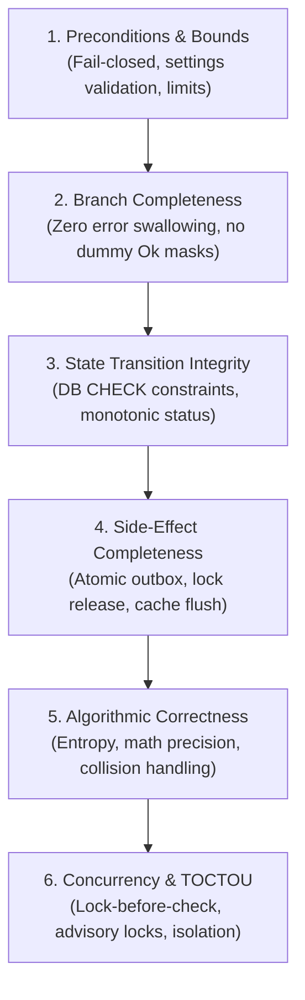

# RusToK — Domain Logic, Invariant Integrity, and Anti-Slop Patterns

This standard codifies systemic patterns and anti-patterns discovered across RusToK domain modules (such as `rustok-forum`, `rustok-commerce`, `rustok-marketplace`, `rustok-moderation`, and `rustok-auth`). It serves as the canonical reference for engineers and AI agents performing deep audits, refactoring, and feature implementation under [AGENTS.md](../../AGENTS.md) and [CONTINUOUS_CODE_REVIEW.md](../CONTINUOUS_CODE_REVIEW.md).

---

## 1. Core Philosophy: The 6 Universal Logic Dimensions

Superficial code cleanup (fixing only scanner warnings or regex hits) is prohibited by [AGENTS.md §2.1](../../AGENTS.md). High-signal code quality requires systematic verification across the **6 Universal Logic Dimensions**:



---

## 2. Catalog of Platform Patterns

### Pattern 1: Scope-Generic Deduplication (`P-SCOPE-GENERIC`)
* **Category:** Structural Architecture & Code Deduplication
* **Problem:** In complex modules, multiple entities require nearly identical storage, multi-layer inheritance, or batch insertion logic (e.g. category visibility, category moderation, topic visibility, reply policies). Writing separate services for each entity creates thousands of lines of copy-pasted SQL/SeaORM queries.
* **Pattern Solution:**
  1. Define a marker trait `EntityScope` with static metadata:
     ```rust
     pub trait EntityScope: Send + Sync + 'static {
         const NAME: &'static str;
         const TABLE_PREFIX: &'static str;
         const SUBJECT_COLUMN: &'static str;
     }
     ```
  2. Implement a single generic struct with `PhantomData<S>`:
     ```rust
     pub struct PolicyEngine<S: EntityScope> {
         pub subject_id: Uuid,
         pub constraints: Option<AudienceConstraints>,
         _marker: PhantomData<S>,
     }
     ```
  3. Keep the shared storage functions (`insert_*_raw`, `load_*_raw`) parameterized and tested in a single submodule.
  4. **Preserve External DTOs:** Convert generic internals into strongly-typed public DTOs (`ForumCategoryModerationAudiencePolicy`, `SellerAudiencePolicy`) or type aliases. Public transports and OpenAPI/GraphQL schemas must never leak internal generic structures.
* **Anti-Pattern (Forbidden):**
  * Copy-pasting this generic engine into unrelated modules where the data model does not match.
  * Creating speculative scopes without an existing canonical consumer.

---

### Pattern 2: Database-Enforced State Invariants (`P-DB-CHECK`)
* **Category:** State Transition & Data Integrity
* **Problem:** Application-level validation is fragile. Migrations, raw SQL updates, or missed application branches can leave rows in corrupted states (e.g. `status = 'archived'` while `is_locked = false`, or `deleted_at IS NOT NULL` while `status = 'active'`).
* **Pattern Solution:**
  Make invalid states unrepresentable in PostgreSQL and SQLite using DDL `CHECK` constraints.
  ```sql
  -- Soft-delete coherence
  ALTER TABLE forum_topics ADD CONSTRAINT forum_topics_deleted_at_status_coherent
      CHECK ((deleted_at IS NULL AND status != 'deleted') OR (deleted_at IS NOT NULL AND status = 'deleted'));

  -- Terminal lock coherence
  ALTER TABLE forum_topics ADD CONSTRAINT forum_topics_archived_implies_locked
      CHECK (status != 'archived' OR is_locked = TRUE);
  ```
* **Application Across Domains:**
  * **`commerce` / `order`:**
    ```sql
    CHECK ((cancelled_at IS NULL AND status != 'cancelled') OR (cancelled_at IS NOT NULL AND status = 'cancelled'));
    CHECK (status NOT IN ('completed', 'cancelled') OR is_locked = TRUE);
    ```
  * **`marketplace-seller`:**
    ```sql
    CHECK (suspended_at IS NULL OR status = 'suspended');
    ```

---

### Pattern 3: Lock-Before-Check Concurrency (`P-LOCK-ORDER`)
* **Category:** Order of Operations & TOCTOU Elimination
* **Problem:** Checking invariants (such as rate limits, inventory availability, balance thresholds, or slug uniqueness) *before* acquiring the transactional or advisory lock introduces a Time-Of-Check to Time-Of-Use (TOCTOU) race condition.
* **Pattern Solution:**
  Always acquire the mutex or advisory lock first, and verify preconditions *inside* the protected critical section:
  ```rust
  // Correct Order of Operations:
  let txn = db.begin().await?;

  // 1. Acquire transaction-level lock first
  lock_entity_in_tx(&txn, tenant_id, entity_id).await?;

  // 2. Perform precondition & rate-limit checks
  enforce_rate_limit_in_tx(&txn, tenant_id, author_id).await?;

  // 3. Mutate entity state
  insert_or_update(&txn, ...).await?;

  txn.commit().await?;
  ```
* **Anti-Pattern (Forbidden):**
  * Performing rate-limit increment or stock validation on a non-transactional connection before `db.begin()`.
  * Using raw string formatting with `execute_unprepared` for advisory locks instead of parameterized SeaORM `Statement`.

---

### Pattern 4: Fail-Closed Security Floor (`P-FAIL-CLOSED`)
* **Category:** Preconditions, Bounds & Authorization
* **Problem:** Evaluating child permission layers (e.g. category-level audience, product visibility) before evaluating global tenant policies allows unauthorized access if a child entity is marked "public" while the entire tenant/feature is restricted.
* **Pattern Solution:**
  Tenant-wide and security policies act as a hard floor. Check fail-closed conditions at the very top of the evaluation chain:
  ```rust
  // Fail-closed floor check
  if !allow_anonymous_reading && security.is_public_read() {
      return Err(DomainError::AuthenticationRequired);
  }

  // Only if the global floor passes, evaluate category/resource policies
  evaluate_resource_audience(&security, resource_policy)?;
  ```
* **Anti-Pattern (Forbidden):**
  * Returning `Ok(())` on `PermissionScope::None` in RBAC evaluation. Missing scope must strictly resolve to `Err(Forbidden)`.

---

### Pattern 5: Bounded Identifier Entropy (`P-ID-ENTROPY`)
* **Category:** Calculation & Algorithmic Correctness
* **Problem:** 12-hex character short identifiers provide only 48 bits of entropy. At scale ($10^7$ records), the birthday paradox results in a ~1.7% collision rate, triggering unexpected `500 Conflict` errors for end-users.
* **Pattern Solution:**
  1. Standardize on 16-hex characters (`VARCHAR(16)`, 64 bits of entropy) for public routes and short identifiers.
  2. Implement an explicit deterministic collision-fallback resolution:
     ```rust
     pub const ROUTE_SHORT_ID_LEN: usize = 16;

     // Primary: lower hex string truncated to 16 chars
     // Fallback upon collision: deterministic HMAC/SHA256 slice
     ```
  3. Ensure database queries check with `LIMIT 2` to verify uniqueness unambiguously.

---

### Pattern 6: Zero Error Swallowing (`P-ANTI-SWALLOW`)
* **Category:** Branch Completeness & Anti-Slop
* **Problem:** Developers and AI agents frequently use `let _ = ...`, dummy `Ok(())` fallbacks, or `std::hint::black_box(...)` to silence compiler warnings and linter errors (such as `let_underscore_must_use = "deny"`), masking aborted rollbacks or unhandled failures.
* **Pattern Solution:**
  1. Propagate errors via typed `Result<T, DomainError>`.
  2. If an error cannot fail the outer operation (e.g. best-effort background notification or rollback cleanup), log it explicitly with structured context:
     ```rust
     if let Err(err) = txn.rollback().await {
         tracing::warn!(error = %err, %tenant_id, "Transaction rollback failed during error recovery");
     }
     ```
  3. If a variable is extracted (e.g. `target_entity_id`), verify its active existence rather than discarding it with `let _ = target_entity_id;`.
* **Anti-Pattern (Forbidden):**
  * Using `std::hint::black_box` in production service code to suppress unused variable or must-use warnings.

---

### Pattern 7: Module Tree Decoupling (`P-ZERO-INCLUDE`)
* **Category:** Compilation Hygiene & Zero AI Slop
* **Problem:** The `include!("...")` macro is abused to merge multiple files into one module to bypass circular dependencies or file-count limits. This breaks `rust-analyzer`, `goto-definition`, incremental compilation, and cargo documentation.
* **Pattern Solution:**
  1. Use standard Rust module hierarchies: `mod category; pub use category::*;`.
  2. Break circular dependencies by defining narrow traits (e.g. `LockProvider`, `AncestorLoader`) implemented by the caller or foundation crate, rather than text-including source files.
  3. Zero `include!()` directives in `src/` (excluding build-time `OUT_DIR` code generation).

---

### Pattern 8: Configuration & Settings Bounding (`P-CONFIG-BOUND`)
* **Category:** Preconditions & Anti-DoS
* **Problem:** Accepting tenant settings without mathematical and logical bounds validation allows operators or attackers to save impossible limits (e.g. `min_length = 20`, `max_length = 10`), causing immediate DoS on all subsequent write operations.
* **Pattern Solution:**
  Implement a mandatory `validate(&self) -> Result<(), DomainError>` method on all module settings DTOs:
  ```rust
  impl ModuleSettings {
      pub fn validate(&self) -> Result<(), DomainError> {
          if self.min_length > self.max_length {
              return Err(DomainError::Validation("min_length cannot exceed max_length".into()));
          }
          if self.rate_limit_seconds > 86_400 {
              return Err(DomainError::Validation("rate_limit_seconds cannot exceed 24 hours".into()));
          }
          Ok(())
      }
  }
  ```
  Invoke this validator in every `put_settings` / `update_settings` lifecycle handler.

---

### Pattern 9: Elimination of Dead Twins (`P-DEAD-TWIN`)
* **Category:** Maintenance Integrity & Zero AI Slop
* **Problem:** Keeping two parallel implementations of a capability (such as an active `posting_rate.rs` and an abandoned 2500-line `posting_policy.rs` prototype) causes new contributors and AI agents to waste effort fixing the wrong files.
* **Pattern Solution:**
  * Delete uncalled and dormant duplicates completely.
  * If a prototype is planned for future delivery, preserve it in an ADR or design specification, not as dead code inside `src/`.

---

### Pattern 10: Bounded Tree Projections (`P-BOUNDED-TREE`)
* **Category:** Algorithmic Correctness & Memory Safety
* **Problem:** Recursive hierarchy traversals (categories, reply threads, organization units) without depth limits or page limits cause Out-Of-Memory (OOM) crashes when catalogs grow.
* **Pattern Solution:**
  1. Enforce strict `MAX_TREE_NODES` bounds (e.g. 512 or 2048) in single-query projections.
  2. When hierarchy exceeds the bounded memory envelope, require depth-limited queries (`?depth=2`) or streaming traversals.

---

### Pattern 11: Transactional Batching & Anti-N+1 (`P-BATCH-QUERY`)
* **Category:** Algorithmic & Concurrency Performance
* **Problem:** Executing round-trip database queries inside iterative loops (`for id in ids { Entity::find_by_id(id).one(txn).await? }`) inside an open database transaction creates severe connection bottlenecks and 100–200 RTTs while holding row locks.
* **Pattern Solution:**
  1. Batch all IDs into an `is_in` set:
     ```rust
     let rows = Entity::find()
         .filter(Column::TenantId.eq(tenant_id))
         .filter(Column::Id.is_in(ids))
         .all(txn)
         .await?;
     ```
  2. Materialize rows into a `HashMap<Uuid, Entity>` in memory before iterating.

---

### Pattern 12: Zero Runtime Panics in Production (`P-ZERO-PANIC-PROD`)
* **Category:** Preconditions, Bounds & Anti-Slop
* **Problem:** Calling `.expect("static contract...")` or `.unwrap()` in production request handlers (e.g. parsing `OwnerSlug`, `ResourceKind`, `UUID` in translation targets or pricing calculation) leads to worker panic and service degradation when inputs deviate or schema constants evolve.
* **Pattern Solution:**
  1. Convert all runtime value parsing to return `Result<T, DomainError>` or `PortError::invalid_input`.
  2. For genuinely static constants, construct them at compile time via `const` or pre-validate them during module initialization.
  3. Enforce `#![deny(clippy::unwrap_used, clippy::expect_used)]` across production service crates.

---

### Pattern 13: Allocation Hygiene & Late Clones (`P-HOTPATH-ALLOC`)
* **Category:** Algorithmic Efficiency & Memory Optimization
* **Problem:** Prematurely cloning inputs (`let canonical = input.name.clone();`) before running preconditions or validations wastes heap allocations on payloads that are immediately rejected.
* **Pattern Solution:**
  1. Validate borrowed slices (`&str`, `&[u8]`) first.
  2. Allocate and normalize (`.to_string()`, `.into()`, `.clone()`) strictly *after* all precondition gates have succeeded.

---

### Pattern 14: SQLSTATE Error Discrimination (`P-SQLSTATE-DISCRIM`)
* **Category:** Branch Completeness & Error Robustness
* **Problem:** Matching database errors via raw message substrings (e.g. `err.to_string().contains("topic conflict")`) is brittle. Changing a trigger message, database locale, or driver wording silently breaks error mapping, returning `500 Internal Server Error` instead of `409 Conflict`.
* **Pattern Solution:**
  1. Discriminate database errors via standard SQLSTATE error codes:
     * `23505`: Unique constraint violation (`Conflict`).
     * `23503`: Foreign key violation (`BadRequest` / `NotFound`).
     * `P0001`: PostgreSQL user-defined trigger exception (`RAISE EXCEPTION`).
  2. Fall back to secondary message token checks only when discriminating between multiple trigger branches sharing code `P0001`.

---

### Pattern 15: Contextual Observability Spans (`P-STRUCTURED-TRACE`)
* **Category:** Observability & Production Diagnostics
* **Problem:** Entrypoint and service methods that lack `#[tracing::instrument]` or omit tenant/user context produce uncorrelatable logs. When an authorization or storage error occurs, operators cannot determine which tenant, actor, or entity caused the failure.
* **Pattern Solution:**
  1. Decorate all public domain service methods with `#[instrument]`:
     ```rust
     #[tracing::instrument(
         skip(self, security, input),
         fields(tenant_id = %tenant_id, user_id = %security.user_id())
     )]
     pub async fn update_entity(&self, tenant_id: Uuid, security: SecurityContext, input: Input) -> DomainResult<Output> {
         // ...
     }
     ```
  2. Explicitly record span errors and durations on failure branches.

---

## 3. Summary Matrix

| ID | Pattern Name | Dimension | Detection Command |
|---|---|---|---|
| `P-SCOPE-GENERIC` | Scope-Generic Deduplication | Algorithmic / Structural | Multiple `insert_*_raw` or `load_*_layers` across services |
| `P-DB-CHECK` | DB-Enforced State Invariants | State Transitions | Look for status/deleted_at without SQL `CHECK` |
| `P-LOCK-ORDER` | Lock-Before-Check Concurrency | Concurrency / TOCTOU | Check before `lock_` or `pg_advisory_xact_lock` |
| `P-FAIL-CLOSED` | Fail-Closed Security Floor | Bounds / Preconditions | `PermissionScope::None => Ok` or missing global check |
| `P-ID-ENTROPY` | Bounded Identifier Entropy | Calculation Correctness | `grep -rn 'VARCHAR(12\|short_id.*12'` |
| `P-ANTI-SWALLOW` | Zero Error Swallowing | Branch Completeness | `grep -rn 'let _ =' crates/modules/<domain>/src` |
| `P-ZERO-INCLUDE` | Module Tree Decoupling | Code Quality | `grep -rn 'include!' crates/modules/<domain>/src` |
| `P-CONFIG-BOUND` | Configuration Bounding | Preconditions / Anti-DoS | `put_settings` handler missing `.validate()` |
| `P-DEAD-TWIN` | Dead Twin Elimination | Maintenance Integrity | Two parallel services with overlapping responsibilities |
| `P-BOUNDED-TREE` | Bounded Tree Projections | Memory Safety | Recursive query without depth cap or node limit |
| `P-BATCH-QUERY` | Transactional Batching | Performance / Concurrency | `grep -rn "\.one(txn)" ... -B2 \| grep "for.*in"` |
| `P-ZERO-PANIC-PROD` | Zero Runtime Panics | Preconditions / Reliability | `grep -rn "\.expect(" ... \| grep -v tests` |
| `P-HOTPATH-ALLOC` | Allocation Hygiene | Performance / Memory | `.clone()` before validation calls in services |
| `P-SQLSTATE-DISCRIM` | SQLSTATE Error Mapping | Error Robustness | `grep -rn "message.contains(" ... in error.rs` |
| `P-STRUCTURED-TRACE` | Contextual Trace Spans | Observability | Missing `#[instrument]` with `%tenant_id` on services |

---

## 4. Automated Verification Scanner

The platform provides a dedicated automated verification scanner to audit any domain module or crate against these patterns:

```bash
# Scan a specific domain module (e.g. rustok-commerce, rustok-forum, rustok-index)
python scripts/verify/verify-domain-hygiene.py --crate rustok-commerce

# Scan a specific path
python scripts/verify/verify-domain-hygiene.py --path crates/modules/rustok-commerce/src

# Scan all platform domain modules
python scripts/verify/verify-domain-hygiene.py --all-modules

# Enforce in CI / pre-commit (returns exit code 1 if any issues are detected)
python scripts/verify/verify-domain-hygiene.py --crate rustok-commerce --strict
```

The scanner continuously checks for:
- File-stitching `include!("*.rs")` macros (`P-ZERO-INCLUDE`).
- Error swallowing via `let _ =` and dummy `black_box` compiler suppressions (`P-ANTI-SWALLOW`).
- Production runtime panics via `.expect()` or `.unwrap()` (`P-ZERO-PANIC-PROD`).
- Deprecated 48-bit short IDs (`VARCHAR(12)` or `[..12]`) (`P-ID-ENTROPY`).
- RBAC authorization leakages (`PermissionScope::None => Ok`) (`P-FAIL-CLOSED`).
- Brittle error string matching in `error.rs` (`P-SQLSTATE-DISCRIM`).
- Transactional N+1 loops (`.one(txn)` inside `for` loops) (`P-BATCH-QUERY`).

---

## Related Documents

- [Automated Domain Hygiene Scanner](../../scripts/verify/verify-domain-hygiene.py) — Verification script
- [Coding Standards](./coding.md) — Rust syntax and styling rules
- [Patterns vs Antipatterns](./patterns-vs-antipatterns.md) — Platform-wide architectural DOs and DON'Ts
- [Continuous Code Review Protocol](../CONTINUOUS_CODE_REVIEW.md) — The audit workflow
- [Continuous Review Ledger](./continuous-review-ledger.md) — Living audit progress
- [AGENTS.md](../../AGENTS.md) — Canonical platform contract

