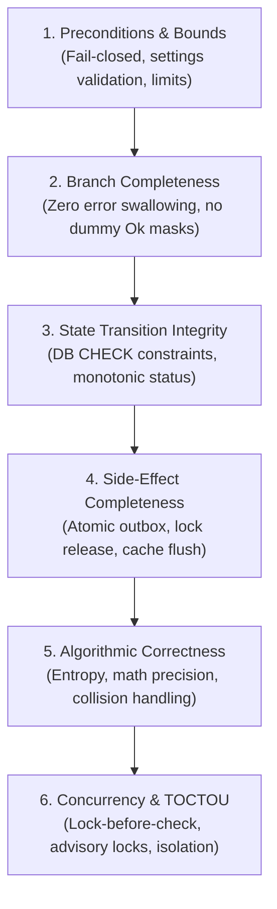

# RusToK — Domain Logic, Invariant Integrity, and Anti-Slop Patterns

This standard codifies systemic patterns and anti-patterns discovered across RusToK domain modules (such as `rustok-forum`, `rustok-commerce`, `rustok-marketplace`, `rustok-moderation`, and `rustok-auth`). It serves as the canonical reference for engineers and AI agents performing deep audits, refactoring, and feature implementation under [AGENTS.md](../../AGENTS.md) and [CONTINUOUS_CODE_REVIEW.md](../CONTINUOUS_CODE_REVIEW.md).

---

## 1. Core Philosophy: The 6 Universal Logic Dimensions

Under [AGENTS.md §4](../../AGENTS.md), verify the affected behavior and its owner contract across the **6 Universal Logic Dimensions**. Use source matches to find code to inspect. A match alone cannot establish a behavioral defect:



---

## 2. Catalog of Platform Patterns

### Pattern 1: Scope-Generic Deduplication (`P-SCOPE-GENERIC`)
* **Category:** Structural Architecture & Code Deduplication
* **Problem:** In complex modules, multiple entities require nearly identical storage, multi-layer inheritance, or batch insertion logic (e.g. category visibility, category moderation, topic visibility, reply policies). Writing separate services for each entity creates thousands of lines of copy-pasted SQL/SeaORM queries.
* **Pattern Solution:**
  1. Define a marker trait `EntityScope` with static metadata:
     ```rust
     pub trait EntityScope: Send + Sync + 'static {
         const NAME: &'static str;
         const TABLE_PREFIX: &'static str;
         const SUBJECT_COLUMN: &'static str;
     }
     ```
  2. Implement a single generic struct with `PhantomData<S>`:
     ```rust
     pub struct PolicyEngine<S: EntityScope> {
         pub subject_id: Uuid,
         pub constraints: Option<AudienceConstraints>,
         _marker: PhantomData<S>,
     }
     ```
  3. Keep the shared storage functions (`insert_*_raw`, `load_*_raw`) parameterized and tested in a single submodule.
  4. **Preserve External DTOs:** Convert generic internals into strongly-typed public DTOs (`ForumCategoryModerationAudiencePolicy`, `SellerAudiencePolicy`) or type aliases. Public transports and OpenAPI/GraphQL schemas must never leak internal generic structures.
* **Anti-Pattern (Forbidden):**
  * Copy-pasting this generic engine into unrelated modules where the data model does not match.
  * Creating speculative scopes without an existing canonical consumer.

---

### Pattern 2: Database-Enforced State Invariants (`P-DB-CHECK`)
* **Category:** State Transition & Data Integrity
* **Problem:** Application-level validation is fragile. Migrations, raw SQL updates, or missed application branches can leave rows in corrupted states (e.g. `status = 'archived'` while `is_locked = false`, or `deleted_at IS NOT NULL` while `status = 'active'`).
* **Pattern Solution:**
  Make invalid states unrepresentable in PostgreSQL and SQLite using DDL `CHECK` constraints.
  ```sql
  -- Soft-delete coherence
  ALTER TABLE forum_topics ADD CONSTRAINT forum_topics_deleted_at_status_coherent
      CHECK ((deleted_at IS NULL AND status != 'deleted') OR (deleted_at IS NOT NULL AND status = 'deleted'));

  -- Terminal lock coherence
  ALTER TABLE forum_topics ADD CONSTRAINT forum_topics_archived_implies_locked
      CHECK (status != 'archived' OR is_locked = TRUE);
  ```
* **Application Across Domains:**
  * **`commerce` / `order`:**
    ```sql
    CHECK ((cancelled_at IS NULL AND status != 'cancelled') OR (cancelled_at IS NOT NULL AND status = 'cancelled'));
    CHECK (status NOT IN ('completed', 'cancelled') OR is_locked = TRUE);
    ```
  * **`marketplace-seller`:**
    ```sql
    CHECK (suspended_at IS NULL OR status = 'suspended');
    ```

---

### Pattern 3: Lock-Before-Check Concurrency (`P-LOCK-ORDER`)
* **Category:** Order of Operations & TOCTOU Elimination
* **Problem:** Checking invariants (such as rate limits, inventory availability, balance thresholds, or slug uniqueness) *before* acquiring the transactional or advisory lock introduces a Time-Of-Check to Time-Of-Use (TOCTOU) race condition.
* **Pattern Solution:**
  Always acquire the mutex or advisory lock first, and verify preconditions *inside* the protected critical section:
  ```rust
  // Correct Order of Operations:
  let txn = db.begin().await?;

  // 1. Acquire transaction-level lock first
  lock_entity_in_tx(&txn, tenant_id, entity_id).await?;

  // 2. Perform precondition & rate-limit checks
  enforce_rate_limit_in_tx(&txn, tenant_id, author_id).await?;

  // 3. Mutate entity state
  insert_or_update(&txn, ...).await?;

  txn.commit().await?;
  ```
* **Anti-Pattern (Forbidden):**
  * Performing rate-limit increment or stock validation on a non-transactional connection before `db.begin()`.
  * Using raw string formatting with `execute_unprepared` for advisory locks instead of parameterized SeaORM `Statement`.

---

### Pattern 4: Fail-Closed Security Floor (`P-FAIL-CLOSED`)
* **Category:** Preconditions, Bounds & Authorization
* **Problem:** Evaluating child permission layers (e.g. category-level audience, product visibility) before evaluating global tenant policies allows unauthorized access if a child entity is marked "public" while the entire tenant/feature is restricted.
* **Pattern Solution:**
  Tenant-wide and security policies act as a hard floor. Check fail-closed conditions at the very top of the evaluation chain:
  ```rust
  // Fail-closed floor check
  if !allow_anonymous_reading && security.is_public_read() {
      return Err(DomainError::AuthenticationRequired);
  }

  // Only if the global floor passes, evaluate category/resource policies
  evaluate_resource_audience(&security, resource_policy)?;
  ```
* **Anti-Pattern (Forbidden):**
  * Treating `PermissionScope::None` as permission to proceed when the guard owns the access decision. Return a denial in the guard's own contract, such as `Err(Forbidden)` or `Ok(false)`. A secondary policy may return `Ok(())` to mean “no additional restriction” when an earlier guard already owns authorization.
* **Verification:** Exercise a missing-scope caller against an otherwise public resource and verify the final outcome. The scanner flags explicit success branches for review.

---

### Pattern 5: Bounded Identifier Entropy (`P-ID-ENTROPY`)
* **Category:** Calculation & Algorithmic Correctness
* **Problem:** The probability of at least one collision among 10 million identifiers in one uniqueness namespace is about 16.3% at 48 bits and 0.000271% at 64 bits, assuming independent, uniform draws. Twelve hex characters encode at most 48 bits. A 12-character prefix of the simple form of UUIDv7 is its timestamp, as defined by [RFC 9562](https://www.rfc-editor.org/rfc/rfc9562.html#name-uuid-version-7), so the uniform-random assumption does not apply.
* **Pattern Solution:** Choose the entropy budget for the namespace and expected volume. Enforce uniqueness at the owner persistence boundary and define an explicit collision outcome, such as retry on the relevant uniqueness conflict. A lookup with `LIMIT 2` detects ambiguity but cannot enforce uniqueness. Preserve existing public route compatibility when changing an identifier scheme.
* **Verification:** Inspect the generator, effective random bits, uniqueness scope, and collision path. The scanner recognizes narrow short-ID declarations, UUID compaction, and short-ID SQL column hints.

---

### Pattern 6: Zero Error Swallowing (`P-ANTI-SWALLOW`)
* **Category:** Branch Completeness & Anti-Slop
* **Problem:** Developers and AI agents frequently use `let _ = ...`, dummy `Ok(())` fallbacks, or `std::hint::black_box(...)` to silence compiler warnings and linter errors (such as `let_underscore_must_use = "deny"`), masking aborted rollbacks or unhandled failures.
* **Pattern Solution:**
  1. Propagate errors via typed `Result<T, DomainError>`.
  2. If an error cannot fail the outer operation (e.g. best-effort background notification or rollback cleanup), log it explicitly with structured context:
     ```rust
     if let Err(err) = txn.rollback().await {
         tracing::warn!(error = %err, %tenant_id, "Transaction rollback failed during error recovery");
     }
     ```
  3. Check the discarded expression’s type and its failure contract. The scanner flags discarded calls for review and skips plain values. Verify any required existence check at the owner boundary.
* **Anti-Pattern (Forbidden):**
  * Using `std::hint::black_box` in production service code to suppress unused variable or must-use warnings.

---

### Pattern 7: Module Tree Decoupling (`P-ZERO-INCLUDE`)
* **Category:** Compilation Hygiene & Zero AI Slop
* **Problem:** The `include!("...")` macro is abused to merge multiple files into one module to bypass circular dependencies or file-count limits. This breaks `rust-analyzer`, `goto-definition`, incremental compilation, and cargo documentation.
* **Pattern Solution:**
  1. Use standard Rust module hierarchies and explicit exports, such as `mod category; pub use category::CategoryService;`.
  2. Break circular dependencies by defining narrow traits (e.g. `LockProvider`, `AncestorLoader`) implemented by the caller or foundation crate, rather than text-including source files.
  3. Keep handwritten Rust source in modules. Build output loaded through `concat!(env!("OUT_DIR"), ...)` is a separate use case. The scanner gates direct literal `include!("file.rs")` outside recognized test, example, and build contexts.
  4. When replacing a file-stitching macro, register the existing source file as a module and move child declarations to their owner as needed. Pasting the file body at the call site can leave a second copy and a stray statement delimiter. Verify the resulting module tree with a scoped build.

---

### Pattern 8: Configuration & Settings Bounding (`P-CONFIG-BOUND`)
* **Category:** Preconditions & Anti-DoS
* **Problem:** Accepting tenant settings without mathematical and logical bounds validation allows operators or attackers to save impossible limits (e.g. `min_length = 20`, `max_length = 10`), causing immediate DoS on all subsequent write operations.
* **Pattern Solution:**
  Implement a mandatory `validate(&self) -> Result<(), DomainError>` method on all module settings DTOs:
  ```rust
  impl ModuleSettings {
      pub fn validate(&self) -> Result<(), DomainError> {
          if self.min_length > self.max_length {
              return Err(DomainError::Validation("min_length cannot exceed max_length".into()));
          }
          if self.rate_limit_seconds > 86_400 {
              return Err(DomainError::Validation("rate_limit_seconds cannot exceed 24 hours".into()));
          }
          Ok(())
      }
  }
  ```
  Invoke this validator in every `put_settings` / `update_settings` lifecycle handler.

---

### Pattern 9: Elimination of Dead Twins (`P-DEAD-TWIN`)
* **Category:** Maintenance Integrity & Zero AI Slop
* **Problem:** Keeping two parallel implementations of a capability (such as an active `posting_rate.rs` and an abandoned 2500-line `posting_policy.rs` prototype) causes new contributors and AI agents to waste effort fixing the wrong files.
* **Pattern Solution:**
  * Delete uncalled and dormant duplicates completely.
  * If a prototype is planned for future delivery, preserve it in an ADR or design specification, not as dead code inside `src/`.

---

### Pattern 10: Bounded Tree Projections (`P-BOUNDED-TREE`)
* **Category:** Algorithmic Correctness & Memory Safety
* **Problem:** Recursive hierarchy traversals (categories, reply threads, organization units) without depth limits or page limits cause Out-Of-Memory (OOM) crashes when catalogs grow.
* **Pattern Solution:**
  1. Enforce strict `MAX_TREE_NODES` bounds (e.g. 512 or 2048) in single-query projections.
  2. When hierarchy exceeds the bounded memory envelope, require depth-limited queries (`?depth=2`) or streaming traversals.

---

### Pattern 11: Transactional Batching & Anti-N+1 (`P-BATCH-QUERY`)
* **Category:** Algorithmic & Concurrency Performance
* **Problem:** Executing round-trip database queries inside iterative loops (`for id in ids { Entity::find_by_id(id).one(txn).await? }`) inside an open database transaction creates severe connection bottlenecks and 100–200 RTTs while holding row locks.
* **Pattern Solution:**
  1. Batch all IDs into an `is_in` set:
     ```rust
     let rows = Entity::find()
         .filter(Column::TenantId.eq(tenant_id))
         .filter(Column::Id.is_in(ids))
         .all(txn)
         .await?;
     ```
  2. Bound the batch size and index the results for lookup. Preserve the caller’s ordering, missing-ID behavior, and lock semantics when replacing per-item queries.

---

### Pattern 12: Zero Runtime Panics in Production (`P-ZERO-PANIC-PROD`)
* **Category:** Preconditions, Bounds & Anti-Slop
* **Problem:** Calling `.expect("static contract...")` or `.unwrap()` in production request handlers (e.g. parsing `OwnerSlug`, `ResourceKind`, `UUID` in translation targets or pricing calculation) leads to worker panic and service degradation when inputs deviate or schema constants evolve.
* **Pattern Solution:**
  1. Convert all runtime value parsing to return `Result<T, DomainError>` or `PortError::invalid_input`.
  2. For genuinely static constants, construct them at compile time via `const` or pre-validate them during module initialization.
  3. Enforce `#![deny(clippy::unwrap_used, clippy::expect_used)]` across production service crates.

---

### Pattern 13: Allocation Hygiene & Late Clones (`P-HOTPATH-ALLOC`)
* **Category:** Algorithmic Efficiency & Memory Optimization
* **Problem:** Prematurely cloning inputs (`let canonical = input.name.clone();`) before running preconditions or validations wastes heap allocations on payloads that are immediately rejected.
* **Pattern Solution:**
  1. Validate borrowed slices (`&str`, `&[u8]`) first.
  2. Allocate and normalize (`.to_string()`, `.into()`, `.clone()`) strictly *after* all precondition gates have succeeded.

---

### Pattern 14: SQLSTATE Error Discrimination (`P-SQLSTATE-DISCRIM`)
* **Category:** Branch Completeness & Error Robustness
* **Problem:** Matching database errors via raw message substrings (e.g. `err.to_string().contains("topic conflict")`) is brittle. Changing a trigger message, database locale, or driver wording silently breaks error mapping, returning `500 Internal Server Error` instead of `409 Conflict`.
* **Pattern Solution:**
  1. Discriminate database errors via standard SQLSTATE error codes:
     * `23505`: Unique constraint violation (`Conflict`).
     * `23503`: Foreign key violation (`BadRequest` / `NotFound`).
     * `P0001`: PostgreSQL user-defined trigger exception (`RAISE EXCEPTION`).
  2. Prefer structured constraint identity or distinct owner-defined SQLSTATEs for failures that share a generic code. Where a legacy contract exposes only a stable message token, keep the fallback at that boundary and test it against the actual database error.

---

### Pattern 15: Contextual Observability Spans (`P-STRUCTURED-TRACE`)
* **Category:** Observability & Production Diagnostics
* **Problem:** When the effective span lacks tenant, actor, or operation context, operators cannot correlate authorization or storage failures with the affected request.
* **Pattern Solution:**
  1. Establish context at the owner entry point or inherit it from the caller. Exclude sensitive inputs from span fields:
     ```rust
     #[tracing::instrument(
         skip(self, security, input),
         fields(tenant_id = %tenant_id, user_id = %security.user_id())
     )]
     pub async fn update_entity(&self, tenant_id: Uuid, security: SecurityContext, input: Input) -> DomainResult<Output> {
         // ...
     }
     ```
  2. Verify the emitted span or trace for the failing operation. A function name and nearby span marker are lexical hints and cannot prove inherited context.

---

### Pattern 16: Ignored Transaction Finalization (`P-TXN-ROLLBACK-SWALLOW`)
* **Category:** Branch Completeness & Transaction Integrity
* **Problem:** Discarding a commit result can report success for a failed or uncertain write. Discarding a rollback result hides cleanup failure. PostgreSQL [transaction advisory locks](https://www.postgresql.org/docs/current/explicit-locking.html#ADVISORY-LOCKS) are released at transaction end. Session advisory locks survive rollback and require explicit release or session termination.
* **Pattern Solution:** Propagate commit failure and use the owner’s idempotency or reconciliation contract when the outcome is uncertain. On failure recovery, report explicit rollback errors with context while preserving the primary error:
  ```rust
  if let Err(rollback_err) = transaction.rollback().await {
      tracing::warn!(%rollback_err, "transaction rollback failed");
  }
  return Err(primary_error);
  ```
* **Verification:** Identify the actual transaction and lock kind. Test that callers never receive false success and that cleanup failures remain observable. The scanner flags discarded `commit` and `rollback` calls.

---

### Pattern 17: Synchronous Lock Guard Across Await Points (`P-SYNC-LOCK-AWAIT`)
* **Category:** Async Concurrency & Thread Pool Starvation
* **Problem:** A synchronous guard retained across suspension keeps the lock held. A competing synchronous acquisition can then block an executor thread or deadlock with the suspended task. Some guards also make a future non-`Send`.
* **Pattern Solution:** Prefer a short synchronous scope that releases the guard before awaiting. Use an async lock when the owner genuinely requires a critical section that spans suspension.
  ```rust
  let snapshot = {
      let guard = self.cache.lock(); // parking_lot::Mutex
      guard.clone()
  };
  remote_client.send(snapshot).await?;
  ```
* **Verification:** Inspect the guard type and all reachable suspension paths, including conditional drops. Where supported, run [Clippy’s `await_holding_lock`](https://clippy.rust-lang.org/master/index.html#await_holding_lock) on the owning crate. The scanner uses lexical acquisition and scope cues.

---

### Pattern 18: Unprepared SQL String Interpolation (`P-RAW-SQL-INTERP`)
* **Category:** Security, Preconditions & Injection Prevention
* **Problem:** Formatting runtime values into SQL can change query semantics and permit injection. Fixed SQL fragments and identifiers selected from a closed set have a different trust boundary from request values.
* **Pattern Solution:**
  1. Bind runtime values as parameters. For identifiers that cannot be bound, use a typed query builder or a fixed allowlist. The scanner traces direct formatting and simple local bindings; verify the origin of each interpolated value.
  2. Use parameterized queries via SeaORM or SeaQuery:
     ```rust
     use sea_orm::{ConnectionTrait, Statement};

     let stmt = Statement::from_sql_and_values(
         db.get_database_backend(),
         "UPDATE orders SET status = $1 WHERE id = $2 AND tenant_id = $3",
         [status.into(), order_id.into(), tenant_id.into()],
     );
     db.execute(stmt).await?;
     ```

---

### Pattern 19: Tenant Isolation Fallback & Identity Leaks (`P-TENANT-FALLBACK-LEAK`)
* **Category:** Multi-Tenancy & Fail-Closed Security
* **Problem:** Calling `.unwrap_or_default()` or using default UUIDs (`Uuid::nil()`) on optional tenant context variables silently coerces unauthenticated or cross-tenant requests into the default tenant or zero UUID. This breaks tenant isolation and leaks shared catalog, order, or user state.
* **Pattern Solution:**
  1. Multi-tenant operations must fail closed:
     ```rust
     let tenant_id = tenant_id.ok_or(DomainError::TenantNotFound)?;
     ```
  2. Do not use dummy nil UUIDs as wildcard or fallback selectors. Verify that absent and wrong-tenant requests cannot reach another tenant’s rows. The scanner recognizes explicit tenant selectors and assignments, and cannot establish identity flow through wrappers.

---

### Pattern 20: Transactional Outbox Decoupling (`P-OUTBOX-DETACHED`)
* **Category:** Side-Effect Completeness & Atomicity
* **Problem:** Publishing independently of the owner’s mutation can emit an event for a rolled-back change or lose the event after a successful commit.
* **Pattern Solution:**
  1. In transactional scopes, always write outbox events through the transaction handle using `publish_in_tx`:
     ```rust
     event_bus.publish_in_tx(&txn, domain_event).await?;
     txn.commit().await?;
     ```
  2. Verify that commit makes both rows durable and rollback leaves neither the change nor its outbox row. The scanner flags direct publication when it sees transaction evidence in the same function. Verify the publisher implementation and transaction handle at the owner boundary.

---

### Pattern 21: UI Reactive Signal Invalidation (`P-LEPTOS-DEAD-SIGNAL`)
* **Category:** Client Architecture & UI Reactivity
* **Problem:** Calling `let _ = signal.get();` outside of a reactive tracking context (such as `view!` or `create_effect`) reads the signal value without establishing a reactive subscriber dependency. Subsequent signal updates will not trigger UI rerendering, causing silent UI desynchronization.
* **Pattern Solution:**
  1. Bind signal dependencies inside an effect when the operation needs reactive tracking:
     ```rust
     Effect::new(move |_| {
         let value = signal.get();
         update_view_model(value);
     });
     ```
  2. In Leptos views, reference signals directly within view macros: `move || signal.get()`.

---

### Pattern 22: Lingering Incomplete Code & Work Markers (`P-UNFINISHED-CODE`)
* **Category:** Production Readiness & Maintenance Integrity
* **Problem:** Reachable `todo!()` and `unimplemented!()` can panic in production. A `TODO` or `FIXME` comment identifies work to review; it does not establish that an invariant is broken.
* **Pattern Solution:** Complete runtime paths with typed error and edge-case behavior. Track agreed follow-up work in the owning plan or ADR. Check that affected inputs cannot reach incomplete execution paths.

---

### Pattern 23: Blocking Sleep in Async Functions (`P-SYNC-SLEEP-AWAIT`)
* **Category:** Async Concurrency & Thread Pool Starvation
* **Problem:** Calling `std::thread::sleep` on an executor worker occupies the thread for the whole delay. Concurrent waits can starve requests and timers.
* **Pattern Solution:** Use the runtime timer for async waiting. Keep necessary blocking work on a blocking executor.
  ```rust
  tokio::time::sleep(delay).await;
  ```
* **Detection:** Start with `rg -n 'std::thread::sleep' crates apps -g '*.rs'`. Verify the execution context, including `spawn_blocking` and dedicated threads. The scanner recognizes direct synchronous sleep calls in lexically async functions.

---

### Pattern 24: Owner SQL Read Boundaries (`P-OWNER-READ-BOUNDARY`)
* **Category:** Module Isolation & Concurrency
* **Problem:** Distribution's Product and Channel Index adapters read owner-private tables. A storage change can break the adapter despite an unchanged owner API. Splitting freshness checks into separate reads can admit stale rows or produce the wrong page or count.
* **Pattern Solution:** Put the projection and selection rules in the owner. Compose the published SQL in the existing transaction or query when the consumer needs one snapshot. For example, the relation resolver uses the Channel owner's statement:
  ```rust
  let statement = rustok_channel::index_projection::relation_channel_ids(
      tenant_id, selected_slugs, fetch_limit,
  );
  let rows = transaction.query_all_raw(statement).await?;
  ```
* **Detection:** Start with `rg -ni '(from|join) (products|product_[a-z_]+|channels|channel_index_[a-z_]+)' crates/modules/rustok-distribution/src`. Review ownership and verify that delayed or deleted owner state is rejected before pagination and exact count.

---

### Pattern 25: Observe Trigger-Derived Revisions (`P-TRIGGER-ROW-CHANGE`)

* **Category:** Transactional integrity. **Dimension:** Side-effect completeness.
* **Problem:** A PostgreSQL `AFTER UPDATE OF revision` trigger checks the statement's target columns. An earlier `BEFORE UPDATE` trigger can change the revision on a scalar edit, leaving the append-only projection at its previous watermark. Both the initial Product graph ledger and its canonical successor contained this defect.
* **Pattern Solution:** Match the row transition after the write. Reuse the owner reconciler so the source and derived watermark commit together.
  ```sql
  CREATE OR REPLACE TRIGGER trg_products_index_graph_projection_update
  AFTER UPDATE ON products
  FOR EACH ROW
  WHEN (OLD.index_revision IS DISTINCT FROM NEW.index_revision)
  EXECUTE FUNCTION rustok_product_capture_index_graph_projection_from_product();
  ```
* **Detection:** Run `rg -ni 'AFTER UPDATE OF .*revision|NEW\\.[a-z_]*revision\\s*:=' crates/modules` and compare each live update trigger with the preceding triggers on its table. On PostgreSQL, update an indexed scalar alone and verify that the projection records the final revision.

---

## 3. Summary Matrix

The evidence column describes how to verify the invariant at its owner. “Manual” means the Python scanner has no rule for that pattern.

| ID | Dimension | Evidence to verify | Python scanner |
|---|---|---|---|
| `P-SCOPE-GENERIC` | Structure | Equivalent behavior and one owner across scopes | Manual |
| `P-DB-CHECK` | State integrity | Database rejects invalid state transitions or combinations | Manual |
| `P-LOCK-ORDER` | Concurrency | Competing writers cannot invalidate a checked precondition | Manual |
| `P-FAIL-CLOSED` | Authorization | Missing scope is denied even for an otherwise public resource | Heuristic: explicit success for absent scope |
| `P-ID-ENTROPY` | Calculation | Effective entropy, uniqueness scope, and collision handling | Heuristic: named widths, UUID compaction, short-ID schema |
| `P-ANTI-SWALLOW` | Failure paths | Required failures propagate or are handled and observable | Heuristic: discarded call or `black_box` |
| `P-ZERO-INCLUDE` | Module structure | Handwritten Rust is wired with explicit modules | High: direct literal Rust inclusion outside recognized exemptions |
| `P-CONFIG-BOUND` | Preconditions | All writers reject invalid combinations and limits | Manual |
| `P-DEAD-TWIN` | Ownership | Active callers and exports show whether an implementation is redundant | Heuristic: broad inner lint suppression |
| `P-BOUNDED-TREE` | Algorithmic bounds | Deep, wide, and cyclic input respects the declared budget | Manual |
| `P-BATCH-QUERY` | Performance and concurrency | Query count stays bounded without changing lock or result semantics | Heuristic: transaction query in a loop |
| `P-ZERO-PANIC-PROD` | Reliability | Runtime inputs cannot trigger panic paths | Heuristic: panic-prone calls |
| `P-HOTPATH-ALLOC` | Allocation | Invalid requests avoid unnecessary allocations on the affected path | Heuristic: early clone |
| `P-SQLSTATE-DISCRIM` | Error mapping | Real SQLSTATE and constraint failures map correctly | Heuristic: error-message substring match |
| `P-STRUCTURED-TRACE` | Observability | Emitted or inherited spans contain required context | Heuristic: mutation name and nearby span marker |
| `P-TXN-ROLLBACK-SWALLOW` | Failure paths | Commit errors propagate and rollback errors remain observable | Heuristic: discarded finalization call |
| `P-SYNC-LOCK-AWAIT` | Concurrency | Actual synchronous guard lifetimes exclude suspension | Heuristic: lock and await in lexical scope |
| `P-RAW-SQL-INTERP` | Security | Runtime values are bound and interpolated identifiers are trusted | Heuristic: formatted direct SQL or local binding |
| `P-TENANT-FALLBACK-LEAK` | Tenant isolation | Missing and wrong-tenant identities fail closed | Heuristic: fallback on a tenant selector |
| `P-OUTBOX-DETACHED` | Side effects | Domain write and outbox write commit or roll back together | Heuristic: direct publish with transaction evidence in the same function |
| `P-LEPTOS-DEAD-SIGNAL` | UI reactivity | An update reruns the intended reactive consumer | Heuristic: discarded signal read outside known reactive scopes |
| `P-UNFINISHED-CODE` | Runtime completeness | Affected runtime paths cannot reach incomplete code | Heuristic: work marker or incomplete-code macro |
| `P-SYNC-SLEEP-AWAIT` | Concurrency | Blocking delay runs outside executor workers | Heuristic: direct blocking sleep in async function |
| `P-OWNER-READ-BOUNDARY` | Ownership and concurrency | Owner controls storage reads and the adapter preserves snapshot and admission semantics | Manual |
| `P-TRIGGER-ROW-CHANGE` | Side effects | An update that derives a revision in a trigger commits the matching projection | Manual |

---

## 4. Automated Verification Scanner

The scanner inspects Rust source and reports candidates from the matrix above:

```bash
# Scan a specific domain module (smart resolution: forum -> crates/modules/rustok-forum)
python scripts/verify/verify-domain-hygiene.py --crate forum

# Scan multiple crates at once
python scripts/verify/verify-domain-hygiene.py --crate commerce,forum,index

# Scan staged Rust blobs directly from the Git index
python scripts/verify/verify-domain-hygiene.py --staged --strict

# Scan all modified files in working tree
python scripts/verify/verify-domain-hygiene.py --changed

# Scan changes relative to a base branch
python scripts/verify/verify-domain-hygiene.py --diff main

# Filter by minimum severity (P0 = critical only, P1 = high+, P2 = all)
python scripts/verify/verify-domain-hygiene.py --crate commerce --severity P0

# Display remediation guidance
python scripts/verify/verify-domain-hygiene.py --crate commerce --suggest-fixes

# Export machine-readable JSON or GitHub-flavored markdown report artifact
python scripts/verify/verify-domain-hygiene.py --crate commerce --markdown-report commerce_hygiene.md
python scripts/verify/verify-domain-hygiene.py --crate commerce --json --fail-on P1

# Generate a patch that appends advisory comments to the scanned source
python scripts/verify/verify-domain-hygiene.py --crate commerce --patch commerce_hygiene.patch

# Enforce high-confidence findings in CI / pre-commit
npm run verify:hygiene:strict

# Run regression tests for the scanner
npm run test:verify:hygiene
```

The scanner uses the Python 3 standard library. Git modes require Git.
Severity (`P0` through `P2`) describes potential impact. The separate `confidence`
field is `high` for a direct source-level violation or `heuristic` for a candidate
that needs review. Text, JSON, CSV, and Markdown reports show both. `--severity`
filters findings by impact. `--strict` is equivalent to `--fail-on P2`: the scanner
returns `1` only for high-confidence findings at or above the threshold, in text
and JSON modes. The current high-confidence rule has severity `P1`, so
`--fail-on P0` does not block on any current rule. A target-selection or
source-read error returns `2`.

Git modes select files and scan their full contents. A pre-existing match in a
selected file can fail a gate even when the matching line was not edited.

The patch keeps flagged Rust statements intact and appends advisory comments with
their original line numbers. Check a working-tree patch with `git apply --check`
and a `--staged` patch with `git apply --cached --check`.

Rules use lexical scope and preserve literal contents for checks that need them.
They do not resolve Rust types, expand macros, or follow calls between functions.
The Leptos rule recognizes effect, memo, and `view!` delimiters. An empty report
means the scanner found no matches in the selected sources; verify behavioral
invariants with the owner’s tests and runtime evidence.

---

## Related Documents

- [Automated Domain Hygiene Scanner](../../scripts/verify/verify-domain-hygiene.py) — Verification script
- [Coding Standards](./coding.md) — Rust syntax and styling rules
- [Patterns vs Antipatterns](./patterns-vs-antipatterns.md) — Platform-wide architectural DOs and DON'Ts
- [Continuous Code Review Protocol](../CONTINUOUS_CODE_REVIEW.md) — The audit workflow
- [Continuous Review Ledger](./continuous-review-ledger.md) — Living audit progress
- [AGENTS.md](../../AGENTS.md) — Canonical platform contract

