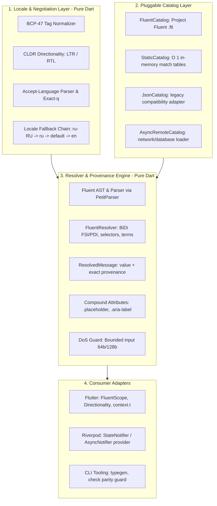

# Implementation Plan: rustok_i18n & rustok_flutter_i18n

> **Canonical Document**: Library implementation plan and architectural specification.
> **Scope**: Pure Dart core (`rustok_i18n`) and Flutter bindings (`rustok_flutter_i18n`).
> **Goal**: Community-grade, multi-catalog Project Fluent i18n platform with zero runtime coupling.
>
> **Status note (audit, 0.1.0+)**: this document is the original design. Where it differs from the code, the code is authoritative:
> - The parser is hand-written, not PetitParser; `petitparser` and `intl` are no longer dependencies.
> - `LazyCatalog` is implemented for on-demand asynchronous loading (`loadLocale`, `loadForLocale`). Remote sources are supplied as a loader function; there is no built-in HTTP client. `AsyncRemoteCatalog` and `appLocaleProvider` are **not implemented**; the Riverpod locale provider is `currentLocaleProvider`.
> - Riverpod state is a `StateNotifier`, not an `AsyncNotifier`. Locale changes are validated. `localeReadyProvider` and `RiverpodFluentScope` load and gate a lazy catalog.
> - `DATETIME()` is implemented for a subset of locales. `NUMBER()` supports grouping and percent style; `CURRENCY()` is **not implemented**.
> - Flutter widget and Riverpod tests live in `rustok_flutter_i18n/test`; CI runs them in `.github/workflows/rustok-i18n.yml`.

---

## 1. Architecture Overview: Decoupled Building Blocks



---

## 2. Division of Responsibilities: Ready-Made vs Custom

### What We Reuse (Standard Industry Foundations)

1. **`intl` (dart.dev / Google Dart Team)**:
   - Official CLDR plural rules (`Intl.pluralRules`) across all world languages.
   - Date, time, currency and number formatters (`DateFormat`, `NumberFormat`).
   - Bidi utilities (`Bidi`, `BidiFormatter`).
2. **`petitparser` (Lukas Renggli / Google)**:
   - Production-grade, deterministic parser combinator framework for Dart.
   - Used to construct the Project Fluent 1.0 AST parser with line/column diagnostics.
3. **`flutter_localizations` (Flutter SDK)**:
   - System `Locale` class and standard framework localizations.
4. **`args` (dart.dev)**:
   - CLI command line parser for typegen and lint tooling.

### What We Implement (Our Canonical Platform Components)

1. **Fluent AST & Parser** (`ast/`, `parser/`):
   - Strict AST representing `Message`, `Term`, `Pattern`, `SelectExpression`, `VariableReference`, `TermReference`, `Attribute`, `Comment`.
   - FTL 1.0 grammar implementation on `petitparser`.
2. **Fluent Resolution Engine** (`resolver/`):
   - Variable substitution, term references, cycle detection (call stack depth guard).
   - CLDR plural selector resolution with string selector fallbacks.
   - Unicode BiDi isolation with FSI (`\u2068`) and PDI (`\u2069`) markers.
3. **Locale Normalization & Candidate Chain** (`locale/`):
   - BCP-47 parsing with script/region canonicalization.
   - Fallback chain algorithm matching `rustok_ui_i18n::locale_candidates`.
   - Deterministic CLDR text directionality (LTR/RTL).
4. **Pluggable Message Catalogs** (`catalog/`):
   - `MessageCatalog` abstract contract.
   - `FluentCatalog` (.ftl bundles).
   - `StaticCatalog` (O(1) in-memory maps for system messages, mirroring `rustok-core::i18n`).
   - `JsonCatalog` (backward compatibility).
   - `LazyCatalog` (on-demand bundle parsing).
5. **Resolution Facade & Provenance** (`messages/`):
   - `UiMessages` coordinating catalogs across locales.
   - `ResolvedMessage` capturing value, resolved locale, and resolution provenance (exact, parent, default, fallback).
   - Kebab-case and dotted key alias normalization (`auth.login.title` == `auth-login-title`).
   - Security: Bounded input guards (`MAX_KEY_LEN = 128`, `MAX_LOCALE_LEN = 64`).
6. **Flutter & Riverpod Integration** (`rustok_flutter_i18n`):
   - `FluentScope` (InheritedWidget) with automatic RTL/LTR `Directionality`.
   - Ergonomic extensions: `context.t(...)`, `context.tAttr(...)`.
   - Reactive Riverpod providers (`appLocaleProvider`, `uiMessagesProvider`).
7. **CLI Developer Tools** (`bin/`):
   - `i18n check`: Multi-catalog parity and schema verification tool.
   - `i18n typegen`: Generates compile-time type-safe Dart classes from `.ftl` files.

---

## 3. Package Structure

```text
rustok_mobile/packages/
├── rustok_i18n/                          # Pure Dart core (zero Flutter dependency)
│   ├── pubspec.yaml
│   ├── lib/
│   │   ├── rustok_i18n.dart              # Main entrypoint
│   │   └── src/
│   │       ├── ast/                      # Fluent AST nodes
│   │       ├── parser/                   # PetitParser FTL grammar
│   │       ├── resolver/                 # Expression resolver & BiDi isolation
│   │       ├── locale/                   # BCP-47, candidate chain, directionality
│   │       ├── catalog/                  # FluentCatalog, StaticCatalog, JsonCatalog, LazyCatalog
│   │       ├── messages/                 # UiMessages, ResolvedMessage, DoS guards
│   │       └── accept_language/          # HTTP Accept-Language parser
│   └── bin/
│       └── i18n_cli.dart                 # CLI tool (check, typegen)
│
└── rustok_flutter_i18n/                  # Flutter UI & Riverpod adapter
    ├── pubspec.yaml
    └── lib/
        ├── rustok_flutter_i18n.dart      # Main Flutter entrypoint
        └── src/
            ├── widgets/                  # FluentScope, DirectionalityHandler
            ├── extensions/               # context.t, context.tAttr
            └── riverpod/                 # Riverpod providers
```

---

## 4. Implementation Phases

1. **Phase 1: Pure Dart Locale & BCP-47 Core (`rustok_i18n/src/locale`)**:
   - `LocaleTag`, `LocaleFallbackChain`, `TextDirectionDetector`, `AcceptLanguageParser`.
2. **Phase 2: Project Fluent AST & Grammar (`rustok_i18n/src/ast`, `src/parser`)**:
   - AST nodes, `FtlParser` with line/column diagnostic reporting.
3. **Phase 3: Resolution Engine & Pluggable Catalogs (`rustok_i18n/src/resolver`, `src/catalog`, `src/messages`)**:
   - `FluentBundle`, `FluentResolver`, `MessageCatalog` implementations, `UiMessages`, `ResolvedMessage`.
4. **Phase 4: Flutter & Riverpod Layer (`rustok_flutter_i18n`)**:
   - `FluentScope`, `Directionality` wiring, `context.t` extensions, Riverpod providers.
5. **Phase 5: CLI Tools (`rustok_i18n/bin`)**:
   - `check` parity gate, `typegen` code generator.
6. **Phase 6: RusToK Mobile Integration**:
   - Wire into `apps/rustok_admin_mobile` and `apps/rustok_frontend_mobile` using module `.ftl` sources.
